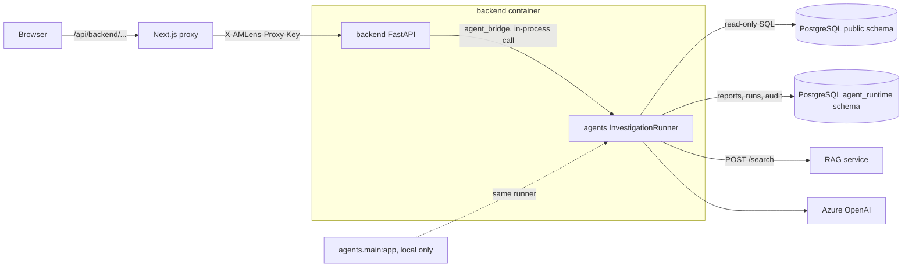

# Agents API

The `agents/` package (the LangGraph investigation workflow) can be used in two ways:

1. **As a library, inside the backend process. This is what production uses.**
   `backend/app/services/agent_bridge.py` imports `agents.main.create_services` and
   `agents.main.create_store`. `POST /investigations/{id}/run` on the backend then calls
   `services.runner.run(InvestigationMessage(...))` directly, in the same Python process. The
   backend image is built with both folders (`backend/Dockerfile` copies `agents/` and sets
   `PYTHONPATH=/app`). The backend's health check reports `agent: healthy` simply when the
   `agents` package can be imported.
2. **As a standalone FastAPI app**, `agents.main:app`, with the routes in
   `agents/api/routes.py`. It is meant for local development and for the agents team's own
   tests. It is **not mounted in the backend and not deployed**: `deploy/aks/base/apps.yaml` runs
   only the `rag`, `backend` and `frontend` Deployments, and there is no `/api/agents` proxy route.



To clients, the backend endpoints [`POST /investigations/{id}/run`](endpoints.md) and
`GET /investigations/{id}/report` **are** the agents API. The rest of this page documents the
standalone app.

## How the backend wires the agents in production

`agent_bridge.py` configures the agents with `agents.config.Settings` and these overrides:

| Concern | Production setting |
|---|---|
| Runtime store | `AML_AGENT_DATABASE_URL` (PostgreSQL, schema `agent_runtime`). Without it, the SQLite file `AML_AGENT_DATABASE_PATH` is used (default `./agent_runtime.db`, which must end in `.db`, `.sqlite` or `.sqlite3`). On AKS it points at the same database as `DATABASE_URL`. |
| Source data | `TeamBackend` (`backend/app/integrations/team_backend.py`) reads alerts and transactions from `AML_SOURCE_DATABASE_URL`, or from `DATABASE_URL`, inside `READ ONLY` transactions with a statement timeout. It loads a 48-hour window and at most 200 transactions, with a 3 s timeout. One adapter is cached per process. |
| Source time zone | `AML_SOURCE_TIMEZONE` must be set (`UTC` on AKS). If it is missing, the run fails with `503`. |
| Queue | `use_mock_service_bus=True`: an in-process queue. No Azure Service Bus is used, so `/health` reports `queue: not_applicable`. |
| LLM | `USE_MOCK_LLM`, `LLM_PROVIDER` (`azure_openai` or `groq`), `AZURE_OPENAI_ENDPOINT`, `AZURE_OPENAI_DEPLOYMENT`, `AZURE_OPENAI_API_VERSION` (default `2024-10-21`), `AZURE_OPENAI_API_KEY` (empty means Entra ID / managed identity), `LLM_TIMEOUT_SECONDS` (default 30, max 60) |
| RAG | `USE_MOCK_RAG`, `RAG_SERVICE_URL` (`http://rag:8001` on AKS). The agents call `POST {RAG_SERVICE_URL}/search` (see [RAG API](rag-api.md)). |
| Lease | `LEASE_SECONDS` (default 900, minimum 600). A run holds a lease on its investigation row, so two runs of the same ID cannot overlap. |

The mock flags default to `true`. Production sets `USE_MOCK_LLM=false` and `USE_MOCK_RAG=false`
in `deploy/aks/base/apps.yaml`.

## Standalone app

| | |
|---|---|
| Entry point | `agents.main:app` (`create_app()`), title `AMLens / TraceIQ Investigation Assistant`, version `0.1.0` |
| Run | From the repository root: `uvicorn agents.main:app --host 127.0.0.1 --port 8000` |
| Authentication | **None.** No proxy-key middleware and no CORS. Bind it to localhost only. |
| Default configuration | Mock LLM, mock RAG, mock backend and mock queue. Store: `sqlite:///./data/synthetic_alerts.db` (`DATABASE_URL` in the agents' own `.env`). |

With `USE_MOCK_BACKEND=true` (the default), alerts come from `MockBackendClient`, which reads the
`transactions` and `alerts` tables of the agents' SQLite file. The committed sample file is
`agents/data/synthetic_alerts.db`, which has 2 alerts and 6 transactions. With
`USE_MOCK_BACKEND=false`, `SQLiteBackendClient` reads the same tables.

Throughout this page, `$AGENTS_URL` is the standalone app's base URL, for example `http://127.0.0.1:8000`.

### Health

`GET /health`

Runs `SELECT 1` against the runtime store.

**Response `200`:** `{"status": "ok", "human_review_required": true}`. If the store cannot be
reached, the exception is not caught and the app returns `500`.

=== "curl"

    ```bash
    curl -s "$AGENTS_URL/health"
    ```

=== "Response"

    ```json
    {"status": "ok", "human_review_required": true}
    ```

### Run an investigation

`POST /investigations/run`

Runs the workflow synchronously and returns the persisted record. The call is idempotent: if the
investigation already finished (`completed` or `incomplete`), the stored record is returned
without running again.

**Request body:** `InvestigationMessage`

| Field | Type | Required | Constraints |
|---|---|---|---|
| `alert_id` | string | yes | `^[A-Za-z0-9_-]{1,80}$` |
| `investigation_id` | string | yes | `^[A-Za-z0-9_-]{1,80}$` |

**Response `200`:** the persisted agent record (`investigation_id`, `alert_id`, `execution_status`,
`created_at`, `updated_at`, `report`, `verification`, `agent_execution_trace`, `audit_history`).
See [Schemas](schemas.md).

| Status | `detail` | Cause |
|---|---|---|
| `200` | | `execution_status` is `completed` or `incomplete` |
| `409` | `Investigation already running` | Another run holds an unexpired lease |
| `409` | `Investigation ID already belongs to another alert` | The ID was used with a different `alert_id` |
| `422` | validation list | Body missing, extra fields, or an ID that fails the pattern |
| `503` | `Investigation failed; inspect persisted status` | An agent node failed, or the workflow could not finish. The record is saved as `failed`. |

=== "curl"

    ```bash
    curl -s -X POST "$AGENTS_URL/investigations/run" \
      -H "Content-Type: application/json" \
      -d '{"alert_id": "ALT-001", "investigation_id": "INV-LOCAL-001"}'
    ```

=== "Response"

    ```json
    {
      "investigation_id": "INV-LOCAL-001",
      "alert_id": "ALT-001",
      "execution_status": "completed",
      "created_at": "2026-11-25 06:40:02",
      "updated_at": "2026-11-25 06:40:05",
      "report": {"investigation_id": "INV-LOCAL-001", "alert_summary": {"alert_id": "ALT-001", "typology": "structuring", "account_id": "ACC-EXAMPLE", "summary": "..."}, "...": "..."},
      "verification": {"passed": true, "errors": [], "warnings": []},
      "agent_execution_trace": [
        {"agent_name": "transaction", "execution_status": "completed", "error_message": null},
        {"agent_name": "retrieval", "execution_status": "completed", "error_message": null},
        {"agent_name": "evidence", "execution_status": "completed", "error_message": null},
        {"agent_name": "information_gap", "execution_status": "completed", "error_message": null},
        {"agent_name": "report", "execution_status": "completed", "error_message": null},
        {"agent_name": "verify", "execution_status": "completed", "error_message": null}
      ],
      "audit_history": [
        {"event_type": "agent_execution", "timestamp": "2026-11-25 06:40:02", "details_json": "{...}", "details": {"agent": "transaction", "status": "completed", "error": null}},
        {"event_type": "verification", "timestamp": "2026-11-25 06:40:05", "details_json": "{...}", "details": {"passed": true, "errors": [], "warnings": []}},
        {"event_type": "persisted", "timestamp": "2026-11-25 06:40:05", "details_json": "{...}", "details": {"status": "completed", "errors": [], "trace": []}}
      ]
    }
    ```

    The example is shortened (`"..."`). The full report structure is in [Schemas](schemas.md).

### Queue an investigation

`POST /investigations/queue`

Sends the message to the configured queue and returns immediately. With
`USE_MOCK_SERVICE_BUS=true` (the default), the queue is in-memory and nothing in the API process
consumes it. With Azure Service Bus (`AZURE_SERVICE_BUS_CONNECTION_STRING`,
`AZURE_SERVICE_BUS_QUEUE_NAME`), the worker `python -m agents.worker.service_bus_worker` processes
messages, retrying up to `MAX_DELIVERY_COUNT` times (default 3). Neither the queue nor the worker
is deployed in production.

**Request body:** `InvestigationMessage`

| Status | Body / `detail` | Cause |
|---|---|---|
| `202` | `{"investigation_id": "...", "status": "queued"}` | Sent |
| `409` | `Investigation ID already belongs to another alert` | A stored record has a different `alert_id` |
| `422` | validation list | Invalid body |
| `503` | `Queue unavailable` | Sending failed |

=== "curl"

    ```bash
    curl -s -X POST "$AGENTS_URL/investigations/queue" \
      -H "Content-Type: application/json" \
      -d '{"alert_id": "ALT-001", "investigation_id": "INV-LOCAL-002"}'
    ```

=== "Response"

    ```json
    {"investigation_id": "INV-LOCAL-002", "status": "queued"}
    ```

### Get an investigation record

`GET /investigations/{investigation_id}`

| Path parameter | Type | Description |
|---|---|---|
| `investigation_id` | string | |

**Response `200`:** the persisted agent record (same shape as the run response). The status can also
be `running` or `failed`, in which case `report` may be `null`.

| Status | `detail` | Cause |
|---|---|---|
| `200` | | |
| `404` | `Investigation not found` | No record in the runtime store |

=== "curl"

    ```bash
    curl -s "$AGENTS_URL/investigations/INV-LOCAL-001"
    ```

=== "Response"

    ```json
    {
      "investigation_id": "INV-LOCAL-001",
      "alert_id": "ALT-001",
      "execution_status": "incomplete",
      "created_at": "2026-11-25 06:40:02",
      "updated_at": "2026-11-25 06:40:09",
      "report": {"...": "..."},
      "verification": {"passed": false, "errors": ["(verifier error message)"], "warnings": []},
      "agent_execution_trace": [],
      "audit_history": []
    }
    ```

## Workflow and execution statuses

The runner (`agents/graph.py`) runs these nodes in order: `transaction`, `retrieval`, `evidence`,
`information_gap`, `report` and `verify`. If verification fails, it runs `correction` and then
`reverify` once, and finally persists the result. Each node is recorded as a row in `agent_runs`
and as an `agent_execution` event in `audit_log`. A run makes at most 8 external tool calls
(`ToolBudget`).

| Run `execution_status` | Meaning |
|---|---|
| `running` | Claimed with a lease, in progress |
| `completed` | The report passed verification |
| `incomplete` | The report failed verification after one correction pass |
| `failed` | A node raised an error, or the workflow could not finish. No usable report. |

For details, see [Agent pipeline](../modules/agent-pipeline.md). The tables are described in
[Database schema](../database/schema.md).
