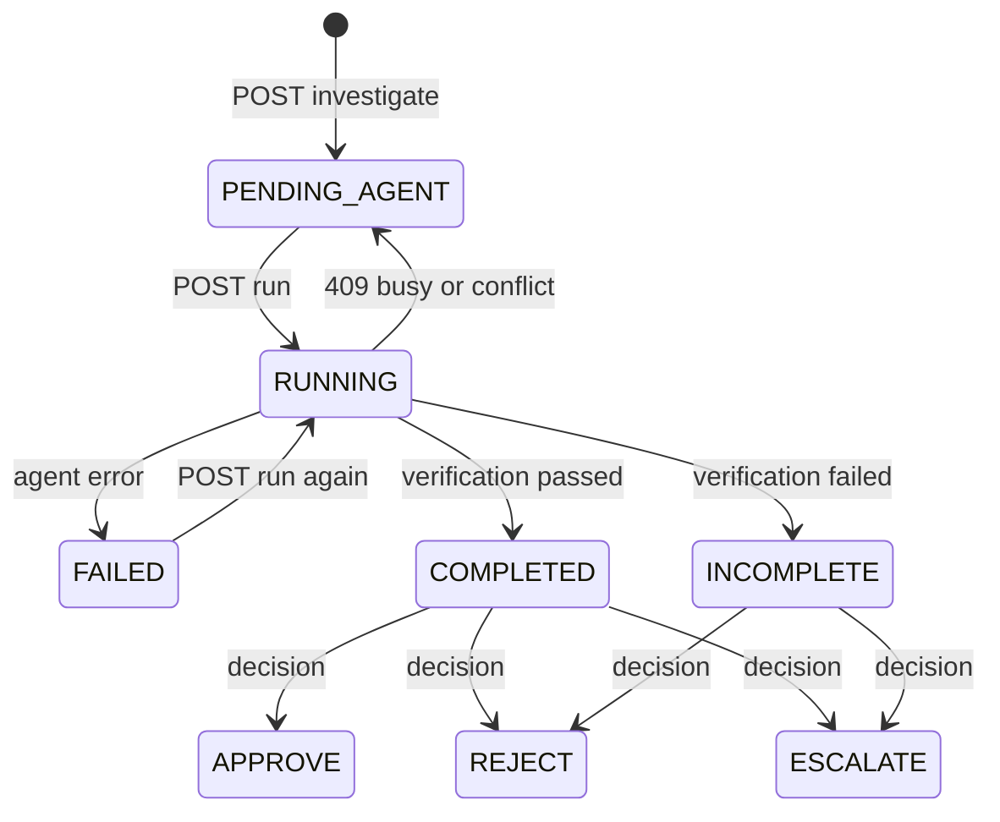

# Backend endpoints

The backend (`backend/app/main.py`) registers five routers. None of them has a path prefix:

| Router module | OpenAPI tag | Routes |
|---|---|---|
| `app/api/upload.py` | Uploads | `POST /upload-transactions` |
| `app/api/alerts.py` | Alerts | `GET /alerts`, `GET /alerts/{alert_id}` |
| `app/api/transactions.py` | Transactions | `GET /accounts/{account_id}/history` |
| `app/api/investigations.py` | Investigations | `GET /investigations`, `POST /investigate/{alert_id}`, `POST /investigations/{id}/run`, `GET /investigations/{id}`, `GET /investigations/{id}/report`, `POST /investigations/{id}/decision`, `GET /audit/{id}` |
| `app/api/health.py` | Health | `GET /health` |

That is 12 routes in all, plus FastAPI's `/docs`, `/redoc` and `/openapi.json`.

**Authentication.** Apart from `GET /health`, every route needs the `X-AMLens-Proxy-Key`
header when `AML_PROXY_KEY` is set (otherwise it returns `401 {"detail": "Not authenticated"}`),
and a signed-in session on the live site. The status code tables below leave out this `401`.
See [API reference overview](overview.md) for the details and for the placeholders
(`$AMLENS_URL`, `$PROXY_KEY`) used in the examples.

Most handlers return plain dictionaries rather than declared response models, so the generated
OpenAPI document shows an empty `200` schema for them. The response shapes below come from the
handler code. The models are collected in [Schemas](schemas.md).

## Uploads

### Upload a transaction CSV

`POST /upload-transactions` · public path `POST /api/backend/upload-transactions`

Imports one CSV file in the IBM AML format, tokenizes the account identifiers, stores the valid
rows as transactions, runs the detection rules and creates alerts. Everything happens in one
request and one database transaction.

**Request:** `multipart/form-data`

| Field | Type | Required | Constraints |
|---|---|---|---|
| `file` | file | yes | The file name must end in `.csv` (any case). At most 20 MB (`MAX_UPLOAD = 20 * 1024 * 1024`) and at most 100,000 data rows (`MAX_ROWS`). |

The CSV must contain these columns (header names exactly as shown): `Timestamp`, `From Bank`,
`Account`, `To Bank`, `Account.1`, `Amount Received`, `Receiving Currency`, `Amount Paid`,
`Payment Currency`, `Payment Format`, `Is Laundering`. `Is Laundering` is validated but never
stored (`ground_truth_exposed: false`).

The dataset ID is the first 20 hex characters of the SHA-256 of the file bytes. Uploading the
same bytes twice is rejected.

Each row is validated on its own. A rejected row gets one or more of these reason codes:
`missing:<column>`, `invalid_timestamp`, `invalid_amount:<column>` (not a positive finite
decimal), `invalid_currency:<column>`, `invalid_payment_format`, `invalid_ground_truth_label`
(not `0` or `1`). The allowed currency and payment format values are listed in
[Transaction ingestion](../modules/transaction-ingestion.md).

**Response `200`:** `UploadResult`

| Field | Type | Description |
|---|---|---|
| `dataset_id` | string | 20 hex characters from the file hash |
| `accepted` | integer | Rows stored as transactions |
| `rejected` | integer | Rows that failed validation |
| `rejection_reasons` | array of `{source_row: integer, reasons: string[]}` | First 50 rejected rows. `source_row` is the 1-based line in the file, where the header is line 1. |
| `rejection_reasons_truncated` | boolean | `true` when more than 50 rows were rejected |
| `alerts_created` | integer | Alerts generated by the detection rules |
| `ground_truth_exposed` | boolean | Always `false` |

**Status codes**

| Status | `detail` | Cause |
|---|---|---|
| `200` | | Imported, even if some rows were rejected |
| `400` | `CSV file required` | Missing file name, or a name that does not end in `.csv` |
| `400` | `MVP upload limit is 20 MB. Split the full dataset first.` | File larger than 20 MB |
| `400` | `Dataset already imported` | Same file bytes already present. A concurrent duplicate upload that hits the primary key returns the same message. |
| `400` | `Could not parse CSV: <parser error>` | pandas could not read the file |
| `400` | `MVP limit is 100,000 rows; use a representative subset.` | More than 100,000 data rows |
| `400` | `Missing required CSV columns: <list>` | One or more required headers are absent |
| `413` | (ingress HTML page) | Live site only: the body exceeds the ingress limit, `proxy-body-size: 25m` |
| `422` | validation list | No `file` form field |
| `500` | `Internal Server Error` | Server misconfiguration, for example `TOKEN_SECRET` unset or shorter than 32 characters |

=== "curl"

    ```bash
    curl -s -X POST "$AMLENS_URL/upload-transactions" \
      -H "X-AMLens-Proxy-Key: $PROXY_KEY" \
      -F "file=@transactions.csv;type=text/csv"
    ```

=== "Response"

    ```json
    {
      "dataset_id": "3f9a1c0be27d4a8e9b10",
      "accepted": 998,
      "rejected": 2,
      "rejection_reasons": [
        {"source_row": 14, "reasons": ["invalid_currency:Payment Currency"]},
        {"source_row": 377, "reasons": ["invalid_amount:Amount Paid", "missing:Amount Paid"]}
      ],
      "rejection_reasons_truncated": false,
      "alerts_created": 41,
      "ground_truth_exposed": false
    }
    ```

!!! note "Frontend mapping"
    `frontend/lib/api/client.ts` renames these fields for the UI: `accepted` becomes `accepted_count`,
    `rejected` becomes `rejected_count`, and each rejection becomes `{row_number, reason}`, with
    the reasons joined by `"; "`. The `UploadResult` type in `frontend/lib/api/types.ts` describes
    the mapped shape, not the wire shape.

## Alerts

### List alerts

`GET /alerts` · public path `GET /api/backend/alerts`

Returns one page of alerts, ordered by alert `id` (string order), together with the total count.

**Query parameters**

| Name | Type | Default | Constraints |
|---|---|---|---|
| `limit` | integer | `50` | 1–200 |
| `offset` | integer | `0` | ≥ 0 |

**Response `200`:** `AlertPage`, which is `{items: Alert[], total, limit, offset}`.

| Status | `detail` | Cause |
|---|---|---|
| `200` | | |
| `400` | `Invalid pagination` | `limit` outside 1–200, or a negative `offset` |
| `422` | validation list | `limit` or `offset` is not an integer |

=== "curl"

    ```bash
    curl -s "$AMLENS_URL/alerts?limit=2&offset=0" -H "X-AMLens-Proxy-Key: $PROXY_KEY"
    ```

=== "Response"

    ```json
    {
      "items": [
        {
          "id": "AL_3f9a1c0be27d4a8e9b10_1",
          "transaction_id": "TX_3f9a1c0be27d4a8e9b10_118",
          "rule_id": "HIGH_VALUE",
          "description": "Transaction meets configured currency-specific review threshold; not proof of laundering.",
          "evidence": {
            "transaction_ids": ["TX_3f9a1c0be27d4a8e9b10_118"],
            "anchor_account_token": "ACC_5d1e0a9c3b7f42e8a1c6d0b4",
            "amount_paid": "1250000.00",
            "currency": "US Dollar",
            "threshold": "1000000"
          },
          "status": "OPEN",
          "created_at": "2026-11-24T09:12:44.102311+00:00"
        }
      ],
      "total": 41,
      "limit": 2,
      "offset": 0
    }
    ```

### Get one alert

`GET /alerts/{alert_id}` · public path `GET /api/backend/alerts/{alert_id}`

| Path parameter | Type | Description |
|---|---|---|
| `alert_id` | string | Alert ID, for example `AL_<dataset_id>_<n>` |

**Response `200`:** `Alert`. `created_at` is `null` for legacy alerts created before the column existed.

| Status | `detail` | Cause |
|---|---|---|
| `200` | | |
| `404` | `Alert not found` | No alert with this ID |

=== "curl"

    ```bash
    curl -s "$AMLENS_URL/alerts/AL_3f9a1c0be27d4a8e9b10_7" -H "X-AMLens-Proxy-Key: $PROXY_KEY"
    ```

=== "Response"

    ```json
    {
      "id": "AL_3f9a1c0be27d4a8e9b10_7",
      "transaction_id": "TX_3f9a1c0be27d4a8e9b10_402",
      "rule_id": "RAPID_MOVEMENT_CANDIDATE",
      "description": "Inbound and subsequent outbound transactions observed at an intermediary; fund identity is unverified.",
      "evidence": {
        "transaction_ids": ["TX_3f9a1c0be27d4a8e9b10_398", "TX_3f9a1c0be27d4a8e9b10_402"],
        "anchor_account_token": "ACC_91b2c7e04f6a3d58b0e2a1f9",
        "account_token": "ACC_91b2c7e04f6a3d58b0e2a1f9",
        "currency": "Euro",
        "gap_minutes": 18.0,
        "incoming_amount": "12000.00",
        "outgoing_amount": "11850.00"
      },
      "status": "UNDER REVIEW",
      "created_at": "2026-11-24T09:12:44.118024+00:00"
    }
    ```

The `evidence` object depends on `rule_id`. The three shapes (`HIGH_VALUE`, `REPEATED_PAIR`,
`RAPID_MOVEMENT_CANDIDATE`) are documented in [Schemas](schemas.md) and
[Detection rules](../modules/detection-rules.md).

## Transactions

### Account transaction history

`GET /accounts/{account_id}/history` · public path `GET /api/backend/accounts/{account_id}/history`

Returns the transactions where the account token is either the sender or the receiver. Newest
come first (ordered by `timestamp` descending, then `id`). The search covers all datasets.

| Parameter | In | Type | Default | Constraints |
|---|---|---|---|---|
| `account_id` | path | string | | An account **token** (`ACC_...`), never a raw bank account number |
| `limit` | query | integer | `100` | 1–500 |

**Response `200`:** an array of `Transaction`. An unknown token returns `[]`, not `404`.

| Status | `detail` | Cause |
|---|---|---|
| `200` | | |
| `400` | `Limit must be 1–500` | `limit` out of range |
| `422` | validation list | `limit` is not an integer |

=== "curl"

    ```bash
    curl -s "$AMLENS_URL/accounts/ACC_5d1e0a9c3b7f42e8a1c6d0b4/history?limit=50" \
      -H "X-AMLens-Proxy-Key: $PROXY_KEY"
    ```

=== "Response"

    ```json
    [
      {
        "transaction_id": "TX_3f9a1c0be27d4a8e9b10_118",
        "source_row": 118,
        "timestamp": "2022-09-01T14:22:00",
        "sender_token": "ACC_5d1e0a9c3b7f42e8a1c6d0b4",
        "receiver_token": "ACC_0e7f3a2b9c18d46e5f0a7b3c",
        "amount_paid": "1250000.00000000",
        "payment_currency": "US Dollar",
        "amount_received": "1250000.00000000",
        "receiving_currency": "US Dollar",
        "payment_format": "Wire"
      }
    ]
    ```

`timestamp` has no time-zone offset because the source data has none (see `AML_SOURCE_TIMEZONE`).

## Investigations

The case lifecycle on the backend is:



The alert moves forward in step with the case: `OPEN` becomes `UNDER REVIEW` when an
investigation is opened, and `DECIDED` when a decision is recorded. It never moves backwards.

### List investigations

`GET /investigations` · public path `GET /api/backend/investigations`

Returns the newest cases first (`created_at` descending, then `id`). Each case includes the agent
run's execution status, its verification result and the recorded decision, if any.

| Query parameter | Type | Default | Constraints |
|---|---|---|---|
| `limit` | integer | `50` | 1–200 |
| `offset` | integer | `0` | ≥ 0 |

**Response `200`:** an array of `InvestigationSummary`. There is no total count.

| Status | `detail` | Cause |
|---|---|---|
| `200` | | |
| `400` | `Invalid pagination` | `limit` or `offset` out of range |
| `503` | `Agent persistence unavailable` | The agent runtime store could not be opened (`OSError` or `ValueError`, for example a bad `AML_AGENT_DATABASE_URL`) |

=== "curl"

    ```bash
    curl -s "$AMLENS_URL/investigations?limit=20" -H "X-AMLens-Proxy-Key: $PROXY_KEY"
    ```

=== "Response"

    ```json
    [
      {
        "investigation_id": "6f1d2c3e-8a4b-4b7e-9c51-2e0d7a9b1f34",
        "alert_id": "AL_3f9a1c0be27d4a8e9b10_7",
        "status": "COMPLETED",
        "execution_status": "completed",
        "report_available": true,
        "verification": {"passed": true, "errors": [], "warnings": []},
        "created_at": "2026-11-24T10:03:12.551902+00:00",
        "decision": null
      }
    ]
    ```

### Open an investigation

`POST /investigate/{alert_id}` · public path `POST /api/backend/investigate/{alert_id}`

Creates a case for the alert with status `PENDING_AGENT` and writes a `CREATED` audit event. If
the alert is `OPEN`, it moves to `UNDER REVIEW`. This call does **not** run the agents (see the
next endpoint). The backend does not stop you opening several investigations for the same alert.

| Path parameter | Type | Description |
|---|---|---|
| `alert_id` | string | Alert to investigate |

No request body.

**Response `201`:** `{investigation_id: string (UUID), alert_id: string, status: "PENDING_AGENT"}`

| Status | `detail` | Cause |
|---|---|---|
| `201` | | Case created |
| `404` | `Alert not found` | Unknown alert |

=== "curl"

    ```bash
    curl -s -X POST "$AMLENS_URL/investigate/AL_3f9a1c0be27d4a8e9b10_7" \
      -H "X-AMLens-Proxy-Key: $PROXY_KEY"
    ```

=== "Response"

    ```json
    {
      "investigation_id": "6f1d2c3e-8a4b-4b7e-9c51-2e0d7a9b1f34",
      "alert_id": "AL_3f9a1c0be27d4a8e9b10_7",
      "status": "PENDING_AGENT"
    }
    ```

### Run the agent investigation

`POST /investigations/{id}/run` · public path `POST /api/backend/investigations/{id}/run`

Runs the LangGraph agent workflow **synchronously, inside the request**. The backend imports the
`agents` package in-process; it does not call the standalone agents HTTP app (see
[Agents API](agents-api.md)). LLM and RAG are live or mocked depending on `USE_MOCK_LLM` and
`USE_MOCK_RAG`. On the live site the ingress allows up to 300 seconds
(`proxy-read-timeout: "300"`).

The call is idempotent for finished runs. If the agents already persisted a `completed` or
`incomplete` record for this ID, the stored summary is returned and nothing runs again.

Sequence:

1. Case status becomes `RUNNING`, and an `AGENT_RUN_REQUESTED` audit event is written.
2. The agents claim a lease on the investigation in the agent runtime store, run the workflow and persist the report.
3. On success the case status becomes `COMPLETED` or `INCOMPLETE` (the run's `execution_status` in upper case), and `AGENT_RUN_FINISHED` is written with `{"execution_status": ...}`.
4. On failure the case status becomes `FAILED`, and `AGENT_RUN_FAILED` is written. A `FAILED` case can be run again.

| Path parameter | Type | Description |
|---|---|---|
| `id` | string | Investigation ID |

No request body.

**Response `200`:** `RunResult`

| Field | Type | Description |
|---|---|---|
| `investigation_id` | string | |
| `alert_id` | string | |
| `execution_status` | `"completed"` or `"incomplete"` | `incomplete` means the report failed verification even after the correction pass |
| `report_available` | boolean | Whether `GET /investigations/{id}/report` will return a report |

| Status | `detail` | Cause |
|---|---|---|
| `200` | | Run finished, or was already finished |
| `404` | `Investigation not found` | Unknown investigation |
| `409` | `Investigation ID belongs to a different alert` | The agent store has a record for this ID under another alert |
| `409` | `Investigation is not available to run` | Case status is not `PENDING_AGENT` or `FAILED` (for example `RUNNING`) |
| `409` | `Investigation already running` | Another worker holds an unexpired lease (`InvestigationBusy`). The case returns to `PENDING_AGENT`. |
| `409` | `Investigation ID already belongs to another alert` | `InvestigationConflict` raised while claiming. The case returns to `PENDING_AGENT`. |
| `503` | `Agent persistence unavailable` | Agent runtime store could not be opened |
| `503` | `Agent investigation failed; inspect persisted status` | Any other error, including an agent failure, a missing `AML_SOURCE_TIMEZONE` or an LLM/RAG outage. The case becomes `FAILED`. |
| `504` | (ingress) | Live site only: the run took longer than 300 s |

=== "curl"

    ```bash
    curl -s -X POST "$AMLENS_URL/investigations/6f1d2c3e-8a4b-4b7e-9c51-2e0d7a9b1f34/run" \
      -H "X-AMLens-Proxy-Key: $PROXY_KEY" --max-time 300
    ```

=== "Response"

    ```json
    {
      "investigation_id": "6f1d2c3e-8a4b-4b7e-9c51-2e0d7a9b1f34",
      "alert_id": "AL_3f9a1c0be27d4a8e9b10_7",
      "execution_status": "completed",
      "report_available": true
    }
    ```

The frontend's `runInvestigation` calls this endpoint and, when `report_available` is `true`, then
calls `GET /investigations/{id}/report`.

### Get an investigation

`GET /investigations/{id}` · public path `GET /api/backend/investigations/{id}`

Returns the same summary as the list, plus the alert's `evidence` and `rule_id`.

**Response `200`:** `InvestigationDetail`, which is `InvestigationSummary` plus `evidence` (object) and `rule_id` (string).

| Status | `detail` | Cause |
|---|---|---|
| `200` | | |
| `404` | `Investigation not found` | |
| `503` | `Agent persistence unavailable` | |

=== "curl"

    ```bash
    curl -s "$AMLENS_URL/investigations/6f1d2c3e-8a4b-4b7e-9c51-2e0d7a9b1f34" \
      -H "X-AMLens-Proxy-Key: $PROXY_KEY"
    ```

=== "Response"

    ```json
    {
      "investigation_id": "6f1d2c3e-8a4b-4b7e-9c51-2e0d7a9b1f34",
      "alert_id": "AL_3f9a1c0be27d4a8e9b10_7",
      "status": "ESCALATE",
      "execution_status": "completed",
      "report_available": true,
      "verification": {"passed": true, "errors": [], "warnings": []},
      "created_at": "2026-11-24T10:03:12.551902+00:00",
      "decision": {
        "decision_id": "0c9b8e27-5f1a-4d3c-a6e2-71b4d9f8c210",
        "decision": "ESCALATE",
        "rationale": "Pass-through pattern confirmed; escalating to the MLRO for review.",
        "analyst_id": "analyst@example.com",
        "created_at": "2026-11-24T10:21:40.009812+00:00"
      },
      "evidence": {
        "transaction_ids": ["TX_3f9a1c0be27d4a8e9b10_398", "TX_3f9a1c0be27d4a8e9b10_402"],
        "anchor_account_token": "ACC_91b2c7e04f6a3d58b0e2a1f9",
        "account_token": "ACC_91b2c7e04f6a3d58b0e2a1f9",
        "currency": "Euro",
        "gap_minutes": 18.0,
        "incoming_amount": "12000.00",
        "outgoing_amount": "11850.00"
      },
      "rule_id": "RAPID_MOVEMENT_CANDIDATE"
    }
    ```

### Get the investigation report

`GET /investigations/{id}/report` · public path `GET /api/backend/investigations/{id}/report`

Returns the AI-generated report as stored by the agents. The report is read from the agent runtime
store (`agent_runtime.investigations.report_json`), not from the `report_versions` table.

**Response `200`:** `ReportResponse`

| Field | Type | Description |
|---|---|---|
| `investigation_id` | string | |
| `execution_status` | string | `completed` or `incomplete`. `failed` runs have no report. |
| `label` | string | Always `AI-Generated Draft — Requires Investigator Review` |
| `report` | `InvestigationReport` | See [Schemas](schemas.md) |
| `verification` | `VerificationResult` | `{passed, errors[], warnings[]}` |
| `agent_execution_trace` | array of `{agent_name, execution_status, error_message}` | One entry per agent node run, in order |

| Status | `detail` | Cause |
|---|---|---|
| `200` | | |
| `404` | `Investigation not found` | Unknown investigation |
| `404` | `Report not available` | Not run yet, still running, or failed |
| `503` | `Agent persistence unavailable` | |

=== "curl"

    ```bash
    curl -s "$AMLENS_URL/investigations/6f1d2c3e-8a4b-4b7e-9c51-2e0d7a9b1f34/report" \
      -H "X-AMLens-Proxy-Key: $PROXY_KEY"
    ```

=== "Response"

    ```json
    {
      "investigation_id": "6f1d2c3e-8a4b-4b7e-9c51-2e0d7a9b1f34",
      "execution_status": "completed",
      "label": "AI-Generated Draft — Requires Investigator Review",
      "report": {
        "investigation_id": "6f1d2c3e-8a4b-4b7e-9c51-2e0d7a9b1f34",
        "alert_summary": {
          "alert_id": "AL_3f9a1c0be27d4a8e9b10_7",
          "typology": "rapid_movement",
          "account_id": "ACC_91b2c7e04f6a3d58b0e2a1f9",
          "summary": "Inbound funds were followed by an outbound transfer 18 minutes later."
        },
        "transaction_analysis": {
          "observed_patterns": [
            {
              "pattern_id": "P1",
              "description": "Outbound transfer within 60 minutes of an inbound transfer.",
              "transaction_ids": ["TX_3f9a1c0be27d4a8e9b10_398", "TX_3f9a1c0be27d4a8e9b10_402"],
              "metric_key": "gap_minutes"
            }
          ],
          "potential_red_flags": ["Rapid pass-through of funds"],
          "supporting_transaction_ids": ["TX_3f9a1c0be27d4a8e9b10_398", "TX_3f9a1c0be27d4a8e9b10_402"],
          "computed_statistics": {"gap_minutes": "18", "transaction_count": 2},
          "limitations": ["Customer profile data was not provided."]
        },
        "aml_guidance_and_evidence": {
          "references": [],
          "evidence": [],
          "potential_concerns": [],
          "unsupported_assumptions": []
        },
        "missing_information_and_questions": {
          "information_gaps": [],
          "investigation_questions": []
        },
        "investigation_narrative": {
          "statements": ["Inbound funds were followed by an outbound transfer 18 minutes later."],
          "recommended_next_steps": ["Review the cited transactions and guidance."],
          "limitations": []
        },
        "human_review_disclaimer": "Human review required. Only a human investigator may escalate, request additional information, or close an alert as a false positive. This report is not a determination of criminal activity."
      },
      "verification": {"passed": true, "errors": [], "warnings": []},
      "agent_execution_trace": [
        {"agent_name": "transaction", "execution_status": "completed", "error_message": null},
        {"agent_name": "retrieval", "execution_status": "completed", "error_message": null},
        {"agent_name": "evidence", "execution_status": "completed", "error_message": null},
        {"agent_name": "information_gap", "execution_status": "completed", "error_message": null},
        {"agent_name": "report", "execution_status": "completed", "error_message": null},
        {"agent_name": "verify", "execution_status": "completed", "error_message": null}
      ]
    }
    ```

    The `report` arrays are shortened in this example. A full example of each nested object is in [Schemas](schemas.md).

### Record a decision

`POST /investigations/{id}/decision` · public path `POST /api/backend/investigations/{id}/decision`

Records the human investigator's decision. Each investigation can have only one decision. The call
sets the case status to the decision value, sets the alert to `DECIDED`, and writes a
`DECISION_RECORDED` audit event whose details contain the decision, analyst, decision ID and
rationale.

**Request body:** `DecisionIn` (`application/json`)

| Field | Type | Required | Constraints |
|---|---|---|---|
| `decision` | string | yes | `APPROVE`, `REJECT` or `ESCALATE` |
| `rationale` | string | yes | 10–5000 characters |
| `analyst_id` | string | yes | 1–100 characters. **Overridden** by `X-AMLens-User` when the request passed the proxy-key check. |

Business rules, checked in this order:

1. The investigation must exist.
2. The agents must have a `completed` or `incomplete` run.
3. `APPROVE` needs `execution_status = completed` **and** `verification.passed = true`. `REJECT` and `ESCALATE` are allowed on `incomplete` reports.
4. No decision may already be recorded.

**Response `200`:** `DecisionOut`

| Field | Type | Description |
|---|---|---|
| `decision_id` | string (UUID) | |
| `decision` | string | `APPROVE`, `REJECT` or `ESCALATE` |
| `rationale` | string | |
| `analyst_id` | string | The signed-in user behind the proxy, otherwise the body value |
| `created_at` | string (ISO 8601) | |
| `investigation_id` | string | |
| `status` | string | New case status, the same as `decision` |

| Status | `detail` | Cause |
|---|---|---|
| `200` | | Recorded |
| `404` | `Investigation not found` | |
| `409` | `Investigation report must be generated before a review decision` | No finished agent run |
| `409` | `Cannot approve an incomplete or unverified AI report` | `APPROVE` on an incomplete or unverified report |
| `409` | `A decision has already been recorded for this investigation` | Duplicate decision |
| `422` | validation list | Bad `decision` value, a rationale that is too short or too long, a missing field, or a body that is not JSON |
| `503` | `Agent persistence unavailable` | |

=== "curl"

    ```bash
    curl -s -X POST "$AMLENS_URL/investigations/6f1d2c3e-8a4b-4b7e-9c51-2e0d7a9b1f34/decision" \
      -H "X-AMLens-Proxy-Key: $PROXY_KEY" \
      -H "Content-Type: application/json" \
      -d '{"decision": "ESCALATE", "rationale": "Pass-through pattern confirmed; escalating to the MLRO for review.", "analyst_id": "analyst@example.com"}'
    ```

=== "Response"

    ```json
    {
      "decision_id": "0c9b8e27-5f1a-4d3c-a6e2-71b4d9f8c210",
      "decision": "ESCALATE",
      "rationale": "Pass-through pattern confirmed; escalating to the MLRO for review.",
      "analyst_id": "analyst@example.com",
      "created_at": "2026-11-24T10:21:40.009812+00:00",
      "investigation_id": "6f1d2c3e-8a4b-4b7e-9c51-2e0d7a9b1f34",
      "status": "ESCALATE"
    }
    ```

!!! warning "One decision per investigation is enforced in code only"
    The duplicate check is a query that runs before the insert. `investigator_decisions.investigation_id`
    has no unique constraint, so two requests sent at exactly the same moment could, in theory,
    both pass the check.

### Get the audit history

`GET /audit/{id}` · public path `GET /api/backend/audit/{id}`

Returns the backend's audit events for one investigation from the `audit_history` table, oldest
first (ordered by `created_at`, then `id`). The agents' own, more detailed audit log
(`agent_runtime.audit_log`) is not exposed by the backend API.

**Response `200`:** an array of `AuditEvent`

| `action` | Written by | `details` |
|---|---|---|
| `CREATED` | `POST /investigate/{alert_id}` | `{"alert_id": ...}` |
| `AGENT_RUN_REQUESTED` | `POST /investigations/{id}/run` | `{}` |
| `AGENT_RUN_FINISHED` | `POST /investigations/{id}/run` | `{"execution_status": "completed" or "incomplete"}` |
| `AGENT_RUN_FAILED` | `POST /investigations/{id}/run` | `{}` |
| `DECISION_RECORDED` | `POST /investigations/{id}/decision` | `{"decision", "analyst_id", "decision_id", "rationale"}` |

| Status | `detail` | Cause |
|---|---|---|
| `200` | | |
| `404` | `Investigation not found` | |

=== "curl"

    ```bash
    curl -s "$AMLENS_URL/audit/6f1d2c3e-8a4b-4b7e-9c51-2e0d7a9b1f34" -H "X-AMLens-Proxy-Key: $PROXY_KEY"
    ```

=== "Response"

    ```json
    [
      {"event_id": "a1e4...", "action": "CREATED", "details": {"alert_id": "AL_3f9a1c0be27d4a8e9b10_7"}, "created_at": "2026-11-24T10:03:12.551902+00:00"},
      {"event_id": "b7c2...", "action": "AGENT_RUN_REQUESTED", "details": {}, "created_at": "2026-11-24T10:03:13.004417+00:00"},
      {"event_id": "c93f...", "action": "AGENT_RUN_FINISHED", "details": {"execution_status": "completed"}, "created_at": "2026-11-24T10:03:41.887120+00:00"},
      {"event_id": "d05a...", "action": "DECISION_RECORDED", "details": {"decision": "ESCALATE", "analyst_id": "analyst@example.com", "decision_id": "0c9b8e27-5f1a-4d3c-a6e2-71b4d9f8c210", "rationale": "Pass-through pattern confirmed; escalating to the MLRO for review."}, "created_at": "2026-11-24T10:21:40.009812+00:00"}
    ]
    ```

    Event IDs are full UUIDs. They are shortened here.

## Health

### Service health

`GET /health` · public path `GET /api/backend/health` (**no sign-in and no proxy key needed**)

Used by the frontend's status panel, the container `HEALTHCHECK`, and the smoke test in
`deploy/aks/rollout.sh`, which waits for `backend`, `agent` and `rag` to all be `healthy`. The
endpoint always returns `200`. Each service gets one of these statuses:

| Field | Values | How it is computed |
|---|---|---|
| `status` | `ok` | Constant |
| `backend` | `healthy`, `offline` | Runs `SELECT 1` on the main PostgreSQL database |
| `agent` | `healthy`, `offline` | Whether the `agents` Python package can be imported (the agents run in-process) |
| `rag` | `healthy`, `degraded`, `offline` | `degraded` when `USE_MOCK_RAG` is true (the default when unset). Otherwise `GET {RAG_SERVICE_URL}/health` with a 2 s timeout: `200` means `healthy`, anything else, or no URL, means `offline`. |
| `queue` | `not_applicable` | Runs are synchronous and in-process. No Service Bus queue is deployed. |
| `checked_at` | ISO 8601 string | UTC time of the check |

=== "curl"

    ```bash
    curl -s "$AMLENS_URL/health"
    # or, on the live site without signing in:
    curl -s "$AMLENS_SITE/api/backend/health"
    ```

=== "Response"

    ```json
    {
      "status": "ok",
      "backend": "healthy",
      "agent": "healthy",
      "rag": "healthy",
      "queue": "not_applicable",
      "checked_at": "2026-11-25T06:30:00.123456+00:00"
    }
    ```
