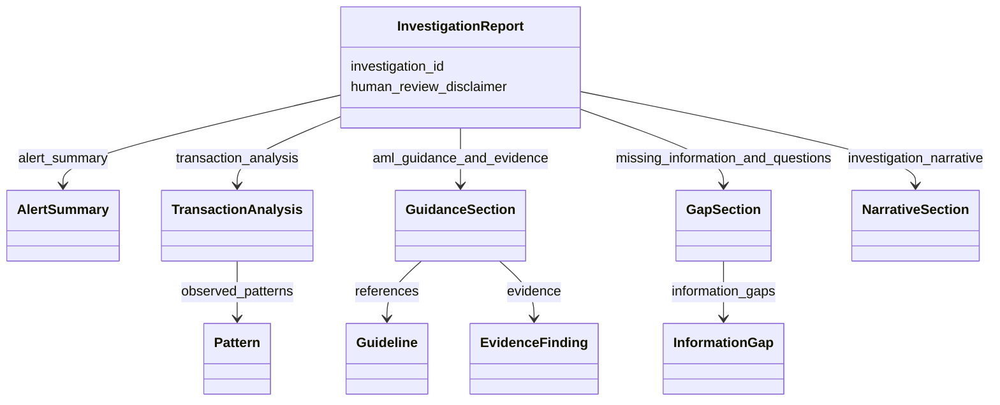

# Schemas

This page lists every request and response shape used by the AMLens services. The shapes come from
three places:

- **Pydantic models.** The backend's `DecisionIn` (`backend/app/models/schemas.py`), the agents' models (`agents/schemas/*.py`) and the RAG models (`RAG/app/models.py` and `RAG/app/main.py`).
- **Handler dictionaries.** Most backend responses are plain dicts built in `backend/app/api/*.py`. The names used here (for example `InvestigationSummary`) are documentation names, aligned with `frontend/lib/api/types.ts` where possible. They are not Python classes.
- **TypeScript types.** `frontend/lib/api/types.ts` is the frontend's view of the same data. The differences are listed at the end of this page.

Notation: *Required* means the key is always present in a response, or must be sent in a request.
Every model in `agents/schemas` extends `StrictModel` (`extra="forbid"`, `revalidate_instances="always"`),
so unknown fields are rejected.

## Backend request models

### DecisionIn

Body of `POST /investigations/{id}/decision`. Source: `backend/app/models/schemas.py`.

| Field | Type | Required | Constraints | Description |
|---|---|---|---|---|
| `decision` | string | yes | `APPROVE`, `REJECT` or `ESCALATE` | The investigator's decision |
| `rationale` | string | yes | `min_length=10`, `max_length=5000` | Reasoning, stored and copied into the audit event |
| `analyst_id` | string | yes | `min_length=1`, `max_length=100` | Analyst identifier. Replaced by the `X-AMLens-User` header when the proxy key is enforced. |

### Upload form

Body of `POST /upload-transactions` (`multipart/form-data`). In the OpenAPI document it appears as
`Body_upload_transactions_upload_transactions_post`.

| Field | Type | Required | Constraints |
|---|---|---|---|
| `file` | binary | yes | `.csv` name, ≤ 20 MB, ≤ 100,000 rows, IBM AML columns |

## Backend response shapes

### UploadResult

| Field | Type | Required | Description |
|---|---|---|---|
| `dataset_id` | string | yes | First 20 hex characters of the SHA-256 of the file |
| `accepted` | integer | yes | Rows stored |
| `rejected` | integer | yes | Rows rejected |
| `rejection_reasons` | `RejectedRow[]` | yes | First 50 rejected rows |
| `rejection_reasons_truncated` | boolean | yes | More than 50 rows were rejected |
| `alerts_created` | integer | yes | Alerts created by the rules |
| `ground_truth_exposed` | boolean | yes | Always `false` |

`RejectedRow`: `{source_row: integer, reasons: string[]}`. The reason codes are `missing:<col>`,
`invalid_timestamp`, `invalid_amount:<col>`, `invalid_currency:<col>`, `invalid_payment_format`
and `invalid_ground_truth_label`.

### Alert

| Field | Type | Required | Description |
|---|---|---|---|
| `id` | string (≤ 80) | yes | `AL_<dataset_id>_<n>` |
| `transaction_id` | string (≤ 80) | yes | Triggering transaction |
| `rule_id` | string (≤ 50) | yes | `HIGH_VALUE`, `REPEATED_PAIR` or `RAPID_MOVEMENT_CANDIDATE` |
| `description` | string | yes | Rule description. Wording is cautious: an observation, not a conclusion. |
| `evidence` | object | yes | Rule-specific, see below |
| `status` | string | yes | `OPEN`, `UNDER REVIEW` or `DECIDED` |
| `created_at` | string or `null` | yes | ISO 8601 UTC. `null` only on legacy alerts. |

#### Alert evidence by rule

Built in `backend/app/services/transaction_analysis.py`. Every rule includes `transaction_ids` and `anchor_account_token`.

| Rule | Fields |
|---|---|
| `HIGH_VALUE` (payment in `US Dollar` ≥ `1000000`) | `transaction_ids` (1 ID), `anchor_account_token` (sender), `amount_paid` (decimal string), `currency`, `threshold` (decimal string) |
| `REPEATED_PAIR` (≥ 5 transactions between the same sender, receiver and currency within 48 h) | `transaction_ids`, `anchor_account_token`, `sender_token`, `receiver_token`, `currency`, `count` (int), `window_hours` (float, `48.0`) |
| `RAPID_MOVEMENT_CANDIDATE` (inbound then outbound in the same currency at one account within 60 minutes) | `transaction_ids` (inbound, outbound), `anchor_account_token`, `account_token`, `currency`, `gap_minutes` (float), `incoming_amount`, `outgoing_amount` (decimal strings) |

### AlertPage

| Field | Type | Required | Description |
|---|---|---|---|
| `items` | `Alert[]` | yes | Ordered by `id` |
| `total` | integer | yes | Total number of alerts |
| `limit` | integer | yes | Echo of the request |
| `offset` | integer | yes | Echo of the request |

### Transaction (backend)

Item of `GET /accounts/{account_id}/history`.

| Field | Type | Required | Description |
|---|---|---|---|
| `transaction_id` | string | yes | `TX_<dataset_id>_<source_row>` |
| `source_row` | integer | yes | Line number in the uploaded file (header = 1) |
| `timestamp` | string | yes | ISO 8601 **without** offset (source-local time, see `AML_SOURCE_TIMEZONE`) |
| `sender_token` | string | yes | `ACC_` plus 24 hex characters |
| `receiver_token` | string | yes | `ACC_` plus 24 hex characters |
| `amount_paid` | string | yes | Decimal with 8 places |
| `payment_currency` | string | yes | Currency name as in the source file, for example `US Dollar` |
| `amount_received` | string | yes | Decimal with 8 places |
| `receiving_currency` | string | yes | Currency name |
| `payment_format` | string | yes | `Cheque`, `Credit Card`, `ACH`, `Cash`, `Reinvestment`, `Wire` or `Bitcoin` |

### RunResult

Response of `POST /investigations/{id}/run`.

| Field | Type | Required | Description |
|---|---|---|---|
| `investigation_id` | string | yes | |
| `alert_id` | string | yes | |
| `execution_status` | string | yes | `completed` or `incomplete` |
| `report_available` | boolean | yes | A report was persisted |

`POST /investigate/{alert_id}` returns `{investigation_id, alert_id, status}`, where `status` is always `PENDING_AGENT`.

### InvestigationSummary

Item of `GET /investigations`. Built by `_summary()` in `backend/app/api/investigations.py`.

| Field | Type | Required | Description |
|---|---|---|---|
| `investigation_id` | string (UUID) | yes | |
| `alert_id` | string | yes | |
| `status` | string | yes | Case status: `PENDING_AGENT`, `RUNNING`, `COMPLETED`, `INCOMPLETE`, `FAILED`, `APPROVE`, `REJECT` or `ESCALATE` |
| `execution_status` | string | yes | From the agent runtime record: `running`, `completed`, `incomplete` or `failed`. With no record yet it is derived from the case status: `RUNNING` gives `running`, `FAILED` gives `failed`, anything else gives `pending`. |
| `report_available` | boolean | yes | The agent record has a report |
| `verification` | `VerificationResult` | yes | `{passed: false, errors: [], warnings: []}` when there is none yet |
| `created_at` | string | yes | ISO 8601 UTC |
| `decision` | `DecisionSummary` or `null` | yes | |

`InvestigationDetail` (`GET /investigations/{id}`) is `InvestigationSummary` plus:

| Field | Type | Required | Description |
|---|---|---|---|
| `evidence` | object | yes | The alert's evidence |
| `rule_id` | string | yes | The alert's rule |

### DecisionSummary and DecisionOut

`DecisionSummary` is embedded in investigation summaries:

| Field | Type | Required |
|---|---|---|
| `decision_id` | string (UUID) | yes |
| `decision` | `APPROVE`, `REJECT` or `ESCALATE` | yes |
| `rationale` | string | yes |
| `analyst_id` | string | yes |
| `created_at` | string (ISO 8601 UTC) | yes |

`DecisionOut` (the response of `POST /investigations/{id}/decision`) is `DecisionSummary` plus
`investigation_id` (string) and `status` (the new case status, equal to `decision`).

### ReportResponse

Response of `GET /investigations/{id}/report`.

| Field | Type | Required | Description |
|---|---|---|---|
| `investigation_id` | string | yes | |
| `execution_status` | string | yes | `completed` or `incomplete` |
| `label` | string | yes | `AI-Generated Draft — Requires Investigator Review` |
| `report` | `InvestigationReport` | yes | See [Investigation report](#investigation-report) |
| `verification` | `VerificationResult` or `null` | yes | |
| `agent_execution_trace` | `AgentTraceEntry[]` | yes | Rows of `agent_runtime.agent_runs` in insertion order |

`AgentTraceEntry`: `{agent_name: string, execution_status: "running" | "completed" | "failed", error_message: string | null}`.
`agent_name` is one of `transaction`, `retrieval`, `evidence`, `information_gap`, `report`, `verify`,
`correction` or `reverify`. `error_message` is only ever an exception **class name** (for example
`StructuredOutputValidationError`). Exception messages are never stored.

### AuditEvent

Item of `GET /audit/{id}`.

| Field | Type | Required | Description |
|---|---|---|---|
| `event_id` | string (UUID) | yes | |
| `action` | string | yes | `CREATED`, `AGENT_RUN_REQUESTED`, `AGENT_RUN_FINISHED`, `AGENT_RUN_FAILED` or `DECISION_RECORDED` |
| `details` | object | yes | Depends on the action (see [Backend endpoints](endpoints.md)) |
| `created_at` | string | yes | ISO 8601 UTC |

### HealthStatus

| Field | Type | Required | Values |
|---|---|---|---|
| `status` | string | yes | `ok` |
| `backend` | string | yes | `healthy`, `offline` |
| `agent` | string | yes | `healthy`, `offline` |
| `rag` | string | yes | `healthy`, `degraded`, `offline` |
| `queue` | string | yes | `not_applicable` |
| `checked_at` | string | yes | ISO 8601 UTC |

### Error bodies

| Shape | Used for |
|---|---|
| `{"detail": "<message>"}` | Every `HTTPException` (400, 401, 404, 409, 503) and the frontend proxy's 404 and 502 |
| `{"detail": [{"type": str, "loc": [..], "msg": str, "input": any, "ctx"?: object}]}` | `422` request validation (`HTTPValidationError` in OpenAPI) |

## Agents models

### InvestigationMessage

Request body of the standalone agents app's `POST /investigations/run` and `POST /investigations/queue`.
The backend also builds one internally for each run. Source: `agents/schemas/messages.py`.

| Field | Type | Required | Constraints |
|---|---|---|---|
| `alert_id` | string | yes | `^[A-Za-z0-9_-]{1,80}$` |
| `investigation_id` | string | yes | `^[A-Za-z0-9_-]{1,80}$` |

### Agent input: AlertBundle

The input the agents receive from a backend client. In production,
`backend/app/integrations/team_backend.py` builds it from PostgreSQL inside read-only transactions.
Source: `agents/schemas/investigation.py`.

`AlertBundle`

| Field | Type | Required |
|---|---|---|
| `alert` | `AlertContext` | yes |
| `transactions` | `Transaction[]` (agents) | yes |

`AlertContext`

| Field | Type | Required | Constraints / description |
|---|---|---|---|
| `alert_id` | string | yes | |
| `transaction_id` | string | yes | Triggering transaction |
| `label` | string | yes | Human-readable alert label |
| `typology` | string | yes | `structuring`, `rapid_movement`, `fan_in_out` or `unusual_activity`. The backend maps `HIGH_VALUE` and `REPEATED_PAIR` to `unusual_activity`, and `RAPID_MOVEMENT_CANDIDATE` to `rapid_movement`. |
| `status` | string | yes | |
| `created_at` | string | yes | |
| `information_status` | map of string to `GapStatus` | no (default `{}`) | Supplied by the backend, never inferred |

`Transaction` (agents)

| Field | Type | Required | Constraints |
|---|---|---|---|
| `transaction_id` | string | yes | `^[A-Za-z0-9_-]{1,80}$` |
| `account_token` | string | yes | |
| `counterparty_token` | string | yes | |
| `amount` | decimal | yes | `> 0`, `max_digits=18`, `decimal_places=2` |
| `currency` | string | yes | `^[A-Z]{3}$` (ISO code) |
| `timestamp` | datetime | yes | Must be timezone-aware |
| `transaction_type` | string | yes | `deposit` or `withdrawal` |
| `description` | string | no (default `""`) | |

`GapStatus` is one of `confirmed_missing`, `not_provided`, `not_applicable` or `available_verified`.

### Investigation report

`InvestigationReport` (`agents/schemas/report.py`) is the document the report agent produces and the
verifier checks. It is stored as JSON in `agent_runtime.investigations.report_json`.



`InvestigationReport`

| Field | Type | Required | Description |
|---|---|---|---|
| `investigation_id` | string | yes | |
| `alert_summary` | `AlertSummary` | yes | |
| `transaction_analysis` | `TransactionAnalysis` | yes | |
| `aml_guidance_and_evidence` | `GuidanceSection` | yes | |
| `missing_information_and_questions` | `GapSection` | yes | |
| `investigation_narrative` | `NarrativeSection` | yes | |
| `human_review_disclaimer` | string | yes | `HUMAN_DISCLAIMER`: "Human review required. Only a human investigator may escalate, request additional information, or close an alert as a false positive. This report is not a determination of criminal activity." |

`AlertSummary`

| Field | Type | Required |
|---|---|---|
| `alert_id` | string | yes |
| `typology` | string | yes |
| `account_id` | string (account token) | yes |
| `summary` | string | yes |

`TransactionAnalysis` (`agents/schemas/agent_outputs.py`)

| Field | Type | Required | Description |
|---|---|---|---|
| `observed_patterns` | `Pattern[]` | yes | |
| `potential_red_flags` | string[] | yes | |
| `supporting_transaction_ids` | string[] | yes | |
| `computed_statistics` | map of string to (string or int) | yes | Money values are exact decimal strings. Totals are kept separate per currency. |
| `limitations` | string[] | yes | |

`Pattern`: `pattern_id` (string), `description` (string), `transaction_ids` (string[]), `metric_key` (string), all required.

`GuidanceSection`

| Field | Type | Required |
|---|---|---|
| `references` | `Guideline[]` | yes |
| `evidence` | `EvidenceFinding[]` | yes |
| `potential_concerns` | string[] | yes |
| `unsupported_assumptions` | string[] | yes |

`EvidenceFinding`

| Field | Type | Required | Constraints |
|---|---|---|---|
| `claim_id` | string | yes | |
| `claim` | string | yes | |
| `claim_type` | string | yes | `observed_fact`, `supported_interpretation`, `unsupported_assumption` or `potential_concern` |
| `supporting_transaction_ids` | string[] | yes | |
| `supporting_chunk_ids` | string[] | yes | Guideline `chunk_id`s |
| `evidence_explanation` | string | yes | |
| `support_status` | string | yes | `supported`, `limited` or `unsupported` |
| `metric_key` | string or null | no (default `null`) | |

`GapSection`: `information_gaps` (`InformationGap[]`) and `investigation_questions` (string[]), both required.

`InformationGap`

| Field | Type | Required |
|---|---|---|
| `field` | string | yes |
| `status` | `GapStatus` | yes |
| `explanation` | string | yes |
| `question` | string or null | no (default `null`) |

`NarrativeSection`

| Field | Type | Required | Constraints |
|---|---|---|---|
| `statements` | string[] | yes | At least 1. Each sentence must match an approved, evidence-grounded sentence (enforced by the verifier). |
| `recommended_next_steps` | string[] | yes | At least 1. Each item must be exactly one of: "Review the cited transactions and guidance.", "Confirm the availability of the listed case information.", "Assess the documented concerns with a human investigator." |
| `limitations` | string[] | yes | |

`VerificationResult`

| Field | Type | Required | Default |
|---|---|---|---|
| `passed` | boolean | yes | |
| `errors` | string[] | no | `[]` |
| `warnings` | string[] | no | `[]` |

For the checks behind `passed`, see [Report verifier](../modules/report-verifier.md).

#### Example nested objects

```json
{
  "references": [
    {
      "chunk_id": "RBI_KYC_Master_Direction_p40_rapid_movement_1",
      "text": "(example passage text from the approved corpus)",
      "source": "RBI_KYC_Master_Direction",
      "section": "Chapter VI - Customer Due Diligence (CDD) Procedure, E. On-going Due Diligence, Paragraph 40",
      "page": 40,
      "typology": "rapid_movement",
      "relevance_score": 0.58
    }
  ],
  "evidence": [
    {
      "claim_id": "C1",
      "claim": "Funds left the account 18 minutes after they arrived.",
      "claim_type": "observed_fact",
      "supporting_transaction_ids": ["TX_3f9a1c0be27d4a8e9b10_398", "TX_3f9a1c0be27d4a8e9b10_402"],
      "supporting_chunk_ids": ["RBI_KYC_Master_Direction_p40_rapid_movement_1"],
      "evidence_explanation": "Timestamps of the inbound and outbound transactions.",
      "support_status": "supported",
      "metric_key": "gap_minutes"
    }
  ],
  "information_gaps": [
    {
      "field": "customer_profile",
      "status": "not_provided",
      "explanation": "No customer profile was supplied with the alert.",
      "question": "What is the account holder's expected activity?"
    }
  ]
}
```

### Persisted agent record

`Persistence.get()` (`agents/services/persistence.py`) returns this shape. It is the response of the
standalone agents app's `GET /investigations/{investigation_id}`, and the backend reads it to build
its own responses.

| Field | Type | Description |
|---|---|---|
| `investigation_id` | string | |
| `alert_id` | string | |
| `execution_status` | string | `running`, `completed`, `incomplete` or `failed` |
| `created_at`, `updated_at` | string | UTC, `YYYY-MM-DD HH:MM:SS` (no `T`, no offset) |
| `report` | `InvestigationReport` or `null` | |
| `verification` | `VerificationResult` or `null` | |
| `agent_execution_trace` | `AgentTraceEntry[]` | |
| `audit_history` | array of `{event_type, timestamp, details_json, details}` | Agent-side audit log. `details_json` is the raw string and `details` the parsed object. |

## RAG models

### AMLSearchRequest

Body of `POST /search`. Defined in `RAG/app/main.py`.

| Field | Type | Required | Constraints | Description |
|---|---|---|---|---|
| `query` | string | yes | `min_length=1` | AML guidance search query |
| `typology` | string | yes | `min_length=1` | Typology key. Lowercased and trimmed before use. See [RAG API](rag-api.md). |
| `top_k` | integer | no (default `5`) | 1–20 | Maximum results |

### AMLQuery

Body of `POST /retrieve` (local FAISS only).

| Field | Type | Required | Constraints |
|---|---|---|---|
| `question` | string | yes | `min_length=1` |
| `top_k` | integer | no (default `5`) | 1–20 |

### RetrievalResult and Guideline

Defined identically in `RAG/app/models.py` (plain `BaseModel`) and `agents/schemas/agent_outputs.py`
(`StrictModel`).

`RetrievalResult`

| Field | Type | Required | Default |
|---|---|---|---|
| `retrieved_guidelines` | `Guideline[]` | no | `[]` |
| `source_references` | string[] | no | `[]` (the `chunk_id`s of the returned guidelines) |
| `relevance_notes` | string[] | no | `[]` |

`Guideline`

| Field | Type | Required | Constraints |
|---|---|---|---|
| `chunk_id` | string | yes | `min_length=1` |
| `text` | string | yes | `min_length=1` |
| `source` | string | yes | `min_length=1` |
| `section` | string | yes | |
| `page` | integer or null | no (default `null`) | `≥ 1` |
| `typology` | string | yes | |
| `relevance_score` | number | yes | −1 to 1 (cosine similarity) |

## Cross-reference: `frontend/lib/api/types.ts`

The frontend types follow the wire shapes above, with these differences. None of them breaks the
UI today, but keep them in mind when you change either side.

| TypeScript type | Difference from the backend |
|---|---|
| `UploadResult` | Describes the **mapped** shape (`accepted_count`, `rejected_count`, `rejection_reasons: {row_number, reason}`). `client.ts` converts the wire fields (`accepted`, `rejected`, `{source_row, reasons[]}`). `ground_truth_exposed` is dropped. |
| `Transaction` | No `source_row`. The backend sends it, and the frontend ignores it. |
| `InvestigationSummary` | No `report_available`. `decision` is typed as `Decision`, which has no `decision_id`. |
| `Decision` | Used as the response type of the decision POST, which actually returns `DecisionOut` (it also has `decision_id`, `investigation_id` and `status`). |
| `ReportResponse.execution_status` | Allows `failed` and `running`. The report endpoint only returns `completed` or `incomplete` and answers `404` otherwise. |
| `HealthStatus` | No `status` field. Allows `degraded` for `backend` and `agent`, but the backend only reports `healthy` or `offline` for those. |
| `Typology` / `SearchRequest.typology` | Four values (`structuring`, `rapid_movement`, `fan_in_out`, `unusual_activity`). The RAG service accepts any string and has verified chunks for nine typologies. |
| `InvestigationStatus`, `AuditEvent.action`, `Alert`, `AlertPage`, `Guideline`, `InvestigationReport` and its parts, `Verification`, `SearchResult` | Match the backend. |
