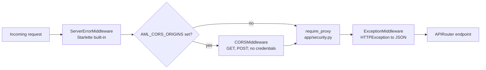
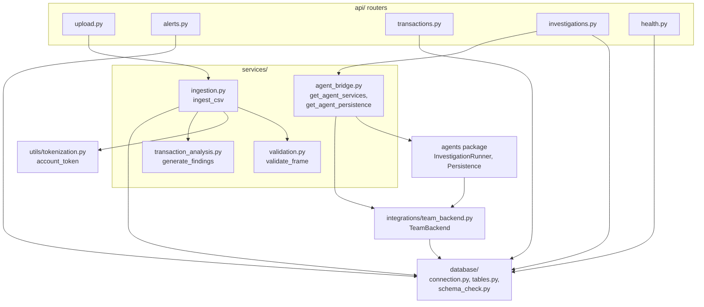
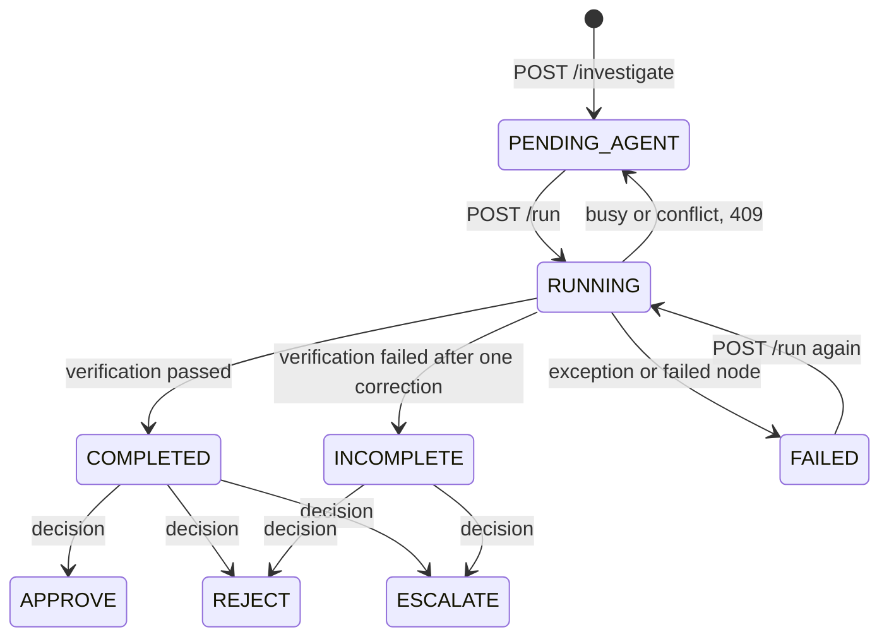

# Backend architecture

The backend (`backend/app/`) is a FastAPI application that owns the AML source data
(transactions, alerts), the case records (investigations, decisions, audit history) and the
execution of the agent pipeline. The agents are a separate Python package (`agents/`) that the
backend **imports and runs in-process**; they are not called over HTTP.

## Entry point and startup

`backend/app/main.py` builds the app:

```python
app = FastAPI(title='AML Member 1 Backend (MVP)', version='0.3.0', lifespan=lifespan)
app.middleware('http')(require_proxy)
if allowed_origins:
    app.add_middleware(CORSMiddleware, allow_origins=allowed_origins, ...)
app.include_router(upload.router, tags=['Uploads'])
app.include_router(alerts.router, tags=['Alerts'])
app.include_router(transactions.router, tags=['Transactions'])
app.include_router(investigations.router, tags=['Investigations'])
app.include_router(health.router, tags=['Health'])
```

Startup happens in two phases:

| Phase | What happens | Failure |
|---|---|---|
| Import | `app.database.connection` calls `load_dotenv()`, reads `DATABASE_URL`, normalizes it to `postgresql+psycopg://` and creates the SQLAlchemy `engine` | `RuntimeError` if `DATABASE_URL` is missing or not PostgreSQL; the process does not start |
| Lifespan | `assert_schema_current(engine)` compares the database's Alembic revision with the code's heads | `RuntimeError: Database schema is not up to date ... Run alembic upgrade head` |

The container command runs `alembic upgrade head` first when `RUN_MIGRATIONS=true` (the image
default). On AKS `RUN_MIGRATIONS=false` and the `migrate` Job runs migrations before rollout.

## Middleware order

Starlette wraps middleware in reverse registration order, so the CORS middleware (added
second) is the outer layer:



`require_proxy` (`backend/app/security.py`):

```python
async def require_proxy(request: Request, call_next):
    request.state.user = None
    key = _proxy_key()
    if key and request.url.path not in OPEN_PATHS and request.method != 'OPTIONS':
        sent = request.headers.get('x-amlens-proxy-key', '')
        if not hmac.compare_digest(sent.encode(), key.encode()):
            return JSONResponse({'detail': 'Not authenticated'}, status_code=401)
        request.state.user = request.headers.get('x-amlens-user') or None
    return await call_next(request)
```

| Condition | Result |
|---|---|
| `AML_PROXY_KEY` unset | Every request passes; `request.state.user` stays `None` (local development) |
| Path is `/health` or method is `OPTIONS` | Passes without a key |
| Key missing or wrong | `401 {"detail": "Not authenticated"}` |
| Key correct | Passes; `request.state.user` = `X-AMLens-User` header (trusted only because the key matched) |

Because CORS is outside the proxy check, a 401 still carries CORS headers in local
cross-origin development. In deployments `AML_CORS_ORIGINS` is empty and no CORS headers are
sent at all.

## Routers

| Router module | Endpoints | Handler type |
|---|---|---|
| `api/upload.py` | `POST /upload-transactions` | `async def` |
| `api/alerts.py` | `GET /alerts`, `GET /alerts/{alert_id}` | `def` |
| `api/transactions.py` | `GET /accounts/{account_id}/history` | `def` |
| `api/investigations.py` | `GET /investigations`, `POST /investigate/{alert_id}`, `POST /investigations/{id}/run`, `GET /investigations/{id}`, `GET /investigations/{id}/report`, `POST /investigations/{id}/decision`, `GET /audit/{id}` | `def` |
| `api/health.py` | `GET /health` | `def` |

Full request and response shapes are in [Backend endpoints](../api-reference/endpoints.md).

## Services and layers



| Module | Key symbols | Responsibility |
|---|---|---|
| `services/ingestion.py` | `ingest_csv(content, db)`, `MAX_UPLOAD = 20 MiB`, `MAX_ROWS = 100_000` | Parse CSV, deduplicate by content hash, tokenize, insert transactions and alerts in one transaction |
| `services/validation.py` | `validate_frame(df)`, `REQUIRED`, `CURRENCIES`, `FORMATS` | Column and row validation; returns `(accepted, rejected)` |
| `services/transaction_analysis.py` | `generate_findings(rows, *, high_value_threshold, ...)` | The three deterministic detection rules |
| `utils/tokenization.py` | `account_token(bank, account)` | HMAC-SHA256 pseudonymization with `TOKEN_SECRET` |
| `services/agent_bridge.py` | `get_agent_services()`, `get_agent_persistence()`, `_team_backend(zone)` | Builds the agents' `Services` with the real PostgreSQL adapter and the configured store |
| `integrations/team_backend.py` | `TeamBackend.get_alert_context(alert_id) -> AlertBundle` | Read-only adapter from backend tables to the agents' `AlertBundle` contract |
| `database/connection.py` | `engine`, `SessionLocal`, `get_db()`, `normalize_database_url()` | Engine (pool 5 + 10, `pool_pre_ping`, UTC sessions) and the request-scoped session dependency |
| `database/tables.py` | `Transaction`, `Alert`, `Investigation`, `InvestigatorDecision`, `ReportVersion`, `AuditEvent` | SQLAlchemy 2 ORM models |
| `database/schema_check.py` | `assert_schema_current(engine)` | Refuse to serve an un-migrated database |
| `models/schemas.py` | `DecisionIn` | The only Pydantic request model |

Each module is documented in detail under [Modules](../modules/index.md).

## How the agents are called: in-process, synchronously

`agent_bridge.py` imports the agents package directly (`from agents.main import
create_services, create_store`). The backend Dockerfile copies `agents/` into the image and
sets `PYTHONPATH=/app` so `import agents` resolves.

```python
def get_agent_services():
    zone = os.getenv('AML_SOURCE_TIMEZONE')
    if not zone:
        raise ValueError('Set AML_SOURCE_TIMEZONE explicitly for source transaction timestamps')
    settings = _agent_settings(use_mock_backend=False, use_mock_service_bus=True)
    return create_services(settings=settings, backend=_team_backend(zone))
```

`run_investigation` then calls it inside the request:

```python
services = agent_bridge.get_agent_services()
try:
    result = services.runner.run(InvestigationMessage(alert_id=inv.alert_id, investigation_id=id))
finally:
    services.close()
```

Facts that follow from this design:

- **Investigations run inside the HTTP request.** This confirms the statement in `DEPLOY.md`
  ("Investigations run inside the HTTP request"). There are no FastAPI `BackgroundTasks`, no
  threads started by the app and no queue. `run_investigation` is a sync `def`, so FastAPI
  runs it on the AnyIO worker thread pool and the event loop stays free.
- A fresh `Services` (runner, LLM client, RAG client, mock bus) is built for every run and
  closed afterwards. Only the `TeamBackend` (and its small connection pool) is cached per
  process in `_BACKENDS`, keyed by `(source URL, timezone)`.
- `use_mock_service_bus=True` is forced; the `MockServiceBus` is created and closed but never
  used on this path.
- The agents' report store is selected by `_agent_database_url()`: `AML_AGENT_DATABASE_URL`
  (PostgreSQL, schema `agent_runtime`) if set, otherwise `sqlite:///` +
  `AML_AGENT_DATABASE_PATH` (default `./agent_runtime.db`).
- LLM and RAG selection come from environment variables read by `agents.config.Settings`
  (`USE_MOCK_LLM`, `LLM_PROVIDER`, `AZURE_OPENAI_*`, `USE_MOCK_RAG`, `RAG_SERVICE_URL`).
  Both default to the offline mocks.

!!! warning "The agents' own HTTP API and worker are not used in production"
    `agents/main.py` defines `create_app()` with `POST /investigations/run`,
    `POST /investigations/queue` and `GET /investigations/{id}`, and `agents/worker/` contains
    an Azure Service Bus consumer. Neither is started by any Dockerfile, Compose file or
    Kubernetes manifest. The backend uses only `create_services`, `create_store`,
    `Persistence` and the schemas.

## Validation

| Layer | Mechanism | Example |
|---|---|---|
| Query parameters | Manual checks in the handler | `limit < 1 or limit > 200 or offset < 0` → `400 Invalid pagination` |
| JSON body | Pydantic model | `DecisionIn`: `decision: Literal['APPROVE','REJECT','ESCALATE']`, `rationale` 10–5000 chars, `analyst_id` 1–100 chars; failures are FastAPI's default `422` |
| File upload | Handler + service | `.csv` extension, size, row count, required columns, per-row rules |
| Agent contract | Pydantic `StrictModel` (`extra="forbid"`) | `AlertBundle.model_validate(...)` in `TeamBackend` |
| Database | Constraints from Alembic | `UNIQUE (dataset_id, source_row)`, foreign keys from `alerts`, `investigations`, `investigator_decisions`, `report_versions`, `audit_history` |

## Exception handling

The app registers no custom exception handlers. Errors surface as follows:

| Source | Handling | Client sees |
|---|---|---|
| `HTTPException` raised in a handler | FastAPI default | `{"detail": "..."}` with the given status |
| Pydantic body validation | FastAPI default | `422` with a `detail` list |
| `ValueError` from `ingest_csv` | `db.rollback()`, re-raised as `HTTPException(400, str(e))` | `400` with the reason |
| `IntegrityError` on upload (concurrent duplicate) | rollback | `400 Dataset already imported` |
| `OSError`/`ValueError` opening the agent store | `_agent_record()` | `503 Agent persistence unavailable` |
| `InvestigationBusy` / `InvestigationConflict` during a run | status reset to `PENDING_AGENT` | `409` with the exception message |
| Any other exception during a run (incl. `InvestigationFailed`, missing `AML_SOURCE_TIMEZONE`) | status `FAILED`, audit `AGENT_RUN_FAILED` | `503 Agent investigation failed; inspect persisted status` |
| Anything else | Starlette `ServerErrorMiddleware` | `500 Internal Server Error` (plain text) |

Exception messages from providers are never returned: the run handler uses `from None` and a
fixed message, and the agent graph stores only exception class names.

## Case lifecycle



The alert moves `OPEN` → `UNDER REVIEW` when the first investigation is created and to
`DECIDED` when a decision is recorded. It never moves backwards. Migration
`0002_alert_status` backfilled these values for older rows.

## Configuration read by the backend process

| Variable | Read by | Default | Purpose |
|---|---|---|---|
| `DATABASE_URL` | `connection.py` | required | Main PostgreSQL database |
| `DB_POOL_SIZE`, `DB_MAX_OVERFLOW` | `connection.py` | 5, 10 | SQLAlchemy pool |
| `AML_PROXY_KEY` | `security.py` | unset (open) | Shared secret with the frontend proxy |
| `AML_CORS_ORIGINS` | `main.py` | unset | Comma-separated origins for local cross-origin use |
| `TOKEN_SECRET` | `tokenization.py` | required for uploads (≥ 32 chars) | HMAC key for account tokens |
| `AML_SOURCE_TIMEZONE` | `agent_bridge.py` | required for runs | Zone of the naive source timestamps (`UTC` on AKS) |
| `AML_SOURCE_DATABASE_URL` | `agent_bridge.py`, `TeamBackend` | falls back to `DATABASE_URL` | Optional SELECT-only login for the agent adapter |
| `AML_AGENT_DATABASE_URL` | `agent_bridge.py` | unset | PostgreSQL agent store (schema `agent_runtime`) |
| `AML_AGENT_DATABASE_PATH` | `agent_bridge.py` | `./agent_runtime.db` | SQLite agent store when the URL is unset |
| `USE_MOCK_RAG`, `RAG_SERVICE_URL` | `health.py`, `agents.config` | `true`, empty | RAG selection and health probe |
| `USE_MOCK_LLM`, `LLM_PROVIDER`, `AZURE_OPENAI_*`, `GROQ_*`, `LLM_TIMEOUT_SECONDS` | `agents.config.Settings` | mock, `azure_openai`, 30 | LLM selection |
| `RUN_MIGRATIONS` | Dockerfile `CMD` | `true` | Run `alembic upgrade head` before uvicorn |

See [Configuration](../getting-started/configuration.md) for the complete list.

## Known limitations visible in the code

- `POST /upload-transactions` is `async def` but `ingest_csv()` is synchronous (pandas,
  row-by-row validation, SQLAlchemy). **Inferred:** a large upload blocks the event loop for
  its duration, delaying other requests handled by the same worker.
- `GET /investigations` reads the agent record for each case one by one; with the PostgreSQL
  store each read opens a new connection (no pool in `PostgresService`).
- Docstrings in `investigations.py` ("Local MVP: synchronous, mocked-agent execution only"),
  `agent_bridge.py` ("Local development bridge") and `TeamBackend` ("separate agent_runtime.db
  (SQLite)") predate the PostgreSQL agent store and the live deployment.
- The `report_versions` table exists in the ORM and the initial migration but nothing reads or
  writes it; reports are stored only in `agent_runtime.investigations.report_json`.

## Related pages

- [Investigation service](../modules/investigation-service.md)
- [Transaction ingestion](../modules/transaction-ingestion.md)
- [Database schema](../database/schema.md)
- [Migrations](../database/migrations.md)
