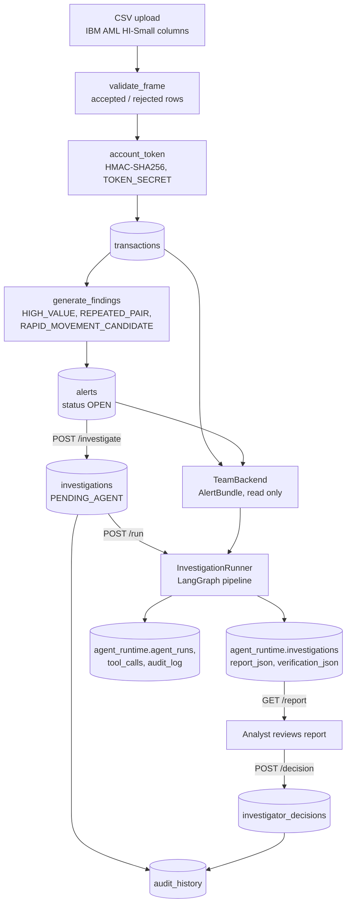
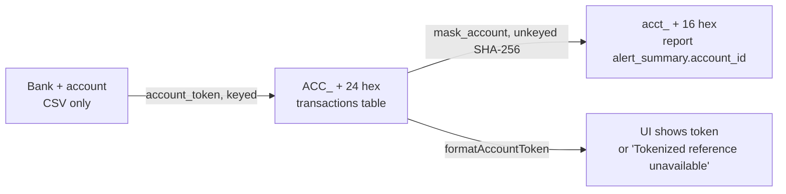

# Data flow

This page follows data from a CSV upload to a recorded decision, names every table it touches
and explains how account identifiers are pseudonymized. Table definitions are in
[Database schema](../database/schema.md).

## End-to-end flow



## Stage by stage

| # | Stage | Trigger | Code | Reads | Writes |
|---|---|---|---|---|---|
| 1 | Upload and validate | `POST /upload-transactions` | `ingest_csv`, `validate_frame` | `transactions` (dedup check on `dataset_id`) | nothing yet |
| 2 | Tokenize and store transactions | same request | `account_token`, `Transaction(...)` | | `transactions` |
| 3 | Detect | same request, after `db.flush()` | `generate_findings(transactions)` | in-memory rows of this upload | `alerts` (`status` default `OPEN`) |
| 4 | Open a case | `POST /investigate/{alert_id}` | `start_investigation` | `alerts` | `investigations` (`PENDING_AGENT`), `audit_history` `CREATED`, `alerts.status` → `UNDER REVIEW` |
| 5 | Run agents | `POST /investigations/{id}/run` | `run_investigation` → `InvestigationRunner.run` | `alerts`, `transactions` (read-only) | `investigations.status` (`RUNNING`, then result), `audit_history` `AGENT_RUN_REQUESTED`/`FINISHED`/`FAILED`; agent store tables |
| 6 | Read report | `GET /investigations/{id}/report` | `get_report` | agent store | nothing |
| 7 | Decide | `POST /investigations/{id}/decision` | `decide` | agent store (`execution_status`, `verification`) | `investigator_decisions`, `investigations.status` = decision, `alerts.status` → `DECIDED`, `audit_history` `DECISION_RECORDED` |
| 8 | Audit view | `GET /audit/{id}` | `audit` | `audit_history` ordered by `created_at, id` | nothing |

Stages 1–3 are a single database transaction: `ingest_csv` adds all transactions, flushes,
adds alerts and commits once. A failure at any point rolls back the whole upload.

## Identifiers

| Entity | ID format | Generated in |
|---|---|---|
| Dataset | first 20 hex chars of `sha256(file bytes)` | `ingest_csv` |
| Transaction | `TX_{dataset_id}_{source_row}` (`source_row` = file line, header is line 1) | `ingest_csv` |
| Alert | `AL_{dataset_id}_{n}` (`n` = 1-based finding index) | `ingest_csv` |
| Investigation | UUID4 | `start_investigation` |
| Decision, audit event | UUID4 | `decide`, `AuditEvent(...)` |
| Agent run, tool call, agent audit event | UUID4 | `graph.traced`, `ToolBudget.consume`, `audit()` |

Because `dataset_id` is a content hash, uploading the same bytes twice returns
`400 Dataset already imported`. Changing one byte creates a new dataset with new IDs.

## Tokenization of account identifiers

Raw account numbers never reach the database. `backend/app/utils/tokenization.py`:

```python
def account_token(bank: str, account: str) -> str:
    secret = os.getenv('TOKEN_SECRET')
    if not secret or len(secret) < 32:
        raise RuntimeError('Set TOKEN_SECRET to at least 32 random characters')
    # Length-prefixed encoding prevents concatenation ambiguity.
    payload = f'{len(str(bank))}:{bank}{len(str(account))}:{account}'.encode('utf-8')
    return 'ACC_' + hmac.new(secret.encode(), payload, hashlib.sha256).hexdigest()[:24]
```

| Property | Consequence |
|---|---|
| Keyed (HMAC) | Tokens cannot be reversed or brute-forced without `TOKEN_SECRET`. |
| Bank-scoped | The same account number at two banks yields two tokens (`test_account_token_is_stable_and_bank_scoped`). |
| Deterministic | The same `(bank, account)` always yields the same token, so history queries and rules work across uploads. |
| Secret must be stable | `DEPLOY.md`: `TOKEN_SECRET` "must be the team's existing value, or account tokens in the loaded data won't match new uploads". Rotating it splits every account's history. |
| Length | `ACC_` + 24 hex = 28 chars; columns are `String(36)`. |

The CSV columns `From Bank`/`Account` become `sender_token` and `To Bank`/`Account.1` become
`receiver_token`. The `Is Laundering` ground-truth label is validated (`0` or `1`) but never
stored, and the upload response states `ground_truth_exposed: false`.

Two further layers of masking happen downstream:



- `agents/services/security.py` `mask_account()` hashes the `ACC_` token again
  (`"acct_" + sha256(value)[:16]`) for the report's `alert_summary.account_id`.
- `safe_llm_payload()` sends the LLM only the investigation ID, the approved statements and
  the allowed next steps. No account tokens, descriptions, alert labels or guidance text cross
  the LLM boundary.
- The frontend refuses to render any account-like value that is not already a token
  ([Frontend architecture](frontend-architecture.md#privacy-in-the-ui)).

## From database rows to the agent contract

`TeamBackend.get_alert_context()` converts backend rows into the agents' `AlertBundle`. The
conversion is the most constrained step in the flow:

| Rule | Implementation |
|---|---|
| Read only | `SET TRANSACTION READ ONLY`; `statement_timeout` and `lock_timeout` = 3 s |
| Bounded history | Same `dataset_id`, transactions of the anchor account within ±48 h of the trigger, closest first, at most 200 including the trigger |
| Anchor account | `evidence.anchor_account_token` (or `account_token`), must be sender or receiver of the trigger |
| Direction | Receiver = anchor → `deposit` (uses `amount_received`, `receiving_currency`); sender = anchor → `withdrawal` (uses `amount_paid`, `payment_currency`) |
| Currency | IBM name → ISO code via `CURRENCIES` (14 entries) |
| Amounts | Must be exactly representable with 2 decimals (`_money`); no rounding |
| Timestamps | Naive source timestamps are interpreted in `AML_SOURCE_TIMEZONE` |
| Self-transfers | Non-required ones are dropped with a warning log; a required one raises `ValueError` |
| Required evidence | Every `evidence.transaction_ids` entry plus the trigger must be in the bundle |
| Typology | `RULE_TO_TYPOLOGY[rule_id]`; unknown rule → `ValueError` |

Any of these errors fails the `transaction` node, so the run ends with
`execution_status = failed`.

## Two stores, one database

| Store | Schema | Tables | Owner | Migrations |
|---|---|---|---|---|
| AML source and cases | default (`public`) | `transactions`, `alerts`, `investigations`, `investigator_decisions`, `report_versions`, `audit_history` | Backend | Alembic (`backend/alembic/versions/`) |
| Agent runtime | `agent_runtime` | `investigations`, `agent_runs`, `tool_calls`, `audit_log` | Agents (`PostgresService`) | `CREATE ... IF NOT EXISTS` on first use, under `pg_advisory_xact_lock` |

Both have an `investigations` table; the schema separation is what prevents the collision.
The investigation ID is the join key: the backend passes its UUID as
`InvestigationMessage.investigation_id`.

### Two audit trails

| Trail | Table | Written by | Events | Shown in UI |
|---|---|---|---|---|
| Case audit | `audit_history` | Backend handlers | `CREATED`, `AGENT_RUN_REQUESTED`, `AGENT_RUN_FINISHED`, `AGENT_RUN_FAILED`, `DECISION_RECORDED` | Yes, `/audit` and dashboard |
| Agent audit | `agent_runtime.audit_log` | `audit()` in `graph.py`, `Persistence.save()` | `agent_execution` (per node), `verification`, `persisted` | No direct view; returned as `audit_history` by `Persistence.get()` but the backend's `/report` response does not include it |

`agent_runtime.tool_calls` records each attempted external call (`backend.read`, `rag.search`,
`llm.generate`) with `input_json = '{}'` and `output_json = '{"status":"attempted"}'`;
payloads are intentionally not logged.

## Report versions

The schema has a `report_versions` table (`version`, `report_json`) but no code writes it.
A run's report is written once to `agent_runtime.investigations.report_json` and is
immutable afterwards: `Persistence.claim()` returns `None` for `completed`/`incomplete`
investigations, so re-running returns the stored record without executing the graph. A
failed run can be retried and overwrites the failed record.

## Data that is deliberately not stored

| Data | Why |
|---|---|
| Raw CSV file | Comment in `ingest_csv`: "Raw file and labels are deliberately not persisted by this demo." |
| `Is Laundering` label | Ground truth must not leak into investigation or evaluation |
| Bank names and account numbers | Only HMAC tokens are stored |
| LLM prompts and responses | Only the validated `NarrativeDraft` survives, merged into the report |
| Provider exception messages | `traced()` stores `type(exc).__name__` only, because "provider errors may echo secrets/PII" |

## Related pages

- [Transaction ingestion](../modules/transaction-ingestion.md)
- [Detection rules](../modules/detection-rules.md)
- [Investigation service](../modules/investigation-service.md)
- [Database overview](../database/overview.md)
