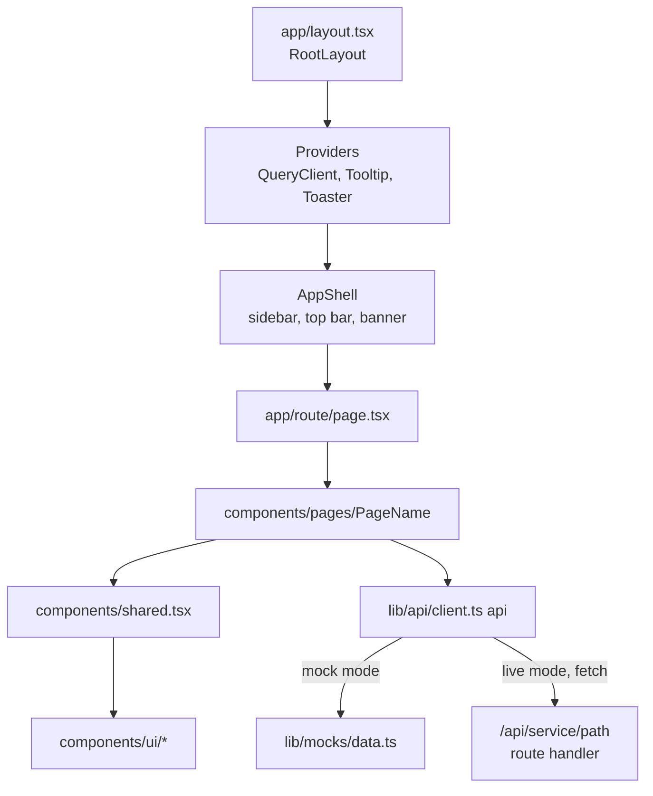
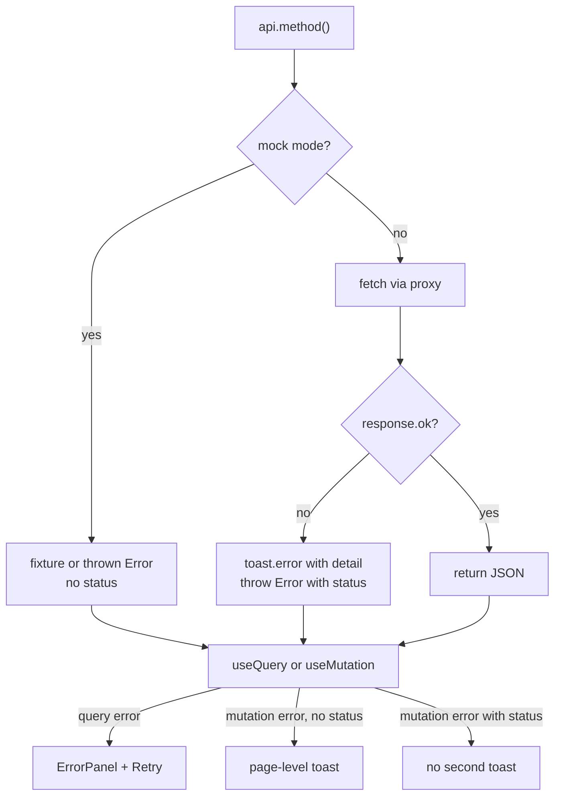

# Frontend architecture

The frontend (`frontend/`) is a Next.js 14 App Router application. Every page is a client
component that reads data through one typed API client, which either calls the backend through
a same-origin proxy or returns in-memory fixtures (mock mode).

## Stack

| Concern | Library | Version (from `package.json`) |
|---|---|---|
| Framework | `next` (App Router, `output: "standalone"`) | 14.2.35 |
| UI runtime | `react`, `react-dom` | ^18.3.1 |
| Server state | `@tanstack/react-query` | ^5.108.2 |
| Tables | `@tanstack/react-table` (alert queue) | ^8.21.3 |
| Forms | `react-hook-form` + `@hookform/resolvers/zod` + `zod` | ^7.92.0 / ^7.0.8 / ^4.6.7 |
| Toasts | `sonner` (via `components/ui/sonner.tsx`) | ^2.0.8 |
| Charts | `recharts` (via `components/ui/chart.tsx`) | ^3.8.0 |
| Components | shadcn/ui (`components.json` style `base-nova`), `@base-ui/react`, `lucide-react` icons | |
| Styling | Tailwind CSS 4 (`@tailwindcss/postcss`), CSS variables in `app/globals.css` | ^4.3.3 |
| Package manager | pnpm (`packageManager: pnpm@12.3.4`) | |

## Directory structure

| Path | Role |
|---|---|
| `app/layout.tsx` | Root layout: `<Providers><AppShell>{children}</AppShell></Providers>`, metadata, viewport |
| `app/**/page.tsx` | Thin route files; each renders one component from `components/pages/` |
| `app/api/[service]/[...path]/route.ts` | Server-side proxy to backend and RAG (see [Frontend proxy](../modules/frontend-proxy.md)) |
| `components/providers.tsx` | `QueryClientProvider`, `TooltipProvider`, `<Toaster position="top-right" richColors />` |
| `components/layout/app-shell.tsx` | Sidebar navigation, top bar, global search, theme toggle, health dot, AI-draft banner |
| `components/pages/*.tsx` | One file per screen (all `"use client"`) |
| `components/shared.tsx` | `PageHeader`, `Panel`, `StatusBadge`, `CopyableId`, `MetricCard`, `EmptyState`, `LoadingRows`, `ErrorPanel`, `DisclaimerCallout`, `InlineLink` |
| `components/ui/*.tsx` | shadcn/ui primitives (button, card, dialog, tabs, table, field, ...) |
| `lib/api/client.ts` | `api` object, `request<T>()`, mock switch, `appConfig` |
| `lib/api/types.ts` | TypeScript contracts mirroring backend and agent JSON |
| `lib/mocks/data.ts` | Fixtures used in mock mode (alerts, investigations, reports, audit events, guidelines, health) |
| `lib/format.ts` | Money, dates, `formatAccountToken`, `formatCitation`, `humanize`, decimal-string comparison |

## Routing

| URL | Route file | Page component | Data used |
|---|---|---|---|
| `/` | `app/page.tsx` | `DashboardPage` | `getAlerts(200,0)`, `getInvestigations()`, `getHealth()`, `getAudit()` for the 4 newest cases |
| `/upload` | `app/upload/page.tsx` | `UploadPage` | `uploadTransactions(file)` |
| `/alerts?search=` | `app/alerts/page.tsx` | `AlertsPage` | `getAlerts(pageSize, offset)` |
| `/alerts/[alertId]` | `app/alerts/[alertId]/page.tsx` | `AlertDetailPage` | `getAlert`, `getInvestigations`, `getInvestigationReport`, `getAccountHistory`, `investigateAlert`, `runInvestigation` |
| `/investigations` | `app/investigations/page.tsx` | `InvestigationsPage` | `getInvestigations()` |
| `/investigations/[id]` | `app/investigations/[id]/page.tsx` | `InvestigationDetailPage` | `getInvestigation`, `getInvestigationReport`, `runInvestigation`, `submitDecision` |
| `/knowledge` | `app/knowledge/page.tsx` | `KnowledgePage` | `searchGuidelines()` (RAG `/search`) |
| `/audit?investigation_id=` | `app/audit/page.tsx` | `AuditPage` | `getInvestigations()`, `getAudit(id)` |
| `/settings` | `app/settings/page.tsx` | `SettingsPage` | `getHealth()` every 30 s |
| `/api/{backend,rag}/...` | `app/api/[service]/[...path]/route.ts` | Route handler | Proxies to `AMLENS_BACKEND_URL` / `AMLENS_RAG_URL` |

The global search in the top bar routes by ID shape (`app-shell.tsx`, `handleSearch`):
`AL_`/`ALT-` prefixes open `/alerts/{id}`, `INV-` or a UUID opens `/investigations/{id}`,
anything else becomes `/alerts?search=`.

## Component hierarchy



## State management

There is no global client store. State lives in three places:

| Kind | Where | Example |
|---|---|---|
| Server state | TanStack Query cache | `["alerts", pageSize, offset]`, `["investigations"]`, `["investigation", id]`, `["investigation-report", id]`, `["audit", id]`, `["account-history", token]`, `["health"]`, `["alerts-total"]` |
| Form state | `react-hook-form` with a zod resolver | upload file, decision form, knowledge search |
| UI state | `useState` in the component | sidebar collapse, active pipeline step, selected citation |

The `QueryClient` is created once per browser session in `components/providers.tsx` with
`staleTime: 30_000`, `retry: 1`, `refetchOnWindowFocus: false`. Polling is explicit:
the shell refetches health every 30 s and the alert total every 60 s.

After a mutation, pages invalidate the affected keys instead of patching the cache, for example
the decision form invalidates `["investigation", id]`, `["investigation-report", id]` and
`["investigations"]`.

### Forms and validation

| Form | Schema (zod) | Server-side counterpart |
|---|---|---|
| Upload (`upload.tsx`) | `z.instanceof(File)`, `.csv` name, size ≤ 25 MB | `MAX_UPLOAD = 20 MB`, `.csv` check, `validate_frame` per row |
| Decision (`investigation-detail.tsx`, `decisionSchema`) | `decision` enum `APPROVE`/`REJECT`/`ESCALATE`, `rationale` 10–5000 chars, `analyst_id` 3–80 chars | `DecisionIn` (`rationale` 10–5000, `analyst_id` 1–100) |
| Knowledge search (`knowledge.tsx`) | `query` 3–500 chars, `typology` enum of 4, `top_k` 1–20 | `AMLSearchRequest` (`top_k` 1–20) |

!!! note "Client and server limits differ"
    The upload form accepts files up to 25 MB but the backend rejects anything above 20 MB
    with `400 MVP upload limit is 20 MB`. The ingress body limit is also 25 MB. The analyst ID
    typed in the decision form is ignored when the request comes through the authenticated
    proxy: the backend records `request.state.user` instead.

## API client

`lib/api/client.ts` exports a single `api` object. Every method has a mock branch and a live
branch:

```ts
const mockMode = () => process.env.NEXT_PUBLIC_USE_MOCKS !== "false";
const apiBase = (process.env.NEXT_PUBLIC_API_BASE_URL || "/api/backend").replace(/\/$/, "");
const ragBase = (process.env.NEXT_PUBLIC_RAG_BASE_URL || "/api/rag").replace(/\/$/, "");
```

| Method | Live request | Notes |
|---|---|---|
| `getHealth()` | `GET {apiBase}/health` | |
| `getAlerts(limit, offset)` | `GET {apiBase}/alerts?limit=&offset=` | Clamps `limit` to 1–200 |
| `getAlert(id)` | `GET {apiBase}/alerts/{id}` | |
| `uploadTransactions(file)` | `POST {apiBase}/upload-transactions` (multipart) | Maps `accepted`/`rejected`/`source_row`/`reasons[]` to `accepted_count`/`rejected_count`/`row_number`/`reason` |
| `getAccountHistory(token, limit)` | `GET {apiBase}/accounts/{token}/history?limit=` | |
| `investigateAlert(id)` | `POST {apiBase}/investigate/{id}` | |
| `runInvestigation(id)` | `POST {apiBase}/investigations/{id}/run`, then `GET .../report` | Throws `Investigation {status}; no report was produced.` if `report_available` is false |
| `getInvestigation(id)` | `GET {apiBase}/investigations/{id}` | |
| `getInvestigationReport(id)` | `GET {apiBase}/investigations/{id}/report` | |
| `submitDecision(id, decision)` | `POST {apiBase}/investigations/{id}/decision` (JSON) | |
| `getInvestigations(limit)` | `GET {apiBase}/investigations?limit=` | |
| `searchGuidelines(input)` | `POST {ragBase}/search` (JSON) | Goes to the RAG service, not the backend |
| `getAudit(id)` | `GET {apiBase}/audit/{id}` | Backend `audit_history`, not the agents' `audit_log` |

`appConfig` (`{ apiBase, ragBase, mocks }`) is read by the shell to show "DEV · Mock data" or
"LIVE API".

## Error handling

All live calls go through `request<T>()`:

```ts
if (!response.ok) {
  let detail = `Request failed (${response.status})`;
  try { const body = await response.json() as { detail?: string }; if (body.detail) detail = body.detail; } catch {}
  toast.error(detail);
  const error = new Error(detail) as Error & { status: number };
  error.status = response.status;
  throw error;
}
```

The resulting conventions:

1. **Every non-2xx response produces exactly one toast** with the FastAPI `detail` string (or
   the proxy's own `detail`, for example `The backend service is unreachable.` on 502).
2. The thrown error carries `status`. Mutation `onError` handlers only toast again when
   `status` is missing, which means the error came from client code (for example
   `runInvestigation` throwing when no report was produced, or a network failure in `fetch`).
3. Queries render `ErrorPanel` with a **Retry** button (`refetch()`) instead of a blank page.
4. Mock-mode errors are plain `Error`s without `status`, so they are toasted by the page.



## Mock mode

| Setting | Effect |
|---|---|
| `NEXT_PUBLIC_USE_MOCKS` unset or any value except `"false"` | Mock mode. `api` methods wait 100–1100 ms and return data from `lib/mocks/data.ts`. Mutations change the in-memory arrays, so a session can create, run and decide investigations without any backend. |
| `NEXT_PUBLIC_USE_MOCKS=false` | Live mode through the proxy. |

`NEXT_PUBLIC_*` values are inlined at build time. The Dockerfile sets
`ARG NEXT_PUBLIC_USE_MOCKS=false`, so production images are live; pass
`--build-arg NEXT_PUBLIC_USE_MOCKS=true` for a self-contained demo image. The service URLs
are deliberately **not** `NEXT_PUBLIC_*`: the proxy reads `AMLENS_BACKEND_URL` and
`AMLENS_RAG_URL` at request time so one image works in every environment.

## Styling

- Tailwind 4 via `@import 'tailwindcss'` in `app/globals.css`, with shadcn tokens mapped in
  `@theme inline`.
- Light and dark palettes are CSS variables on `:root` and `.dark`. The shell's theme button
  toggles the `dark`/`light` class on `<html>` and dispatches an `amlens-theme-change` event.
- Most layout is hand-written classes in `globals.css` (`page-heading`, `panel-card`,
  `status-badge`, `status-open`, ...). `StatusBadge` maps backend status strings to these
  classes through the `statusColors` table in `components/shared.tsx`.
- `next.config.mjs` adds security headers to every response (`X-Content-Type-Options`,
  `Referrer-Policy`, `Strict-Transport-Security`, `X-Frame-Options: SAMEORIGIN`,
  `Permissions-Policy`).

## Privacy in the UI

The UI never shows something that might be a raw account number:

- `formatAccountToken()` (`lib/format.ts`) only passes values that look like masked IDs
  (`ACC-****1234`), backend HMAC tokens (`ACC_<hex>`) or agent tokens (`acct_<hex>`), and
  returns `Tokenized reference unavailable` otherwise.
- `redactSensitiveIdentifiers()` in `investigation-detail.tsx` and `safeEvidenceValue()` in
  `alert-detail.tsx` replace any value under a key containing `account` that is not already
  masked.

## How to add a page

1. **Add the API contract.** Add response types to `lib/api/types.ts` and a method on `api`
   in `lib/api/client.ts`, with both a mock branch (fixture in `lib/mocks/data.ts`) and a
   live branch that calls ``request<T>(`${apiBase}/...`)``.
2. **Create the page component** in `components/pages/my-page.tsx`, starting with
   `"use client"`. Use `useQuery({ queryKey: ["my-key", ...], queryFn: ... })`, and render
   `LoadingRows`, `ErrorPanel` (with `onRetry`) and `EmptyState` from `components/shared.tsx`.
3. **Create the route** `app/my-page/page.tsx`:

    ```tsx
    import { MyPage } from "@/components/pages/my-page";
    export default function MyRoute() { return <MyPage />; }
    ```

4. **Add navigation.** Append `{ label, href, icon }` to the `navigation` array in
   `components/layout/app-shell.tsx`; the breadcrumb title is derived from it.
5. **Forms**: define a zod schema, `useForm({ resolver: zodResolver(schema) })`, and a
   `useMutation` that invalidates the query keys it affects. Do not add your own toast for
   HTTP errors; `request()` already shows one.
6. **New backend endpoint?** No proxy change is needed: any path under `/api/backend/` is
   forwarded. A new upstream service needs an entry in the proxy's `upstreams` map (see
   [Frontend proxy](../modules/frontend-proxy.md#extension-points)).
7. Run `pnpm build` (CI runs the type-check and build on every push).

## Related pages

- [Frontend proxy](../modules/frontend-proxy.md)
- [Backend endpoints](../api-reference/endpoints.md)
- [Local development](../getting-started/local-development.md)
