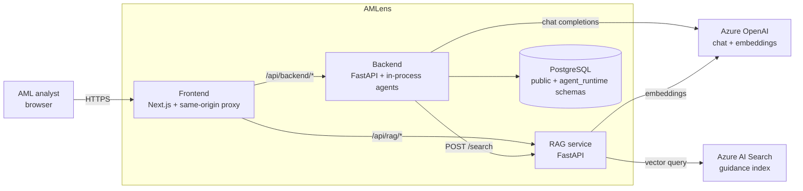

# Architecture overview

AMLens is an investigator-led workspace for transaction-monitoring alerts. It has four parts:

1. **Deterministic detection**: an uploaded CSV of transactions is validated, account
   identifiers are tokenized, and fixed rules create alerts.
2. **An AI-assisted investigation**: a LangGraph pipeline of agents builds an evidence-linked
   draft report for one alert.
3. **Independent verification**: the draft is recomputed from source data and checked before
   anyone can approve it.
4. **A human decision**: only an analyst can approve, reject or escalate, and every step is
   written to an audit trail.

This page is the map. The pages that follow go deeper:

| Page | What it covers |
|---|---|
| [System architecture](system-architecture.md) | Context and container diagrams, runtime topology on AKS and Docker Compose, the full request lifecycle |
| [Frontend architecture](frontend-architecture.md) | Next.js App Router, React Query, API client, mock mode, toasts |
| [Backend architecture](backend-architecture.md) | FastAPI entry point, middleware, routers, services, how the agents run in-process |
| [Data flow](data-flow.md) | Upload to audit history, tokenization, the two data stores |
| [Architecture decisions](architecture-decisions.md) | ADR-style records of the decisions visible in the repository |
| [Modules](../modules/index.md) | One page per module, with source files, flows, failure modes and extension points |

## The system in one picture

## Repository layout

| Path | Component | Language / framework | Deployed as |
|---|---|---|---|
| `frontend/` | Analyst UI and the server-side API proxy | Next.js 14 (App Router), React 18, TanStack Query, Tailwind 4, shadcn/ui | `amlens-frontend` image, port 3000 |
| `backend/` | Upload, rules, alerts, cases, decisions, audit; hosts the agents | FastAPI, SQLAlchemy 2, Alembic, pandas | `amlens-backend` image (also contains `agents/`), port 8000 |
| `agents/` | LangGraph investigation pipeline, verifier, runtime store | LangGraph, Pydantic v2, openai / groq SDKs, psycopg 3 | Python package imported by the backend; also has its own optional FastAPI app and Service Bus worker |
| `RAG/` | Guidance retrieval service and index-build scripts | FastAPI, Azure AI Search SDK, optional FAISS + sentence-transformers | `amlens-rag` image, port 8001 |
| `deploy/aks/` | Current production deployment (AKS) | Kubernetes manifests, bash | `kubectl apply` via `deploy.sh` / `rollout.sh` |
| `infra/` | Alternative Azure Container Apps design | Bicep, PowerShell | Not the live deployment |
| `docker-compose.yml` | Production-like local run of the three images | Docker Compose | Local only |

## Key properties

| Property | How it is achieved | Where |
|---|---|---|
| The browser only talks to one origin | Next.js route handler `app/api/[service]/[...path]/route.ts` forwards to the backend and RAG | [Frontend proxy](../modules/frontend-proxy.md) |
| Backend only accepts proxied calls | `require_proxy` middleware checks `X-AMLens-Proxy-Key` with `hmac.compare_digest` | `backend/app/security.py` |
| No raw account numbers are stored | `account_token()` HMAC-SHA256 with `TOKEN_SECRET` at ingestion | [Data flow](data-flow.md#tokenization-of-account-identifiers) |
| Agents never write source data | `TeamBackend` reads inside `SET TRANSACTION READ ONLY` with a statement timeout | [Investigation service](../modules/investigation-service.md) |
| LLM cannot invent facts | The LLM only selects from approved sentences; the verifier recomputes the report | [Agent pipeline](../modules/agent-pipeline.md), [Report verifier](../modules/report-verifier.md) |
| Bounded external calls | `ToolBudget` (8 calls per run) over `backend.read`, `rag.search`, `llm.generate` | `agents/services/audit_service.py` |
| Only humans decide | `POST /investigations/{id}/decision` is the only path that changes a case to `APPROVE`/`REJECT`/`ESCALATE`; the agents have no such tool | `backend/app/api/investigations.py` |
| Approvals require a verified report | Backend returns 409 unless `execution_status == "completed"` and `verification.passed` | `decide()` |

## Runtime facts worth knowing up front

!!! info "Investigations run synchronously inside the HTTP request"
    `POST /investigations/{id}/run` calls `services.runner.run(...)` directly. There is no
    queue or background task in the deployed path; the ingress sets
    `proxy-read-timeout: "300"` for this reason. The Azure Service Bus worker in
    `agents/worker/` exists and is tested but is not wired into any deployment
    (`/health` reports `queue: "not_applicable"`).

!!! info "Two logical stores in one PostgreSQL database"
    The backend's tables (`transactions`, `alerts`, `investigations`, ...) live in the default
    schema and are managed by Alembic. The agents keep their own tables (`investigations`,
    `agent_runs`, `tool_calls`, `audit_log`) in schema `agent_runtime`, created on first use by
    `PostgresService`. Locally the agent store can be a SQLite file instead.

!!! warning "Mock mode is on by default in the frontend"
    `lib/api/client.ts` uses in-memory fixtures unless `NEXT_PUBLIC_USE_MOCKS` is exactly
    `"false"`. The production Dockerfile sets it to `false` at build time; `pnpm dev` without
    it shows mock data and the top bar reads "DEV · Mock data".

## Where to go next

- New to the code: read [System architecture](system-architecture.md), then
  [Backend architecture](backend-architecture.md).
- Changing detection logic: [Detection rules](../modules/detection-rules.md).
- Changing the AI pipeline: [Agent pipeline](../modules/agent-pipeline.md) and
  [Report verifier](../modules/report-verifier.md).
- Changing retrieval: [RAG service](../modules/rag-service.md) and
  [Azure AI Search](../integrations/azure-ai-search.md).
