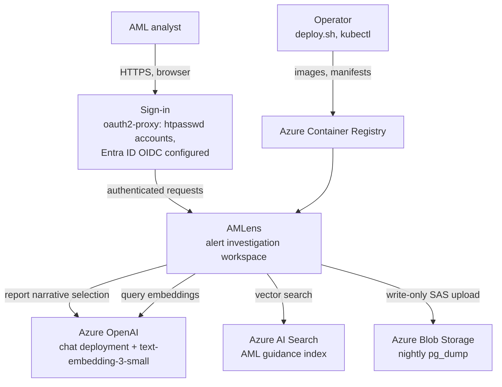
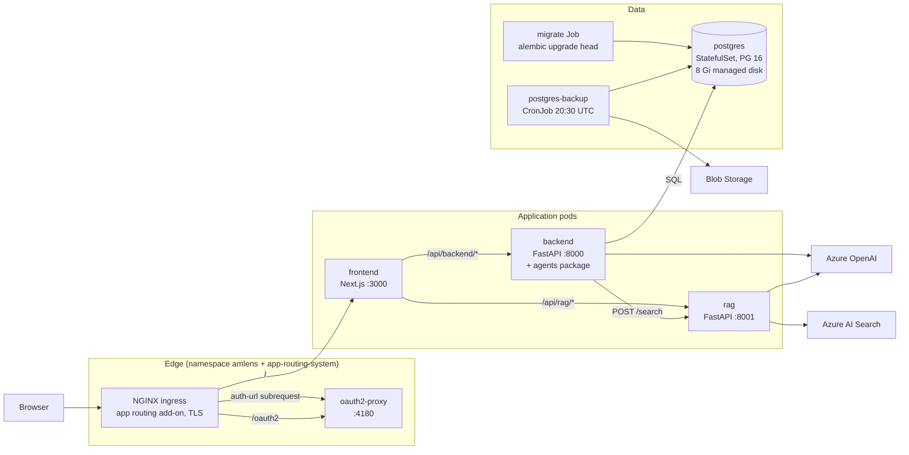
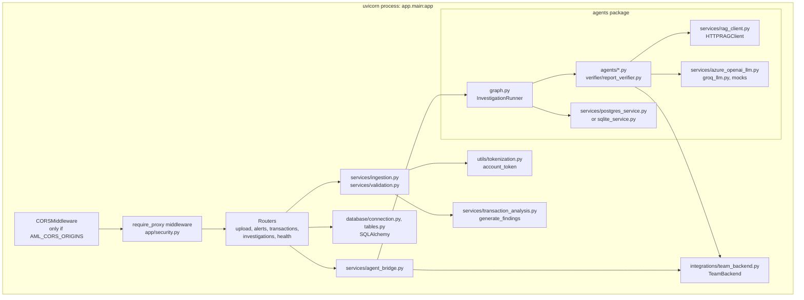
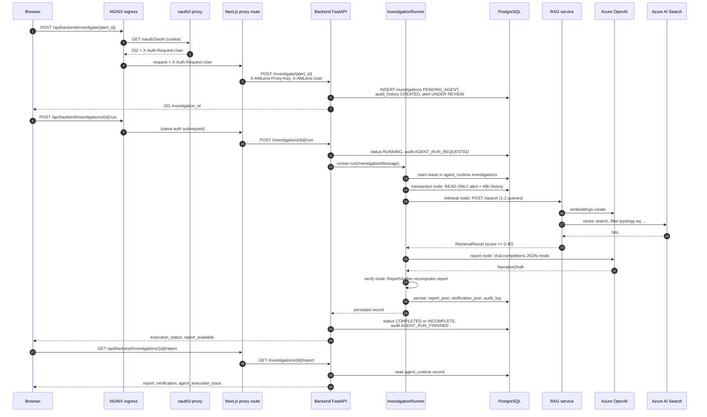

# System architecture

This page describes AMLens at three zoom levels (system context, containers, components) and
then follows one investigation request end to end. All facts are taken from the code and the
manifests in `deploy/aks/base/`; anything inferred is marked **Inferred**.

## System context

| External system | Used by | Purpose | Auth in the AKS deployment |
|---|---|---|---|
| Azure OpenAI (chat) | Backend (agents `AzureOpenAILLM`) | Report agent selects and orders approved statements | API key (`amlens-ai` secret); Entra ID token provider when no key is set |
| Azure OpenAI (embeddings) | RAG `TeamAzureSearchAdapter` | Embeds the search query (1536 dimensions) | API key or `DefaultAzureCredential` |
| Azure AI Search | RAG | Vector search with typology pre-filter | Query key, or `DefaultAzureCredential` |
| Azure Blob Storage | `postgres-backup` CronJob | Off-cluster logical backups | Write-only SAS |
| oauth2-proxy | Ingress | Sign-in; sets `X-Auth-Request-User` / `X-Auth-Request-Email` | htpasswd file (bcrypt) plus OIDC client |

## Containers

### Container reference

| Container | Image / source | Port | Talks to | Allowed inbound (NetworkPolicy) |
|---|---|---|---|---|
| `frontend` | `frontend/Dockerfile` (Node 20 alpine, `output: "standalone"`) | 3000 | backend, rag | ingress controller namespace `app-routing-system` |
| `oauth2-proxy` | `oauth2-proxy/oauth2-proxy:v7.7.1` (imported to ACR) | 4180 | Entra ID OIDC | ingress controller |
| `backend` | `backend/Dockerfile`, built from repo root; contains `backend/app`, `backend/alembic`, `agents/` | 8000 | postgres, rag, Azure OpenAI | `app: frontend` only |
| `rag` | `RAG/Dockerfile`, default `requirements-azure.txt` (no torch/FAISS) | 8001 | Azure OpenAI, Azure AI Search | `app: backend`, `app: frontend` |
| `postgres` | `postgres:16-alpine` StatefulSet, PVC `managed-csi` 8 Gi | 5432 | none | pods labelled `amlens.io/db-client: "true"` (backend, migrate, seed, backup) |
| `migrate` Job | backend image, `alembic upgrade head` | none | postgres | none |
| `postgres-backup` CronJob | `pg_dump -Fc` then `curl PUT` to Blob | none | postgres, Blob | none |

The namespace starts from `default-deny-ingress`; each allow rule is in
`deploy/aks/base/network-policy.yaml`. Outbound traffic is not restricted.

### Ingress routes

| Ingress | Path | Backend | Auth |
|---|---|---|---|
| `amlens-web` | `/` (prefix) | `frontend:3000` | `auth-url` → oauth2-proxy `/oauth2/auth`; copies `X-Auth-Request-Email,X-Auth-Request-User` |
| `amlens-oauth2` | `/oauth2` | `oauth2-proxy:4180` | none; rate limited `limit-rpm: "20"` |
| `amlens-health` | `/api/backend/health` (exact) | `frontend:3000` | none (status only, for smoke tests) |

`amlens-web` also sets `proxy-body-size: "25m"` (CSV uploads) and `proxy-read-timeout: "300"`
(investigations run in the request).

## Components inside the backend container

## Request lifecycle: running an investigation

The sequence below is what happens when an analyst clicks **Run investigation** on an alert in
the AKS deployment (`USE_MOCK_LLM=false`, `USE_MOCK_RAG=false`).

Notes on the lifecycle:

- Steps 2 to 4 repeat on every request: NGINX calls oauth2-proxy's `/oauth2/auth` for each
  request to `amlens-web`. Unauthenticated users are redirected to `/oauth2/sign_in`.
- The proxy forwards only `accept` and `content-type` from the browser, plus the two
  `X-AMLens-*` headers. Cookies never reach the backend.
- The browser makes three separate calls (`investigate`, `run`, `report`). The first is
  skipped when an investigation for the alert is already `pending` or `running`
  (`components/pages/alert-detail.tsx`).
- The run call holds the HTTP connection for the whole pipeline. Every agent node writes an
  `agent_runs` row and every external call writes a `tool_calls` row, so a run can be
  inspected after the fact even if the client disconnects.

## Topologies

| Environment | How it runs | Agent store | LLM / RAG |
|---|---|---|---|
| Local dev (`uvicorn` + `pnpm dev`) | Processes on the host; `backend/docker-compose.yml` for PostgreSQL | SQLite `./agent_runtime.db` unless `AML_AGENT_DATABASE_URL` is set | Mocks by default (`USE_MOCK_LLM`, `USE_MOCK_RAG` default `true`) |
| Root `docker-compose.yml` | Three images; only frontend published on `127.0.0.1:3100` | PostgreSQL, schema `agent_runtime` | From `backend/.env` and `RAG/.env` |
| AKS (live) | `deploy/aks/base/*.yaml`, one replica each | PostgreSQL StatefulSet, schema `agent_runtime` | Azure OpenAI (`LLM_PROVIDER=azure_openai`), RAG with `RAG_BACKEND=azure` |
| Container Apps (`infra/`) | Alternative design for an unrestricted subscription | PostgreSQL Flexible Server | Managed identity |

See [AKS deployment](../deployment/aks-deployment.md) and
[Container Apps design](../deployment/container-apps-design.md) for the operational detail.

## Scaling characteristics

| Concern | Current behaviour |
|---|---|
| Replicas | 1 for every Deployment. The agent store is in PostgreSQL with advisory locks and leases, so more backend replicas are safe for correctness. |
| Long runs | Bound by the ingress `proxy-read-timeout` (300 s) and by the LLM timeout (`llm_timeout_seconds`, default 30 s, max 3 attempts per call). |
| Concurrency on one investigation | `Persistence.claim()` takes `pg_advisory_xact_lock(hashtext(investigation_id))`; a second run while the lease is live raises `InvestigationBusy` and the backend returns 409. |
| Database connections | Backend pool: `DB_POOL_SIZE` 5 + `DB_MAX_OVERFLOW` 10. `TeamBackend` keeps its own pool (2 + 2). The agent store opens a new psycopg connection per operation (no pool). |

## Related pages

- [Backend architecture](backend-architecture.md)
- [Frontend proxy](../modules/frontend-proxy.md)
- [Authentication](../authentication/index.md)
- [Security](../security/index.md)
