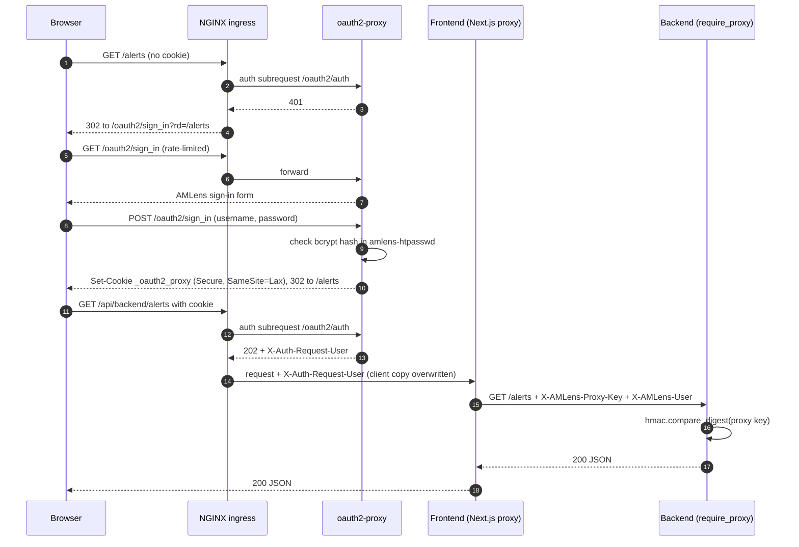

# Authentication

AMLens has no login code of its own. Authentication happens **in front of** the application at
the ingress, and the application trusts the signed-in user name only because it arrives through
a chain that the browser cannot forge. This page describes that chain in production (AKS), the
alternative for Container Apps, and local development.

## Summary

| Layer | Component | What it does |
|---|---|---|
| Edge | NGINX ingress (`amlens-nginx`) | For every request to `/`, asks oauth2-proxy whether the session is valid (`auth-url`); redirects to the sign-in page if not; copies the user headers onto the request |
| Sign-in | oauth2-proxy v7.7.1 | Shows the AMLens sign-in form, checks username/password against bcrypt hashes, sets a secure session cookie, answers auth subrequests with `X-Auth-Request-User` |
| App proxy | Next.js route `frontend/app/api/[service]/[...path]/route.ts` | Forwards `/api/backend/*` and `/api/rag/*` to the internal services with `X-AMLens-Proxy-Key` and `X-AMLens-User` |
| API | `backend/app/security.py` (`require_proxy` middleware) | Rejects any request without the correct proxy key (`401`); trusts `X-AMLens-User` only after the key matched |

Production facts on this page were **verified live** on 2026-11-25 where stated (oauth2-proxy
arguments, ingress annotations, `302` redirect for unauthenticated requests); everything else is
**from repository**.

## Request and sign-in sequence



## Edge: ingress and oauth2-proxy

The ingress `amlens-web` (all paths) carries these annotations (verified live):

| Annotation | Value | Effect |
|---|---|---|
| `nginx.ingress.kubernetes.io/auth-url` | `http://oauth2-proxy.amlens.svc.cluster.local:4180/oauth2/auth` | Every request is first checked by oauth2-proxy |
| `nginx.ingress.kubernetes.io/auth-signin` | `https://$host/oauth2/sign_in?rd=$escaped_request_uri` | Unauthenticated users are redirected to sign in and returned to where they were |
| `nginx.ingress.kubernetes.io/auth-response-headers` | `X-Auth-Request-Email,X-Auth-Request-User` | These headers from the auth response are set on the upstream request, **overwriting** any value the browser sent |

The ingress `amlens-oauth2` exposes `/oauth2/*` (sign-in, sign-out, callback) with
`limit-rpm: 20` and `limit-burst-multiplier: 2` per client IP, to slow down password guessing.
The ingress `amlens-health` exposes exactly `/api/backend/health` without authentication; it
returns status only, no data.

oauth2-proxy arguments that matter for security (verified live):

| Argument | Meaning |
|---|---|
| `--htpasswd-file=/etc/oauth2-proxy/htpasswd/users` | Accounts from Secret `amlens-htpasswd` (bcrypt hashes, mounted read-only) |
| `--display-htpasswd-form=true` | Show the username/password form |
| `--custom-templates-dir=/etc/oauth2-proxy/templates` | AMLens-branded sign-in page from ConfigMap `signin-templates`; it shows only the password form, no "Sign in with Microsoft" button |
| `--set-xauthrequest=true` | Return `X-Auth-Request-User` / `-Email` on auth responses |
| `--reverse-proxy=true` | Trust `X-Forwarded-*` from the ingress |
| `--cookie-secure=true`, `--cookie-samesite=lax` | Cookie only over HTTPS, not sent on cross-site POSTs |
| `--redirect-url=https://<host>/oauth2/callback`, `--whitelist-domain=<host>` | Redirects only to the AMLens host |
| `--upstream=static://202` | oauth2-proxy never proxies application traffic itself; it only answers auth checks |
| `--provider=oidc` with the Entra ID issuer, `--email-domain=*` | Entra ID configuration, present but unused while the button is hidden |

The session cookie is encrypted and signed with `cookie-secret` from Secret `amlens-oauth`.
oauth2-proxy defaults apply for lifetime (7 days) and refresh.

### Accounts

Accounts are created or reset with `bash deploy/aks/add-user.sh <username>`; see the
[runbook](../deployment/operations-runbook.md#add-or-reset-an-analyst-account). Only bcrypt
hashes (cost 12, `$2y$` prefix) are stored in the cluster. There are no roles: every signed-in
user has the same access.

Password logins have no e-mail address, so the user identity is the **username**, delivered in
`X-Auth-Request-User`.

### Why not Entra ID (yet)

`deploy.sh` registers an Entra ID application (`AMLens (<resource-group>)`) with *assignment
required*, and oauth2-proxy is configured for it. Using it requires a tenant administrator to
grant consent for the app, which is not available in the training tenant. To switch to Entra ID
once consent is granted:

1. Remove the three flags `--htpasswd-file`, `--display-htpasswd-form` and
   `--custom-templates-dir` (and the two volume mounts) from the oauth2-proxy Deployment in
   `deploy/aks/base/edge.yaml`.
2. Assign the analysts to the enterprise application (*Enterprise applications → AMLens →
   Users and groups*).
3. Re-run `deploy.sh`. The user identity then comes from the `preferred_username` claim (the
   Entra sign-in name) in `X-Auth-Request-Email`.

The client secret was created valid for one year; renew it before enabling Entra ID if it has
expired.

## App proxy: the Next.js route

All browser API calls go to the same origin: `/api/backend/<path>` and `/api/rag/<path>`. The
route handler in `frontend/app/api/[service]/[...path]/route.ts`:

- Maps `backend` → `AMLENS_BACKEND_URL` and `rag` → `AMLENS_RAG_URL` (read at request time, so
  one image works everywhere). Any other service name returns `404`.
- Re-encodes each path segment with `encodeURIComponent`, so `..`, `/` or `?` inside a segment
  cannot escape the upstream path.
- Forwards only `accept` and `content-type` request headers. Cookies and auth tokens are **not**
  forwarded to the backend.
- Adds `x-amlens-proxy-key: $AMLENS_PROXY_KEY`.
- Sets `x-amlens-user` from the first present of `x-ms-client-principal-name` (Container Apps
  Easy Auth), `x-auth-request-email`, `x-auth-request-user` (oauth2-proxy via NGINX).
- Returns `502 {"detail": "The <service> service is unreachable."}` if the upstream cannot be
  reached; otherwise passes status and body through with only `content-type`,
  `content-disposition` and `cache-control` headers.

Details: [Frontend proxy](../modules/frontend-proxy.md).

!!! warning "Why the user header can be trusted"
    The frontend trusts these headers because every path to the frontend pod goes through the
    ingress, which overwrites them. The `edge-from-ingress` NetworkPolicy allows traffic to the
    frontend only from the `app-routing-system` namespace. The `/api/backend/health` ingress
    path does not run the auth check, but it matches only that exact path and the health
    endpoint does not use the user.

## API: `require_proxy`

`backend/app/security.py` registers an HTTP middleware:

```python
OPEN_PATHS = {'/health'}

async def require_proxy(request, call_next):
    request.state.user = None
    key = os.getenv('AML_PROXY_KEY', '').strip()
    if key and request.url.path not in OPEN_PATHS and request.method != 'OPTIONS':
        sent = request.headers.get('x-amlens-proxy-key', '')
        if not hmac.compare_digest(sent.encode(), key.encode()):
            return JSONResponse({'detail': 'Not authenticated'}, status_code=401)
        request.state.user = request.headers.get('x-amlens-user') or None
    return await call_next(request)
```

- The comparison is constant-time (`hmac.compare_digest`).
- `X-AMLens-User` is read **only** after the key matched.
- `/health` stays open for Kubernetes probes; `OPTIONS` is allowed for CORS pre-flight.
- If `AML_PROXY_KEY` is unset, every request is accepted. This is the local development mode;
  production always sets it (Secret `amlens-app`).

The backend and the frontend read the key from the same Secret key (`amlens-app/AML_PROXY_KEY`),
and the `backend-from-frontend` NetworkPolicy allows only the frontend pod to reach the backend.

### Where the user name is used

When an analyst records a decision, the backend stores
`analyst_id = request.state.user or payload.analyst_id`: the signed-in name wins over anything
in the request body. The same value goes into the `DECISION_RECORDED` audit event, so the audit
trail shows who decided. See [Backend endpoints](../api-reference/endpoints.md).

## Container Apps alternative

In the [Container Apps design](../deployment/container-apps-design.md), Container Apps
authentication (Easy Auth) with Entra ID protects the frontend, excludes only
`/api/backend/health`, and injects `X-MS-CLIENT-PRINCIPAL-NAME`. The proxy and `require_proxy`
work unchanged. Some code comments (`security.py`, `route.ts`, `apps.yaml`, `edge.yaml`) still
describe Entra ID or Easy Auth as the sign-in; on AKS the active method is the oauth2-proxy
password form.

## Local development

- `npm`/`pnpm dev` with the backend on `localhost`: no sign-in, `AML_PROXY_KEY` unset, so the
  backend accepts all requests and `analyst_id` comes from the request body.
- `docker compose up --build` at the repository root sets the same proxy key on both containers
  (`AMLENS_PROXY_KEY`, default a local placeholder) and publishes only the frontend on
  `127.0.0.1:3100`, reproducing the production trust chain without sign-in.

See [Configuration](../getting-started/configuration.md) for the variables.
