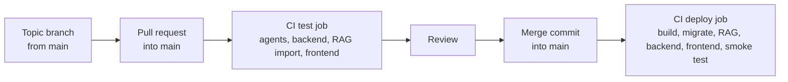

# Contributing

This page describes how changes get into AMLens: the conventions you can observe in the
repository, how to make the common kinds of change end to end, and a checklist for pull
requests. Where the repository has no explicit rule, the guidance is marked as a
**recommendation**.

## How a change reaches production



Every push to `main` is deployed to the live AKS environment by
`.github/workflows/ci-cd.yml` (through the `production` GitHub environment, where required
reviewers can gate releases). **Merging to `main` is releasing.** See
[CI/CD pipeline](../deployment/ci-cd.md).

## Repository conventions

### Branches

The default branch is **`main`**. Branch names in the repository follow a few patterns:

| Pattern | Examples in the repository | Used for |
|---|---|---|
| Team-member branches | `member1-backend`, `Member-2---RAG`, `member3-agents` | Each member's original component work |
| `feature/<topic>` | `feature/frontend`, `feature/postgres-migration` | Feature work |
| `fix/<topic>` | `fix/knowledge-base` | Bug fixes |
| `deploy/<topic>` | `deploy/azure-container-apps` | Deployment and infrastructure work |
| `docs/<topic>` | `docs/documentation-portal` | Documentation |
| `integration` | `integration` | Historical branch where the member branches were first merged together |

**Recommendation:** branch from an up-to-date `main` with a `feature/`, `fix/`, `deploy/` or
`docs/` prefix and a short kebab-case topic. New work should not target `integration`.

### Pull requests and merges

Changes reach `main` through GitHub pull requests merged with **merge commits** (for
example "Merge pull request #1 from silvrfur/feature/postgres-migration" and "#2 from
silvrfur/deploy/azure-container-apps"). The history is not squashed or rebased.

### Commit messages

Most commits use a short, imperative, sentence-case summary that explains the *why* as well
as the *what*, for example "Run each ingress controller with one replica on the small
sandbox nodes" or "Stop tracking compiled Python files and local databases". A few use a
Conventional Commits prefix (`feat(backend): …`). **Recommendation:** follow the
imperative sentence style; keep one logical change per commit.

### Line endings

`.gitattributes` forces **LF** for files that run inside Linux containers or Bash, even on
a Windows checkout with `core.autocrlf`:

```gitattributes
*.sh        text eol=lf
Dockerfile  text eol=lf
*.bicep     text eol=lf
*.yml       text eol=lf
```

A CRLF in one of these makes `sh` fail on `\r`. If you add another file type that runs in
Linux (for example a `.yaml` manifest, a `.sql` init script or an extension-less
entrypoint), add a matching rule. Note that `deploy/aks/` uses `.yaml`, which the current
rules do not cover.

### Secrets and generated files

- Never commit `.env`, `.env.*` or `frontend/.env.local`; only `*.env.example` templates are
  tracked. Never commit `deploy/aks/.credentials` or `deploy/aks/.kubeconfig`.
- `.gitignore` excludes `*.db` and `*.sqlite3` except the two shared sample databases
  `backend/aml.db` and `agents/data/synthetic_alerts.db`. Do not commit `agent_runtime.db`
  or `demo_runtime.db`.
- Do not commit `__pycache__/`, `.venv/`, `node_modules/`, `.next/` or the docs build
  output `site/`.

### Code style

There is no shared linter or formatter configuration. Observable conventions:

| Area | Convention |
|---|---|
| Python | Type hints on public functions, module docstrings that explain *why*, `pydantic` v2 models at boundaries, SQLAlchemy 2 ORM. The backend mostly uses single quotes; the agents package is compact. Match the file you are editing. |
| Money | Never floats: `Decimal` in Python, `Numeric` in PostgreSQL, decimal strings in JSON. |
| Agents | Provider SDKs only behind `agents/main.py:create_services` adapters; agents never instantiate clients. No agent may record a decision. |
| TypeScript | Strict mode (`tsconfig.json`), `@/` path alias, API calls only through `lib/api/client.ts`, which must keep a mock branch for every call. |
| Configuration | Environment variables only; secrets never in `NEXT_PUBLIC_*`. Document new variables in the service's `.env.example` and in [Configuration](../getting-started/configuration.md). |

## Making changes

### Add a feature end to end

A typical feature (for example a new field on an alert shown in the UI) touches every layer.
Work from the data outwards:

1. **Database** (if needed): change `backend/app/database/tables.py` and add an Alembic
   migration. See [Modify the database schema](#modify-the-database-schema).
2. **Backend**: add or change the route in `backend/app/api/` and the business logic in
   `backend/app/services/`. Keep response shapes explicit (see `alert_out` in
   `app/api/alerts.py`).
3. **Agents** (if the feature affects investigations): extend the schema in
   `agents/schemas/`, the agent in `agents/agents/`, and the verifier in
   `agents/verifier/report_verifier.py` together. The `AlertBundle` contract rejects extra
   properties on purpose, so schema drift is visible.
4. **RAG** (if it affects guidance search): change `RAG/app/` and, for index changes, the
   scripts in `RAG/scripts/`.
5. **Frontend**: add the type in `frontend/lib/api/types.ts`, the call in
   `lib/api/client.ts` **with both a mock branch and a live branch**, mock data in
   `lib/mocks/data.ts`, then the UI in `components/pages/`.
6. **Tests**: add backend and/or agent tests (see [Testing](../testing/index.md#adding-a-test)).
7. **Docs**: update the affected pages in `docs/` and any `.env.example`.
8. Verify locally in **mock mode and live mode**
   ([Local development](../getting-started/local-development.md)), then open the PR.

### Modify an API

The backend API is consumed by the frontend proxy and, for the RAG service, by the agents.
There is no versioning, and the deployment rolls out backend before frontend.

- **Prefer additive changes:** new optional fields, new endpoints. The frontend from the
  previous release keeps working while the new backend is already live.
- **Renaming or removing a field** needs a two-step change: add the new field and update the
  frontend, release, then remove the old field in a later release.
- Update the mapping in `frontend/lib/api/client.ts` (it translates backend shapes, for
  example `accepted` → `accepted_count`) and the types in `lib/api/types.ts`.
- If you change the RAG `/search` request or response, update
  `agents/services/rag_client.py` and `test_retrieval_agent.py::test_http_contract`.
- Routes must stay behind the proxy-key middleware; only `/health` is open. Do not add paths
  to `OPEN_PATHS` in `app/security.py` without a security review.
- Update [Backend endpoints](../api-reference/endpoints.md) and [Schemas](../api-reference/schemas.md).

### Modify the database schema

Tables are created and changed **only** by Alembic migrations in
`backend/alembic/versions/`. The backend refuses to start if the database head does not
match the code.

=== "PowerShell"

    ```powershell
    $env:PYTHONPATH = (Get-Location).Path
    cd backend
    # 1. Edit app/database/tables.py, then generate a draft migration:
    ..\.venv\Scripts\alembic revision --autogenerate --rev-id 0003_alert_priority -m "add alert priority"
    # 2. Review and edit the generated file (autogenerate is a draft, not a final migration).
    # 3. Apply it and test the round trip:
    ..\.venv\Scripts\alembic upgrade head
    ..\.venv\Scripts\alembic downgrade -1
    ..\.venv\Scripts\alembic upgrade head
    ..\.venv\Scripts\python -m pytest tests\test_migrations.py -q
    ```

=== "Bash"

    ```bash
    export PYTHONPATH="$(pwd)"      # run from the repository root
    cd backend
    ../.venv/bin/alembic revision --autogenerate --rev-id 0003_alert_priority -m "add alert priority"
    ../.venv/bin/alembic upgrade head
    ../.venv/bin/alembic downgrade -1
    ../.venv/bin/alembic upgrade head
    ../.venv/bin/python -m pytest tests/test_migrations.py -q
    ```

!!! danger "Migrations must be backward compatible"
    In production, migrations run as a separate job **before** the new backend starts
    (`RUN_MIGRATIONS=false` on the app; `deploy/aks/rollout.sh` runs the `migrate` Job
    first). For a while, the **previous** backend runs against the **new** schema. So:

    - Add tables and nullable columns (or columns with server defaults) first.
    - Remove or rename columns only in a **later** release, after no running code uses them.
    - Backfill data in a migration (as `0002_alert_status_backfill.py` does) rather than at
      application start.
    - Always implement `downgrade()`; `test_upgrade_downgrade_roundtrip` checks it.

`test_models_match_migrations` fails if `tables.py` and the migrations disagree, so commit
the model change and the migration together. Existing revisions use numbered IDs (`revision = '0001_initial'`,
`'0002_alert_status'`, files `0001_initial_schema.py`, `0002_alert_status_backfill.py`);
**recommendation:** keep that pattern by passing `--rev-id`, and rename the generated file
to match. `0003_alert_priority` above is only an example. More detail: [Migrations](../database/migrations.md).

The agents' runtime store (`agent_runtime` schema or SQLite) is created by the agents
package itself (`agents/services/postgres_service.py`, `sqlite_service.py`), not by Alembic.
Changes there must also tolerate existing data.

### Add tests

Every behaviour change should come with a test in the matching suite. See
[Testing → Adding a test](../testing/index.md#adding-a-test) for fixtures and examples. Rules
the suites enforce:

- Agent tests must not open network connections (an autouse fixture fails them).
- Backend database tests use the throwaway `TEST_DATABASE_URL` and the `clean_db` fixture.
- Neither suite may call live Azure services.

### Add a configuration variable

1. Read it in one place (`agents/config.py` for agent settings; a small helper next to the
   code for the backend).
2. Give it a safe default for local development (mocks on, security checks off only when
   unset is clearly "local").
3. Add it to the service's `.env.example` with a comment, to
   [Configuration](../getting-started/configuration.md), and, for deployed services, to
   `deploy/aks/base/apps.yaml` (and `infra/main.bicep` if the Container Apps design should
   stay in sync). Secrets go in Kubernetes Secrets via `deploy/aks/deploy.sh`, never in
   manifests.

## Debugging

| Situation | Where to look |
|---|---|
| Backend request fails | Uvicorn console; Swagger UI at `http://127.0.0.1:8000/docs` to call the endpoint directly without the frontend. |
| Frontend shows a toast error | The toast is the backend's `detail` message. Check the browser network tab for `/api/backend/...`; a `502` means the proxy cannot reach the service, a `404 "not configured"` means `AMLENS_BACKEND_URL` is unset. |
| Investigation fails or is "incomplete" | `GET /investigations/{id}` returns verification errors and the execution trace; `GET /audit/{id}` the audit trail. Agent runs live in `backend/agent_runtime.db` (SQLite) locally. |
| Reproduce an agent run without the UI | From `backend/`: `python phase4_run.py <ALERT_ID>` (mock LLM/RAG, read-only on the source data). |
| Inspect the database | From `backend/`: `python scripts/inspect_db.py` (tables and counts), `python scripts/inspect_db.py alerts 50`, or a `SELECT` string. Every query is read-only. |
| An alert will not convert for the agents | `python scripts/check_alerts.py [DATASET_ID]` |
| Guidance search returns nothing | `curl http://127.0.0.1:8001/health` shows the active backend; call `POST /search` in the RAG Swagger UI (`:8001/docs`). Scores below the threshold are dropped. |
| Service health shows "degraded" RAG | `USE_MOCK_RAG` is still true in `backend/.env`. |
| Production | [Operations runbook](../deployment/operations-runbook.md) and [Monitoring](../monitoring/index.md): `kubectl -n amlens logs deploy/backend`. |

Use your IDE's debugger by launching Uvicorn as a Python module (`-m uvicorn app.main:app`)
with `backend/` as the working directory and `PYTHONPATH` set to the repository root.

## Pull request checklist

Copy this into your PR description and tick what applies.

- [ ] Branch is up to date with `main`; the PR targets `main`.
- [ ] Agent tests pass: `python -m pytest agents/tests -q` (with `PYTHONPATH` set).
- [ ] Backend tests pass against the Docker database: `cd backend; python -m pytest -q`, with **no unexpected skips**.
- [ ] Frontend: `pnpm exec tsc --noEmit` and `pnpm build` pass (with `NEXT_PUBLIC_USE_MOCKS=false`, as in CI).
- [ ] New behaviour has tests; bug fixes have a regression test.
- [ ] Schema changes: model and migration committed together, `downgrade()` implemented, migration is **backward compatible** with the previous release.
- [ ] API changes are additive, or the two-step rename/remove plan is described.
- [ ] Frontend API changes have both a mock and a live branch in `lib/api/client.ts`.
- [ ] No secrets, `.env` files, local databases, credentials or kubeconfigs in the diff.
- [ ] New environment variables are in the `.env.example`, the [Configuration](../getting-started/configuration.md) page and the deployment manifests.
- [ ] Files that run in Linux containers or Bash have LF line endings.
- [ ] No agent path can record an investigator decision; reports still pass the verifier.
- [ ] Docs updated (`mkdocs build` passes; the site is `strict`).
- [ ] Tested by hand in mock mode **and** against the live local stack where relevant.

!!! tip "Remember: merging deploys"
    Once the PR merges, CI builds the images, runs migrations and rolls out to production.
    If the change is risky, ask a reviewer to watch the deploy job and the
    [health check](../monitoring/index.md).
