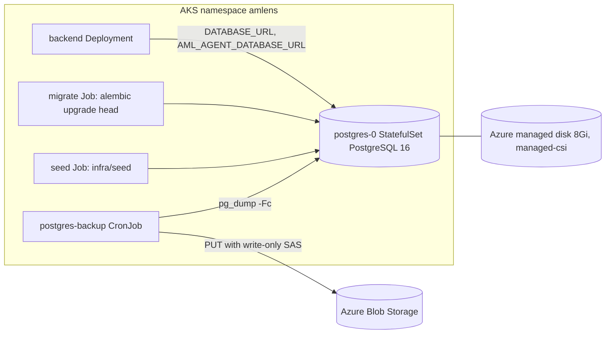
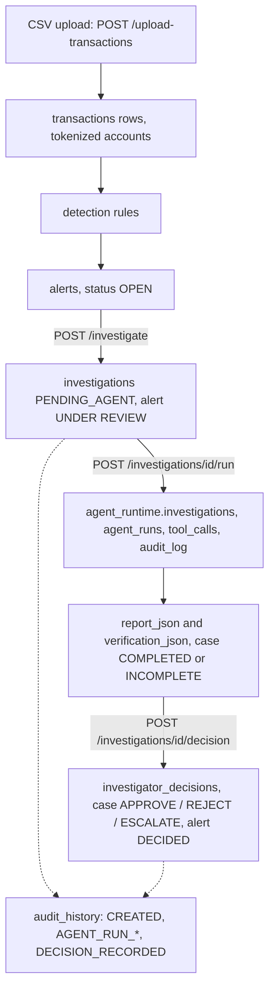

# Database overview

AMLens stores all of its persistent state in **one PostgreSQL 16 database**, in two separate
schemas:

| Schema | Owner | Contents | Schema management |
|---|---|---|---|
| `public` | Backend (`backend/app/database/tables.py`) | Transactions, alerts, investigations (cases), investigator decisions, report versions, the backend audit history | **Alembic** migrations (`backend/alembic/versions`) |
| `agent_runtime` | Agents (`agents/services/postgres_service.py`) | Agent investigation records with the report JSON, per-agent runs, tool calls, the agent audit log | Created **at runtime** with `CREATE ... IF NOT EXISTS`. Not managed by Alembic. |

The two schemas both have a table called `investigations`. That is why the agents keep their
tables in a schema of their own. The tables and columns are described in [Schema](schema.md),
and the migration process in [Migrations](migrations.md).

## Production: PostgreSQL on AKS



- **Server.** `deploy/aks/base/postgres.yaml` runs an in-cluster StatefulSet `postgres` (one replica, image `postgres:16-alpine` imported into ACR). The database is `amlens`, the user is `amlens`, and the password comes from the `amlens-db` Secret (`POSTGRES_PASSWORD`). The sandbox subscription does not allow Azure Database for PostgreSQL, which is why the database runs in the cluster.
- **Storage.** A PersistentVolumeClaim from `volumeClaimTemplates`: 8 GiB, `ReadWriteOnce`, storage class `managed-csi` (an Azure managed disk). `PGDATA=/var/lib/postgresql/data/pgdata`.
- **Network.** The `postgres-from-db-clients` NetworkPolicy allows port 5432 only from pods labelled `amlens.io/db-client: "true"`: the backend, and the migrate, seed and backup jobs. There is no public endpoint.
- **Backups.** `deploy/aks/base/backup.yaml` defines the CronJob `postgres-backup`, scheduled at `30 20 * * *` (20:30 UTC, which is 02:00 IST), with `concurrencyPolicy: Forbid`. An init container runs `pg_dump -h postgres -U amlens -d amlens -Fc`. A curl container then uploads the dump to Azure Blob Storage as `amlens-<UTC timestamp>.dump`, using `BACKUP_CONTAINER_URL` and `BACKUP_SAS` from the `amlens-backup` Secret. The SAS allows only create and write, so the cluster cannot read or delete existing backups. Retention is a lifecycle rule on the storage account, set by `deploy.sh`.
- **Agent store.** The backend sets `AML_AGENT_DATABASE_URL` to the same value as `DATABASE_URL`, so agent runs are kept in the `agent_runtime` schema of the same database. Container disks are wiped on restart, so a SQLite file would not survive there.

The dumps are in PostgreSQL custom format (`-Fc`), so you restore them with `pg_restore`. For
operational procedures, see the [Operations runbook](../deployment/operations-runbook.md).

## Connection configuration

Only the variable **names** are listed here. The values live in Kubernetes Secrets (`amlens-db`,
`amlens-app`) or in a local, git-ignored `backend/.env`. See
[Configuration](../getting-started/configuration.md).

| Variable | Used by | Purpose |
|---|---|---|
| `DATABASE_URL` | Backend, Alembic, migrate Job | Main database. It **must** be PostgreSQL: `postgres://`, `postgresql://` and `postgresql+psycopg://` are all normalized to the psycopg 3 driver, and anything else, including SQLite, raises an error at startup. |
| `DB_POOL_SIZE` / `DB_MAX_OVERFLOW` | Backend | SQLAlchemy pool sizes (defaults 5 and 10). The pool also uses `pool_pre_ping`, `pool_recycle=1800`, `connect_timeout=10`, `application_name=amlens-backend`, and the session time zone `UTC`. |
| `AML_SOURCE_DATABASE_URL` | Agents adapter (`TeamBackend`) | Optional SELECT-only login for the agents' reads of `transactions` and `alerts`. Defaults to `DATABASE_URL`. Reads are `READ ONLY` transactions either way. |
| `AML_AGENT_DATABASE_URL` | Agent runtime store | PostgreSQL URL for the `agent_runtime` schema. If unset, the SQLite file below is used. |
| `AML_AGENT_DATABASE_PATH` | Agent runtime store (local) | SQLite file for agent runs when `AML_AGENT_DATABASE_URL` is unset. Default `./agent_runtime.db`. |
| `TOKEN_SECRET` | Backend ingestion | HMAC key for account tokenization (at least 32 characters). It must stay the same for the lifetime of the data. See [Schema](schema.md). |
| `AML_SOURCE_TIMEZONE` | Agents adapter | The time zone of the naive `transactions.timestamp` values (`UTC` on AKS) |
| `DATABASE_URL_LIBPQ` (Secret key) | seed Job | A plain libpq URL for `psql` |
| `TEST_DATABASE_URL` | Backend tests | A throwaway PostgreSQL database. Database tests are skipped without it. |

For local development, `backend/docker-compose.yml` starts `postgres:16` on `127.0.0.1:5433`, with
development-only credentials. On first start it also creates the `amlens_test` database
(`backend/scripts/docker-init-test-db.sql`). Use `127.0.0.1` rather than `localhost` in URLs: on
Windows, `localhost` may try IPv6 first and stall.

## SQLite files in the repository

SQLite is **not** used for the main data any more. A few SQLite files remain in the repository:

| File | Tracked in git? | What it is |
|---|---|---|
| `backend/aml.db` | Yes (explicitly un-ignored) | The **legacy** SQLite main database from before the move to PostgreSQL. It holds 1,006 transactions, 47 alerts, 1 investigation, 1 decision and 2 audit events. It is the source for `backend/scripts/migrate_sqlite_to_postgres.py` (a one-time, read-only copy into an empty PostgreSQL database) and for `infra/seed/make-seed.sh`, which builds `infra/seed/seed.sql`. The application never opens it. |
| `agents/data/synthetic_alerts.db` | Yes | Sample data for the **standalone** agents package: 2 alerts and 6 transactions, using the agents' own SQLite schema. It is the default `DATABASE_URL` of `agents.config.Settings` (`sqlite:///./data/synthetic_alerts.db`) and is used by the mock backend, the demo and the agents tests. Production never reads it. |
| `backend/agent_runtime_check.db` | No (`backend/.gitignore`) | A local agent runtime store left behind by a developer check run. It can be deleted safely. |
| `agent_runtime.db` (created on demand) | No | The default local agent runtime store when `AML_AGENT_DATABASE_URL` is unset |

## Data lifecycle



1. **Upload.** `ingest_csv` hashes the file into a `dataset_id`, validates the rows, tokenizes account identifiers and inserts `transactions`. The raw file and the `Is Laundering` labels are not stored.
2. **Alerts.** In the same database transaction, the rules (`HIGH_VALUE`, `REPEATED_PAIR`, `RAPID_MOVEMENT_CANDIDATE`) insert `alerts` with `status = 'OPEN'`.
3. **Investigation.** Opening a case inserts `investigations` (`PENDING_AGENT`) and a `CREATED` row in `audit_history`, and moves the alert to `UNDER REVIEW`.
4. **Agent run.** The agents read the source rows read-only, then write `agent_runtime.investigations` (holding a lease), one `agent_runs` row per node, `tool_calls` and `audit_log`. The final report and verification are stored as JSON text on the agent investigation row. The backend updates the case status and writes `AGENT_RUN_*` audit events.
5. **Report versions.** The `report_versions` table exists in the schema (and is copied by the seed and SQLite migration scripts and cleaned up by `remove-dataset.sh`), but **no current code path writes to it**. Reports are read from `agent_runtime.investigations.report_json`.
6. **Decision.** Inserts `investigator_decisions`, sets the case status to the decision, sets the alert to `DECIDED`, and writes a `DECISION_RECORDED` audit event.
7. **Audit.** `audit_history` (backend) and `agent_runtime.audit_log` (agents) are append-only in the application. No API updates or deletes them.

There is no automatic retention or purge. Data stays until it is removed by hand.

### Removing a dataset

`deploy/aks/remove-dataset.sh` removes **one** uploaded dataset and everything derived from it in
the live AKS database, so that a demo file can be uploaded again:

```bash
bash deploy/aks/remove-dataset.sh backend/examples/<file>.csv           # dry run (default)
bash deploy/aks/remove-dataset.sh <20-hex dataset id> --apply           # really delete
```

The script computes the same dataset ID as the upload (the first 20 hex characters of the file's
SHA-256). Through `kubectl exec` into `postgres-0` it runs a single `psql` transaction that deletes, in
foreign-key order: `agent_runtime.tool_calls`, `agent_runs`, `audit_log` and `investigations`,
then `audit_history`, `report_versions`, `investigator_decisions`, `investigations`, `alerts` and
`transactions`. A dry run prints the counts and rolls back. The script also deletes the dataset's
audit trail, so use it only for demo or rehearsal data.

## Initialization

A new environment is initialized in this order:

1. **Schema.** Run `alembic upgrade head` from `backend/`. On AKS, the `migrate` Job (`deploy/aks/jobs/migrate.yaml`) does this before every rollout. The backend refuses to start if the database revision differs from the code's Alembic head (`assert_schema_current` in `backend/app/database/schema_check.py`). See [Migrations](migrations.md).
2. **Agent runtime schema.** No step is needed. The first `PostgresService` created by a process runs the `agent_runtime` DDL under `pg_advisory_xact_lock(hashtext('agent_runtime_schema'))`, so replicas that start together do not race.
3. **Sample data (optional).** The `seed` Job (`deploy/aks/jobs/seed.yaml`) runs the `amlens-seed` image built from `infra/seed/`. Its `load.sh` loads `seed.sql` (a data-only `pg_dump` of the legacy `aml.db` after migration, without `alembic_version`) in one transaction, and skips the load if `alerts` already has rows. `seed.sql` is generated locally with `bash infra/seed/make-seed.sh` (against the local docker PostgreSQL) and is git-ignored. `deploy/aks/deploy.sh` builds the seed image and runs the Job only when `SEED=1`.
4. **Read-only role (optional).** `backend/scripts/create_readonly_role.sql` creates the `amlens_reader` login with `CONNECT` on the `amlens` database, `USAGE` on schema `public`, and `SELECT` on `transactions` and `alerts` only. Run it as the database owner **after** `alembic upgrade head`, passing the password as a psql variable (`-v reader_password="'...'"`). Then point `AML_SOURCE_DATABASE_URL` at that login so the agents' reads cannot write even by mistake.

For local development the same steps apply: `docker compose up -d` in `backend/`, set
`DATABASE_URL`, run `alembic upgrade head`, and optionally run
`python scripts/migrate_sqlite_to_postgres.py` to copy `aml.db`. See
[Local development](../getting-started/local-development.md).
