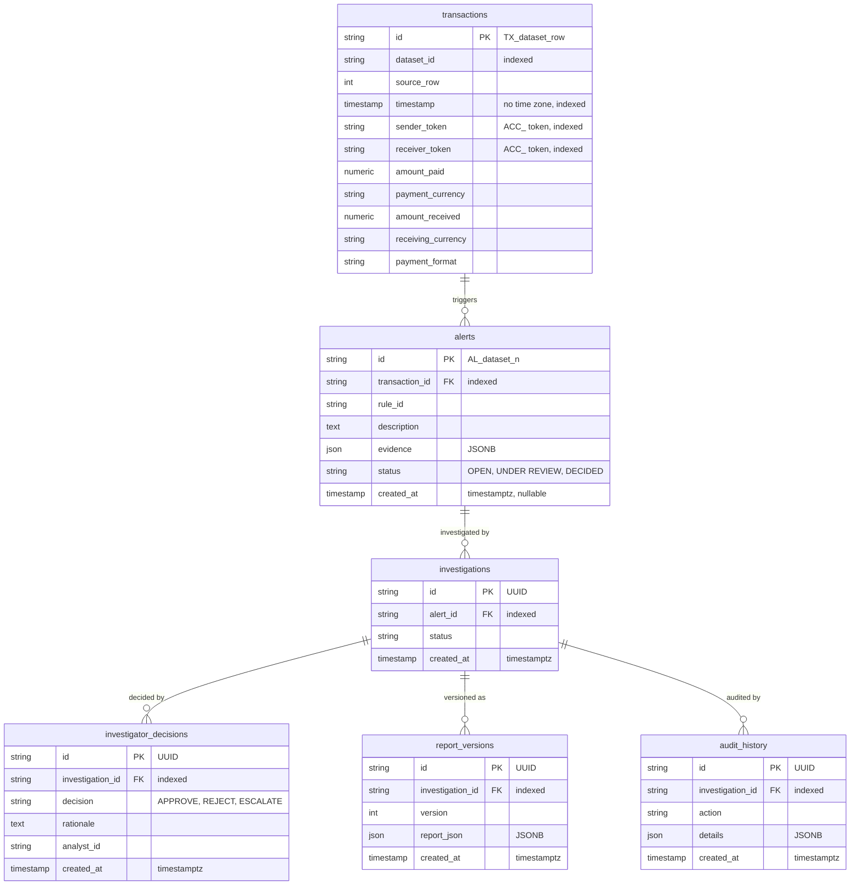
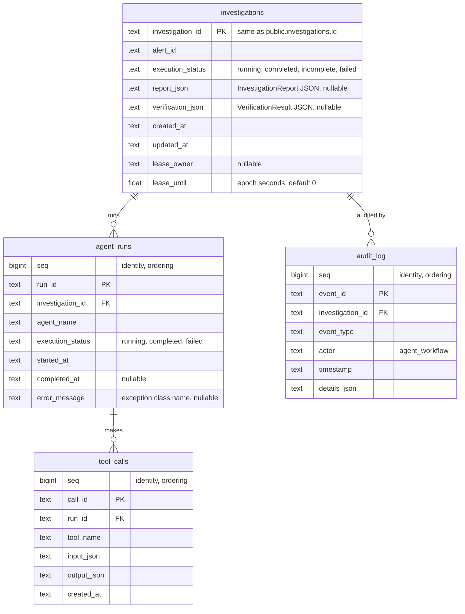

# Database schema

The PostgreSQL database `amlens` has two application schemas:

- **`public`**: the backend's tables, defined in `backend/app/database/tables.py` and created by the Alembic migration `0001_initial`. It contains 6 tables plus Alembic's `alembic_version`.
- **`agent_runtime`**: the agents' tables, created at runtime by `agents/services/postgres_service.py`. It contains 4 tables.

Column names in `public` are part of the contract with the API and with the agents' adapter
(`backend/app/integrations/team_backend.py`), so do not rename them casually. Any change goes
through an Alembic migration (see [Migrations](migrations.md)).

## Main schema (`public`)



Conventions for all `public` tables:

- Every column is `NOT NULL` except `alerts.created_at`.
- Defaults (`alerts.status = 'OPEN'`, `investigations.status = 'PENDING_AGENT'`, and `created_at = now()` in UTC) are applied by the **ORM** (Python-side `default=`). The migration declares **no server defaults**, so raw `INSERT`s must supply every value.
- Primary keys are strings generated by the application, never sequences.
- Primary key and foreign key constraints use PostgreSQL's default names (for example `alerts_pkey` and `alerts_transaction_id_fkey`). Foreign keys have no `ON DELETE` action, so rows must be deleted child-first (see `deploy/aks/remove-dataset.sh`).
- `timestamptz` columns are written in UTC. The backend's connections use `-c timezone=UTC`.

### transactions

One row per accepted CSV row. Written only by `POST /upload-transactions`.

| Column | Type | Null | Default | Key / index | Description |
|---|---|---|---|---|---|
| `id` | `varchar(80)` | no | | PK | `TX_<dataset_id>_<source_row>` |
| `dataset_id` | `varchar(64)` | no | | `ix_transactions_dataset_id` | The first 20 hex characters of the SHA-256 of the uploaded file |
| `source_row` | `integer` | no | | | The line in the file (the header is line 1) |
| `timestamp` | `timestamp` (without time zone) | no | | `ix_transactions_timestamp` | Source-local time. `AML_SOURCE_TIMEZONE` says which zone. |
| `sender_token` | `varchar(36)` | no | | `ix_transactions_sender_token` | Tokenized `From Bank` + `Account` |
| `receiver_token` | `varchar(36)` | no | | `ix_transactions_receiver_token` | Tokenized `To Bank` + `Account.1` |
| `amount_paid` | `numeric(24,8)` | no | | | |
| `payment_currency` | `varchar(40)` | no | | | Currency name, for example `US Dollar` |
| `amount_received` | `numeric(24,8)` | no | | | |
| `receiving_currency` | `varchar(40)` | no | | | |
| `payment_format` | `varchar(40)` | no | | | `Cheque`, `Credit Card`, `ACH`, `Cash`, `Reinvestment`, `Wire` or `Bitcoin` |

Constraints: `transactions_dataset_id_source_row_key` UNIQUE (`dataset_id`, `source_row`).
The ground-truth `Is Laundering` column is deliberately **not** stored.

### alerts

Rule findings, created in the same transaction as the upload.

| Column | Type | Null | Default | Key / index | Description |
|---|---|---|---|---|---|
| `id` | `varchar(80)` | no | | PK | `AL_<dataset_id>_<n>` |
| `transaction_id` | `varchar(80)` | no | | FK → `transactions.id`, `ix_alerts_transaction_id` | Triggering transaction |
| `rule_id` | `varchar(50)` | no | | | `HIGH_VALUE`, `REPEATED_PAIR` or `RAPID_MOVEMENT_CANDIDATE` |
| `description` | `text` | no | | | |
| `evidence` | `jsonb` | no | | | Rule-specific evidence (see [Schemas](../api-reference/schemas.md)) |
| `status` | `varchar(24)` | no | ORM: `'OPEN'` | | Alert lifecycle status |
| `created_at` | `timestamptz` | **yes** | ORM: now (UTC) | | Nullable only for legacy alerts. The agents' adapter refuses alerts without it. |

### investigations

One row per investigation case. Several cases may exist for the same alert.

| Column | Type | Null | Default | Key / index | Description |
|---|---|---|---|---|---|
| `id` | `varchar(36)` | no | | PK | UUID4. The same value is used as `agent_runtime.investigations.investigation_id`. |
| `alert_id` | `varchar(80)` | no | | FK → `alerts.id`, `ix_investigations_alert_id` | |
| `status` | `varchar(32)` | no | ORM: `'PENDING_AGENT'` | | Case status |
| `created_at` | `timestamptz` | no | ORM: now (UTC) | | |

### investigator_decisions

The human decision on a case. The API allows one per investigation, but this is **enforced in code,
not by a unique constraint**.

| Column | Type | Null | Default | Key / index | Description |
|---|---|---|---|---|---|
| `id` | `varchar(36)` | no | | PK | UUID4 |
| `investigation_id` | `varchar(36)` | no | | FK → `investigations.id`, `ix_investigator_decisions_investigation_id` | |
| `decision` | `varchar(32)` | no | | | `APPROVE`, `REJECT` or `ESCALATE` |
| `rationale` | `text` | no | | | 10–5000 characters (validated by the API) |
| `analyst_id` | `varchar(100)` | no | | | The signed-in user name passed on by the proxy (`X-AMLens-User`), or the request value in local mode |
| `created_at` | `timestamptz` | no | ORM: now (UTC) | | |

### report_versions

Intended to hold versioned report snapshots.

| Column | Type | Null | Default | Key / index | Description |
|---|---|---|---|---|---|
| `id` | `varchar(36)` | no | | PK | |
| `investigation_id` | `varchar(36)` | no | | FK → `investigations.id`, `ix_report_versions_investigation_id` | |
| `version` | `integer` | no | | | |
| `report_json` | `jsonb` | no | | | |
| `created_at` | `timestamptz` | no | ORM: now (UTC) | | |

!!! note "Currently unused"
    No application code writes to `report_versions` today. Reports are stored by the agents in
    `agent_runtime.investigations.report_json` and read from there by
    `GET /investigations/{id}/report`. The table is kept for compatibility: the seed, the SQLite
    migration script and `remove-dataset.sh` all handle it.

### audit_history

The backend's append-only audit trail, served by `GET /audit/{id}`.

| Column | Type | Null | Default | Key / index | Description |
|---|---|---|---|---|---|
| `id` | `varchar(36)` | no | | PK | UUID4 |
| `investigation_id` | `varchar(36)` | no | | FK → `investigations.id`, `ix_audit_history_investigation_id` | |
| `action` | `varchar(70)` | no | | | `CREATED`, `AGENT_RUN_REQUESTED`, `AGENT_RUN_FINISHED`, `AGENT_RUN_FAILED` or `DECISION_RECORDED` |
| `details` | `jsonb` | no | | | Action-specific (see [Backend endpoints](../api-reference/endpoints.md)) |
| `created_at` | `timestamptz` | no | ORM: now (UTC) | | |

### alembic_version

Alembic's bookkeeping table, with one column `version_num`. The current head is `0002_alert_status`.
The backend compares it with the code's head at startup.

## Agent runtime schema (`agent_runtime`)



Created by `PostgresService.__init__` the first time each process opens a given URL. The DDL is
`CREATE SCHEMA IF NOT EXISTS agent_runtime` followed by `CREATE TABLE IF NOT EXISTS ...`, run under
`pg_advisory_xact_lock(hashtext('agent_runtime_schema'))`. Connections use
`search_path=agent_runtime`. Agent SQL is written with SQLite-style `?` placeholders, which the
wrapper converts to `%s`.

Conventions for all `agent_runtime` tables:

- Timestamps are **text** in the form `YYYY-MM-DD HH:MM:SS`, in UTC (`agents/services/timeutil.py`). This is the same format SQLite's `datetime('now')` produces, so one SQL dialect works on both stores.
- JSON is stored as **text**, not `jsonb`.
- The `seq` identity columns preserve insertion order. `PostgresService.order_column = "seq"`, while SQLite uses `rowid`.
- There is **no foreign key** between `agent_runtime.investigations.investigation_id` and `public.investigations.id`. The link is logical, and the backend checks that `alert_id` matches (otherwise it returns a `409`).
- Every column is `NOT NULL` except those marked nullable.

### agent_runtime.investigations

One row per investigation run by the agents. It holds the report and the run lease.

| Column | Type | Null | Default | Description |
|---|---|---|---|---|
| `investigation_id` | `text` | no | | PK |
| `alert_id` | `text` | no | | |
| `execution_status` | `text` | no | | `running`, `completed`, `incomplete` or `failed` |
| `report_json` | `text` | yes | | Serialized `InvestigationReport` |
| `verification_json` | `text` | yes | | Serialized `VerificationResult` |
| `created_at` | `text` | no | | |
| `updated_at` | `text` | no | | |
| `lease_owner` | `text` | yes | | UUID of the run that holds the lease |
| `lease_until` | `double precision` | no | `0` | Unix time when the lease expires (`LEASE_SECONDS`, default 900). It is reset to 0 on save. |

The lease works like this:

1. `Persistence.claim()` takes `pg_advisory_xact_lock(hashtext(<investigation_id>))`. SQLite uses `BEGIN IMMEDIATE` instead.
2. If the row is `completed` or `incomplete`, the run is skipped.
3. If the row is `running` with an unexpired lease, `InvestigationBusy` is raised.
4. Otherwise a new lease is taken.
5. `save()` updates the row only `WHERE lease_owner = <owner>`. A stale writer gets `LostLease`.

### agent_runtime.agent_runs

One row per workflow node execution (`transaction`, `retrieval`, `evidence`, `information_gap`,
`report`, `verify`, `correction` or `reverify`). Served as `agent_execution_trace`.

| Column | Type | Null | Default | Key / index | Description |
|---|---|---|---|---|---|
| `seq` | `bigint` | no | identity (`GENERATED ALWAYS`) | | Ordering |
| `run_id` | `text` | no | | PK | UUID4 |
| `investigation_id` | `text` | no | | FK → `investigations`, index `runs_investigation` | |
| `agent_name` | `text` | no | | | Node name |
| `execution_status` | `text` | no | | | `running`, then `completed` or `failed` |
| `started_at` | `text` | no | | | |
| `completed_at` | `text` | yes | | | |
| `error_message` | `text` | yes | | | Exception **class name** only, for example `StructuredOutputValidationError`. Messages are never stored, because they could echo secrets or PII. |

### agent_runtime.tool_calls

One row per external tool attempt counted against the run's budget (at most 8 per run, from
`ToolBudget` in `agents/services/audit_service.py`).

| Column | Type | Null | Default | Key / index | Description |
|---|---|---|---|---|---|
| `seq` | `bigint` | no | identity | | |
| `call_id` | `text` | no | | PK | UUID4 |
| `run_id` | `text` | no | | FK → `agent_runs.run_id` (not indexed) | |
| `tool_name` | `text` | no | | | Must be in `ALLOWED_TOOLS` |
| `input_json` | `text` | no | | | Currently always `{}` |
| `output_json` | `text` | no | | | Currently always `{"status":"attempted"}` |
| `created_at` | `text` | no | | | |

### agent_runtime.audit_log

The agents' own append-only audit trail. The backend API does not expose it directly, but
`Persistence.get()` returns it as `audit_history`.

| Column | Type | Null | Default | Key / index | Description |
|---|---|---|---|---|---|
| `seq` | `bigint` | no | identity | | |
| `event_id` | `text` | no | | PK | UUID4 |
| `investigation_id` | `text` | no | | FK → `investigations`, index `audit_investigation` | |
| `event_type` | `text` | no | | | `agent_execution` (per node: `{agent, status, error}`), `verification` (the `VerificationResult`), `persisted` (`{status, errors, trace}`) |
| `actor` | `text` | no | | | Always `agent_workflow` |
| `timestamp` | `text` | no | | | |
| `details_json` | `text` | no | | | JSON |

### SQLite variant

When `AML_AGENT_DATABASE_URL` is unset, `agents/services/sqlite_service.py` creates the same four
tables in a SQLite file, with these differences:

- No `seq` columns. Rows are ordered by `rowid`.
- `lease_until` is `REAL`.
- `PRAGMA journal_mode=WAL` and `foreign_keys=ON` are set.
- There is no `audit_investigation` index.
- Two **extra** tables, `transactions` and `alerts`, are created for the standalone agents' mock and SQLite backends. `transactions` has `transaction_type CHECK IN ('deposit','withdrawal')` and an `account_history(account_token, timestamp)` index. These tables are not related to the backend's `public` tables of the same names.

## Status values

| Entity | Column | Values | Transitions |
|---|---|---|---|
| Alert | `alerts.status` | `OPEN`, `UNDER REVIEW`, `DECIDED` | `OPEN` → `UNDER REVIEW` when an investigation is opened. Any status → `DECIDED` when a decision is recorded. Never moves backwards. Migration `0002` backfilled older rows. |
| Case | `investigations.status` | `PENDING_AGENT`, `RUNNING`, `COMPLETED`, `INCOMPLETE`, `FAILED`, `APPROVE`, `REJECT`, `ESCALATE` | `PENDING_AGENT` → `RUNNING` → `COMPLETED` / `INCOMPLETE` / `FAILED`. `FAILED` can run again. A busy or conflicting run returns to `PENDING_AGENT`. A decision sets the decision value. |
| Decision | `investigator_decisions.decision` | `APPROVE`, `REJECT`, `ESCALATE` | `APPROVE` only on a `completed` run whose verification passed |
| Agent run | `agent_runtime.investigations.execution_status` | `running`, `completed`, `incomplete`, `failed` | `completed` = verified, `incomplete` = failed verification after one correction, `failed` = error |
| Agent node | `agent_runtime.agent_runs.execution_status` | `running`, `completed`, `failed` | |
| Backend audit | `audit_history.action` | `CREATED`, `AGENT_RUN_REQUESTED`, `AGENT_RUN_FINISHED`, `AGENT_RUN_FAILED`, `DECISION_RECORDED` | |
| Agent audit | `audit_log.event_type` | `agent_execution`, `verification`, `persisted` | |

None of these values is enforced by a database `CHECK` constraint or enum type. They are plain
`varchar` or `text` columns, validated by the application.

## Tokenization of account identifiers

Raw bank and account numbers are **never stored**. During ingestion, `account_token()` in
`backend/app/utils/tokenization.py` replaces each (bank, account) pair:

```text
payload = f"{len(bank)}:{bank}{len(account)}:{account}"     # length-prefixed, no ambiguity
token   = "ACC_" + HMAC-SHA256(TOKEN_SECRET, payload).hexdigest()[:24]
```

- `TOKEN_SECRET` must be at least 32 characters. Otherwise ingestion raises `RuntimeError` and the upload fails with `500`.
- Tokens are deterministic. The same account always gets the same token **as long as `TOKEN_SECRET` does not change**, which is what lets the account history and the rules link transactions across uploads and datasets. If you rotate the secret, newly uploaded data no longer matches existing tokens. The SQLite-to-PostgreSQL copy keeps tokens as they are, so keep using the same secret.
- Tokens are 28 characters long and fit `varchar(36)`. They appear in `sender_token`, `receiver_token`, alert `evidence`, the agents' `account_token` and `counterparty_token`, and the report's `alert_summary.account_id`.
- An HMAC cannot be reversed without the secret, so the database alone does not reveal account numbers. Anyone who holds `TOKEN_SECRET` and a candidate account number can still confirm a match. Treat the secret as sensitive (see [Security](../security/index.md)).
