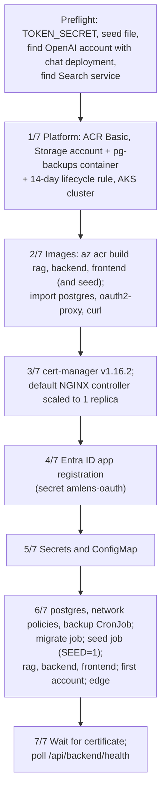

# AKS deployment

Everything needed to stand up AMLens on Azure Kubernetes Service lives in `deploy/aks/`. One
script, `deploy.sh`, creates the platform and the first release; `rollout.sh` ships later
releases (and is what CI runs). This page explains both scripts and every manifest. For the
live state of the cluster see [Production environment](index.md); for step-by-step procedures
see the [Operations runbook](operations-runbook.md).

## Files

| Path | Purpose |
|---|---|
| `deploy/aks/deploy.sh` | Idempotent full deployment: platform, images, add-ons, secrets, workloads, sign-in, health check |
| `deploy/aks/rollout.sh` | Routine release: build images → migrate → roll out RAG, backend, frontend → smoke test |
| `deploy/aks/add-user.sh` | Create or reset a username/password analyst account |
| `deploy/aks/remove-dataset.sh` | Delete one uploaded demo dataset and everything derived from it (dry run by default) |
| `deploy/aks/base/apps.yaml` | Deployments and Services for `rag`, `backend`, `frontend` |
| `deploy/aks/base/postgres.yaml` | PostgreSQL 16 StatefulSet and Service |
| `deploy/aks/base/network-policy.yaml` | Default-deny ingress plus allow rules |
| `deploy/aks/base/backup.yaml` | Nightly `pg_dump` CronJob to Blob Storage |
| `deploy/aks/base/edge.yaml` | NGINX ingress controller, Let's Encrypt issuer, oauth2-proxy, the three Ingresses |
| `deploy/aks/base/signin-templates.yaml` | AMLens-branded sign-in page for oauth2-proxy |
| `deploy/aks/jobs/migrate.yaml` | Job running `alembic upgrade head` |
| `deploy/aks/jobs/seed.yaml` | One-off sample data load |
| `deploy/aks/.gitignore` | Keeps `.kubeconfig`, `.build/`, `.deploy.log`, `.credentials` out of git |

Manifests contain placeholders that the scripts replace with `sed` before applying:
`__ACR__` (registry login server), `__TAG__` (image tag), `__HOST__` (public host name),
`__DNSLABEL__` and `__TENANT__`. The rendered copies go to `deploy/aks/.build/` (git-ignored).

## Prerequisites

- Git Bash on Windows, or Linux/macOS, with `az`, `git` and `python` on the `PATH`.
  `kubectl` is installed with `az aks install-cli` into `~/.azure-kubectl` if missing.
- `az login` as a user with rights to create resources and app registrations in the target
  resource group. Expect MFA prompts in the sandbox.
- An Azure OpenAI (or AI Services) account **in the same resource group** with a chat deployment
  named `gpt-4.1-mini` (override with `CHAT_DEPLOYMENT=`) and an embedding deployment
  `text-embedding-3-small` (`EMBEDDING_DEPLOYMENT=`).
- An Azure AI Search service in the same resource group with the index `amlens-guidance-v1`
  (`SEARCH_INDEX=`); see [Azure AI Search](../integrations/azure-ai-search.md).
- `TOKEN_SECRET`: the team's existing value (at least 32 characters), from
  `$AMLENS_TOKEN_SECRET` or `backend/.env`. It must match the value used to tokenize existing
  data, or account tokens in new uploads will not match the loaded data.
- For `SEED=1`: `infra/seed/seed.sql`, generated once with `bash infra/seed/make-seed.sh`
  (needs the local Docker database; the file is git-ignored).

Secrets are read from files or the environment, never from command-line arguments.

## What `deploy.sh` does

Run from the repository root:

```bash
SEED=1 RG=<resource-group> bash deploy/aks/deploy.sh   # first deployment, loads sample data
RG=<resource-group> bash deploy/aks/deploy.sh          # re-run: reuses existing secrets
```

The script is safe to re-run: the database password, proxy key and sign-in app registration are
read back from the cluster and reused. It writes the cluster credentials to
`deploy/aks/.kubeconfig` and never touches `~/.kube/config`.



### Preflight

- Prints the signed-in subscription and user.
- Checks `TOKEN_SECRET` length (≥ 32) and, with `SEED=1`, that `infra/seed/seed.sql` exists.
- Finds the Azure OpenAI account: the first `AIServices`/`OpenAI` account in the resource group
  that has a deployment named `$CHAT_DEPLOYMENT` (or use `OPENAI=<account>`). The endpoint
  becomes `https://<account>.openai.azure.com/`.
- Takes the first AI Search service in the resource group.
- The image tag is `git rev-parse --short HEAD`; if tracked files have uncommitted changes, the
  tag becomes `<sha>-dirty<MMDDHHMM>` (but images are still built from the **committed** code;
  see below).

### Step 1: platform

| Resource | Settings |
|---|---|
| ACR | SKU Basic, admin user disabled; attached to AKS (`--attach-acr`) so nodes pull with the cluster identity |
| Storage account | Standard_LRS, StorageV2, TLS 1.2 minimum, public blob access disabled; container `pg-backups`; lifecycle rule `expire-backups` deletes block blobs under `pg-backups/` 14 days after modification (if the policy is not allowed, the script prints a warning and continues) |
| AKS | Free tier, `--node-count 2 --node-vm-size Standard_B2s --os-sku Ubuntu`, `--network-plugin azure --network-plugin-mode overlay --network-dataplane cilium`, managed identity, OIDC issuer, workload identity, app-routing add-on |

### Step 2: images

Images are built **in ACR** with `az acr build`, so no local Docker is needed. Each build
context is a clean `git archive HEAD` export of only the folders the image needs. That keeps
`node_modules`, virtual environments and git-ignored files such as `.env` out of the images and
avoids Windows path-length failures. Builds run with `--no-logs` because the Windows Azure CLI
crashes while streaming build logs on a cp1252 console; the script still waits and checks the
run status (`az acr task list-runs -r <acr>` shows failures).

| Image | Context | Dockerfile |
|---|---|---|
| `amlens-rag:<tag>` | `RAG/` | `RAG/Dockerfile` (Azure-only requirements, no torch) |
| `amlens-backend:<tag>` | `backend/`, `agents/`, `.dockerignore` | `backend/Dockerfile` |
| `amlens-frontend:<tag>` | `frontend/` | `frontend/Dockerfile` |
| `amlens-seed:<tag>` | `infra/seed/` + local `seed.sql` | `infra/seed/Dockerfile` (only with `SEED=1`) |

Third-party images are imported into the same registry once, so the cluster pulls only from ACR:
`library/postgres:16-alpine`, `oauth2-proxy/oauth2-proxy:v7.7.1`, `curlimages/curl:8.11.0`.

### Step 3: cluster add-ons

- cert-manager `v1.16.2` from the upstream release manifest.
- The app-routing add-on's `default` NGINX controller is not used by AMLens (AMLens has its own
  controller carrying the DNS label), so it is patched to `minReplicas: 1`.

### Step 4: sign-in app registration

If the secret `amlens-oauth` does not exist, the script creates an Entra ID app registration
`AMLens (<resource-group>)` with redirect URI `https://<host>/oauth2/callback`, a client secret
valid for one year, a service principal with *assignment required*, assigns the deploying user,
and stores `client-id`, `client-secret` and a random `cookie-secret` in `amlens-oauth`.
Entra ID sign-in itself is currently switched off in favour of username/password accounts; the
registration is kept for when admin consent is granted. See
[Authentication](../authentication/index.md).

### Step 5: configuration and secrets

| Kubernetes object | Keys | Source |
|---|---|---|
| Secret `amlens-db` | `POSTGRES_PASSWORD`, `DATABASE_URL`, `DATABASE_URL_LIBPQ` | Random 24-byte password, generated once and reused |
| Secret `amlens-app` | `TOKEN_SECRET`, `AML_PROXY_KEY` | Team value; random 32-byte proxy key generated once and reused |
| Secret `amlens-ai` | `AZURE_OPENAI_API_KEY`, `AZURE_SEARCH_ADMIN_KEY` | `key1` of the OpenAI account; the **first query key** of the Search service (read-only, despite the variable name). Read from Azure on every run, so a rotated key is picked up by re-running |
| Secret `amlens-backup` | `BACKUP_CONTAINER_URL`, `BACKUP_SAS` | Container SAS with permissions `cw` (create, write), HTTPS only, expiring 365 days after the run |
| Secret `amlens-oauth` | `client-id`, `client-secret`, `cookie-secret` | Step 4 |
| Secret `amlens-htpasswd` | `users` | bcrypt hashes written by `add-user.sh` |
| ConfigMap `amlens-config` | `AZURE_OPENAI_ENDPOINT`, `AZURE_OPENAI_DEPLOYMENT`, `AZURE_OPENAI_BASE_URL`, `AZURE_OPENAI_EMBEDDING_DEPLOYMENT`, `AZURE_SEARCH_ENDPOINT`, `AZURE_SEARCH_INDEX_NAME` | Discovered endpoints and deployment names |

Secrets are applied with `kubectl create secret ... --dry-run=client -o yaml | kubectl apply -f -`
so re-runs update them in place. Pods read secrets as environment variables, which only change
when a pod restarts.

### Step 6: workloads

1. Apply `postgres.yaml`, `network-policy.yaml`, `backup.yaml`; wait for the StatefulSet.
2. Run the `migrate` Job (delete, apply, wait up to 600 s; on failure print the last 50 log lines
   and stop).
3. With `SEED=1`, run the `seed` Job. `infra/seed/load.sh` refuses to load if the `alerts` table
   already has rows.
4. Apply `apps.yaml` and wait for `rag`, then `backend`, then `frontend`.
5. If `amlens-htpasswd` does not exist, create the first account with
   `add-user.sh ${FIRST_USER:-analyst}`.
6. Apply `signin-templates.yaml` and `edge.yaml`; wait for `oauth2-proxy`.

### Step 7: checks

Waits up to 600 s for `certificate/amlens-tls` to be Ready, then polls
`https://<host>/api/backend/health` (30 × 10 s) until both `backend` and `rag` report `healthy`.

## Manifests

### Application workloads (`apps.yaml`)

| Deployment | Image | Port | Probes | Notes |
|---|---|---|---|---|
| `rag` | `amlens-rag` | 8001 | readiness and liveness `GET /health` | `RAG_BACKEND=azure`; config from `amlens-config`, keys from `amlens-ai` |
| `backend` | `amlens-backend` | 8000 | readiness `GET /health` every 10 s; liveness every 30 s, 5 failures | `RUN_MIGRATIONS=false`, `AML_SOURCE_TIMEZONE=UTC`, `USE_MOCK_LLM=false`, `LLM_PROVIDER=azure_openai`, `USE_MOCK_RAG=false`, `RAG_SERVICE_URL=http://rag:8001`; `DATABASE_URL` and `AML_AGENT_DATABASE_URL` both point at PostgreSQL (agent runs live in schema `agent_runtime`); `amlens-app` and `amlens-ai` secrets; label `amlens.io/db-client=true` |
| `frontend` | `amlens-frontend` | 3000 | readiness `GET /` | `AMLENS_BACKEND_URL=http://backend:8000`, `AMLENS_RAG_URL=http://rag:8001`, `AMLENS_PROXY_KEY` from `amlens-app/AML_PROXY_KEY` |

Each Deployment has one replica and a `ClusterIP` Service of the same name. The agents run
inside the backend process (the backend image contains both `backend/` and `agents/`).

### Database (`postgres.yaml`)

- StatefulSet `postgres`, one replica, image `postgres:16-alpine` from ACR, `fsGroup: 999`.
- Database and user `amlens`; password from `amlens-db`.
- `PGDATA=/var/lib/postgresql/data/pgdata` on a `volumeClaimTemplate` of 8 Gi, storage class
  `managed-csi` (an Azure managed disk), `ReadWriteOnce`.
- Readiness and liveness probes run `pg_isready -U amlens -d amlens`.
- Only pods labelled `amlens.io/db-client=true` (backend, migrate, seed, backup) may connect.

Schema changes are applied by the `migrate` Job, never by the backend at start-up; see
[Migrations](../database/migrations.md).

### Network policies (`network-policy.yaml`)

| Policy | Selects | Allows ingress from |
|---|---|---|
| `default-deny-ingress` | all pods | nothing |
| `postgres-from-db-clients` | `app=postgres` | pods with `amlens.io/db-client=true`, port 5432 |
| `backend-from-frontend` | `app=backend` | `app=frontend`, port 8000 |
| `rag-from-app` | `app=rag` | `app=backend` and `app=frontend`, port 8001 |
| `edge-from-ingress` | `app in (frontend, oauth2-proxy)` | namespace `app-routing-system`, ports 3000 and 4180 |
| `acme-solver-from-ingress` | cert-manager HTTP-01 solver pods | namespace `app-routing-system` |

Policies are enforced by the Cilium dataplane. Egress is not restricted.

### Backups (`backup.yaml`)

CronJob `postgres-backup`, schedule `30 20 * * *` (UTC, which is 02:00 IST),
`concurrencyPolicy: Forbid`, keeps 3 successful and 3 failed jobs, `backoffLimit: 1`.

- Init container `dump` (`postgres:16-alpine`): `pg_dump -h postgres -U amlens -d amlens -Fc`
  into an `emptyDir`.
- Container `upload` (`curl:8.11.0`): `PUT` the file as a block blob named
  `amlens-<YYYYMMDDTHHMMSSZ>.dump` to `${BACKUP_CONTAINER_URL}/<name>?${BACKUP_SAS}`.

The SAS can create and write but not read, list or delete. A compromised cluster can therefore
not read or destroy earlier backups. Retention is enforced by the storage lifecycle rule. Restore
procedure: [runbook](operations-runbook.md#restore-from-a-dump).

### Edge (`edge.yaml`)

| Object | Purpose |
|---|---|
| `NginxIngressController amlens` | App-routing (Microsoft-managed NGINX) controller, class `amlens-nginx`, 1–2 replicas, its own load balancer annotated with `service.beta.kubernetes.io/azure-dns-label-name: <dns-label>` |
| `ClusterIssuer letsencrypt` | ACME production directory, HTTP-01 solver through `amlens-nginx` |
| `Deployment oauth2-proxy` | `quay.io/oauth2-proxy/oauth2-proxy:v7.7.1` (from ACR), port 4180, readiness `GET /ping` |
| `Ingress amlens-web` | `/` → `frontend:3000`, TLS `amlens-tls`, `auth-url` / `auth-signin` to oauth2-proxy, `auth-response-headers: X-Auth-Request-Email,X-Auth-Request-User`, `proxy-body-size: 25m` (CSV uploads), `proxy-read-timeout: 300` (investigations run in the request) |
| `Ingress amlens-oauth2` | `/oauth2` → `oauth2-proxy:4180`, `limit-rpm: 20`, `limit-burst-multiplier: 2` per client IP |
| `Ingress amlens-health` | Exact path `/api/backend/health` → `frontend:3000` without authentication, for the smoke test and uptime checks |

The complete request and sign-in flow is described in
[Authentication](../authentication/index.md).

### Jobs (`jobs/`)

| Job | Image | Command | Retries | TTL |
|---|---|---|---|---|
| `migrate` | `amlens-backend:<tag>` | `alembic upgrade head` with `DATABASE_URL` | `backoffLimit: 2` | 24 h |
| `seed` | `amlens-seed:<tag>` | `sh /load.sh` with `DATABASE_URL_LIBPQ` | `backoffLimit: 0` | 24 h |

Both carry `amlens.io/db-client=true` so the network policy lets them reach PostgreSQL.

## What `rollout.sh` does

```bash
RG=<resource-group> TAG=<git-sha> bash deploy/aks/rollout.sh
```

1. Build `amlens-rag`, `amlens-backend`, `amlens-frontend` at `$TAG` in ACR from
   `git archive HEAD` (so `TAG` should be the SHA of the checked-out commit).
2. Write cluster credentials to a temporary kubeconfig.
3. Render `jobs/migrate.yaml` and `base/apps.yaml`.
4. Delete and re-run the `migrate` Job; stop on failure.
5. Apply `apps.yaml`; wait for `rag`, `backend`, `frontend` rollouts (600 s each).
6. Smoke test: poll `/api/backend/health` up to 18 × 10 s until `backend`, `agent` and `rag`
   are all `healthy`; exit 1 otherwise.

`rollout.sh` never touches infrastructure, secrets, the edge or the sign-in setup. Changes to
`edge.yaml`, `network-policy.yaml`, `postgres.yaml`, `backup.yaml` or secrets need a
`deploy.sh` re-run (or a targeted `kubectl apply` of the rendered file).

!!! warning "Migrations run before the new code"
    The migrate Job runs while the previous backend is still serving. Migrations must be
    backward compatible with the previous release: add columns and tables first, remove them in
    a later release.

## Windows notes

Both scripts work from Git Bash on Windows. They set `PYTHONUTF8=1` and strip the `\r` that the
Windows Azure CLI appends to every output line, so captured keys and IDs are clean.

## Local production-like run

`docker-compose.yml` at the repository root runs the three images with the same wiring (only the
frontend published, on `http://localhost:3100`), against the development PostgreSQL from
`backend/docker-compose.yml`. See [Local development](../getting-started/local-development.md).
