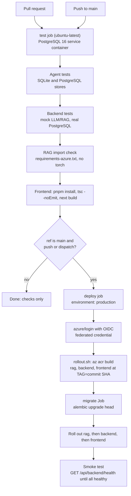

# CI/CD pipeline

The pipeline is a single GitHub Actions workflow, `.github/workflows/ci-cd.yml`. It tests every
pull request and every push, and on `main` it releases to AKS by running
`deploy/aks/rollout.sh`. Infrastructure, secrets and sign-in are **not** managed by the
pipeline; they are created once by `deploy/aks/deploy.sh` (see [AKS deployment](aks-deployment.md)).

## Triggers

| Event | Jobs that run |
|---|---|
| `pull_request` (any branch) | `test` |
| `push` to `main` | `test`, then `deploy` |
| `workflow_dispatch` (manual run) | `test`; `deploy` only when run on `main` |

Concurrency group `ci-cd-<ref>`: a newer run on the same pull request cancels the older one;
runs on `main` are queued, never cancelled, so a release is not interrupted halfway.
Default token permissions are `contents: read`.

## Flow



## The `test` job

Runs on `ubuntu-latest` with a `postgres:16` service container on host port 5433
(user `amlens`, database `amlens_test`; the name contains "test" because the suites wipe it).

| Step | Command | Notes |
|---|---|---|
| Python 3.12 | `actions/setup-python@v5` | Same version as the backend and RAG images; pip cache keyed on both requirements files |
| Install | `pip install -r backend/requirements.txt -r agents/requirements.txt` | |
| Agent tests | `python -m pytest agents/tests -q` | Uses `AML_AGENT_TEST_DATABASE_URL` for the PostgreSQL store |
| Backend tests | `python -m pytest -q` in `backend/` | `TEST_DATABASE_URL` points at the service container; LLM and RAG are mocked |
| RAG import check | Fresh venv with `RAG/requirements-azure.txt`, then `from app.main import app` with dummy Azure settings | Proves the slim deployment image starts without the FAISS/torch stack. It does not contact Azure |
| Node 20 + pnpm | `pnpm/action-setup@v4` (version from `packageManager` in `frontend/package.json`), `actions/setup-node@v4` | Same Node version as the frontend image |
| Frontend | `pnpm install --frozen-lockfile`, `pnpm exec tsc --noEmit`, `pnpm build` | With `NEXT_PUBLIC_USE_MOCKS=false` |

More detail on the suites: [Testing](../testing/index.md).

## The `deploy` job

```yaml
deploy:
  needs: test
  if: github.ref == 'refs/heads/main' && (github.event_name == 'push' || github.event_name == 'workflow_dispatch')
  environment: production
  permissions:
    contents: read
    id-token: write
```

1. `actions/checkout@v4`.
2. `azure/login@v2` with `client-id`, `tenant-id` and `subscription-id` taken from repository
   **variables** (not secrets): OIDC needs no stored password.
3. `azure/setup-kubectl@v4`.
4. `bash deploy/aks/rollout.sh` with `RG=${{ vars.AZURE_RESOURCE_GROUP }}` and
   `TAG=${{ github.sha }}` (the full 40-character commit SHA).

What `rollout.sh` does step by step is described in
[AKS deployment](aks-deployment.md#what-rolloutsh-does). If the migration fails, the job prints
the migration log and stops before any application rolls out. If the smoke test fails, the new
pods are already running; follow [Roll back a release](operations-runbook.md#roll-back-a-release).

## One-time setup

### Azure: federated identity

Create an app registration and service principal for the pipeline, trust GitHub's OIDC tokens
for this repository's `production` environment, and give it Contributor on the resource group.
Adapted from `DEPLOY.md` (PowerShell):

```powershell
$repo = "<github-owner>/<repository>"
$ci = az ad app create --display-name "AMLens GitHub deploy" | ConvertFrom-Json
az ad sp create --id $ci.appId | Out-Null
az ad app federated-credential create --id $ci.appId --parameters "{\"name\":\"github-production\",\"issuer\":\"https://token.actions.githubusercontent.com\",\"subject\":\"repo:${repo}:environment:production\",\"audiences\":[\"api://AzureADTokenExchange\"]}"
az role assignment create --assignee $ci.appId --role Contributor --scope (az group show -n <resource-group> --query id -o tsv)
```

The subject `repo:<owner>/<repo>:environment:production` means only jobs that run in the
`production` environment of this repository can obtain an Azure token.

`rollout.sh` also calls `az aks get-credentials`. The cluster is created without Entra ID
integration for Kubernetes RBAC, so with Contributor on the resource group this returns a
kubeconfig with full access to the cluster. Treat the pipeline identity as a cluster
administrator.

### GitHub: environment and variables

1. **Settings → Environments → New environment `production`.** Add required reviewers to make
   every release wait for approval.
2. **Settings → Secrets and variables → Actions → Variables**, create:

| Variable | Value |
|---|---|
| `AZURE_CLIENT_ID` | Application (client) ID of the pipeline app registration |
| `AZURE_TENANT_ID` | Directory (tenant) ID |
| `AZURE_SUBSCRIPTION_ID` | Subscription ID |
| `AZURE_RESOURCE_GROUP` | `<resource-group>` that holds the cluster and registry |

These are identifiers, not credentials, but do not paste their values into documentation or
issues. The registry and cluster names are derived from the resource group inside
`rollout.sh`, so no registry variable is needed.

!!! note "`DEPLOY.md` mentions `AZURE_ACR_NAME`"
    The CI/CD section of `DEPLOY.md` was written for the Container Apps design and lists an extra
    `AZURE_ACR_NAME` variable and the resource group `rg-amlens`. The current workflow does not
    read `AZURE_ACR_NAME`; the four variables above are sufficient.

## Image tags

| Who deployed | Tag format |
|---|---|
| CI (`deploy` job) | Full commit SHA, `github.sha` |
| `deploy.sh` / `rollout.sh` by hand | `git rev-parse --short HEAD` (7 characters), or `<sha>-dirty<MMDDHHMM>` from `deploy.sh` when tracked files have uncommitted changes |

The tag tells you how the running release was deployed: `kubectl -n amlens get deploy -o wide`.
On 2026-11-25 the live images carried the short tag `f204b1a` (verified live), i.e. the current
release was deployed by hand. Whether the pipeline's deploy job has completed successfully was
**not verified** (GitHub run history was not accessible from the documentation environment).

## Rules for changes that go through the pipeline

- **Migrations must be backward compatible** with the release that is still running while the
  migrate Job executes (expand first, contract in a later release).
- **Do not change secrets or the edge in a pull request and expect CI to apply them.** Edit the
  manifest, merge, then re-run `deploy.sh` (or apply the rendered manifest) by hand.
- **Keep `rollout.sh` and `deploy.sh` in sync**: both contain the image build commands and the
  ACR naming rule.
- **Keep the slim RAG image importable**: anything `RAG/app/main.py` imports at start-up in
  Azure mode must be in `RAG/requirements-azure.txt`, or the RAG import check fails.
