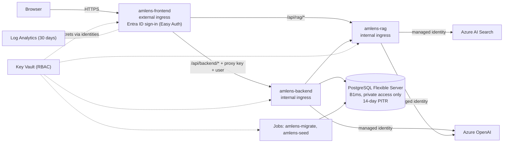

# Container Apps design

`infra/` contains a complete Bicep design for running AMLens on **Azure Container Apps** with
managed PostgreSQL, Key Vault and managed identities. It is the target architecture for an
unrestricted subscription. **It is not deployed**: the training-sandbox subscription blocks
Container Apps, Azure Database for PostgreSQL and private DNS zones, so production runs on AKS
instead ([Production environment](index.md)). Everything on this page is **from repository**.

## Files

| Path | Purpose |
|---|---|
| `infra/main.bicep` | Whole environment: Log Analytics, VNet, PostgreSQL Flexible Server, ACR, Key Vault, identities, Container Apps environment, three apps, two jobs, Entra ID authentication |
| `infra/modules/ai-roles.bicep` | `Cognitive Services OpenAI User` on the Azure OpenAI account for the app identities |
| `infra/modules/search-roles.bicep` | `Search Index Data Reader` on the AI Search service |
| `infra/deploy.ps1` | PowerShell driver: platform → images → apps and jobs → migrate → seed → health check |
| `infra/seed/` | `make-seed.sh` (builds `seed.sql` from the team's sample database), `load.sh`, `Dockerfile`. Shared with the AKS deployment |

## Architecture



## Design decisions

| Concern | Design |
|---|---|
| Network | VNet `10.40.0.0/16` with `snet-apps` (delegated to `Microsoft.App/environments`) and `snet-postgres` (delegated to PostgreSQL, private DNS zone `amlens.private.postgres.database.azure.com`) |
| Ingress | Only `amlens-frontend` is external. `amlens-rag` and `amlens-backend` have internal ingress (plain HTTP inside the environment) |
| Sign-in | Container Apps authentication (Easy Auth) with Entra ID on the frontend, `RedirectToLoginPage`, only `/api/backend/health` excluded. The frontend proxy reads `X-MS-CLIENT-PRINCIPAL-NAME` |
| Backend trust | Same proxy key mechanism as on AKS (`AML_PROXY_KEY` / `AMLENS_PROXY_KEY`) |
| Secrets | Key Vault with RBAC authorization, soft delete 30 days, purge protection. Secrets: `database-url`, `pg-admin-password`, `token-secret`, `proxy-key`, plus `azure-openai-key`/`azure-search-key` in keys mode and `auth-client-secret` |
| Identities | Four user-assigned identities (`id-amlens-*` for rag, backend, frontend, jobs) with `AcrPull` and `Key Vault Secrets User` |
| Azure OpenAI / AI Search | Managed identity by default (`aiAuth = 'managedIdentity'`); `-AIAuth keys` fallback when role assignments are not possible |
| Database | PostgreSQL 16 Flexible Server, `Standard_B1ms` Burstable, 32 GB with auto-grow, public network access disabled, backup retention `postgresBackupRetentionDays` (default 14, up to 35), geo-redundant backup optional, no HA |
| Schema and data | `amlens-migrate` (`alembic upgrade head`) and `amlens-seed` run as manual-trigger Container Apps jobs inside the VNet |
| Scaling | Frontend 1–3 replicas; single active revision per app; probes on `/health` |
| Images | ACR Basic, admin user disabled, pulled with managed identities |
| Logs | Log Analytics workspace (`PerGB2018`), 30 days, wired as the environment's log destination |
| Agent runs | Stored in PostgreSQL schema `agent_runtime`, so restarts and multiple backend replicas are safe |

## Deploying it (unrestricted subscription)

Prerequisites (from `DEPLOY.md`): Owner, or Contributor plus User Access Administrator, on the
target resource group (the template creates role assignments); an Entra ID app registration for
sign-in; AI Search API access control set to *Both* or *Role-based*; `infra/seed/seed.sql`
generated with `bash infra/seed/make-seed.sh` if you want the sample data.

```powershell
.\infra\deploy.ps1 `
  -ResourceGroup <resource-group> -Location <region of the AI resources> `
  -AzureOpenAIEndpoint https://<openai-account>.openai.azure.com/ `
  -AzureSearchEndpoint https://<search-service>.search.windows.net `
  -AzureOpenAIResourceId (az cognitiveservices account show -n <openai-account> -g <ai-resource-group> --query id -o tsv) `
  -AzureSearchResourceId (az search service show -n <search-service> -g <ai-resource-group> --query id -o tsv) `
  -AuthClientId <app-id> -Seed
```

Parameter defaults in `deploy.ps1`: resource group `rg-amlens`, location `centralindia`, chat
deployment `gpt-4.1-mini`, embedding deployment `text-embedding-3-small`, `AIAuth`
`managedIdentity`. `-AllowAnonymous` deploys without sign-in and is only for a throwaway
environment with no real data. `TOKEN_SECRET` is read from `backend\.env` or
`$env:AMLENS_TOKEN_SECRET`. The PostgreSQL password and proxy key are generated once and stored
in Key Vault; re-runs reuse them.

The script runs five stages: platform (about 10 minutes the first time), image builds in ACR,
apps and jobs, migrate and seed jobs, and a health check through the public URL.

Rough idle cost from `DEPLOY.md`: PostgreSQL B1ms about US$15/month, three always-on Container
Apps replicas about US$30–50, ACR Basic about US$5, Key Vault and Log Analytics a few dollars.

## Differences from the AKS deployment

| Aspect | Container Apps design | AKS (production) |
|---|---|---|
| Database | Managed Flexible Server, private only, PITR up to 35 days | PostgreSQL StatefulSet on a managed disk, nightly `pg_dump` to Blob (14 days) |
| Secrets | Key Vault, read by managed identities | Kubernetes Secrets created by `deploy.sh` |
| AI authentication | Managed identity + RBAC roles | API keys (Search: read-only query key) |
| Sign-in | Entra ID (Easy Auth) | oauth2-proxy with username/password accounts |
| Edge | Container Apps managed ingress and certificate | App-routing NGINX + cert-manager (Let's Encrypt) |
| Rate limiting | None | `/oauth2` sign-in endpoints limited per client IP |
| Logs | Log Analytics | Container stdout via `kubectl logs` only |
| Network isolation | VNet, internal ingress | NetworkPolicies (Cilium) |
| CI deploy | The first version of the workflow (commit `98e22f4`) ran `az containerapp job start` for migrations and `az containerapp update` per app; it needed an extra `AZURE_ACR_NAME` variable | `deploy/aks/rollout.sh` (current workflow) |

The application code supports both: the frontend proxy accepts the user from
`X-MS-CLIENT-PRINCIPAL-NAME` (Easy Auth) or `X-Auth-Request-Email` / `X-Auth-Request-User`
(oauth2-proxy), and the RAG service and agents use managed identity whenever no key is set.

## Gaps remaining even in this design

From `DEPLOY.md`, "Remaining gaps before real customer data":

- PostgreSQL still uses a password (in Key Vault); Entra ID authentication for PostgreSQL needs
  token refresh in the backend's connection code.
- Key Vault, ACR, Azure OpenAI and AI Search are reached over public endpoints (RBAC-protected);
  private endpoints need ACR Premium and per-service DNS zones.
- No rate limiting or WAF in front of the frontend (Front Door or Application Gateway).
- Investigations run inside the HTTP request; a Service Bus queue (the agents contain a worker)
  would let long or bulk runs survive restarts.

## Related older document

`backend/DEPLOY_AZURE.md` describes creating an Azure Database for PostgreSQL Flexible Server by
hand for the backend alone (region `centralindia`, public access with a firewall rule for your
IP). It predates both `infra/` and `deploy/aks/` and is superseded by them; use it only as
background on the database settings.
