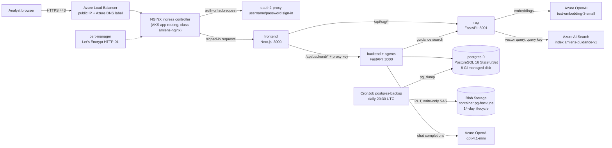

# Production environment

AMLens runs in production on **Azure Kubernetes Service (AKS)** in a training-sandbox
subscription in the `southindia` region. This page describes what is deployed, how the pieces
connect, and which facts have been checked against the running cluster.

| Page | Covers |
|---|---|
| [AKS deployment](aks-deployment.md) | What `deploy/aks/deploy.sh` builds, every manifest, first deployment |
| [CI/CD pipeline](ci-cd.md) | GitHub Actions: tests on every PR, automatic release on `main` |
| [Operations runbook](operations-runbook.md) | Day-two procedures: releases, accounts, backups, restores, rollback, troubleshooting |
| [Container Apps design](container-apps-design.md) | The `infra/` Bicep design for an unrestricted subscription (not deployed) |

Related: [Security](../security/index.md), [Authentication](../authentication/index.md),
[Monitoring](../monitoring/index.md), [Azure OpenAI](../integrations/azure-openai.md),
[Azure AI Search](../integrations/azure-ai-search.md).

## Why AKS and not Container Apps

The sandbox subscription allows only AKS, virtual machines, Azure Container Registry (ACR),
Storage and Key Vault, in a single resource group, in a single region. Azure Container Apps,
Azure Database for PostgreSQL and private DNS zones are blocked, and every Azure write needs
MFA. The team therefore runs the stack on a small AKS cluster with PostgreSQL inside the cluster
(`deploy/aks/`). The richer Container Apps design in `infra/` is kept for a future unrestricted
subscription; see [Container Apps design](container-apps-design.md).

## Deployment architecture

Everything except Azure OpenAI, Azure AI Search and Blob Storage runs in the Kubernetes
namespace `amlens`. Only the ingress controller has a public IP. The `frontend`, `backend`,
`rag`, `postgres` and `oauth2-proxy` Services are all `ClusterIP`, and NetworkPolicies decide
which pod may reach which (see [Security](../security/index.md#network-isolation)).

## Production facts: verified live vs from repository

**Verified live** means the fact was checked with read-only `kubectl` commands or `curl` against
the running deployment on **2026-11-25**. **From repository** means it is what the scripts and
manifests in this repository produce; it was not (or could not be) checked against the cluster
with read-only access.

| Area | Fact | Source |
|---|---|---|
| URL | `https://amlens-870b3a.southindia.cloudapp.azure.com` (Azure DNS label on the ingress load balancer) | Verified live |
| Public health check | `GET /api/backend/health` returns `200` without sign-in, body `{"status":"ok","backend":"healthy","agent":"healthy","rag":"healthy","queue":"not_applicable",...}` | Verified live |
| Sign-in enforced | `GET /` and `GET /api/backend/alerts` return `302` to `/oauth2/sign_in?rd=...` when not signed in | Verified live |
| Cluster | 2 nodes, `Standard_B2s`, Ubuntu 24.04, Kubernetes v1.36.5 | Verified live |
| Networking | Cilium dataplane (node label `kubernetes.azure.com/ebpf-dataplane=cilium`, Cilium pods running); pod IPs (`10.244.x.x`) are separate from node IPs (`10.224.x.x`), consistent with Azure CNI overlay | Verified live (overlay mode itself from repository: `--network-plugin-mode overlay`) |
| AKS tier, identity | Free tier, managed identity, OIDC issuer and workload identity enabled, ACR attached | From repository (`deploy.sh`) |
| Workloads | Deployments `rag`, `backend`, `frontend`, `oauth2-proxy` (1 replica each); StatefulSet `postgres` (1 replica) | Verified live |
| Image tag | All three application images at tag `f204b1a` (a short commit SHA, which is the default tag format of `deploy.sh`/`rollout.sh` run by hand; CI uses the full 40-character SHA) | Verified live |
| Images | Built in ACR with `az acr build`; `postgres:16-alpine`, `oauth2-proxy:v7.7.1` and `curl:8.11.0` imported into the same ACR | Verified live (image references) / From repository (build method) |
| Ingress | Two `NginxIngressController` objects: `amlens` (class `amlens-nginx`, carries the DNS label) and the add-on's unused `default` controller; both available | Verified live |
| Ingress rules | `amlens-web` (`/` → frontend, behind sign-in), `amlens-oauth2` (`/oauth2` → oauth2-proxy, rate limit 20 req/min per client IP, burst ×2), `amlens-health` (exact path `/api/backend/health` → frontend, no sign-in) | Verified live |
| TLS | cert-manager v1.16.2; `ClusterIssuer letsencrypt` Ready; `Certificate amlens-tls` Ready | Verified live |
| Sign-in | oauth2-proxy with `--htpasswd-file`, `--display-htpasswd-form=true`, custom templates; Entra ID OIDC configured but its button hidden | Verified live (container arguments) |
| NetworkPolicies | `default-deny-ingress`, `postgres-from-db-clients`, `backend-from-frontend`, `rag-from-app`, `edge-from-ingress`, `acme-solver-from-ingress` | Verified live |
| Database | PostgreSQL 16 (`postgres:16-alpine`), PVC `data-postgres-0` 8 Gi, storage class `managed-csi` (Azure managed disk) | Verified live |
| Backups | CronJob `postgres-backup`, schedule `30 20 * * *` (02:00 IST), last successful run 2026-11-24 20:30 UTC | Verified live |
| Backup storage | Blob container `pg-backups`, SAS with create/write permission only, valid 365 days; lifecycle rule deletes blobs after 14 days | From repository (the lifecycle rule step tolerates failure; confirm with `az storage account management-policy show`) |
| Secrets | Kubernetes Secrets `amlens-ai`, `amlens-app`, `amlens-backup`, `amlens-db`, `amlens-htpasswd`, `amlens-oauth`, `amlens-tls` exist (names only were listed) | Verified live |
| Configuration | ConfigMap `amlens-config`: chat deployment `gpt-4.1-mini`, embedding deployment `text-embedding-3-small`, index `amlens-guidance-v1` | Verified live |
| Search key | `amlens-ai` holds an AI Search **query** (read-only) key under the variable name `AZURE_SEARCH_ADMIN_KEY` | From repository (`deploy.sh` reads `az search query-key list`); secret contents deliberately not read |
| Backend settings | `RUN_MIGRATIONS=false`, `LLM_PROVIDER=azure_openai`, `USE_MOCK_LLM=false`, `USE_MOCK_RAG=false`, `RAG_SERVICE_URL=http://rag:8001`, probes on `/health` | Verified live |
| Last jobs | `migrate` Complete (20 s), `seed` Complete, `postgres-backup-*` Complete | Verified live |
| Monitoring | No Azure Monitor / Container Insights agent pods in `kube-system`; `kubectl top` works (metrics-server) | Verified live |
| CI deploy | GitHub Actions deploy job with OIDC, environment `production` | From repository; whether the pipeline has deployed successfully was **not verified** (the live tag format suggests the running release was deployed by hand) |

## Resource naming

All names are derived in `deploy/aks/deploy.sh` from the resource group name, so a re-run finds
the same resources. `SUF` is the first 6 hex characters of `md5(<resource-group>)`.

| Resource | Default name | Override |
|---|---|---|
| Container registry | `acramlens<SUF>` | `ACR=` |
| AKS cluster | `aks-amlens` | `AKS=` |
| Storage account (backups) | `stamlens<SUF>` | `ST=` |
| DNS label | `amlens-<SUF>` → host `amlens-<SUF>.southindia.cloudapp.azure.com` | `DNSLABEL=` |
| Region | `southindia` | `LOC=` |
| Node size / count | `Standard_B2s` × 2 | `NODE_SIZE=`, `NODES=` |
| Namespace | `amlens` | fixed |

The resource group defaults to the sandbox group in the script; always pass your own with
`RG=<resource-group>`.

## Capacity

Two `Standard_B2s` nodes give 2 vCPU / 4 GiB each. Resource requests are kept small so that
everything fits. The add-on's default NGINX controller is patched down to one replica because
each controller replica reserves 0.5 vCPU.

| Workload | CPU request | Memory request / limit |
|---|---|---|
| backend | 250m | 512Mi / 1Gi |
| rag | 100m | 192Mi / 512Mi |
| frontend | 100m | 192Mi / 512Mi |
| postgres | 100m | 256Mi / 512Mi |
| oauth2-proxy | 25m | 32Mi / 128Mi |
| migrate job | 100m | 256Mi / 512Mi |
| seed job | 50m | 64Mi / 256Mi |

Verified live on 2026-11-25: node CPU use was about 10 % and memory about 65–70 %.
Memory is the tighter resource; see the "Pods stay Pending" entry in the
[runbook troubleshooting table](operations-runbook.md#troubleshooting).

## Sandbox constraints

- **Region lock:** only `southindia`.
- **MFA for writes:** `az` commands that change Azure resources may ask you to sign in again
  (`az login`). This is why the pipeline uses a federated identity rather than a person.
- **Blocked services:** Container Apps, Azure Database for PostgreSQL, private DNS zones.
- **No managed identity for AI services:** the AI resources are reached with keys stored in
  Kubernetes Secrets.
- **Tenant admin consent:** Entra ID sign-in needs a tenant administrator to approve the app
  registration, so the deployment uses username/password accounts for now
  (see [Authentication](../authentication/index.md)).
- **Expiry and lab interference:** the subscription may expire, and the lab provider has
  deleted resources before (the AI Search service once had to be recreated; see
  [Rebuild the AI Search index](operations-runbook.md#rebuild-the-ai-search-index)).
