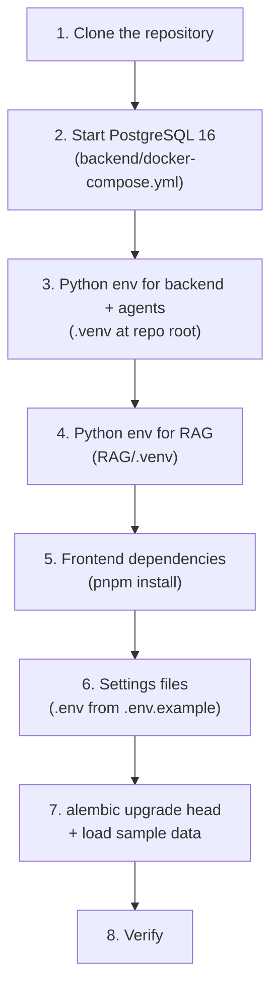

# Installation

This page takes you from an empty machine (with the [prerequisites](prerequisites.md)
installed) to a repository with every dependency installed, settings files in place, and a
migrated database with sample data. To *run* the services afterwards, see
[Local development](local-development.md).

!!! info "Every block starts from the repository root"
    Unless a block says otherwise, run it from the folder that contains `backend/`,
    `agents/`, `RAG/` and `frontend/`.

## Overview



If you only work on the frontend, do steps 1 and 5 and go straight to
[mock mode](local-development.md#mode-1-frontend-only-mock-mode).

## 1. Clone the repository

```bash
git clone https://github.com/silvrfur/AMLens.git
cd AMLens
```

The default branch is `main`, which is what CI deploys. See
[Contributing](../contributing/index.md#branches) for the other branches.

## 2. Start the development database

Start Docker Desktop first, then:

=== "PowerShell"

    ```powershell
    cd backend; docker compose up -d; cd ..
    docker compose -f backend/docker-compose.yml ps     # STATUS: healthy after ~10 s
    ```

=== "Bash"

    ```bash
    (cd backend && docker compose up -d)
    docker compose -f backend/docker-compose.yml ps     # STATUS: healthy after ~10 s
    ```

This starts the `postgres:16` container with:

| Setting | Value |
|---|---|
| Host and port | `127.0.0.1:5433` (5433 avoids clashing with a local install on 5432) |
| User / password | `amlens` / `amlens_dev` (development only, never reuse) |
| Databases | `amlens` (application) and `amlens_test` (created by `backend/scripts/docker-init-test-db.sql`; **wiped by tests**) |
| Volume | `amlens_pgdata`, so data survives `docker compose stop` / `down` (but not `down -v`) |

### Alternative: a locally installed PostgreSQL 16

If you cannot use Docker, create the role and both databases with the admin password chosen
at install time, then use port `5432` instead of `5433` in every URL in `backend/.env`:

```powershell
& "C:\Program Files\PostgreSQL\16\bin\psql.exe" -U postgres -h 127.0.0.1 `
  -c "CREATE ROLE amlens LOGIN PASSWORD 'amlens_dev' CREATEDB;" `
  -c "CREATE DATABASE amlens OWNER amlens;" `
  -c "CREATE DATABASE amlens_test OWNER amlens;"
```

## 3. Python environment for the backend and agents

The backend imports the `agents` package in-process, so both share **one** virtual
environment at the repository root.

=== "PowerShell"

    ```powershell
    python -m venv .venv
    .venv\Scripts\python -m pip install -r backend\requirements.txt -r agents\requirements.txt
    ```

=== "Bash"

    ```bash
    python3 -m venv .venv
    .venv/bin/python -m pip install -r backend/requirements.txt -r agents/requirements.txt
    ```

| File | What it contains |
|---|---|
| `backend/requirements.txt` | FastAPI, Uvicorn, pandas, SQLAlchemy 2, psycopg 3 (binary), Alembic, python-dotenv, pytest, httpx |
| `agents/requirements.txt` | LangGraph, OpenAI SDK (Azure OpenAI), Groq SDK, azure-identity, azure-servicebus, faiss-cpu, pandas, pydantic-settings, pytest |
| `agents/requirements-lock.txt` | Exact versions from the agents' own validation run; optional, for reproducing that environment |

This is the same install command CI runs, so a green local run here matches CI.

## 4. Python environment for the RAG service

The RAG service has its **own** environment because the local FAISS backend needs
`sentence-transformers` (and therefore PyTorch).

=== "PowerShell"

    ```powershell
    python -m venv RAG\.venv
    RAG\.venv\Scripts\python -m pip install -r RAG\requirements.txt
    ```

=== "Bash"

    ```bash
    python3 -m venv RAG/.venv
    RAG/.venv/bin/python -m pip install -r RAG/requirements.txt
    ```

| File | Use it for |
|---|---|
| `RAG/requirements.txt` | Full set: Azure AI Search **and** local FAISS (`sentence-transformers`, `faiss-cpu`, `pymupdf`), plus the index-building scripts. Large download. |
| `RAG/requirements-azure.txt` | Azure AI Search only, no torch. This is what the Docker image installs by default and what CI import-checks. Enough if you only run `RAG_BACKEND=azure`. |

!!! note
    `RAG/requirements.txt.txt` is a stray duplicate in the repository; use
    `RAG/requirements.txt`.

## 5. Frontend dependencies

=== "PowerShell"

    ```powershell
    cd frontend; npx pnpm install; cd ..
    ```

=== "Bash"

    ```bash
    (cd frontend && npx pnpm install)
    ```

`npx pnpm` uses the pnpm version pinned in `package.json` (`pnpm@12.3.4`). If you have
Corepack enabled (`corepack enable`), plain `pnpm install` does the same. CI and the Docker
image use `pnpm install --frozen-lockfile`; use that too when you want to be sure you match
`pnpm-lock.yaml` exactly.

## 6. Settings files

Each Python service reads a git-ignored `.env` file next to its code. Create them from the
committed templates. The full variable reference is in [Configuration](configuration.md).

=== "PowerShell"

    ```powershell
    copy backend\.env.example backend\.env
    copy RAG\.env.example RAG\.env
    ```

=== "Bash"

    ```bash
    cp backend/.env.example backend/.env
    cp RAG/.env.example RAG/.env
    ```

Then edit them:

| File | Minimum to set | For live AI |
|---|---|---|
| `backend/.env` | `TOKEN_SECRET`: the **team's shared value** (ask the team; [why](configuration.md#token_secret)). The database URLs already point at the Docker database. | `USE_MOCK_LLM=false`, `AZURE_OPENAI_ENDPOINT`, `AZURE_OPENAI_DEPLOYMENT`, `AZURE_OPENAI_API_KEY`; `USE_MOCK_RAG=false`, `RAG_SERVICE_URL=http://127.0.0.1:8001` |
| `RAG/.env` | Only needed if you run the RAG service. `RAG_BACKEND=azure` plus the `AZURE_SEARCH_*` and `AZURE_OPENAI_*` values, or `RAG_BACKEND=faiss` for the offline index. | - |
| `frontend/.env.local` | **Not needed** for mock mode. For live services create it with `NEXT_PUBLIC_USE_MOCKS=false`, `AMLENS_BACKEND_URL=http://127.0.0.1:8000`, `AMLENS_RAG_URL=http://127.0.0.1:8001`. | - |

!!! warning "There is no frontend `.env.example`"
    The frontend has no template file. Without `frontend/.env.local` it runs on built-in mock
    data and calls no service. See [Configuration](configuration.md#frontend-frontend).

## 7. Create the tables and load sample data

Tables are created and changed **only** by Alembic. The backend refuses to start against a
database whose migration head does not match the code.

=== "PowerShell"

    ```powershell
    $env:PYTHONPATH = (Get-Location).Path
    cd backend
    ..\.venv\Scripts\alembic upgrade head
    ..\.venv\Scripts\python scripts\migrate_sqlite_to_postgres.py
    ..\.venv\Scripts\python scripts\check_alerts.py
    cd ..
    ```

=== "Bash"

    ```bash
    export PYTHONPATH="$(pwd)"
    cd backend
    ../.venv/bin/alembic upgrade head
    ../.venv/bin/python scripts/migrate_sqlite_to_postgres.py
    ../.venv/bin/python scripts/check_alerts.py
    cd ..
    ```

| Command | What it does |
|---|---|
| `alembic upgrade head` | Applies `backend/alembic/versions/0001_initial_schema.py` and `0002_alert_status_backfill.py` to `DATABASE_URL`. |
| `scripts/migrate_sqlite_to_postgres.py` | Optional. Copies the committed sample data from `backend/aml.db` (SQLite) into PostgreSQL in one transaction, keeping all IDs; refuses a non-empty target, verifies row counts, never modifies `aml.db`. |
| `scripts/check_alerts.py` | Optional. Checks every alert converts into the agents' `AlertBundle`. The backend README expects 46 of 47 OK (one legacy alert has no `created_at`). |

!!! tip "PYTHONPATH"
    `PYTHONPATH` must point at the repository root so `import agents` works. Set it again in
    every new terminal. The Docker image sets `PYTHONPATH=/app` for you.

## 8. Verify the installation

Run the same checks CI runs (details in [Testing](../testing/index.md)):

=== "PowerShell"

    ```powershell
    $env:PYTHONPATH = (Get-Location).Path
    .venv\Scripts\python -m pytest agents\tests -q
    cd backend; ..\.venv\Scripts\python -m pytest -q; cd ..
    cd frontend; npx pnpm exec tsc --noEmit; cd ..
    ```

=== "Bash"

    ```bash
    export PYTHONPATH="$(pwd)"
    .venv/bin/python -m pytest agents/tests -q
    (cd backend && ../.venv/bin/python -m pytest -q)
    (cd frontend && npx pnpm exec tsc --noEmit)
    ```

Expected results, as measured for this guide:

| Suite | Expected |
|---|---|
| Agents | 98 tests collected; **95 passed, 3 skipped** (the PostgreSQL-store tests skip unless `AML_AGENT_TEST_DATABASE_URL` is set) |
| Backend | 22 tests collected. All pass with the Docker database running and `TEST_DATABASE_URL` set (it is, in `.env.example`). Without the database or without `PYTHONPATH`, the database and API tests are **skipped**, not failed. |
| Frontend | `tsc --noEmit` exits with no output |

!!! note "Stale counts elsewhere"
    `backend/README.md` says "expect: 17 passed" and `agents/VALIDATION.md` records 74
    passed. Both predate later tests; the numbers above were measured with
    `pytest --collect-only` on the current code.

## Documentation site (optional)

The docs have their own requirements:

=== "PowerShell"

    ```powershell
    python -m venv .venv-docs
    .venv-docs\Scripts\python -m pip install -r docs\requirements.txt
    .venv-docs\Scripts\mkdocs serve        # http://127.0.0.1:8000
    ```

=== "Bash"

    ```bash
    python3 -m venv .venv-docs
    .venv-docs/bin/python -m pip install -r docs/requirements.txt
    .venv-docs/bin/mkdocs serve            # http://127.0.0.1:8000
    ```

`mkdocs serve` uses port 8000, the same as the backend; stop one or pass
`-a 127.0.0.1:8002`. `mkdocs.yml` sets `strict: true`, so `mkdocs build` fails on broken links.

## Next step

Continue with [Local development](local-development.md).
