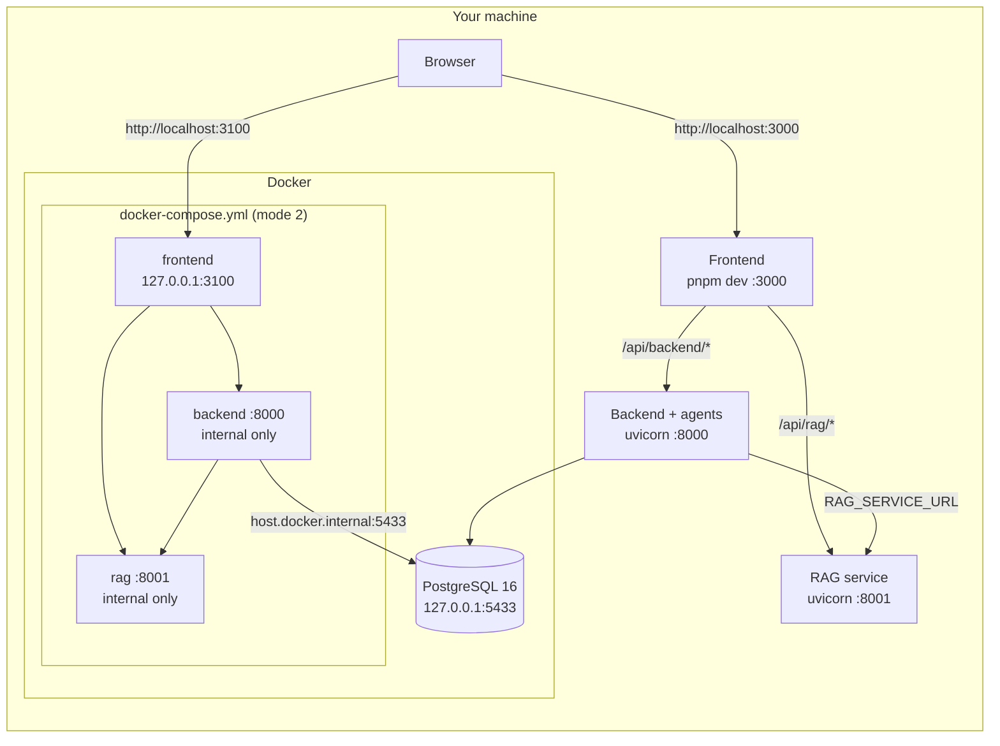

# Local development

AMLens can run locally in three ways. Choose the lightest one that covers your change.

| Mode | What runs | Needs | Use it for |
|---|---|---|---|
| [1. Frontend-only mock mode](#mode-1-frontend-only-mock-mode) | Next.js dev server with built-in fixtures | Node.js + pnpm | UI work, layout, copy, client logic |
| [2. Full stack with `docker-compose.yml`](#mode-2-production-like-stack-with-docker-composeyml) | The three production images, wired as in Azure | Docker, `backend/.env`, `RAG/.env` with Azure values | Checking images, the proxy key, PostgreSQL agent store, before a release |
| [3. Each service by hand](#mode-3-run-each-service-by-hand) | Uvicorn (backend, RAG) + `pnpm dev`, hot reload | Everything in [Installation](installation.md) | Day-to-day backend, agents, RAG and integration work |

Complete [Installation](installation.md) first (for mode 1, only the frontend steps).

## Ports and services



| Port | Service | Bound to | Notes |
|---|---|---|---|
| 3000 | Frontend dev server (`pnpm dev`) | all interfaces (Next.js default) | Mode 1 and 3 |
| 3100 | Frontend container | `127.0.0.1` | Mode 2; the only published compose port |
| 8000 | Backend (Uvicorn) | `127.0.0.1` in the documented command | Swagger UI at `/docs` |
| 8001 | RAG service (Uvicorn) | `127.0.0.1` | Swagger UI at `/docs` |
| 5433 | PostgreSQL 16 (Docker) | `127.0.0.1` | Maps to 5432 inside the container |

!!! note "Port 8000 in older READMEs"
    `RAG/README.md` and `agents/README.md` start their services on port 8000. In the
    integrated stack the backend owns 8000 and the RAG service runs on **8001**.

## Mode 1: frontend-only mock mode

The frontend ships with fixtures in `frontend/lib/mocks/data.ts`. **Mock mode is the
default**: `lib/api/client.ts` uses mocks unless `NEXT_PUBLIC_USE_MOCKS` is exactly the
string `false`.

=== "PowerShell"

    ```powershell
    cd frontend
    npx pnpm install
    npx pnpm dev
    ```

=== "Bash"

    ```bash
    cd frontend
    npx pnpm install
    npx pnpm dev
    ```

Open <http://localhost:3000>. The top bar shows **DEV · Mock data** and *Settings* shows
"Mock fixtures enabled — no external service calls". Uploads, alerts, investigations,
reports, decisions, audit events and knowledge search all return fixture data; no request
leaves the browser.

!!! warning "A leftover `.env.local` turns mock mode off"
    If `frontend/.env.local` contains `NEXT_PUBLIC_USE_MOCKS=false`, the app calls the
    proxy instead and every page fails without a backend. Remove or rename the file (or set
    the value to `true`) and restart `pnpm dev`: `NEXT_PUBLIC_*` values are read only when
    the dev server starts or the app is built.

Mock IDs look like `ALT-…` and `INV-…`; the live backend uses `AL_<hex>` alert IDs and UUID
investigation IDs. Code that parses IDs must handle both.

## Mode 2: production-like stack with docker-compose.yml

The root `docker-compose.yml` builds the three deployable images and runs them wired as in
production: **only the frontend is published** (on `127.0.0.1:3100`); the backend and RAG
service are reachable only on the compose network; agent runs are stored in PostgreSQL
(schema `agent_runtime`); and the backend accepts only calls that carry the proxy key.

**Before you start**

- `backend/.env` and `RAG/.env` must exist (compose loads them with `env_file`).
- The RAG container is forced to `RAG_BACKEND=azure`, so `RAG/.env` needs working
  `AZURE_SEARCH_*` and `AZURE_OPENAI_*` values. There is no FAISS option in this mode.
- The development database must be running and migrated: the stack does not include
  PostgreSQL; it uses the one from `backend/docker-compose.yml` via `host.docker.internal:5433`.

=== "PowerShell"

    ```powershell
    cd backend; docker compose up -d; cd ..     # the dev database holds the data
    docker compose up --build                   # open http://localhost:3100
    ```

=== "Bash"

    ```bash
    (cd backend && docker compose up -d)
    docker compose up --build                   # open http://localhost:3100
    ```

What compose sets on top of the `.env` files (values under `environment:` win):

| Service | Variable | Value |
|---|---|---|
| `rag` | `RAG_BACKEND` | `azure` |
| `rag` | `RAG_CORS_ORIGINS` | empty (the browser never calls RAG directly) |
| `backend` | `DATABASE_URL`, `AML_AGENT_DATABASE_URL` | `${AMLENS_DATABASE_URL}` or the dev database at `host.docker.internal:5433/amlens` |
| `backend` | `AML_SOURCE_DATABASE_URL` | empty (use `DATABASE_URL`) |
| `backend` | `RAG_SERVICE_URL` | `http://rag:8001` |
| `backend` | `AML_PROXY_KEY` | `${AMLENS_PROXY_KEY}` or a fixed local placeholder |
| `backend` | `AML_CORS_ORIGINS` | empty (same-origin through the proxy) |
| `frontend` | `AMLENS_BACKEND_URL` / `AMLENS_RAG_URL` | `http://backend:8000` / `http://rag:8001` |
| `frontend` | `AMLENS_PROXY_KEY` | same expression as the backend's `AML_PROXY_KEY` |

!!! info "Migrations run on start"
    The backend image defaults to `RUN_MIGRATIONS=true`, so the backend container runs
    `alembic upgrade head` against the dev database before Uvicorn starts. In AKS and the
    Container Apps design this is `false` and a separate migrate job runs instead.

To point the stack at another database or use your own proxy key, set host environment
variables before `docker compose up`:

```powershell
$env:AMLENS_DATABASE_URL = "postgresql+psycopg://amlens:<password>@host.docker.internal:5433/amlens"
$env:AMLENS_PROXY_KEY = "<at least 32 random characters>"
```

Stop with ++ctrl+c++, then `docker compose down` (this does not touch the database volume,
which belongs to `backend/docker-compose.yml`).

## Mode 3: run each service by hand

This is the everyday setup: hot reload on the frontend, and a backend you can restart in
seconds. Use three terminals.

### Settings for the full stack

| File | Set |
|---|---|
| `backend/.env` | `TOKEN_SECRET` (team value). For live AI: `USE_MOCK_LLM=false` + `AZURE_OPENAI_ENDPOINT`, `AZURE_OPENAI_DEPLOYMENT`, `AZURE_OPENAI_API_KEY`. For live guidance: `USE_MOCK_RAG=false`, `RAG_SERVICE_URL=http://127.0.0.1:8001`. |
| `RAG/.env` | `RAG_BACKEND=azure` with the `AZURE_SEARCH_*` and `AZURE_OPENAI_*` values, or `RAG_BACKEND=faiss` for the offline index. |
| `frontend/.env.local` | `NEXT_PUBLIC_USE_MOCKS=false`, `AMLENS_BACKEND_URL=http://127.0.0.1:8000`, `AMLENS_RAG_URL=http://127.0.0.1:8001` |

Leave `AML_PROXY_KEY` unset locally: with no key, the backend accepts every request. You do
not need `AML_CORS_ORIGINS` either, because the browser only talks to the frontend's own
proxy routes.

### Terminal 1: RAG service

=== "PowerShell"

    ```powershell
    cd RAG
    .venv\Scripts\python -m uvicorn app.main:app --host 127.0.0.1 --port 8001
    ```

=== "Bash"

    ```bash
    cd RAG
    .venv/bin/python -m uvicorn app.main:app --host 127.0.0.1 --port 8001
    ```

The search backend is chosen once, at import time. With `RAG_BACKEND=faiss` (the code
default when unset) the first start downloads the `all-MiniLM-L6-v2` embedding model and
loads `RAG/indexes/aml_faiss.index`, which takes a while. Check it with
`curl http://127.0.0.1:8001/health` → `{"status":"healthy","search_backend":"azure"}`.

You can skip the RAG service entirely by keeping `USE_MOCK_RAG=true` in `backend/.env`; the
agents then use offline fixtures and *Settings → Service health* reports RAG as "degraded".

### Terminal 2: backend (with the agents)

=== "PowerShell"

    ```powershell
    $env:PYTHONPATH = (Get-Location).Path
    cd backend
    docker compose up -d
    ..\.venv\Scripts\python -m uvicorn app.main:app --host 127.0.0.1 --port 8000 --reload
    ```

=== "Bash"

    ```bash
    export PYTHONPATH="$(pwd)"
    cd backend
    docker compose up -d
    ../.venv/bin/python -m uvicorn app.main:app --host 127.0.0.1 --port 8000 --reload
    ```

- `PYTHONPATH` must be the repository root so `import agents` works; otherwise health
  reports the agent as "offline" and runs fail with `No module named 'agents'`.
- Run from `backend/` so `backend/.env` is found and `AML_AGENT_DATABASE_PATH=./agent_runtime.db`
  lands in `backend/` (git-ignored).
- On start the backend checks the Alembic head and refuses to serve an un-migrated
  database. After pulling a new file under `backend/alembic/versions/`, run
  `alembic upgrade head` again.
- Swagger UI: <http://127.0.0.1:8000/docs>. Health: <http://127.0.0.1:8000/health>.

### Terminal 3: frontend

=== "PowerShell"

    ```powershell
    cd frontend
    npx pnpm dev
    ```

=== "Bash"

    ```bash
    cd frontend
    npx pnpm dev
    ```

Open <http://localhost:3000>. *Settings → Service health* should show backend, agent and RAG
as **healthy** and the task queue as **not applicable** (investigations run in-process).
Restart `pnpm dev` after any change to `.env.local`.

!!! tip "Before a demo"
    Click through every page once: the dev server compiles each page on first visit. If Azure
    is unreachable, set `USE_MOCK_RAG=true` and/or `USE_MOCK_LLM=true` in `backend/.env` and
    restart the backend; investigations then use offline fixtures.

### A quick end-to-end check

With the backend running, from `backend/`:

```bash
curl -s http://127.0.0.1:8000/health
curl -s -F "file=@examples/demo_transactions_v2.csv" http://127.0.0.1:8000/upload-transactions
curl -s "http://127.0.0.1:8000/alerts?limit=5"
```

The backend README expects `accepted: 3` for `demo_transactions_v2.csv`. The full API flow is
`POST /investigate/{alert_id}` → `POST /investigations/{id}/run` →
`GET /investigations/{id}/report` → `POST /investigations/{id}/decision` → `GET /audit/{id}`;
see [Backend endpoints](../api-reference/endpoints.md).

### Running the agents on their own

The `agents/` package also has a standalone demo and FastAPI app that use only offline
fixtures (SQLite, mock LLM, mock RAG). Run from the repository root:

```bash
python -m agents.run_demo                                         # prints three scenarios
python -m uvicorn agents.main:app --host 127.0.0.1 --port 8002    # standalone agents API
```

The demo writes `agents/data/demo_runtime.db`; delete only that file to replay it. The
standalone app reads its own settings (environment variables, plus a `.env` in the current
directory; see
[Configuration](configuration.md#agents-agents)). Use a port other than 8000 if the backend is
running. See [Agents API](../api-reference/agents-api.md).

### Everyday commands

| Task | Command (from `backend/`) |
|---|---|
| Start / stop the database | `docker compose up -d` / `docker compose stop` |
| Apply new migrations | `alembic upgrade head` |
| Inspect tables | `python scripts/inspect_db.py` |
| Run one alert through the agents (mock LLM/RAG) | `python phase4_run.py [ALERT_ID]` |
| Reset the database **(deletes all data)** | `docker compose down -v`, then `docker compose up -d` and `alembic upgrade head` |

## Common setup issues

| Symptom | Cause | Fix |
|---|---|---|
| Every page shows errors / "service is unreachable" | `NEXT_PUBLIC_USE_MOCKS=false` but the backend or RAG URL is not running or not set | Start the services, or remove `.env.local` to return to mock mode; restart `pnpm dev` |
| `Service 'backend' is not configured on this server.` (404) | `AMLENS_BACKEND_URL` (or `AMLENS_RAG_URL`) missing on the frontend server | Add it to `frontend/.env.local` and restart `pnpm dev` |
| `401 Not authenticated` from the backend | `AML_PROXY_KEY` is set on the backend but the frontend's `AMLENS_PROXY_KEY` differs or is missing | Use the same value on both, or unset `AML_PROXY_KEY` locally |
| `DATABASE_URL is not set` | Started outside `backend/` or no `backend/.env` | `cd backend`; create `.env` from `.env.example` |
| `Database schema is not up to date` / `relation "alerts" does not exist` | Migrations not applied | `alembic upgrade head` from `backend/` |
| `No module named 'agents'`; health shows agent "offline" | `PYTHONPATH` not set in this terminal | Set it to the repository root |
| `Set TOKEN_SECRET to at least 32 random characters` on upload | `TOKEN_SECRET` empty or short | Put the team value in `backend/.env` |
| `Set AML_SOURCE_TIMEZONE explicitly…` on an investigation run | Variable removed from `.env` | `AML_SOURCE_TIMEZONE=UTC` |
| DB calls hang ~8 s each | `localhost` resolves to IPv6 first on Windows | Use `127.0.0.1` in every database URL |
| Port 5433 already in use | Another PostgreSQL or container | Change `127.0.0.1:5433` in `backend/docker-compose.yml` and the URLs in `backend/.env` |
| `docker: … cannot connect` | Docker Desktop not running | Start it and wait for "Engine running" |
| RAG start fails with `KeyError: 'AZURE_OPENAI_BASE_URL'` | `RAG_BACKEND=azure` without the Azure values | Fill `RAG/.env` or use `RAG_BACKEND=faiss` |
| RAG ignores a variable you exported | `RAG/app/main.py` loads `RAG/.env` with `override=True`, so the file **wins** over the shell | Change the value in `RAG/.env` |
| "running scripts is disabled" when activating a venv | PowerShell execution policy | `Set-ExecutionPolicy -Scope CurrentUser RemoteSigned`, or call `.venv\Scripts\python` directly as in this guide |

### Windows specifics

**Line endings (CRLF).** Git for Windows usually has `core.autocrlf=true`, which checks text
files out with CRLF. `.gitattributes` forces LF for `*.sh`, `Dockerfile`, `*.bicep` and
`*.yml`, because those run in Linux containers or Bash where `\r` breaks `sh`. Other file
types are not covered: if you add a new script type that runs in Linux (for example a
`.sql` init script or an entrypoint without a `.sh` extension), add a rule to
`.gitattributes`. If you checked out before `.gitattributes` existed, renormalise with
`git add --renormalize .`.

**Long paths.** pnpm's `node_modules/.pnpm` directory nests deeply and can exceed the classic
260-character Windows path limit when the repository sits in a deep folder. Keep the clone
near the drive root, or enable long paths (`git config --global core.longpaths true` and the
Windows *LongPathsEnabled* policy). The deployment scripts avoid the issue by building
images from `git archive` exports instead of the working tree.

**Git Bash path conversion.** Git Bash rewrites arguments that look like POSIX paths (for
example `/app` or `/var/lib/postgresql/data`) into Windows paths before passing them to
native programs such as `docker`. If you run `docker compose exec` with an absolute container
path from Git Bash, prefix the command with `MSYS_NO_PATHCONV=1`. The PowerShell commands in
this guide are not affected.
