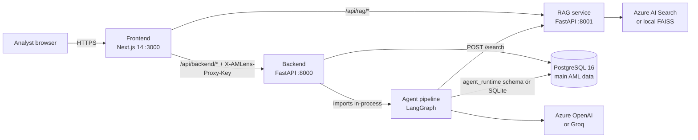

# Developer guide

This guide is for engineers who build, test, deploy and operate AMLens: an AI-assisted
workspace in which anti-money-laundering (AML) analysts review transaction-monitoring alerts,
run an evidence-grounded AI investigation, and record a human decision with a full audit trail.

!!! abstract "The one rule that shapes the code"
    **The AI drafts; a person decides.** No agent, endpoint or service can record an
    investigator decision on its own. Agent reports are verified deterministically before
    they are shown as verified, and every decision and state change is written to the audit
    history.

## The system in one paragraph

AMLens is four components in one repository. A **Next.js 14 frontend** (`frontend/`) serves
the analyst workspace and forwards every browser API call through its own server-side proxy
(`/api/backend/*`, `/api/rag/*`). A **FastAPI backend** (`backend/`) ingests CSV uploads,
runs detection rules, manages alerts, investigations, decisions and audit history in
**PostgreSQL 16** (SQLAlchemy + Alembic, psycopg 3). The backend imports the
**LangGraph agent pipeline** (`agents/`) in-process: six steps (transaction analysis,
guidance retrieval, evidence, information gaps, report, verification) call **Azure OpenAI**
(or Groq) and a separate **RAG service** (`RAG/`, FastAPI) that searches approved AML
guidance in **Azure AI Search** or a local FAISS index. Agent runs are stored in SQLite
locally or in the PostgreSQL schema `agent_runtime` in deployments.

The live deployment runs on Azure Kubernetes Service (AKS); see
[Production environment](deployment/index.md).

## Sections

-   :material-rocket-launch-outline: **Getting started**

    ---

    Tools to install, cloning and setup, running the stack locally, and every
    environment variable.

    [:octicons-arrow-right-24: Prerequisites](getting-started/prerequisites.md) ·
    [Installation](getting-started/installation.md) ·
    [Local development](getting-started/local-development.md) ·
    [Configuration](getting-started/configuration.md)

-   :material-sitemap-outline: **Architecture**

    ---

    How the services fit together, why, and how data moves through them.

    [:octicons-arrow-right-24: Overview](architecture/overview.md) ·
    [System](architecture/system-architecture.md) ·
    [Frontend](architecture/frontend-architecture.md) ·
    [Backend](architecture/backend-architecture.md) ·
    [Data flow](architecture/data-flow.md) ·
    [Decisions](architecture/architecture-decisions.md)

-   :material-puzzle-outline: **Modules**

    ---

    Deep dives into each functional module, from CSV ingestion to the frontend proxy.

    [:octicons-arrow-right-24: Module index](modules/index.md) ·
    [Ingestion](modules/transaction-ingestion.md) ·
    [Detection rules](modules/detection-rules.md) ·
    [Investigations](modules/investigation-service.md) ·
    [Agent pipeline](modules/agent-pipeline.md) ·
    [Verifier](modules/report-verifier.md) ·
    [RAG](modules/rag-service.md) ·
    [Proxy](modules/frontend-proxy.md)

-   :material-api: **API reference**

    ---

    Backend, agents and RAG endpoints with request and response schemas.

    [:octicons-arrow-right-24: Overview](api-reference/overview.md) ·
    [Endpoints](api-reference/endpoints.md) ·
    [Schemas](api-reference/schemas.md) ·
    [Agents API](api-reference/agents-api.md) ·
    [RAG API](api-reference/rag-api.md)

-   :material-database-outline: **Database**

    ---

    PostgreSQL tables, the agent runtime store, and Alembic migrations.

    [:octicons-arrow-right-24: Overview](database/overview.md) ·
    [Schema](database/schema.md) ·
    [Migrations](database/migrations.md)

-   :material-shield-key-outline: **Authentication and security**

    ---

    Sign-in at the edge, the proxy shared key, account tokenisation and hardening.

    [:octicons-arrow-right-24: Authentication](authentication/index.md) ·
    [Security](security/index.md)

-   :material-microsoft-azure: **Integrations**

    ---

    How the agents call Azure OpenAI and how the RAG service uses Azure AI Search.

    [:octicons-arrow-right-24: Azure OpenAI](integrations/azure-openai.md) ·
    [Azure AI Search](integrations/azure-ai-search.md)

-   :material-test-tube: **Testing**

    ---

    The three test suites, fixtures and mocks, how CI runs them, and known gaps.

    [:octicons-arrow-right-24: Testing](testing/index.md)

-   :material-cloud-upload-outline: **Deployment and operations**

    ---

    The AKS production environment, CI/CD, the runbook, and the Container Apps design.

    [:octicons-arrow-right-24: Production](deployment/index.md) ·
    [AKS](deployment/aks-deployment.md) ·
    [CI/CD](deployment/ci-cd.md) ·
    [Runbook](deployment/operations-runbook.md) ·
    [Container Apps](deployment/container-apps-design.md)

-   :material-chart-line: **Monitoring**

    ---

    Health endpoints, logs and what to watch in production.

    [:octicons-arrow-right-24: Monitoring](monitoring/index.md)

-   :material-source-pull: **Contributing**

    ---

    Branches, pull requests, schema changes, adding a feature end to end, and the PR checklist.

    [:octicons-arrow-right-24: Contributing](contributing/index.md)

-   :material-book-open-variant: **Reference**

    ---

    Technology stack, terminology, supported platforms and release notes.

    [:octicons-arrow-right-24: Technology stack](../reference/technology-stack.md) ·
    [Terminology](../reference/terminology.md) ·
    [Platforms](../reference/supported-platforms.md) ·
    [Release notes](../reference/release-notes.md)

## Where to start

Pick the path that matches what you are about to do. Each path is ordered: read the pages
top to bottom.

=== "New contributor"

    You have just joined and want the stack running and a first change merged.

    1. [Prerequisites](getting-started/prerequisites.md): install Git, Docker Desktop,
       Python and Node.js with pnpm.
    2. [Installation](getting-started/installation.md): clone, create the virtual
       environments, install dependencies, create the database.
    3. [Local development](getting-started/local-development.md): start with **frontend-only
       mock mode** (no backend needed), then run the full stack.
    4. [Architecture overview](architecture/overview.md) and
       [Data flow](architecture/data-flow.md): the mental model.
    5. [Testing](testing/index.md) and [Contributing](contributing/index.md): run the suites
       CI runs and follow the PR checklist.

=== "Backend developer"

    You will change the FastAPI service, detection rules, or the database.

    1. [Backend architecture](architecture/backend-architecture.md)
    2. [Transaction ingestion](modules/transaction-ingestion.md),
       [Detection rules](modules/detection-rules.md),
       [Investigation service](modules/investigation-service.md)
    3. [Backend endpoints](api-reference/endpoints.md) and [Schemas](api-reference/schemas.md)
    4. [Database schema](database/schema.md) and [Migrations](database/migrations.md):
       migrations run **before** the new backend starts, so they must stay backward compatible.
    5. [Configuration](getting-started/configuration.md#backend-backend): `DATABASE_URL`,
       `TOKEN_SECRET`, `AML_PROXY_KEY`, `RUN_MIGRATIONS`.

=== "AI / agents developer"

    You will change the LangGraph pipeline, prompts, the verifier, or guidance retrieval.

    1. [Agent pipeline](modules/agent-pipeline.md) and [Report verifier](modules/report-verifier.md)
    2. [Agents API](api-reference/agents-api.md) and [RAG service](modules/rag-service.md)
    3. [Azure OpenAI](integrations/azure-openai.md) and [Azure AI Search](integrations/azure-ai-search.md)
    4. [Testing](testing/index.md#agents-suite): the agent suite is fully offline; the
       `no_external_network` fixture fails any test that opens a non-loopback socket.
    5. [Configuration](getting-started/configuration.md#agents-agents): `USE_MOCK_LLM`,
       `LLM_PROVIDER`, `AZURE_OPENAI_*`, `USE_MOCK_RAG`, `RAG_SERVICE_URL`.

=== "Frontend developer"

    You will change the Next.js workspace.

    1. [Local development, mode 1](getting-started/local-development.md#mode-1-frontend-only-mock-mode):
       the frontend runs on built-in mock data by default.
    2. [Frontend architecture](architecture/frontend-architecture.md)
    3. [Frontend proxy](modules/frontend-proxy.md): why the browser never calls the backend directly.
    4. [Backend endpoints](api-reference/endpoints.md): the contract `lib/api/client.ts` maps.
    5. [Configuration](getting-started/configuration.md#frontend-frontend): `NEXT_PUBLIC_USE_MOCKS`,
       `AMLENS_BACKEND_URL`, `AMLENS_RAG_URL`, `AMLENS_PROXY_KEY`.

=== "Operator"

    You deploy, monitor or support the production environment.

    1. [Production environment](deployment/index.md) and [AKS deployment](deployment/aks-deployment.md)
    2. [CI/CD pipeline](deployment/ci-cd.md): every push to `main` builds, migrates and rolls out.
    3. [Operations runbook](deployment/operations-runbook.md)
    4. [Monitoring](monitoring/index.md) and [Security](security/index.md)
    5. [Configuration](getting-started/configuration.md): which secrets each service needs.

## Repository at a glance

| Path | What it is | Runtime |
|---|---|---|
| `backend/` | FastAPI API, detection rules, Alembic migrations, tests | Python 3.12 image, port 8000 |
| `agents/` | LangGraph investigation pipeline, imported by the backend (also has a standalone FastAPI app and a Service Bus worker) | Python 3.12, in the backend image |
| `RAG/` | Guidance search API over Azure AI Search or local FAISS, plus index-building scripts | Python 3.12 image, port 8001 |
| `frontend/` | Next.js 14 analyst workspace with a server-side proxy | Node.js 20 image, port 3000 |
| `docker-compose.yml` | Production-like local run of the three images | frontend published on `127.0.0.1:3100` |
| `backend/docker-compose.yml` | Development PostgreSQL 16 on `127.0.0.1:5433` | Docker |
| `.github/workflows/ci-cd.yml` | Tests on every PR and push; build and roll out on `main` | GitHub Actions |
| `deploy/aks/` | Kubernetes manifests and scripts for the live AKS deployment | Bash, `kubectl`, `az` |
| `infra/` | Bicep design for Azure Container Apps (unrestricted subscription) | Bicep, PowerShell |
| `docs/` | This documentation site (MkDocs Material) | Python |
