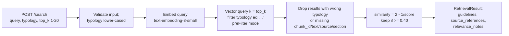

# Azure AI Search

The RAG service retrieves AML guidance passages (RBI KYC Master Direction, FIU guidance, FATF
recommendations and additional AML guidance) from an Azure AI Search vector index. The agents call
it through the RAG service's `POST /search` endpoint; every citation in a report comes from this
index.

| Item | Value | Source |
|---|---|---|
| Index name | `amlens-guidance-v1` | Verified live (ConfigMap `amlens-config`) |
| RAG backend mode | `RAG_BACKEND=azure` | Verified live (Deployment `rag`) |
| Key used in production | A **query** key (read-only) | From repository (`deploy.sh`) |
| Embedding model | `text-embedding-3-small`, 1536 dimensions | Verified live (ConfigMap) |

Related pages: [RAG service](../modules/rag-service.md), [RAG API](../api-reference/rag-api.md),
[Azure OpenAI](azure-openai.md).

## Index schema

Created by `RAG/scripts/create_azure_search_index.py`:

| Field | Type | Attributes |
|---|---|---|
| `chunk_id` | `Edm.String` | key, filterable |
| `text` | `Edm.String` | searchable |
| `source` | `Edm.String` | searchable, filterable (document file name, e.g. `RBI_KYC_Master_Direction.pdf`) |
| `document_id` | `Edm.String` | filterable |
| `section` | `Edm.String` | searchable, filterable |
| `page` | `Edm.Int32` | filterable |
| `typology` | `Edm.String` | searchable, filterable (one typology key per chunk, or empty) |
| `content_vector` | `Collection(Edm.Single)` | 1536 dimensions, profile `amlens-vector-profile` |

Vector search: HNSW algorithm `amlens-hnsw`, metric **cosine**.

## Query path

`RAG/app/azure_search_adapter.py`, `TeamAzureSearchAdapter.search_aml_guidance(query, typology, top_k)`:



- **Typology pre-filter.** Only chunks whose `typology` equals the requested typology are
  candidates (`vector_filter_mode="preFilter"`). The OData string is escaped by doubling single
  quotes. Typologies: `structuring`, `rapid_movement`, `fan_in_out`, `unusual_activity` (see
  [Terminology](../../reference/terminology.md#typology-keys)).
- **Score conversion.** For a single cosine vector query Azure returns
  `@search.score = 1 / (2 - cosine)`, so the adapter converts back with `2 - 1/score`, clamped to
  [-1, 1]. A non-positive score raises an error.
- **No results** is a valid outcome: the result then contains a note that no sufficiently relevant
  verified guidance was found, and the report records the gap.
- Client retries are disabled (`retry_total=0`); errors surface as `500 AML guidance search
  failed` from the RAG service.

### Relevance threshold

`min_score = 0.40`, calibrated on 2026-11-24 with `text-embedding-3-small` inside the typology
pre-filter:

| Query kind | Similarity range |
|---|---|
| The agents' descriptive queries | 0.46 – 0.66 |
| Other AML topics (e.g. onboarding) | 0.27 – 0.37 |
| Unrelated text | ≤ 0.12 |

An earlier cutoff of 0.50 dropped every agent query. Re-check these ranges if the embedding
model or corpus changes; `RAG/scripts/evaluate_azure_rag.py` uses the same constant
(`MIN_RELEVANCE = 0.40`).

## Authentication

| Mode | When | Requirement |
|---|---|---|
| Key | `AZURE_SEARCH_ADMIN_KEY` set (production) | Despite the variable name, production stores a **query key**: `deploy.sh` reads `az search query-key list ... --query "[0].key"`. Query keys can only search, not modify the index |
| Entra ID | Variable empty | `DefaultAzureCredential` (managed identity / `az login`); identity needs *Search Index Data Reader*; Search service API access control must allow role-based access |

The index-maintenance scripts (`create_azure_search_index.py`, `upload_azure_chunks.py`,
`update_azure_typologies.py`, `test_azure_retrieval.py`) need a real **admin** key in
`RAG/.env` on the developer's machine. That key is never deployed to the cluster.

## Corpus and indexing pipeline

The corpus is committed to the repository, so the index can be rebuilt without reprocessing PDFs:

| Stage | Script | Output |
|---|---|---|
| Extract PDF text | `scripts/extract_pdfs.py` (PyMuPDF) | `RAG/extracted/` |
| Clean and chunk | `scripts/clean_and_chunk.py` (1200 characters, 200 overlap) | `RAG/chunks/*_chunks.json` |
| Add verified passages | `scripts/add_verified_structuring_chunk.py`, `scripts/add_verified_typology_chunks.py` (verbatim paragraphs from the PDFs, human-reviewed 2026-11-24) | extra chunks with stable IDs, e.g. `RBI_KYC_Master_Direction_p23_structuring_1` |
| Local index (FAISS mode only) | `scripts/generate_embeddings.py` (all-MiniLM-L6-v2), `scripts/build_faiss_index.py` | `RAG/indexes/aml_chunks_metadata.json`, `aml_embeddings.npy`, `aml_faiss.index` |
| Create Azure index | `scripts/create_azure_search_index.py` | index `amlens-guidance-v1` (never overwrites an existing index; verifies its fields and dimensions instead) |
| Upload to Azure | `scripts/upload_azure_chunks.py --limit 0 --upload` | Chunks from documents in `APPROVED_AML_DOCUMENTS`, embedded with Azure OpenAI in batches of 8, with `section` and `typology` from `app/typology_annotations.py` |
| Patch typology metadata | `scripts/update_azure_typologies.py [--apply]` | Checks each verified annotation points at the intended passage (required phrase) and merges `section`/`typology` |
| Verify | `scripts/test_azure_retrieval.py`, `scripts/evaluate_azure_rag.py` | Document count and a known citation; a labelled evaluation set per typology |

Only chunks with a verified typology annotation can be returned to the agents, because of the
typology pre-filter. Other chunks are in the index but are not yet classified.

The rebuild procedure for production is in the runbook:
[Rebuild the AI Search index](../deployment/operations-runbook.md#rebuild-the-ai-search-index).

## Health and failure modes

- The RAG `/health` endpoint does **not** call Azure; it returns healthy whenever the process is
  running. The adapter is created at start-up, so a missing **configuration** variable makes the
  pod crash on start, but a missing **service** or index shows up only when `/search` is called.
- If the Search service has been deleted or the key is wrong, `/search` returns
  `500 AML guidance search failed` and investigations fail at the retrieval step, while
  **Settings → Service health** still shows RAG as healthy. Check
  `kubectl -n amlens logs deploy/rag`.
- The training-lab provider has deleted the Search service once. The service was recreated and
  the index rebuilt with the scripts above. A recreated service has new keys, so the cluster must
  also receive the new query key (re-run `deploy.sh`, then restart `deploy/rag`).

## Local development

`RAG/.env` (template `RAG/.env.example`):

```bash
RAG_BACKEND=azure                         # or faiss for the fully local index
AZURE_SEARCH_ENDPOINT=https://<search-service>.search.windows.net
AZURE_SEARCH_INDEX_NAME=amlens-guidance-v1
AZURE_SEARCH_ADMIN_KEY=<query key for the service, admin key for the scripts>
AZURE_OPENAI_BASE_URL=https://<openai-account>.openai.azure.com/openai/v1/
AZURE_OPENAI_API_KEY=<key>
AZURE_OPENAI_EMBEDDING_DEPLOYMENT=text-embedding-3-small
APPROVED_AML_DOCUMENTS=Additional_AML_Guidance.pdf,FATF_Recommendations.pdf,FIU_Guidance.pdf,RBI_KYC_Master_Direction.pdf
```

With `RAG_BACKEND=faiss` the service uses the committed FAISS index and a local
sentence-transformers model instead (needs the full `RAG/requirements.txt`, including torch).
