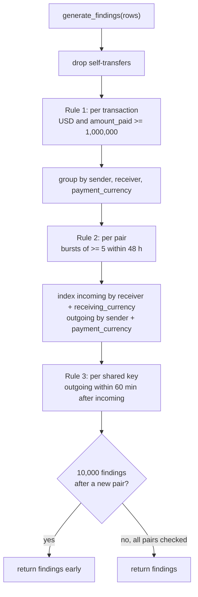

# Detection rules

## Purpose

Produce review alerts from newly uploaded transactions using fixed, explainable rules. The
rules make **observations, not conclusions**: every description says so, and no ground-truth
label is used.

## Responsibilities

- Exclude self-transfers (`sender_token == receiver_token`) from every rule.
- Apply three rules: `HIGH_VALUE`, `REPEATED_PAIR`, `RAPID_MOVEMENT_CANDIDATE`.
- Emit, for each finding, a trigger transaction, a description and an `evidence` object that
  the [investigation service](investigation-service.md) can turn into an agent `AlertBundle`.
- Stay bounded: stop at 10,000 findings.

## Source files

| File | Contents |
|---|---|
| `backend/app/services/transaction_analysis.py` | `generate_findings(rows, *, ...)`, the only rules engine |
| `backend/app/services/ingestion.py` | Calls `generate_findings(transactions)` and stores `Alert` rows |
| `backend/app/integrations/team_backend.py` | `RULE_TO_TYPOLOGY`: maps rule IDs to agent typologies |
| `backend/app/api/alerts.py` | `GET /alerts`, `GET /alerts/{alert_id}` |
| `backend/scripts/check_alerts.py` | Helper script to inspect generated alerts |

## Key function

```python
def generate_findings(
    rows,
    *,
    high_value_threshold=Decimal("1000000"),
    high_value_currency="US Dollar",
    repeated_min_count=5,
    repeated_window=timedelta(hours=48),
):
```

`rows` is any iterable of objects with the `Transaction` attributes (`id`, `timestamp`,
`sender_token`, `receiver_token`, `amount_paid`, `payment_currency`, `amount_received`,
`receiving_currency`). It returns a list of finding dicts. The keyword parameters are not
exposed through configuration; `ingest_csv` uses the defaults.

## Rules

| Rule ID | Condition | Trigger (`transaction_id`) | Anchor account | Agent typology |
|---|---|---|---|---|
| `HIGH_VALUE` | `payment_currency == "US Dollar"` and `amount_paid >= 1,000,000` | the transaction | sender | `unusual_activity` |
| `REPEATED_PAIR` | ≥ 5 transactions with the same `(sender, receiver, payment_currency)` within 48 h of the first one in the burst | first transaction of the burst | sender | `unusual_activity` |
| `RAPID_MOVEMENT_CANDIDATE` | An account receives in currency C and sends in currency C within 0 < Δt ≤ 60 minutes | the outgoing transaction | the intermediary account | `rapid_movement` |

### Evidence payloads

| Rule | `evidence` keys |
|---|---|
| `HIGH_VALUE` | `transaction_ids` (1), `anchor_account_token`, `amount_paid`, `currency`, `threshold` |
| `REPEATED_PAIR` | `transaction_ids` (burst), `anchor_account_token`, `sender_token`, `receiver_token`, `currency`, `count`, `window_hours` (`48.0`) |
| `RAPID_MOVEMENT_CANDIDATE` | `transaction_ids` `[incoming, outgoing]`, `anchor_account_token`, `account_token`, `currency`, `gap_minutes`, `incoming_amount`, `outgoing_amount` |

Amounts are stored as strings so JSONB keeps them exact. `anchor_account_token` and
`transaction_ids` are part of the contract with `TeamBackend`: the anchor must be the sender
or receiver of the trigger, and every listed transaction must fall into the bundle's history
window.

### Rule details

**Repeated pairs** are counted in non-overlapping bursts. For each pair the transactions are
sorted by `(timestamp, id)`; starting at index `i`, the burst extends while transactions are
within 48 h of `txs[i]`. A burst of 5 or more creates one finding and the scan continues after
it; a smaller burst advances `i` by one.

**Rapid movement** compares every incoming transaction with every outgoing transaction of the
same account and currency. Each qualifying pair is a separate finding, so one outgoing payment
preceded by three deposits within the hour produces three alerts. This is the only loop that
checks the 10,000-finding cap.

## Inputs and outputs

| | Description |
|---|---|
| Input | The `Transaction` objects inserted by one upload (after `db.flush()`) |
| Output | `list[dict]` with `rule_id`, `transaction_id`, `description`, `evidence` |
| Persisted as | `alerts` rows: `id = AL_{dataset_id}_{n}`, `status = 'OPEN'`, `created_at = now(UTC)` |

## Execution flow



## Dependencies

Standard library only (`collections.defaultdict`, `datetime.timedelta`, `decimal.Decimal`).
The module does not touch the database; persistence is done by `ingest_csv`.

## Integration points

| Consumer | What it relies on |
|---|---|
| `ingest_csv` | Finding dict keys; stores them unchanged |
| `TeamBackend.get_alert_context` | `rule_id` in `RULE_TO_TYPOLOGY`; `evidence.anchor_account_token` (or `account_token`); `evidence.transaction_ids` as a list of non-empty strings |
| Agents `TransactionAgent` | Re-analyses the bundled history independently; it does **not** reuse the rule's result |
| Frontend `alert-detail.tsx` | `evidence.anchor_account_token` for the history chart, `evidence.transaction_ids`; `lib/format.ts` `alertAmount()` reads `amount_paid` or `incoming_amount` |

## Failure scenarios

| Scenario | Effect |
|---|---|
| No rule fires | Upload succeeds with `alerts_created: 0` |
| More than 10,000 findings | Silently truncated to 10,000; rapid-movement pairs after the cap are lost |
| Repeated-pair burst whose anchor has more than 199 other transactions within ±48 h | **Inferred:** `TeamBackend` keeps only the 200 closest; if a burst member is dropped, the run fails with `Required alert evidence is missing from the bounded agent history` |
| Alert on a Bitcoin transaction or an amount with more than 2 decimals | Alert is created; the investigation fails in the `transaction` node |
| Rule ID not in `RULE_TO_TYPOLOGY` | Investigation fails with `Unsupported rule ID` |

!!! note "Mapped but never generated"
    `RULE_TO_TYPOLOGY` also maps `FAN_IN`, `FAN_OUT` (→ `fan_in_out`) and
    `STRUCTURING_CANDIDATE` (→ `structuring`). No code generates these rule IDs, so in
    practice only the `unusual_activity` and `rapid_movement` typologies reach the agents
    from uploaded data. The structuring and fan-in/out typologies are exercised only through
    agent fixtures and the knowledge-base search.

!!! note "Description text"
    The `REPEATED_PAIR` description interpolates the `timedelta` directly, so it reads
    "within 2 days, 0:00:00; context required."

## Extension points

### How to add a detection rule

1. **Implement it** in `generate_findings()` after the existing rules, working on the
   filtered `rows` (self-transfers already removed). Append a dict:

    ```python
    findings.append({
        "rule_id": "STRUCTURING_CANDIDATE",          # <= 50 chars (alerts.rule_id)
        "transaction_id": trigger.id,                 # the alert's trigger
        "description": "Observation wording; not proof of laundering.",
        "evidence": {
            "transaction_ids": [t.id for t in group],  # every transaction the rule used
            "anchor_account_token": account,           # sender or receiver of the trigger
            # rule-specific values, amounts as strings
        },
    })
    ```

2. **Keep the evidence inside the agent window.** `TeamBackend` loads the anchor's
   transactions from the same dataset within ±48 h of the trigger, at most 200. Choose the
   trigger so every `transaction_ids` entry falls inside that window.
3. **Map the typology.** Add the rule ID to `RULE_TO_TYPOLOGY` in
   `backend/app/integrations/team_backend.py`. The value must be one of `structuring`,
   `rapid_movement`, `fan_in_out`, `unusual_activity` (the `AlertContext.typology` literal).
   A new typology also needs the steps in [Agent pipeline](agent-pipeline.md#how-to-add-a-typology-to-the-agents)
   and [RAG service](rag-service.md#how-to-add-a-typology).
4. **Respect the cap.** If the rule can produce many findings, check `len(findings) >= 10000`.
5. **Frontend (optional).** If the rule has a headline amount under a new key, extend
   `alertAmount()` in `frontend/lib/format.ts`.
6. **Test it** in `backend/tests/test_transaction_analysis.py`, including a self-transfer
   case, and run an end-to-end investigation on a sample CSV.

No migration is needed: `rule_id` is a string column and `evidence` is JSONB.

### Make thresholds configurable

The thresholds are keyword arguments. To make them environment-driven, read the values in
`ingest_csv` and pass them to `generate_findings(...)`; keep the defaults for tests.

## Tests

| Test | File | What it checks |
|---|---|---|
| `test_self_transfers_never_produce_or_support_findings` | `backend/tests/test_transaction_analysis.py` | Self-transfers are excluded from every rule |
| `test_normal_high_value_still_alerts` | `backend/tests/test_transaction_analysis.py` | `HIGH_VALUE` fires for a normal transfer |
| `test_repeated_pair_only_counts_repeats_within_window` | `backend/tests/test_transaction_analysis.py` | Burst windowing |
| `test_upload_and_alert_and_investigation` | `backend/tests/test_api.py` | A `HIGH_VALUE` alert is created and investigated |
| `test_alert_status_follows_case_lifecycle` | `backend/tests/test_api.py` | `OPEN` → `UNDER REVIEW` → `DECIDED` |
