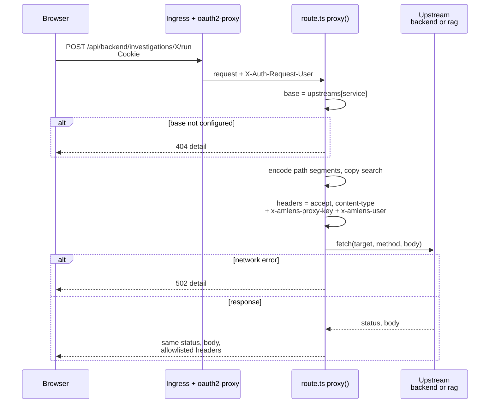

# Frontend proxy

## Purpose

Give the browser a single origin. The Next.js route handler at
`frontend/app/api/[service]/[...path]/route.ts` forwards `/api/backend/*` and `/api/rag/*` to
the internal services, adds the shared proxy key and the signed-in user, and strips everything
else. The reasoning is recorded in
[ADR-001](../architecture/architecture-decisions.md#adr-001-same-origin-frontend-proxy-instead-of-cors)
and [ADR-002](../architecture/architecture-decisions.md#adr-002-shared-secret-between-proxy-and-backend).

## Responsibilities

- Map a service name to an upstream base URL read from the environment at request time.
- Rebuild the upstream path safely (per-segment encoding) and keep the query string.
- Forward only an allowlist of request and response headers.
- Add `x-amlens-proxy-key` and `x-amlens-user`.
- Pass the upstream status code and body through unchanged.
- Return a JSON `detail` error when the service is unknown or unreachable.

## Source files

| File | Contents |
|---|---|
| `frontend/app/api/[service]/[...path]/route.ts` | `proxy()` and its exports as `GET`, `POST`, `PUT`, `PATCH`, `DELETE`; `upstreams`, `FORWARD_REQUEST`, `FORWARD_RESPONSE` |
| `frontend/lib/api/client.ts` | Uses `/api/backend` and `/api/rag` as default bases (`apiBase`, `ragBase`) |
| `backend/app/security.py` | Server side of the contract (`require_proxy`) |
| `deploy/aks/base/edge.yaml` | Ingress `auth-response-headers` that set the user headers |
| `deploy/aks/base/apps.yaml` | `AMLENS_BACKEND_URL`, `AMLENS_RAG_URL`, `AMLENS_PROXY_KEY` |
| `docker-compose.yml` | The same variables for the local three-container run |

## Key code

```ts
export const dynamic = "force-dynamic";
export const runtime = "nodejs";

const upstreams: Record<string, string | undefined> = {
  backend: process.env.AMLENS_BACKEND_URL,
  rag: process.env.AMLENS_RAG_URL,
};

const FORWARD_REQUEST = ["accept", "content-type"];
const FORWARD_RESPONSE = ["content-type", "content-disposition", "cache-control"];
```

User resolution, in order of precedence:

```ts
const user = request.headers.get("x-ms-client-principal-name")
  || request.headers.get("x-auth-request-email")
  || request.headers.get("x-auth-request-user");
if (user) headers.set("x-amlens-user", user);
```

| Header source | Set by | Deployment |
|---|---|---|
| `X-MS-CLIENT-PRINCIPAL-NAME` | Azure Container Apps Easy Auth | Container Apps design (`infra/`) |
| `X-Auth-Request-Email` | oauth2-proxy via ingress-nginx `auth-response-headers` | AKS, Entra ID login |
| `X-Auth-Request-User` | same | AKS, password (htpasswd) login, which has no email |

## Inputs and outputs

| | Value |
|---|---|
| Input | Any `GET`/`POST`/`PUT`/`PATCH`/`DELETE` to `/api/{service}/{...path}?query` |
| Upstream URL | `{upstreams[service] without trailing slash}/{path segments, each encodeURIComponent}{search}` |
| Upstream request | Same method; headers `accept`, `content-type`, `x-amlens-proxy-key`, `x-amlens-user`; body as `ArrayBuffer` for non-GET/HEAD; `cache: "no-store"`, `redirect: "manual"` |
| Output | Upstream status and streamed body; headers `content-type`, `content-disposition`, `cache-control` only |
| Own errors | `404 {"detail": "Service '<name>' is not configured on this server."}`, `502 {"detail": "The <name> service is unreachable."}` |

## Execution flow



## Dependencies

- Next.js 14 App Router route handlers on the Node.js runtime (`runtime = "nodejs"`), global
  `fetch` (undici).
- Environment, read per request: `AMLENS_BACKEND_URL`, `AMLENS_RAG_URL`, `AMLENS_PROXY_KEY`.
  These are not `NEXT_PUBLIC_*`, so they never reach the browser bundle.

## Integration points

| Peer | Contract |
|---|---|
| `lib/api/client.ts` | Calls `/api/backend/...` and `/api/rag/...` unless `NEXT_PUBLIC_API_BASE_URL` / `NEXT_PUBLIC_RAG_BASE_URL` override them; parses `detail` from error bodies, including the proxy's own 404/502 |
| Backend `require_proxy` | Rejects with 401 unless `x-amlens-proxy-key` equals `AML_PROXY_KEY`; then trusts `x-amlens-user` |
| RAG service | Receives the key but does not check it; access is controlled by NetworkPolicy |
| Ingress | `amlens-web` requires sign-in for `/`; `amlens-health` exposes only `/api/backend/health` without sign-in. `proxy-body-size: "25m"` and `proxy-read-timeout: "300"` apply before the proxy |

## Failure scenarios

| Scenario | What happens | User sees |
|---|---|---|
| `AMLENS_BACKEND_URL` unset | 404 from the proxy | Toast "Service 'backend' is not configured on this server." |
| Backend pod down or DNS failure | `fetch` throws → 502 | Toast "The backend service is unreachable." |
| `AMLENS_PROXY_KEY` differs from the backend's `AML_PROXY_KEY` | Backend 401 passed through | Toast "Not authenticated" on every call; `/health` still works |
| Backend returns 4xx/5xx | Passed through unchanged | Toast with the backend's `detail` |
| Long investigation | The proxy waits for the backend; NGINX cuts at 300 s | **Inferred:** a 504 from NGINX, without a JSON body, so the toast reads "Request failed (504)"; the run itself continues on the backend |
| Upstream redirect | `redirect: "manual"` returns the 3xx as-is | Not expected from these services |

## Security notes

- Cookies, `Authorization` and oauth2-proxy session headers are never forwarded; only the two
  allowlisted request headers are.
- Path segments are re-encoded, so `..`, `/` or `?` inside a segment cannot escape the upstream
  path.
- The user header must be set by the edge, never by the browser. On AKS, ingress-nginx
  overwrites `X-Auth-Request-Email` and `X-Auth-Request-User` from oauth2-proxy's response.

!!! warning "Header precedence on AKS (Inferred)"
    The proxy checks `x-ms-client-principal-name` **first**. That header is stripped by Easy
    Auth on Container Apps, but nothing in `deploy/aks/base/edge.yaml` removes it on AKS. A
    signed-in user who adds `X-MS-CLIENT-PRINCIPAL-NAME` to a request could therefore have
    another name recorded as `analyst_id` on a decision. Likewise, in the local
    `docker-compose.yml` there is no sign-in layer, so any client-sent `X-Auth-Request-*`
    header becomes the recorded user. Consider reading only the header that the current edge
    sets, or stripping the others at the ingress.

## Extension points

### Add an upstream service

1. Add an entry to `upstreams`, for example `reports: process.env.AMLENS_REPORTS_URL`.
2. Set the variable in `deploy/aks/base/apps.yaml` (frontend Deployment) and
   `docker-compose.yml`.
3. Allow traffic from `app: frontend` to the new pods in `deploy/aks/base/network-policy.yaml`.
4. Add a base URL in `lib/api/client.ts` following `apiBase` / `ragBase`.

### Forward another header

Add its lower-case name to `FORWARD_REQUEST` or `FORWARD_RESPONSE`. Never forward `cookie`,
`authorization`, or any `x-amlens-*` header received from the browser.

### Add an HTTP method

Export `proxy` under the new name (the file currently exports `GET`, `POST`, `PUT`, `PATCH`,
`DELETE`). Bodies are forwarded for every method except `GET` and `HEAD`.

## Tests

There are no automated tests for the route handler; CI runs only the frontend type-check and
build. The backend side of the contract is covered by `backend/tests/test_proxy_auth.py`:

| Test | What it checks |
|---|---|
| `test_open_when_no_key_configured` | No key configured → requests pass and a sent `X-AMLens-User` is ignored (`user` is `None`) |
| `test_rejects_missing_or_wrong_key` | Missing or wrong `X-AMLens-Proxy-Key` → 401 |
| `test_accepts_proxy_and_trusts_its_user` | Correct key → `request.state.user` is the `X-AMLens-User` value (checked through a `/whoami` test route) |
| `test_health_stays_open_for_probes` | `/health` works without the key |

**Manual check:** with the Compose stack running, `curl -s localhost:3100/api/backend/health`
should return the backend health JSON, and `curl -s localhost:3100/api/unknown/x` should return
the 404 `detail`.
