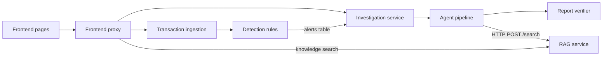

# Modules

AMLens is split into seven modules. Each page below follows the same structure: purpose,
responsibilities, source files, key classes and functions, inputs and outputs, execution
flow, dependencies, integration points, failure scenarios, extension points and tests.

| Module | Lives in | Runs in | One-line purpose |
|---|---|---|---|
| [Transaction ingestion](transaction-ingestion.md) | `backend/app/services/ingestion.py`, `validation.py`, `utils/tokenization.py` | backend process | Validate a CSV, tokenize accounts, store transactions |
| [Detection rules](detection-rules.md) | `backend/app/services/transaction_analysis.py` | backend process | Turn transactions into alerts with three deterministic rules |
| [Investigation service](investigation-service.md) | `backend/app/api/investigations.py`, `services/agent_bridge.py`, `integrations/team_backend.py` | backend process | Case lifecycle, running the agents, decisions, audit |
| [Agent pipeline](agent-pipeline.md) | `agents/graph.py`, `agents/agents/*.py`, `agents/services/*` | backend process (imported) | LangGraph workflow that drafts the report |
| [Report verifier](report-verifier.md) | `agents/verifier/report_verifier.py` | backend process (imported) | Recompute and check the draft before it can be approved |
| [RAG service](rag-service.md) | `RAG/app/*`, `RAG/scripts/*` | `rag` container | Retrieve verified AML guidance for a typology |
| [Frontend proxy](frontend-proxy.md) | `frontend/app/api/[service]/[...path]/route.ts` | `frontend` container | Same-origin forwarding with the proxy key and user header |

## How the modules connect

| From | To | Mechanism | Contract |
|---|---|---|---|
| Frontend proxy | Backend modules | HTTP | [Backend endpoints](../api-reference/endpoints.md) |
| Frontend proxy | RAG service | HTTP | [RAG API](../api-reference/rag-api.md) |
| Transaction ingestion | Detection rules | Python call `generate_findings(transactions)` | List of `Transaction` ORM objects in, list of finding dicts out |
| Detection rules | Investigation service | `alerts` table | `rule_id`, `evidence` JSON with `anchor_account_token` and `transaction_ids` |
| Investigation service | Agent pipeline | Python call `services.runner.run(InvestigationMessage)` | `InvestigationMessage(alert_id, investigation_id)`; result is the persisted record dict |
| Agent pipeline | Investigation service | `BackendClient` protocol, implemented by `TeamBackend` | `get_alert_context(alert_id) -> AlertBundle` |
| Agent pipeline | RAG service | `HTTPRAGClient.search_aml_guidance` | `POST /search {query, typology, top_k}` → `RetrievalResult` |
| Agent pipeline | Report verifier | Python call in the `verify` node | `ReportVerifier().verify(state) -> VerificationResult` |

## Shared vocabulary

| Term | Values | Defined in |
|---|---|---|
| Rule ID | `HIGH_VALUE`, `REPEATED_PAIR`, `RAPID_MOVEMENT_CANDIDATE` (generated); `FAN_IN`, `FAN_OUT`, `STRUCTURING_CANDIDATE` (mapped but never generated) | `transaction_analysis.py`, `team_backend.py` `RULE_TO_TYPOLOGY` |
| Typology | `structuring`, `rapid_movement`, `fan_in_out`, `unusual_activity` | `agents/schemas/investigation.py` `AlertContext.typology` |
| Alert status | `OPEN`, `UNDER REVIEW`, `DECIDED` | `investigations.py` constants |
| Case status | `PENDING_AGENT`, `RUNNING`, `COMPLETED`, `INCOMPLETE`, `FAILED`, `APPROVE`, `REJECT`, `ESCALATE` | `investigations.py`, `frontend/lib/api/types.ts` |
| Execution status | `pending` (no agent record yet), `running`, `completed`, `incomplete`, `failed` | `graph.py`, `persistence.py`, `_summary()` |
| Tool name | `backend.read`, `rag.search`, `llm.generate` | `agents/services/security.py` `ALLOWED_TOOLS` |

## Running the tests for a module

| Suite | Command | Needs |
|---|---|---|
| Backend | `cd backend && python -m pytest -q` | `TEST_DATABASE_URL` (database name must contain `test`); DB tests are skipped without it |
| Agents | `python -m pytest agents/tests -q` (from the repo root) | Nothing for SQLite tests; `AML_AGENT_TEST_DATABASE_URL` for `test_postgres_store.py` |
| RAG | No automated suite. `RAG/app/test_*.py` are manual scripts with a `main()` (some call `input()`); CI only checks that `app.main` imports with `requirements-azure.txt` |
| Frontend | `cd frontend && pnpm build` | Type-check and build only; there are no unit tests |

The agents' `conftest.py` blocks outbound network connections (except `127.0.0.1`), so the
agent suite is guaranteed offline. See [Testing](../testing/index.md) for details.
