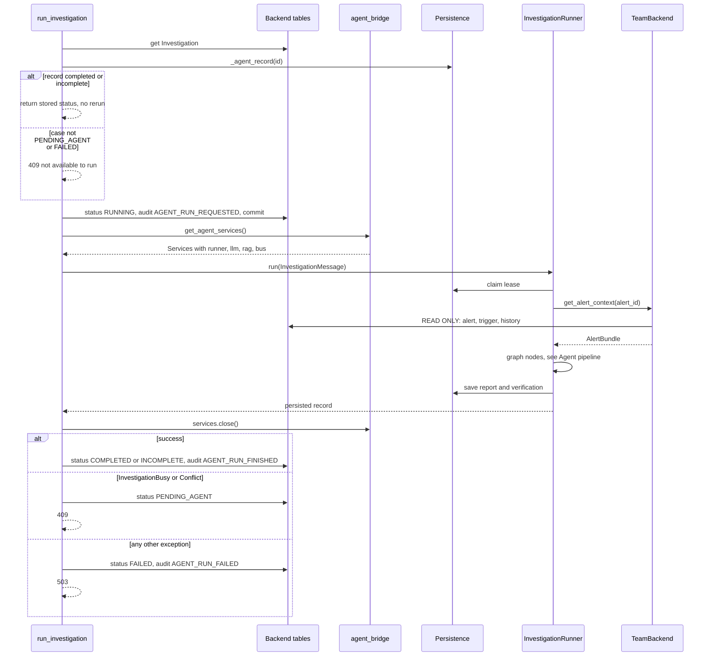
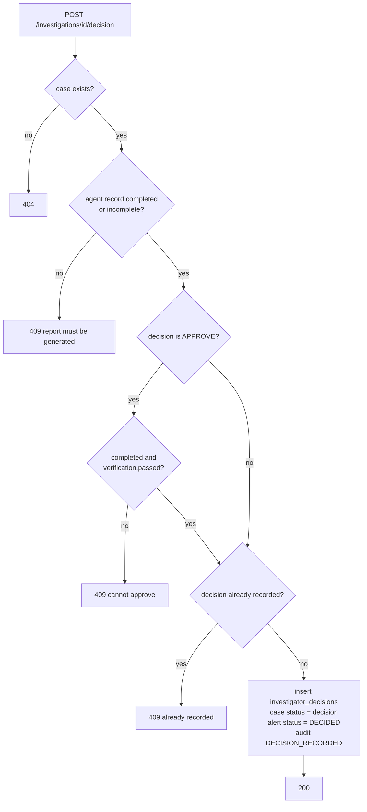

# Investigation service

## Purpose

Own the case lifecycle on the backend side: open an investigation for an alert, run the
[agent pipeline](agent-pipeline.md) for it, expose the persisted report, accept exactly one
human decision and keep an audit trail. It is also the bridge between the backend's
PostgreSQL data and the agents' contracts.

## Responsibilities

- Create investigations and move alerts `OPEN` → `UNDER REVIEW` → `DECIDED`.
- Run the agents synchronously and translate the outcome into a case status.
- Combine backend case rows with the agents' persisted record into one response shape.
- Enforce decision rules: report must exist; `APPROVE` needs a completed, verified report;
  one decision per case; record the authenticated user.
- Write `audit_history` events for every state change.
- Provide the agents with a read-only, validated `AlertBundle` (`TeamBackend`).

## Source files

| File | Contents |
|---|---|
| `backend/app/api/investigations.py` | Router: `list_investigations`, `start_investigation`, `run_investigation`, `get_investigation`, `get_report`, `decide`, `audit`; helpers `_agent_record`, `_summary`, `_decision_out` |
| `backend/app/services/agent_bridge.py` | `get_agent_services()`, `get_agent_persistence()`, `_agent_database_url()`, `_team_backend(zone)` |
| `backend/app/integrations/team_backend.py` | `TeamBackend`, `RULE_TO_TYPOLOGY`, `CURRENCIES`, `_money`, `_time` |
| `backend/app/models/schemas.py` | `DecisionIn` |
| `backend/app/database/tables.py` | `Investigation`, `InvestigatorDecision`, `AuditEvent` |
| `frontend/components/pages/alert-detail.tsx` | Starts and runs investigations from an alert |
| `frontend/components/pages/investigation-detail.tsx` | Report review, re-run, `DecisionPanel` |

## Endpoints

| Method and path | Handler | Success | Errors |
|---|---|---|---|
| `GET /investigations?limit&offset` | `list_investigations` | `200` list of summaries, newest first | `400` pagination, `503` agent store |
| `POST /investigate/{alert_id}` | `start_investigation` | `201 {investigation_id, alert_id, status: "PENDING_AGENT"}` | `404` alert |
| `POST /investigations/{id}/run` | `run_investigation` | `200 {investigation_id, alert_id, execution_status, report_available}` | `404`, `409`, `503` |
| `GET /investigations/{id}` | `get_investigation` | `200` summary + `evidence`, `rule_id` | `404`, `503` |
| `GET /investigations/{id}/report` | `get_report` | `200 {investigation_id, execution_status, label, report, verification, agent_execution_trace}` | `404` case or report |
| `POST /investigations/{id}/decision` | `decide` | `200` decision + `investigation_id`, `status` | `404`, `409`, `422` |
| `GET /audit/{id}` | `audit` | `200` list of `{event_id, action, details, created_at}` | `404` |

The summary shape is built in one place, `_summary(inv, record, decision)`, so list and detail
always agree. When the agents have not persisted anything yet, `execution_status` is derived
from the case status (`RUNNING` → `running`, `FAILED` → `failed`, otherwise `pending`) and
`verification` defaults to `{passed: false, errors: [], warnings: []}`.

## Key classes and functions

| Symbol | Signature | Notes |
|---|---|---|
| `run_investigation` | `def run_investigation(id: str, db: Session = Depends(get_db))` | Lazy-imports `InvestigationMessage`, `InvestigationBusy`, `InvestigationConflict`, `InvestigationFailed` so read-only endpoints do not build LangGraph |
| `decide` | `def decide(id: str, payload: DecisionIn, request: Request, db: Session = Depends(get_db))` | `analyst_id = request.state.user or payload.analyst_id` |
| `_agent_record` | `def _agent_record(investigation_id: str, persistence=None)` | `Persistence.get()`; `OSError`/`ValueError` → `503` |
| `get_agent_services` | `def get_agent_services()` | Requires `AML_SOURCE_TIMEZONE`; forces `use_mock_backend=False`, `use_mock_service_bus=True` |
| `get_agent_persistence` | `def get_agent_persistence()` | `Persistence(create_store(_agent_settings()))` |
| `TeamBackend.__init__` | `(database_url=None, *, source_timezone, window_hours=48, max_transactions=200, timeout_seconds=3)` | Own engine: pool 2 + 2, `application_name=amlens-agent-adapter` |
| `TeamBackend.get_alert_context` | `(alert_id: str) -> AlertBundle` | Calls `consume("backend.read")` first, then reads inside `_read_only()` |

## Execution flow: run

## Execution flow: decision

## TeamBackend: building the `AlertBundle`

`TeamBackend.get_alert_context()` implements the agents' `BackendClient` protocol
(`agents/services/backend_client.py`). Its rules:

1. `consume("backend.read")` counts against the run's tool budget **before** any read.
2. One connection, `SET TRANSACTION READ ONLY`, `statement_timeout` and `lock_timeout` =
   `timeout_seconds` (3 s).
3. Load the alert; reject a missing `created_at` or an unknown `rule_id`.
4. Load the trigger transaction and its `dataset_id`.
5. Anchor = `evidence.anchor_account_token` or `evidence.account_token`; it must be the
   trigger's sender or receiver.
6. Load up to 199 other transactions of the anchor in the same dataset within ±48 h, ordered by
   distance in time from the trigger.
7. Map each row to a `deposit` or `withdrawal` from the anchor's point of view; convert currency
   names to ISO codes and amounts to 2-decimal strings; attach `AML_SOURCE_TIMEZONE` to naive
   timestamps.
8. Drop non-required self-transfers (logged as `INCOMPLETE AGENT HISTORY`); fail on required ones.
9. Check every `evidence.transaction_ids` entry and the trigger are present.
10. Return `AlertBundle.model_validate(...)` with `information_status: {}` (no verified KYC
    or case data is available, so every information gap is `not_provided`).

## Dependencies

| Dependency | Purpose |
|---|---|
| `agents` package | `create_services`, `create_store`, `Persistence`, `InvestigationMessage`, `AlertBundle`, `consume` |
| SQLAlchemy | Backend session (`get_db`) and the separate `TeamBackend` engine |
| Environment | `AML_SOURCE_TIMEZONE`, `DATABASE_URL`, `AML_SOURCE_DATABASE_URL`, `AML_AGENT_DATABASE_URL`, `AML_AGENT_DATABASE_PATH`, plus the LLM/RAG variables read by `agents.config.Settings` |

## Integration points

- **Frontend:** `alert-detail.tsx` calls `investigateAlert` then `runInvestigation` (which
  calls `/run` then `/report`) and navigates to `/investigations/{id}`. If an investigation for
  the alert is already `pending` or `running`, it reuses it instead of creating a new one.
- **Agents:** the backend's investigation UUID becomes the agents' `investigation_id`; the agent
  store is the source of truth for `execution_status`, `report`, `verification` and
  `agent_execution_trace`.
- **Proxy auth:** `request.state.user` is set by `require_proxy` from `X-AMLens-User`.
- **Audit UI:** `/audit` and the dashboard read `GET /audit/{id}` (backend `audit_history` only).

## Failure scenarios

| Scenario | Backend outcome | What the analyst sees |
|---|---|---|
| Agent pipeline node fails (LLM unavailable, RAG 5xx, bundle validation error, budget exhausted) | `InvestigationFailed` → case `FAILED`, `AGENT_RUN_FAILED`, `503` | Toast "Agent investigation failed; inspect persisted status"; investigation page shows `failed` and offers a re-run |
| Report fails verification after one correction | Case `INCOMPLETE`, `200` | Report shown with verification errors; `APPROVE` disabled, `REJECT`/`ESCALATE` allowed |
| Second run while the first holds the lease | `InvestigationBusy` → case back to `PENDING_AGENT`, `409` | Toast "Investigation already running" |
| Investigation ID reused for another alert | `InvestigationConflict` or explicit check → `409` | Toast |
| `AML_SOURCE_TIMEZONE` unset | `ValueError` inside the try → case `FAILED`, `503` | Same as a failed run |
| Agent store unreachable on read | `503 Agent persistence unavailable` | `ErrorPanel` on list/detail pages |
| Agent store unreachable during `persist` | Exception propagates from `runner.run` → `FAILED`, `503`; the failed state may not be persisted | Failed run |
| Pod restarts during a run | **Inferred:** case stays `RUNNING`, agent record stays `running` until the 900 s lease expires; `/run` returns `409 Investigation is not available to run` because the case is neither `PENDING_AGENT` nor `FAILED` | Investigation looks stuck; needs a manual status fix in the database |
| Client disconnects mid-run | **Inferred:** the sync handler keeps running in its worker thread and completes normally | Refreshing the page shows the final status |
| Run completes but `report` is `None` | `report_available: false` | `api.runInvestigation` throws "Investigation {status}; no report was produced." |

## Extension points

- **Add a decision type:** extend `DecisionIn.decision` (`Literal[...]`), the `decisionOptions`
  list and `decisionSchema` in `investigation-detail.tsx`, `Decision` and `InvestigationStatus`
  in `lib/api/types.ts`, and `statusColors` in `components/shared.tsx`. `investigations.status`
  is `String(32)`, so no migration is needed unless the value is longer.
- **Add an audit event:** add `AuditEvent(id=str(uuid4()), investigation_id=..., action='NAME',
  details={...})` before `db.commit()`, and add the name to the `AuditEvent["action"]` union in
  `frontend/lib/api/types.ts`.
- **Move runs off the request path:** the agents already provide
  `MessageHandler` and `run_azure_worker` (`agents/worker/`). A queue-based design would make
  `/run` publish an `InvestigationMessage` (the agents' `POST /investigations/queue` shows the
  shape) and return `202`; the frontend would then poll `GET /investigations/{id}`. This is the
  remaining gap named in `DEPLOY.md`.
- **Different source database:** implement the `BackendClient` protocol
  (`get_alert_context(alert_id) -> AlertBundle`) and pass it as `backend=` to
  `create_services()` in `agent_bridge.py`.

## Tests

| Test | File | What it checks |
|---|---|---|
| `test_upload_and_alert_and_investigation` | `backend/tests/test_api.py` | Full flow incl. early decision refused (409) and mock run |
| `test_alert_status_follows_case_lifecycle` | `backend/tests/test_api.py` | Alert status transitions |
| `test_pending_investigation_has_stable_shape` | `backend/tests/test_api.py` | Summary shape before any agent record |
| `test_health_reports_each_service` | `backend/tests/test_api.py` | `/health` fields |
| `test_accepts_proxy_and_trusts_its_user` | `backend/tests/test_proxy_auth.py` | With the right key, `request.state.user` is the `X-AMLens-User` value (tested on a `/whoami` test route; `decide()` reads the same attribute) |
| `test_demo_bundle` | `backend/tests/test_team_backend.py` | `AlertBundle` built from PostgreSQL rows |
| `test_history_limit_keeps_closest_transactions` | `backend/tests/test_team_backend.py` | 200-row limit keeps the nearest transactions |
| `test_adapter_transactions_are_read_only` | `backend/tests/test_team_backend.py` | Writes inside the adapter transaction fail |
| `test_missing_created_at_is_rejected` | `backend/tests/test_team_backend.py` | Legacy alerts without `created_at` are refused |
