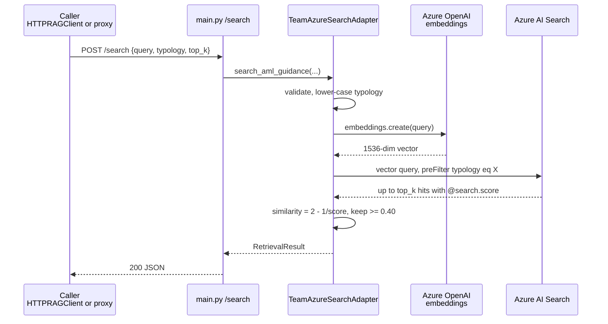
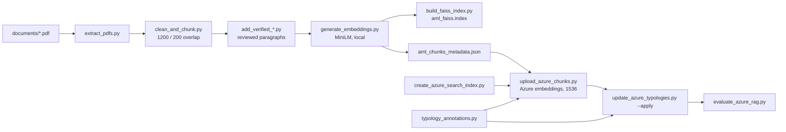

# RAG service

## Purpose

Retrieve **human-verified** AML guidance passages for a given typology so the agents can cite
them, and serve the analyst's knowledge-base search. The service is a small FastAPI app
(`RAG/app/`) with two interchangeable search backends; the deployed one is Azure AI Search.
The `RAG/scripts/` folder holds the offline pipeline that builds the corpus and the indexes.

## Responsibilities

- Expose `POST /search` with the contract the agents' `HTTPRAGClient` expects.
- Restrict results to passages whose `typology` was assigned by a reviewed annotation.
- Convert search scores to cosine similarity and drop results below the relevance cutoff.
- Explain empty or partial results in `relevance_notes`.
- Provide `/health` for probes and the backend's status panel.
- Build, tag and evaluate the guidance index offline.

## Source files

### Service (`RAG/app/`)

| File | Contents |
|---|---|
| `main.py` | FastAPI app, backend selection by `RAG_BACKEND`, endpoints `/`, `/health`, `/retrieve`, `/search`; request models `AMLQuery`, `AMLSearchRequest` |
| `azure_search_adapter.py` | `TeamAzureSearchAdapter` (deployed backend), `min_score = 0.40` |
| `team_faiss_adapter.py` | `TeamFAISSAdapter` (local backend over the FAISS index) |
| `typology_annotations.py` | `VERIFIED_CHUNKS`: typology → chunk ID → reviewed section |
| `models.py` | `Guideline`, `RetrievalResult` (no FAISS imports) |
| `retriever.py` | `AMLRetriever`: `all-MiniLM-L6-v2` + `indexes/aml_faiss.index` |
| `rag_pipeline.py`, `prompt_template.py` | `AMLRAGPipeline` and prompt builder for `/retrieve` |
| `test_azure_adapter.py`, `test_rag_pipeline.py`, `test_retriever.py`, `test_prompt.py` | Manual scripts, not pytest suites |

### Index pipeline (`RAG/scripts/`)

| Script | Step |
|---|---|
| `extract_pdfs.py` | `documents/*.pdf` → `extracted/*.json` (per page text, PyMuPDF) |
| `check_extraction.py` | Report empty pages and character counts |
| `clean_and_chunk.py` | Normalize whitespace, chunk 1200 chars with 200 overlap → `chunks/*_chunks.json`; IDs `{document_id}_p{page}_c{n}` |
| `add_verified_structuring_chunk.py`, `add_verified_typology_chunks.py` | Extract complete reviewed paragraphs verbatim as extra chunks with stable IDs (for example `RBI_KYC_Master_Direction_p40_rapid_movement_1`) |
| `generate_embeddings.py` | Local embeddings (`all-MiniLM-L6-v2`) → `indexes/aml_embeddings.npy`, `aml_chunks_metadata.json` |
| `build_faiss_index.py` | `indexes/aml_faiss.index` |
| `search_faiss.py` | Interactive local search |
| `check_typology_coverage.py` | Keyword scan for typology coverage in the corpus |
| `create_azure_search_index.py` | Creates the Azure index (fields below, HNSW, cosine, 1536 dims); refuses to overwrite an index with other dimensions |
| `upload_azure_chunks.py` | Embeds approved documents with Azure OpenAI and uploads them (`--limit`, `--upload`; dry run by default; requires `APPROVED_AML_DOCUMENTS`) |
| `update_azure_typologies.py` | Sets `typology` and `section` on verified chunks in Azure after checking text, source and page match locally and a `REQUIRED_PHRASES` entry is present (`--apply`) |
| `test_azure_connections.py`, `test_azure_retrieval.py` | Connectivity and raw retrieval checks |
| `evaluate_azure_rag.py` | Calls `/search` for one known query per typology and checks the expected chunk is returned above `MIN_RELEVANCE = 0.40`; writes `reports/azure_rag_evaluation.json` |

## Endpoints

| Method | Path | Body | Response | Notes |
|---|---|---|---|---|
| `GET` | `/` | | `{message, status, search_backend}` | |
| `GET` | `/health` | | `{status: "healthy", search_backend}` | No external call; used by probes and the backend's `/health` |
| `POST` | `/search` | `AMLSearchRequest {query (≥1 char), typology (≥1 char), top_k 1–20, default 5}` | `RetrievalResult` | Used by agents and the knowledge page |
| `POST` | `/retrieve` | `AMLQuery {question, top_k}` | `{question, status, sources, prompt_ready}` | FAISS pipeline only; `503` in the Azure image |

`RetrievalResult`:

```json
{
  "retrieved_guidelines": [
    {"chunk_id": "RBI_KYC_Master_Direction_p40_rapid_movement_1", "text": "...",
     "source": "RBI_KYC_Master_Direction.pdf", "section": "Chapter VI - ...",
     "page": 40, "typology": "rapid_movement", "relevance_score": 0.58}
  ],
  "source_references": ["RBI_KYC_Master_Direction_p40_rapid_movement_1"],
  "relevance_notes": ["Results are restricted to verified typology annotations. Other guidance chunks are not yet classified."]
}
```

See [RAG API](../api-reference/rag-api.md) for the full reference.

## Key classes

### `TeamAzureSearchAdapter`

```python
def search_aml_guidance(self, query: str, typology: str, top_k: int = 5) -> RetrievalResult
```

1. Validate inputs (`ValueError` → HTTP 400); lower-case the typology.
2. Embed the query with `AZURE_OPENAI_EMBEDDING_DEPLOYMENT`; require 1536 dimensions.
3. One vector query: `k_nearest_neighbors=top_k` on `content_vector`,
   `filter="typology eq '<typology>'"` (single quotes escaped), `vector_filter_mode="preFilter"`.
4. Drop results with a different typology or missing `chunk_id`/`text`/`source`/`section`.
5. `similarity = 2.0 - 1.0 / @search.score` (valid for one cosine vector query), clamped to
   [-1, 1]; drop if `< self.min_score` (0.40).
6. Add a relevance note explaining either the restriction or the empty result.

Authentication: `AZURE_OPENAI_API_KEY` and `AZURE_SEARCH_ADMIN_KEY` if set, otherwise
`DefaultAzureCredential` (needs "Cognitive Services OpenAI User" and "Search Index Data
Reader"). Both clients have retries disabled (`max_retries=0`, `retry_total=0`).

The threshold is documented in the code:

```python
# Calibrated 2026-11-24 on text-embedding-3-small, within the
# typology pre-filter (every candidate is a human-verified passage):
#   agent's descriptive queries .......... 0.46 - 0.66
#   other AML topics (e.g. onboarding) ... 0.27 - 0.37
#   unrelated text ....................... <= 0.12
# 0.40 keeps real agent queries and drops off-topic ones. The old
# 0.50 cutoff dropped every agent query, including structuring.
# Re-check these ranges if the embedding model or corpus changes.
self.min_score = 0.40
```

### `TeamFAISSAdapter`

Runs one FAISS search for `max(10, top_k)` results, then returns **only** the chunks listed in
`VERIFIED_CHUNKS[typology]`: their FAISS score if they were hit, otherwise the dot product of
the query embedding with the stored vector (`index.reconstruct`). It has no score cutoff and
notes verified chunks missing from the index.

### `VERIFIED_CHUNKS`

| Typology | Verified chunk IDs |
|---|---|
| `structuring` | `RBI_KYC_Master_Direction_p23_structuring_1` |
| `unusual_activity` | `RBI_KYC_Master_Direction_p40_unusual_activity_1`, `FIU_Guidance_p10_unusual_activity_1`, `FATF_Recommendations_p73_unusual_activity_1` |
| `rapid_movement` | `RBI_KYC_Master_Direction_p40_rapid_movement_1` |
| `fan_in_out` | `RBI_KYC_Master_Direction_p41_fan_in_out_1` |
| `customer_due_diligence`, `enhanced_due_diligence`, `ongoing_monitoring`, `suspicious_transaction_reporting`, `money_mules` | one chunk each (knowledge-base topics; not agent typologies) |

Each chunk carries exactly one typology, because the Azure index stores a single `typology`
string and the retrieval agent drops chunks whose typology differs.

## Execution flow

### Query path



### Index build path



Azure index fields (`create_azure_search_index.py`): `chunk_id` (key), `text`, `source`,
`document_id`, `section`, `page` (Int32), `typology` (filterable), `content_vector`
(1536 floats, profile `amlens-vector-profile`, HNSW `amlens-hnsw`, cosine).

## Dependencies

| Image | Requirements | Includes |
|---|---|---|
| Deployed (`RAG/Dockerfile` default) | `requirements-azure.txt` | fastapi, uvicorn, pydantic, python-dotenv, azure-search-documents, azure-core, openai, azure-identity |
| FAISS build (`--build-arg RAG_REQUIREMENTS=requirements.txt`) | `requirements.txt` | plus faiss, sentence-transformers (torch), PyMuPDF for scripts |

Environment: `RAG_BACKEND` (`azure` or `faiss`, default `faiss` in code, `azure` in the image),
`AZURE_OPENAI_BASE_URL`, `AZURE_OPENAI_EMBEDDING_DEPLOYMENT`, `AZURE_OPENAI_API_KEY`,
`AZURE_SEARCH_ENDPOINT`, `AZURE_SEARCH_INDEX_NAME` (`amlens-guidance-v1` by default in
`deploy.sh`), `AZURE_SEARCH_ADMIN_KEY` (despite the name, `deploy.sh` fills it with a
read-only **query** key in secret `amlens-ai`), `RAG_CORS_ORIGINS`. `main.py` and the adapter both call
`load_dotenv(RAG/.env, override=True)`, so a `.env` file in the image would override the
container environment.

## Integration points

| Caller | How | Notes |
|---|---|---|
| Agents `AMLRetrievalAgent` | `HTTPRAGClient(RAG_SERVICE_URL)`, `POST /search`, timeout 20 s, `raise_for_status()` | `top_k=5`; up to two queries per run; validated as the agents' strict `RetrievalResult` |
| Frontend knowledge page | `api.searchGuidelines()` → `/api/rag/search` → proxy | Typology limited to the four agent typologies by the zod enum |
| Backend `/health` | `GET {RAG_SERVICE_URL}/health`, timeout 2 s | `degraded` when `USE_MOCK_RAG` is true |
| Agents `EvidenceAgent` | Cites only chunks with `relevance_score >= 0.45` | Stricter than the service's 0.40 |

## Failure scenarios

| Scenario | Service response | Effect on an investigation |
|---|---|---|
| Empty query/typology, `top_k` out of range | `400` (adapter `ValueError`) or `422` (FastAPI model) | `retrieval` node fails → run `failed` |
| Azure OpenAI or Search error, timeout, dimension mismatch | `500 AML guidance search failed` (traceback printed to stdout) | `retrieval` node fails → run `failed`, case `FAILED`, HTTP 503 to the UI |
| Service down or unreachable | connection error in `httpx` | same as above; `/health` shows `rag: offline` |
| No verified chunk above 0.40 | `200` with empty list and an explanatory note | Run continues; no interpretation/concern claims; verifier warning "No retrieved guidance available" |
| Typology with no annotations (for example a typo) | `200`, empty | same as above |
| Missing environment variable at startup | `KeyError` at import, container crash-loops | `/health` probe fails, pod not ready |
| `/retrieve` in the Azure image | `503` | not used by the agents |

The knowledge page shows any non-2xx as a toast with the `detail` text.

## Extension points

### How to add a typology

1. **Find and review a passage.** It must be a complete paragraph from an approved document
   that clearly describes the typology.
2. **Add it as a chunk.** Extend `scripts/add_verified_typology_chunks.py` (verbatim extraction
   from the PDF page, stable ID `{doc}_p{page}_{typology}_1`), run it, then
   `generate_embeddings.py` and `build_faiss_index.py`.
3. **Annotate it** in `app/typology_annotations.py` under the new typology key with its
   `section`. One typology per chunk.
4. **Add a guard phrase** to `REQUIRED_PHRASES` in `scripts/update_azure_typologies.py`.
5. **Upload and tag** in Azure: `python scripts/upload_azure_chunks.py --limit 0 --upload`
   (or only the new chunk), then `python scripts/update_azure_typologies.py --apply`.
6. **Add an evaluation case** to `TEST_CASES` in `scripts/evaluate_azure_rag.py` and run it.
   Check the expected chunk scores ≥ 0.40 for the agent's query wording (see
   `TYPOLOGY_DESCRIPTIONS` in `agents/agents/aml_retrieval_agent.py`).
7. If the agents should use it, follow
   [Agent pipeline: how to add a typology](agent-pipeline.md#how-to-add-a-typology-to-the-agents).

### Recalibrating the threshold

When the embedding model or corpus changes, rerun `evaluate_azure_rag.py`, compare the score
ranges with the comment in `azure_search_adapter.py`, and update `min_score`,
`MIN_RELEVANCE` in the evaluation script and `CITATION_MIN_RELEVANCE` in the evidence agent
together.

### Adding a search backend

Implement `search_aml_guidance(query, typology, top_k) -> RetrievalResult`, import it in
`main.py` under a new `RAG_BACKEND` value, and keep heavy imports lazy so the slim image still
starts.

## Tests

| Test | Where | Notes |
|---|---|---|
| Import check without torch | `.github/workflows/ci-cd.yml` | Installs `requirements-azure.txt` and imports `app.main` with dummy Azure settings |
| `test_http_contract` | `agents/tests/test_retrieval_agent.py` | The agents' `HTTPRAGClient` request/response contract |
| `test_local_real_faiss` | `agents/tests/test_retrieval_agent.py` | Uses `LocalFAISSDemoClient` (`agents/mocks/local_faiss.py`), a toy bag-of-words FAISS index over agent fixtures, not this service's index |
| `test_metadata_and_filter`, `test_weak_result_kept` | `agents/tests/test_retrieval_agent.py` | Typology filtering and low-score handling on the agent side |
| `RAG/app/test_azure_adapter.py` | manual | Live structuring query against Azure; run `python -m app.test_azure_adapter` from `RAG/` with a populated `RAG/.env` |
| `RAG/scripts/evaluate_azure_rag.py` | manual | Retrieval quality per typology; defaults to `http://127.0.0.1:8000/search`, override with `RAG_EVAL_URL` (the service listens on 8001 in containers) |
