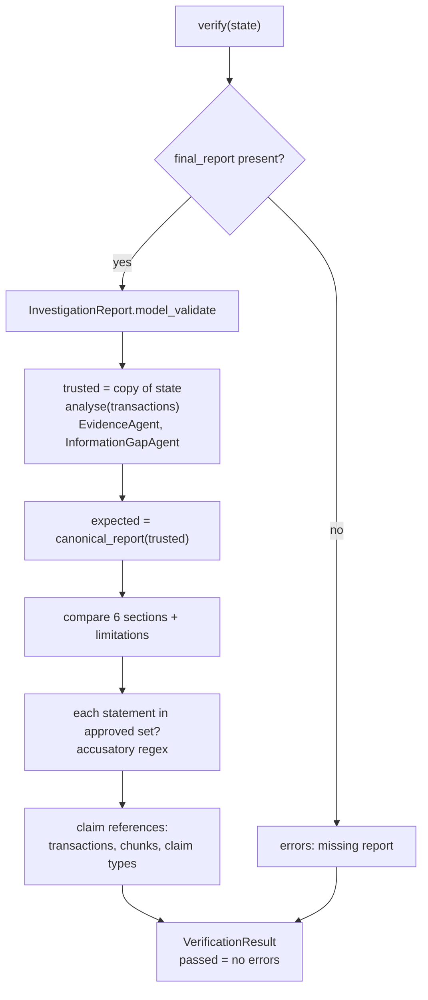
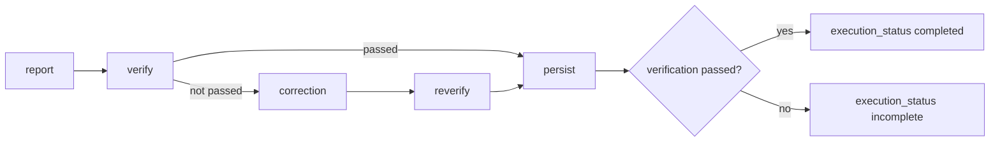

# Report verifier

## Purpose

Decide whether a drafted `InvestigationReport` is fully grounded in the source data before an
analyst may approve it. The verifier does not trust the draft: it recomputes what the report
must contain from the raw transactions and retrieved guidance and compares.

## Responsibilities

- Reject a missing or schema-invalid report.
- Recompute the transaction analysis, evidence findings and information gaps, and require the
  report's sections to be equal to the recomputed canonical report.
- Require every narrative sentence to be one of the approved statements.
- Reject accusatory wording.
- Check every claim's transaction and chunk references exist and match its claim type.
- Return warnings for unsupported assumptions and missing guidance.

## Source files

| File | Contents |
|---|---|
| `agents/verifier/report_verifier.py` | `ReportVerifier.verify(state) -> VerificationResult`, `ACCUSATORY` regex |
| `agents/schemas/report.py` | `InvestigationReport`, `NarrativeSection`, `VerificationResult`, `HUMAN_DISCLAIMER` |
| `agents/agents/report_agent.py` | `canonical_report()`, `approved_statements()` (reused by the verifier) |
| `agents/agents/transaction_agent.py` | `analyse()` (reused) |
| `agents/agents/evidence_agent.py`, `information_gap_agent.py` | Re-run on the trusted state |
| `agents/graph.py` | `verify` node, conditional edges to `correction` and `persist` |
| `backend/app/api/investigations.py` | `decide()` uses `verification.passed` to allow `APPROVE` |

## Key class

```python
class ReportVerifier:
    def verify(self, state) -> VerificationResult: ...

class VerificationResult(StrictModel):
    passed: bool
    errors: list[str] = Field(default_factory=list)
    warnings: list[str] = Field(default_factory=list)
```

`passed` is `not errors`. Warnings never fail verification.

## Inputs and outputs

| Input (from state) | Used for |
|---|---|
| `final_report` | The draft under test (`None` if the report node had a validation error) |
| `transactions` | Recomputing `transaction_analysis` with `analyse()` |
| `retrieved_guidelines` | Recomputing evidence; the set of valid `chunk_id`s |
| `alert_context`, `investigation_id`, `alert_id`, `account_id`, `relevance_notes` | Rebuilding the canonical report |

| Output | Where it goes |
|---|---|
| `VerificationResult` | `state['verification_result']`; `errors` appended to `state['errors']`; a `verification` event in `audit_log`; `verification_json` in the agent store; returned by `GET /investigations/{id}/report` and in case summaries |

## Checks

| # | Check | Error message |
|---|---|---|
| 1 | `final_report` is present | `Missing or invalid structured report` |
| 2 | `investigation_id`, `alert_summary`, `transaction_analysis`, `aml_guidance_and_evidence`, `missing_information_and_questions`, `human_review_disclaimer` equal the recomputed canonical report | `<field>: differs from verified evidence or required content` |
| 3 | `investigation_narrative.limitations` equal the canonical limitations | `Limitations were changed or omitted` |
| 4 | Every narrative statement is in `approved_statements(trusted)` | `Narrative contains an unverified factual, numerical or citation claim` |
| 5 | No statement matches the `ACCUSATORY` pattern (case-insensitive): guilty, criminal, launderer, "money laundering confirmed", "prove(s) laundering" | `Accusatory language in narrative` |
| 6 | Each evidence claim's `supporting_transaction_ids` is a subset of the bundle's transaction IDs | `Unknown transaction reference` |
| 7 | Each claim's `supporting_chunk_ids` is a subset of the retrieved chunk IDs | `Fabricated guidance reference` |
| 8 | `observed_fact` claims cite at least one transaction | `Observed fact lacks transaction evidence` |
| 9 | `supported_interpretation` claims cite at least one chunk | `Interpretation lacks guidance evidence` |
| 10 | `unsupported_assumption` claims have `support_status == "unsupported"` | `Unsupported assumption not flagged` |
| 11 | Any `ValueError`, `TypeError` or `KeyError` while checking | `Report or evidence failed schema validation` |

Warnings: the text of each `unsupported_assumption` claim, and `No retrieved guidance
available` when retrieval returned nothing.

`recommended_next_steps` is not compared to the canonical list, but the schema restricts it to
the three `NEXT_STEPS` literals, so an invented step already fails `InvestigationReport`
validation in the report node.

## Execution flow



### Where it sits in the graph



The `correction` node re-runs `ReportAgent` with `retry_count = 1`, which sets
`correction_requested: true` in the LLM payload. There is exactly one correction. Failure
edges to `persist` are omitted here; see the full graph in
[Agent pipeline](agent-pipeline.md#orchestration-graph).

## Dependencies

Only the agents package itself (schemas and the deterministic agents). No I/O, no LLM, no
network. Running it twice on the same state gives the same result.

## Integration points

- **Graph:** the `verify` and `reverify` nodes; the result drives the `correction` edge and
  the final `completed`/`incomplete` status in `persist`.
- **Backend:** `decide()` refuses `APPROVE` unless `execution_status == "completed"` and
  `verification.passed` is true (409 `Cannot approve an incomplete or unverified AI report`).
- **Frontend:** `investigation-detail.tsx` shows `verification.errors` and `warnings` and
  computes `canApprove = execution_status === "completed" && verification.passed && canRecord`.

## Failure scenarios

| Scenario | Outcome |
|---|---|
| LLM picks a sentence that is not approved (for example an invented amount) | Check 4 fails and correction runs; if it still fails, the run is `incomplete` |
| LLM output is not valid `NarrativeDraft` JSON | Report node sets `final_report = None`, check 1 fails, correction runs |
| A deterministic agent changes but `canonical_report()` is not kept consistent | Check 2 fails on every run, so every report is `incomplete` |
| RAG returns no guidance | Passes, with warning `No retrieved guidance available` |
| An exception other than the caught types escapes `verify` | `traced()` marks the node failed and the run is `failed` |

## Extension points

- **New report section:** add it to `InvestigationReport`, build it in `canonical_report()`, and
  add the field name to the tuple compared in check 2. If the LLM may influence it, write an
  explicit rule instead of equality.
- **New forbidden wording:** extend the `ACCUSATORY` regular expression.
- **New claim type:** add it to `EvidenceFinding.claim_type`, then add a rule in the claim loop
  (what it must cite, which `support_status` it requires), and update `claimLabels` in
  `frontend/components/pages/investigation-detail.tsx`.
- **Loosening equality:** any field that is not compared becomes something the LLM could alter.
  Keep `safe_llm_payload()` and the compared fields in sync.

## Tests

| Test | File | What it checks |
|---|---|---|
| `test_accepts_grounded_report` | `agents/tests/test_verifier.py` | A canonical report passes |
| `test_rejects_tampering` | `agents/tests/test_verifier.py` | Altered figures, citations and narrative are rejected |
| `test_no_decision_action` | `agents/tests/test_verifier.py` | The report carries no decision capability |
| `test_report_cannot_mutate_grounding` | `agents/tests/test_verifier.py` | Changing the report does not change the trusted state used for checking |
| `test_single_correction` | `agents/tests/test_graph.py` | One correction, then persisted |
| `test_invalid_structured_output_correction` | `agents/tests/test_graph.py` | Invalid LLM output triggers correction and the run completes |
