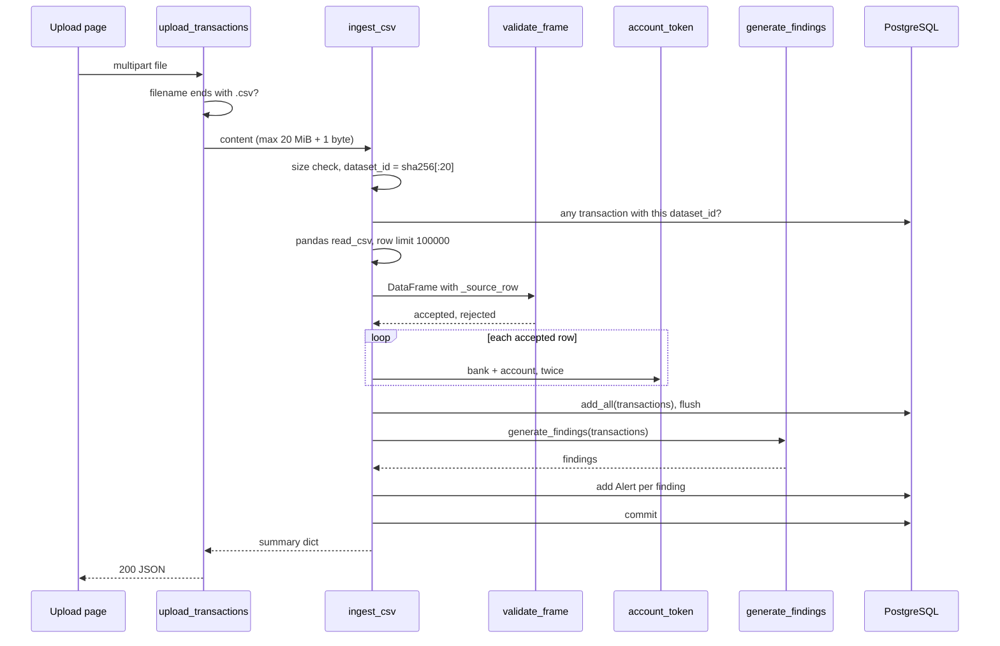

# Transaction ingestion

## Purpose

Turn an uploaded CSV of transactions (IBM AML "HI-Small" format) into tokenized rows in the
`transactions` table and trigger detection, in one atomic database transaction.

## Responsibilities

- Accept only `.csv` uploads up to 20 MiB and 100,000 rows.
- Reject a file that was already imported (content hash).
- Validate required columns, then each row; report rejected rows with reasons.
- Replace bank and account numbers with HMAC tokens before anything is stored.
- Insert accepted rows, run the [detection rules](detection-rules.md), insert alerts, commit.
- Never persist the raw file or the `Is Laundering` ground-truth label.

## Source files

| File | Contents |
|---|---|
| `backend/app/api/upload.py` | `POST /upload-transactions` handler `upload_transactions(file, db)` |
| `backend/app/services/ingestion.py` | `ingest_csv(content, db)`, `MAX_UPLOAD`, `MAX_ROWS` |
| `backend/app/services/validation.py` | `validate_frame(df)`, `REQUIRED`, `CURRENCIES`, `FORMATS` |
| `backend/app/utils/tokenization.py` | `account_token(bank, account)` |
| `backend/app/database/tables.py` | `Transaction`, `Alert` ORM models |
| `frontend/components/pages/upload.tsx` | Upload page, zod schema, receipt view |
| `backend/examples/*.csv` | Example input files |
| `backend/scripts/create_ibm_subset.py` | Builds smaller CSVs from the full IBM dataset |

## Key functions

| Symbol | Signature | Notes |
|---|---|---|
| `upload_transactions` | `async def upload_transactions(file: UploadFile = File(...), db: Session = Depends(get_db))` | Checks the extension, reads at most `MAX_UPLOAD + 1` bytes, maps `ValueError` and `IntegrityError` to 400 |
| `ingest_csv` | `def ingest_csv(content: bytes, db: Session) -> dict` | Whole pipeline; one `db.commit()` at the end |
| `validate_frame` | `def validate_frame(df: pd.DataFrame) -> tuple[list[dict], list[dict]]` | Raises `ValueError` for missing columns; otherwise returns accepted and rejected rows |
| `account_token` | `def account_token(bank: str, account: str) -> str` | `ACC_` + 24 hex of HMAC-SHA256; raises `RuntimeError` if `TOKEN_SECRET` < 32 chars |

## Inputs

Required CSV columns (`REQUIRED` in `validation.py`):

| Column | Rule | Stored as |
|---|---|---|
| `Timestamp` | Parseable by `pd.to_datetime` | `transactions.timestamp` (timezone-naive) |
| `From Bank`, `Account` | Non-empty | `sender_token = account_token(From Bank, Account)` |
| `To Bank`, `Account.1` | Non-empty | `receiver_token = account_token(To Bank, Account.1)` |
| `Amount Received`, `Amount Paid` | `Decimal`, finite, > 0 | `amount_received`, `amount_paid` (`Numeric(24, 8)`) |
| `Receiving Currency`, `Payment Currency` | One of 15 names in `CURRENCIES` (`US Dollar`, `Euro`, ..., `Bitcoin`) | `receiving_currency`, `payment_currency` |
| `Payment Format` | One of `Cheque`, `Credit Card`, `ACH`, `Cash`, `Reinvestment`, `Wire`, `Bitcoin` | `payment_format` |
| `Is Laundering` | `0` or `1` | **not stored** |

The CSV is read with `dtype=str, keep_default_na=False`, so values like `NA` stay strings and
fail the specific rule rather than becoming `NaN`.

## Outputs

HTTP 200 body:

```json
{
  "dataset_id": "3f1c0b9d2e7a4c5b6a81",
  "accepted": 999,
  "rejected": 1,
  "rejection_reasons": [{"source_row": 4, "reasons": ["invalid_timestamp"]}],
  "rejection_reasons_truncated": false,
  "alerts_created": 37,
  "ground_truth_exposed": false
}
```

| Field | Meaning |
|---|---|
| `dataset_id` | First 20 hex chars of `sha256(file bytes)` |
| `rejection_reasons` | First 50 rejected rows; `source_row` is the 1-based file line (header = line 1) |
| `rejection_reasons_truncated` | `true` when more than 50 rows were rejected |

Possible row reasons: `missing:<column>`, `invalid_timestamp`, `invalid_amount:<column>`,
`invalid_currency:<column>`, `invalid_payment_format`, `invalid_ground_truth_label`.

The frontend's `api.uploadTransactions()` renames these fields to `accepted_count`,
`rejected_count`, `row_number` and `reason` (reasons joined with `; `).

Side effects: rows in `transactions` (`id = TX_{dataset_id}_{source_row}`) and `alerts`
(`id = AL_{dataset_id}_{n}`).

## Execution flow



## Dependencies

| Dependency | Used for |
|---|---|
| `pandas` | CSV parsing and timestamp parsing |
| `decimal.Decimal` | Exact amounts (no floats) |
| `hmac`, `hashlib` | Tokenization and dataset hash |
| SQLAlchemy session from `get_db()` | Transactional inserts |
| `python-multipart` | FastAPI `UploadFile` |
| Environment: `TOKEN_SECRET` | HMAC key (required) |

## Integration points

- **Downstream:** [Detection rules](detection-rules.md) receives the list of new `Transaction`
  objects. It only sees this upload's rows, so patterns that span two uploads are not detected.
- **Agents:** `TeamBackend` later reads these rows; it relies on `dataset_id`, the tokens,
  and on amounts that have at most two decimal places (`_money()` rejects others).
- **Frontend:** `components/pages/upload.tsx` (zod: `.csv`, ≤ 25 MB) and the
  `UploadResult` type in `lib/api/types.ts`.
- **Ingress:** `proxy-body-size: "25m"` on `amlens-web`.

## Failure scenarios

| Scenario | Where | Surfaces as |
|---|---|---|
| File name does not end in `.csv` | `upload_transactions` | `400 CSV file required` (toast) |
| File larger than 20 MiB | `ingest_csv` | `400 MVP upload limit is 20 MB. Split the full dataset first.` |
| File larger than 25 MB | Ingress / zod | NGINX `413`, or a form error before upload |
| Same file uploaded twice | `ingest_csv` or primary key | `400 Dataset already imported` |
| Not parseable as CSV | `pd.read_csv` | `400 Could not parse CSV: ...` |
| More than 100,000 rows | `ingest_csv` | `400 MVP limit is 100,000 rows; use a representative subset.` |
| Missing required columns | `validate_frame` | `400 Missing required CSV columns: ...` |
| Individual bad rows | `validate_frame` | `200` with `rejected > 0` and reasons |
| `TOKEN_SECRET` unset or short | `account_token` | `RuntimeError`, not caught → `500 Internal Server Error` (the toast shows `Request failed (500)`) |
| Database error mid-way | SQLAlchemy | Nothing is committed; `500` |

!!! warning "Accepted here, rejected later"
    `Bitcoin` is a valid currency for validation but `TeamBackend.CURRENCIES` has no mapping
    for it. Alerts involving Bitcoin rows are created, but their investigation fails in the
    transaction node with `Unsupported currency mapping`. Amounts with more than two decimals
    behave the same way (`_money()`).

!!! note "Event loop blocking (Inferred)"
    `upload_transactions` is `async def` but calls the synchronous `ingest_csv` directly. For
    large files the uvicorn event loop is blocked until the upload finishes.

## Extension points

### Accept a new column or value

1. Add the column to `REQUIRED` (or a value to `CURRENCIES` / `FORMATS`) in `validation.py`.
2. If it must be stored, add a column to `Transaction` in `tables.py` **and** a new Alembic
   revision in `backend/alembic/versions/` (see [Migrations](../database/migrations.md));
   `test_models_match_migrations` fails otherwise.
3. Map it in `ingest_csv` where `Transaction(...)` is built.
4. For a new currency, also add the ISO code to `CURRENCIES` in
   `backend/app/integrations/team_backend.py`, or investigations on it will fail.

### Support a different file layout

Write a converter to the IBM column names before `validate_frame`, or add a second
validator and branch on the header in `ingest_csv`. Keep tokenization in the ingestion step so
no raw identifier is ever stored.

## Tests

| Test | File | What it checks |
|---|---|---|
| `test_validation_and_bad_amount` | `backend/tests/test_validation.py` | Accepted/rejected split and amount rules |
| `test_account_token_is_stable_and_bank_scoped` | `backend/tests/test_validation.py` | Determinism and bank scoping of tokens |
| `test_upload_and_alert_and_investigation` | `backend/tests/test_api.py` | Upload → alert → case → run → decision, `ground_truth_exposed` is false |
| `test_duplicate_upload_rejected` | `backend/tests/test_api.py` | Second upload of the same bytes returns 400 |
| `test_account_history_uses_tokens_and_exact_amounts` | `backend/tests/test_api.py` | History is keyed by token; amounts are exact strings |
