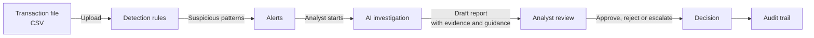

# AMLens documentation

AMLens helps anti-money-laundering (AML) analysts review suspicious transactions. It flags
unusual payments, drafts an evidence-linked investigation report with AI, and records the
analyst's final decision in a complete audit trail. **The AI drafts; a person decides.**

## Choose your guide

<a class="amlens-audience-card user" href="user-guide/">
  I'm an application user
  You review alerts, read investigation reports and record decisions.
  No technical knowledge needed: step-by-step guides, screenshots and plain-language explanations.
  Open the user guide →
</a>

<a class="amlens-audience-card developer" href="developer-guide/">
  I'm a developer
  You build, run, test, deploy or operate AMLens. Architecture,
  modules, API and database reference, the AI agent pipeline, and the production runbook.
  Open the developer guide →
</a>

## Popular pages

-   :material-rocket-launch-outline: **Your first case, end to end**

    ---

    Upload a file, open an alert, run the AI investigation and record a decision.

    [:octicons-arrow-right-24: Start the walkthrough](user-guide/workflows/first-case-end-to-end.md)

-   :material-help-circle-outline: **Understanding results**

    ---

    What every status, score and report section means, and what to do next.

    [:octicons-arrow-right-24: Read the guide](user-guide/understanding-results.md)

-   :material-sitemap-outline: **System architecture**

    ---

    How the frontend, backend, AI agents and guidance search fit together.

    [:octicons-arrow-right-24: See the architecture](developer-guide/architecture/system-architecture.md)

-   :material-laptop: **Run AMLens locally**

    ---

    Install the services and run the full stack on your machine.

    [:octicons-arrow-right-24: Local development](developer-guide/getting-started/local-development.md)

-   :material-api: **API reference**

    ---

    Every backend, agent and guidance-search endpoint, with examples.

    [:octicons-arrow-right-24: Browse the API](developer-guide/api-reference/overview.md)

-   :material-kubernetes: **Production environment**

    ---

    The live Azure Kubernetes Service deployment and how to operate it.

    [:octicons-arrow-right-24: Deployment](developer-guide/deployment/index.md)

## What AMLens does, in one picture

!!! info "Scope"
    AMLens is decision support for analysts. It does **not** make decisions on its own,
    file regulatory reports (SAR/STR), or monitor payments in real time.
