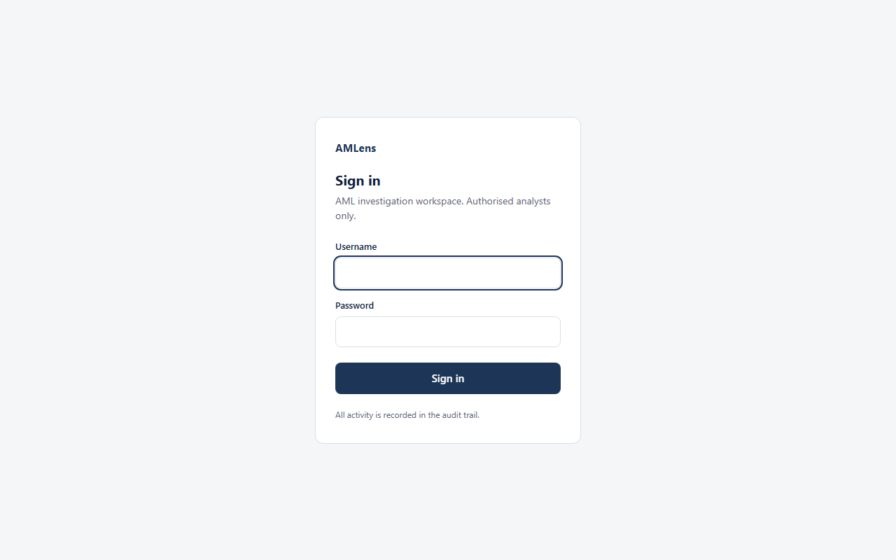

# Account and sign-in

AMLens is protected by a sign-in page. This page explains how you get an account, how to sign in and out, and what to do when sign-in does not work.

## How accounts work

- **Accounts are created by an administrator.** There is no self-registration and no "Create account" link. Ask your AMLens administrator for a username and password.
- **You sign in with a username and password.** There is no "Sign in with Microsoft" button on the live site.
- **There is no in-app password reset.** If you forget your password, contact your administrator. There is no "Forgot password" link.
- **Everyone has the same access.** Once signed in, every user can see all alerts and investigations and can perform every action. There are no separate roles inside the app.

!!! warning "Keep your credentials to yourself"
    Your username is recorded as the analyst on every decision you make. Never share your password, and never sign in for someone else. If you think your password is known to someone else, tell your administrator straight away.

## Sign in

1. Open **<https://amlens-870b3a.southindia.cloudapp.azure.com>**.
2. If you are not already signed in, you are sent to the **Sign in** page. It reads *"AML investigation workspace. Authorised analysts only."*

    <figure markdown="span">
      { loading=lazy }
      <figcaption>The AMLens sign-in page on the live site.</figcaption>
    </figure>

3. Type your **Username**.
4. Type your **Password**.
5. Select **Sign in**.

**What you should see:** the **Compliance overview** dashboard. If you opened a link to a specific page (for example an investigation) before signing in, you are taken to that page instead.

### Inputs

| Field | Required | Notes |
| --- | --- | --- |
| Username | Yes | Exactly as given to you by your administrator. |
| Password | Yes | Case-sensitive. |

## How your identity is used

When you record a decision, AMLens stores **the username you signed in with** as the analyst who made it. The decision form also has an **Analyst ID** box (pre-filled with `ANL-2048`). On the live site, whatever you type there is **replaced** by your signed-in username when the decision is saved. The saved decision and the audit trail show your username.

The profile button in the top-right corner (showing a demo analyst name and "Analyst ID: ANL-2048") is a fixed placeholder in the app design. It is not your account and cannot be changed.

## Sign out

There is no **Sign out** button inside AMLens. To sign out:

1. Go to **<https://amlens-870b3a.southindia.cloudapp.azure.com/oauth2/sign_out>**.
2. Close all browser tabs that had AMLens open.

!!! tip "On a shared computer"
    Always sign out using the address above and close the browser when you finish, especially on a shared or public computer.

How long you stay signed in before you are asked to sign in again has not been verified. If you are sent back to the sign-in page during your work, sign in again. Unsaved typing in a form (for example a decision rationale) may be lost, so keep long rationales in a draft document until you submit them.

## Sign-in is rate limited

To protect accounts from password guessing, the sign-in pages accept only **about 20 requests per minute from the same network address** (with a short burst allowance). If you try too many times in a short period you may see an error page instead of the sign-in form.

**What to do:** wait one minute, then try again carefully. Colleagues behind the same office network share this allowance, so a busy morning may occasionally trigger it.

## Troubleshooting sign-in

| What you see | Likely cause | Can you fix it? |
| --- | --- | --- |
| The sign-in page shows a message after you select **Sign in** and you stay on the form | Wrong username or password | **Yes.** Check Caps Lock and try again slowly. After two or three failures, contact your administrator. |
| An error page instead of the sign-in form, after several attempts | Rate limit reached | **Yes.** Wait one minute and try again. |
| An error page with a **Sign in again** link | Your session expired or the sign-in step failed | **Yes.** Select **Sign in again**. |
| The site does not load at all, or your browser warns about the connection | Network or site problem | **No.** This is a system problem. Contact your administrator. |
| You can sign in, but every page shows "Unable to load this information" | The services behind AMLens are down | **No.** See [Settings and service health](features/settings-and-health.md) and contact your administrator. |

More help: [Troubleshooting](troubleshooting.md).

## Related pages

- [Getting started](getting-started.md)
- [Recording a decision](features/recording-decisions.md)
- [Audit trail](features/audit-trail.md)
- [FAQ](faq.md)
