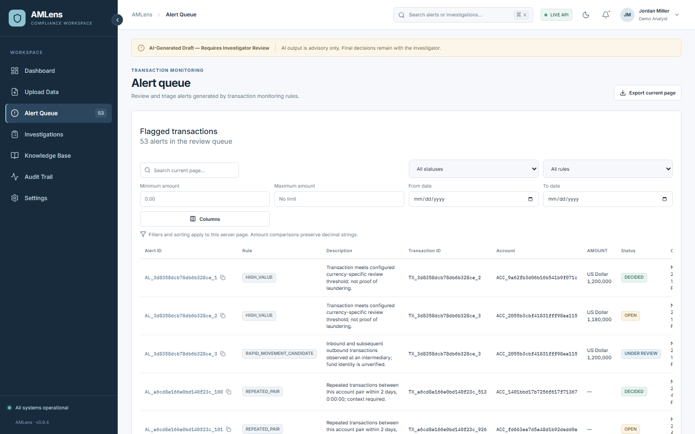

# Alert queue

## What it is

The **Alert queue** is the list of every [alert](../glossary.md) created from uploaded transaction files. Each row is one rule match that needs a human to look at it.

## Why you would use it

To decide which alert to work on next, to check the status of alerts, and to export a list for reporting.

## Where to find it

Select **Alert Queue** in the sidebar. The number beside it is the total number of alerts.

## Before you start

At least one transaction file must have been uploaded. See [Upload transaction data](upload-data.md).

<figure markdown="span">
  { loading=lazy }
  <figcaption>The Alert queue, with filters for rule, status, date and amount above the table.</figcaption>
</figure>

## Read the queue

The table is titled **Flagged transactions** and shows *"N alerts in the review queue"*.

| Column | Meaning |
| --- | --- |
| **Alert ID** | Unique ID, for example `AL_3c1f…_2`. Select the copy icon to copy it. |
| **Rule** | Which screening rule fired: `HIGH_VALUE`, `REPEATED_PAIR` or `RAPID_MOVEMENT_CANDIDATE`. See [Introduction](../introduction.md). |
| **Description** | The rule's standard wording, for example *"Transaction meets configured currency-specific review threshold; not proof of laundering."* |
| **Transaction ID** | The transaction that triggered the alert (for repeated pairs, the first one in the series). |
| **Account** | The tokenised [anchor account](../glossary.md) the alert is about. |
| **Amount** | For High Value: the amount paid. For Rapid Movement: the amount that came **in**. For Repeated Pair: **—** (there is no single amount; open the alert to see the count). |
| **Status** | *OPEN*, *UNDER REVIEW* or *DECIDED*. See below. |
| **Created** | When the alert was created (the upload time, not the transaction time), in your browser's time zone. |
| **Review** | Opens the alert. |

### Alert statuses

| Status | Meaning |
| --- | --- |
| **OPEN** | Nobody has started an investigation yet. |
| **UNDER REVIEW** | An investigation has been started. |
| **DECIDED** | A human decision has been recorded on its investigation. |

Statuses only move forward: OPEN → UNDER REVIEW → DECIDED. See [Understanding results](../understanding-results.md).

## Find and filter alerts

!!! warning "Filters only apply to the page you are looking at"
    The queue loads one page of alerts at a time (10 by default). The search box, every filter and column sorting work **only on that page**, not on all alerts. The line below the table tells you, for example, *"Showing 1–10 of 42 alerts · 3 match current-page filters"*. To filter across more alerts, set **Rows** to **200** first.

1. **Show more rows:** at the bottom right, change **Rows** to 10, 25, 50, 100 or 200.
2. **Search:** type in **Search current page…**. It matches text in the alert ID, rule, description, account token and transaction ID.
3. **Filter by status:** choose *All statuses*, *Open*, *Under review* or *Decided*.
4. **Filter by rule:** choose *All rules*, *High value*, *Repeated pair* or *Rapid movement candidate*.
5. **Filter by amount:** enter a **Minimum amount** and/or **Maximum amount** (numbers only, for example `10000` or `9500.50`). Alerts with no amount (Repeated Pair) are hidden while an amount filter is set. An entry that is not a valid number is ignored.
6. **Filter by date:** set **From date** and/or **To date**. These compare against the alert's **Created** date.
7. **Sort:** select a column heading (Alert ID, Rule, Description, Transaction ID, Account, Status, Created). Select again to reverse. Amount cannot be sorted.
8. **Choose columns:** select **Columns** and tick or untick columns to show or hide them.
9. **Move between pages:** use **Previous** and **Next**.

**What you should see:** the table updates immediately. If nothing matches, it says *No alerts match the current filters*.

## Open an alert

Select anywhere on the row, select **Review**, or highlight the row with ++tab++ and press ++enter++. The [Alert review](alert-review.md) page opens.

## Export the current page

1. Apply any filters you want.
2. Select **Export current page**.

**What you get:** a file named `amlens-alerts-current-page.csv` containing the alerts **currently shown after filtering** (only that page), with alert ID, transaction ID, rule, description, account token, amount, currency and status.

!!! note
    The `created_at` column in this export is currently empty for alerts from uploaded files. Use the **Created** column on screen if you need the date.

## Order of alerts

Alerts are listed in order of their alert ID, which groups them by uploaded file. Within a file the IDs are numbered (`_1`, `_2`, ...). The numbering is compared as text, so for example `_10` may appear before `_2`.

## Errors and edge cases

| You see | Meaning | What to do |
| --- | --- | --- |
| *0 alerts in the review queue* | Nothing has been uploaded, or no rule matched. | [Upload a file](upload-data.md). |
| *Unable to load this information* with **Retry** | The service did not respond. | Select **Retry**. If it persists, it is a system problem. Contact your administrator. |
| An alert you expect is missing | It may be on another page, or hidden by a filter. | Clear filters, set **Rows** to 200, or paste the alert ID into the top-bar search. |

## Related pages

- [Reviewing an alert](alert-review.md)
- [Working the daily alert queue](../workflows/daily-alert-triage.md)
- [Navigation and dashboard](../navigation-and-dashboard.md)
- [Understanding results](../understanding-results.md)
