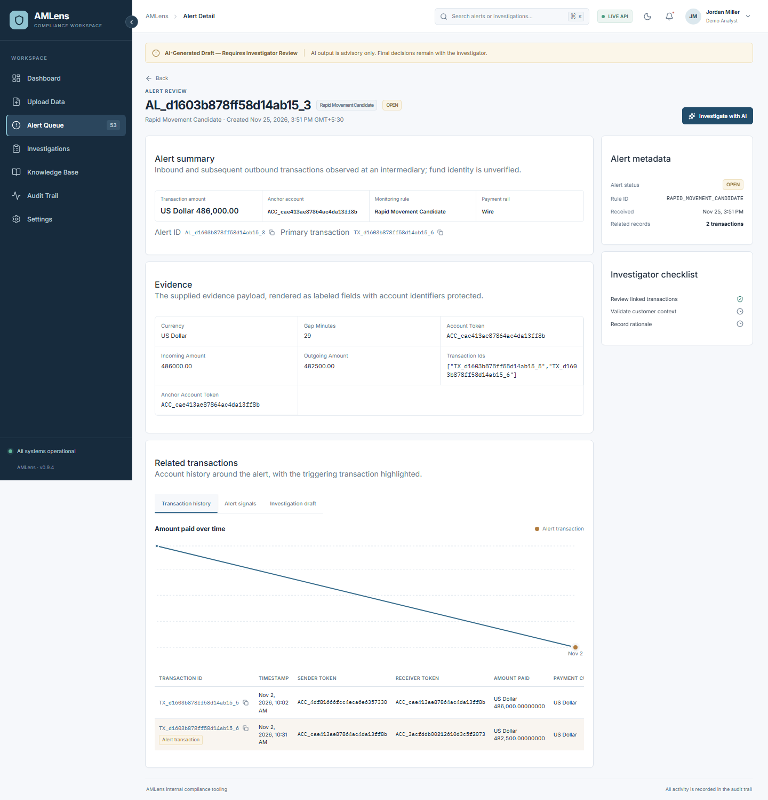

# Reviewing an alert

## What it is

The **Alert review** page (breadcrumb: *Alert Detail*) shows everything AMLens knows about one [alert](../glossary.md): the triggering transaction, the evidence the rule recorded, the account's transaction history, and any investigation already started.

## Why you would use it

To understand **why** the alert fired before deciding whether it needs an AI-assisted investigation, and to check the raw transactions behind any report.

## Where to find it

- In the [Alert queue](alert-queue.md), select a row or its **Review** link.
- Paste an alert ID (starting with `AL_`) into the top-bar search and press ++enter++.
- From an investigation, select **Open source alert**.

## Before you start

The alert must exist. If you see **Alert not found**, check the ID (IDs are case-sensitive).

<figure markdown="span">
  { loading=lazy }
  <figcaption>An alert's review page: the alert signals, the account's transaction history and the related records.</figcaption>
</figure>

## The page layout

### Header

The header shows the **alert ID**, a badge for the **rule** (for example *High Value*), a badge for the **status** (*OPEN*, *UNDER REVIEW* or *DECIDED*), and the creation date. On the right is the main action button:

| Button | When it appears |
| --- | --- |
| **Investigate with AI** | No investigation exists for this alert yet. |
| **Open investigation** | An investigation already exists. |
| **Open running investigation** | An investigation exists and its AI run is still in progress. |

### Alert summary

| Field | Meaning |
| --- | --- |
| **Transaction amount** | High Value: amount paid. Rapid Movement: amount that came in. Repeated Pair: **—**. |
| **Anchor account** | The tokenised account the alert is about. For High Value and Repeated Pair this is the **sender**; for Rapid Movement it is the account the money passed **through**. |
| **Monitoring rule** | The rule name. |
| **Payment rail** | The payment format (for example *Wire*), when known. |
| **Alert ID** / **Primary transaction** | IDs with copy buttons. |

### Evidence

The **Evidence** panel lists every value the rule recorded. Account values are shown as tokens or as *[redacted]*. What you see depends on the rule:

| Rule | Evidence fields you will see |
| --- | --- |
| High Value | Transaction Ids, Anchor Account Token, Amount Paid, Currency, Threshold (`1000000`) |
| Repeated Pair | Transaction Ids, Anchor Account Token, Sender Token, Receiver Token, Currency, Count (number of payments), Window Hours (`48`) |
| Rapid Movement Candidate | Transaction Ids (incoming then outgoing), Anchor Account Token, Account Token, Currency, Gap Minutes (time between in and out), Incoming Amount, Outgoing Amount |

### Related transactions

This panel has three tabs.

**Transaction history** shows up to the **100 most recent transactions** in which the anchor account was the sender or the receiver, across all uploaded files:

- A line chart of **Amount paid over time**. The triggering transaction is marked with a larger highlighted dot. Hover over a point to see its date and amount.
- A table with Transaction ID, Timestamp, Sender token, Receiver token, Amount paid, Payment currency, Amount received, Receiving currency and Payment format. The triggering row is labelled **Alert transaction**.

**Alert signals** gives three reminders: the **Rule match**, the **Observed window** (shown as *Not supplied* for current rules), and the note *"A rule match is a screening signal and is not proof of suspicious activity."* It also lists all **Linked transaction references**.

**Investigation draft** shows a short status of the AI report if one exists (run status, *Verified structure* or *Verification issues*) with an **Open full review** link. If no investigation exists yet it shows *No report available.*

### Side panels

- **Alert metadata:** status, rule ID, received time and number of related transactions.
- **Latest investigation** (only once an investigation exists): investigation ID, run status and decision (or *Not recorded*).
- **Investigator checklist:** a static reminder list: *Review linked transactions*, *Validate customer context*, *Record rationale*. The ticks are fixed and do not track your progress.

## Review an alert step by step

1. Read the header: which rule fired, and what the status is.
2. Read the **Alert summary** and **Evidence**: amount, anchor account, count or time gap.
3. Open **Transaction history** and find the row labelled **Alert transaction**. Look at what happened before and after it.
4. Open **Alert signals** and note the linked transaction IDs.
5. Decide whether to investigate:
    - Select **Investigate with AI** to draft a report. See [AI investigation](ai-investigation.md).
    - If an investigation already exists, select **Open investigation** instead.

!!! tip "One investigation per alert"
    Once an investigation exists, this page always links to it rather than starting a new one. If a run fails, retry it from the investigation page. See [Retrying a failed investigation](../workflows/retry-failed-investigation.md).

## Errors and edge cases

| You see | Meaning | What to do |
| --- | --- | --- |
| **Alert not found** | The ID is wrong or the alert does not exist. | Check the ID, or go **Back** to the queue. |
| *Tokenized reference unavailable* as the anchor account | The account value is not in the expected token format, so it is withheld. Transaction history cannot be loaded. | Contact your administrator if this happens for uploaded data. |
| *No transaction history* | No transactions were returned for the account. | Unusual for uploaded data. If it persists, contact your administrator. |
| *Unable to load this information* | A service did not respond. | Select **Retry**. If it persists, contact your administrator. |

## Related pages

- [Alert queue](alert-queue.md)
- [AI investigation](ai-investigation.md)
- [Understanding results](../understanding-results.md)
- [Glossary](../glossary.md)
