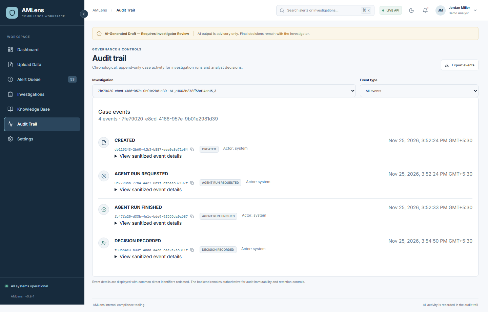

# Audit trail

## What it is

The **Audit trail** is the time-ordered, append-only history of everything that happened to an investigation: when it was created, when the AI run was requested, whether it finished or failed, and who recorded the decision and why. "Append-only" means events are only ever added; AMLens offers no way to edit or delete them.

## Why you would use it

- To prove what happened, when, and who decided, for a supervisor, auditor or regulator.
- To understand the history of a case before you act on it, for example how many times a run failed.

## Where to find it

- Select **Audit Trail** in the sidebar, then choose an investigation.
- From an investigation, select **View event history** (in the **Audit trail** panel on the right, or on a failed-run page). The audit trail opens with that investigation already selected.
- From the dashboard, select **View audit trail** in **Recent activity**.

## Before you start

At least one investigation must exist. The audit trail is organised **per investigation**: there is no single list of all events across all cases.

<figure markdown="span">
  { loading=lazy }
  <figcaption>The Audit trail for one investigation: case created, AI run requested and finished, decision recorded.</figcaption>
</figure>

## View a case's history

1. Open **Audit Trail**.
2. In **Investigation**, choose a case. Each option shows the investigation ID and its alert ID. If you arrived from a case, it is already selected; otherwise the most recent case is selected.
3. Optionally, in **Event type**, choose one event type to show.

**What you should see:** the **Case events** panel, oldest event first, with a count such as *"4 events · <investigation ID>"*.

## Event types

| Event (as shown) | Filter label | When it is recorded | Details include |
| --- | --- | --- | --- |
| **CREATED** | Case created | An investigation is started from an alert. | The alert ID |
| **AGENT RUN REQUESTED** | Agent run requested | An AI run starts (including every retry). | — |
| **AGENT RUN FINISHED** | Agent run finished | An AI run ends with a report. | Execution status: *completed* or *incomplete* |
| **AGENT RUN FAILED** | Agent run failed | An AI run fails without a report. | — |
| **DECISION RECORDED** | Decision recorded | A person records a decision. | Decision, analyst ID (your signed-in username), decision ID, rationale |

A typical successful case has four events: CREATED → AGENT RUN REQUESTED → AGENT RUN FINISHED → DECISION RECORDED. A case that failed once and was retried has a FAILED event followed by a second REQUESTED event.

## Read an event

Each event shows:

- the event name and an icon,
- the date and time to the second, with your time zone,
- the **event ID** (with a copy button) and a status badge,
- **Actor**, and
- **View sanitized event details**: select it to see the details. Common direct identifiers (such as account numbers, emails, phone numbers or names) are shown as *[REDACTED]*.

!!! note "Actor shows 'system'"
    The **Actor** line currently shows *system* for every event, including decisions. The person who made a decision is recorded in the event details as **analyst_id**. Open **View sanitized event details** to see it.

## Export events

1. Select the investigation (and an event type, if you want only some events).
2. Select **Export events**.

A file named `amlens-audit-events.csv` downloads, containing the events currently shown, with event ID, investigation ID, action, time and the sanitised details. The button is disabled when no events are shown.

## Errors and edge cases

| You see | Meaning | What to do |
| --- | --- | --- |
| *No investigation selected* | No case is chosen, or none exist. | Choose a case, or start one from an alert. |
| *No events found* | No events match the event-type filter. | Choose *All events*. |
| *Unable to load this information* | The service did not respond. | Select **Retry**. If it persists, contact your administrator. |
| The case you want is not in the list | The list shows the 200 most recent investigations. | Open the investigation by ID (top-bar search) and select **View event history**. |

The note under the panel reminds you: *"Event details are displayed with common direct identifiers redacted. The backend remains authoritative for audit immutability and retention controls."* How long events are kept is set by your organisation and has not been verified here.

## Related pages

- [Preparing evidence for an audit](../workflows/audit-evidence.md)
- [Recording a decision](recording-decisions.md)
- [Investigations list](investigations-list.md)
- [Understanding results](../understanding-results.md)
