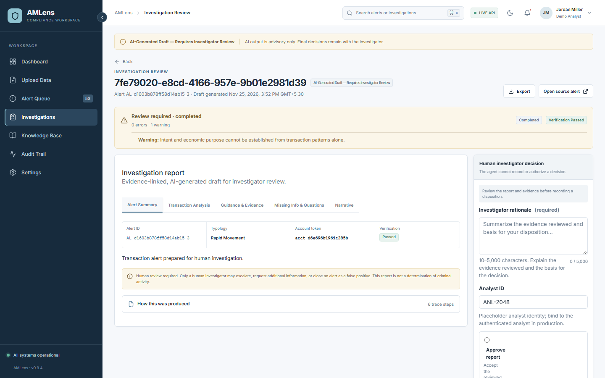
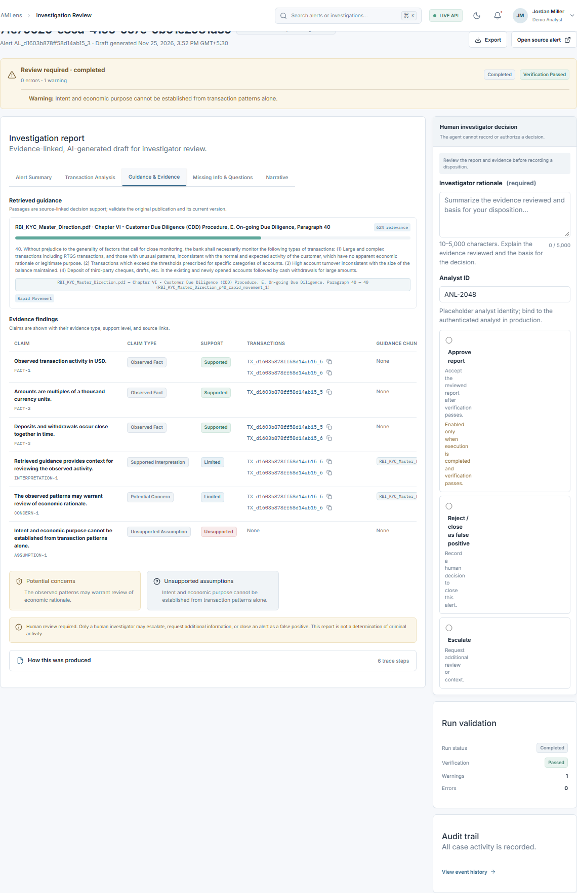

# Reading the investigation report

## What it is

The **Investigation Review** page shows the AI-generated draft report for one investigation, the verification result, the decision form, and links to the source alert and the audit trail.

## Why you would use it

To check the AI's draft against the evidence before you record a decision. Every factual statement in the report is linked to transaction IDs or guidance passages so you can check it yourself.

## Where to find it

- It opens automatically when an AI run finishes.
- From the [Investigations list](investigations-list.md), select an investigation ID or **Review**.
- From an alert, select **Open investigation**.
- Paste the investigation ID into the top-bar search.

## Before you start

The AI run must have ended with status **completed** or **incomplete**. If it **failed**, or has not run yet, you see a different page. See [Retrying a failed investigation](../workflows/retry-failed-investigation.md).

<figure markdown="span">
  { loading=lazy }
  <figcaption>An AI investigation report. The status strip shows the run is completed and verification passed; the decision panel is on the right.</figcaption>
</figure>

<figure markdown="span">
  { loading=lazy }
  <figcaption>The Guidance & Evidence tab: the guidance passages the AI relied on, with evidence findings linked to transactions.</figcaption>
</figure>

## Page layout

| Area | What it contains |
| --- | --- |
| **Header** | Investigation ID, a badge reading *AI-Generated Draft — Requires Investigator Review*, the alert ID and when the draft was generated. Buttons: **Export** and **Open source alert**. |
| **Verification strip** | The verification result and any errors or warnings. |
| **Investigation report** | The report, in five tabs, plus *How this was produced*. |
| **Recorded investigator disposition** | Appears once a decision exists: the decision, who recorded it, when, and the rationale. |
| **Right-hand side** | **Human investigator decision** form, **Run validation** summary, and an **Audit trail** link. |

## Read the verification strip

| Strip title | Meaning |
| --- | --- |
| **Verification passed** (green) | Run completed, verification passed and no warnings. |
| **Review required · completed** (amber) | Verification **passed**, but there are warnings to read. |
| **Review required · incomplete** (amber) | Verification did **not** pass. Approval is disabled. |
| **Verification failed** (red) | There are verification errors, or the run failed. |

Below the title you see the number of errors and warnings, followed by each one, prefixed **Error:** or **Warning:**.

!!! note "Almost every report shows at least one warning"
    The checker always lists the statement *"Intent and economic purpose cannot be established from transaction patterns alone."* as a warning, as a reminder that the data cannot show intent. So a passing report usually shows **Review required · completed** rather than the green strip. Check the badge **Verification passed** and the **Run validation** panel to confirm that verification passed.

Other warnings you may see: *"No retrieved guidance available"*, which means no guidance passage was relevant enough to cite.

Common errors (these make verification fail):

| Error | Meaning in plain terms |
| --- | --- |
| *...: differs from verified evidence or required content* | A section of the draft did not match the independently recalculated facts. |
| *Narrative contains an unverified factual, numerical or citation claim* | The AI wrote a statement that is not on the approved list. |
| *Accusatory language in narrative* | Words such as "guilty" or "criminal" were used. |
| *Unknown transaction reference* / *Fabricated guidance reference* | A claim pointed at a transaction or passage that was not in the evidence. |
| *Missing or invalid structured report* | The AI did not produce a usable draft. |

## Read the report tabs

### Alert Summary

Alert ID (links to the alert), **Typology**, the tokenised **Account token**, **Verification** (*Passed* or *Needs review*) and a one-line summary. Every tab ends with the disclaimer: *"Human review required. Only a human investigator may escalate, request additional information, or close an alert as a false positive. This report is not a determination of criminal activity."*

### Transaction Analysis

| Part | What it shows |
| --- | --- |
| **Statistic cards** | Calculated figures for the 48-hour window around the alert, some per currency (the currency code appears first and is shown as, for example, *Usd*). Examples: *Transaction Count*, *Counterparty Count*, *Usd.Total*, *Usd.Deposits*, *Usd.Withdrawals*, *Usd.Net*, *Usd.Fan In*, *Usd.Fan Out*, *Usd.Peak Hour Count*, *Usd.Round Count*, *Usd.Rapid Transaction Count*. Deposits are money coming **into** the anchor account; withdrawals are money going **out**. |
| **Observed patterns** | Each pattern found, with the transaction IDs that show it. Examples: *Frequent transactions within an inclusive rolling hour*, *Amounts are multiples of a thousand currency units*, *Repeated deposits below the illustrative analysis threshold*, *Deposits and withdrawals occur close together in time*, *Multiple incoming and outgoing counterparties*. |
| **Potential red flags** | The non-routine patterns, each followed by *"Requires contextual human review."* |
| **Supporting transaction IDs** | Every transaction the analysis used. |
| **Limitations** | Fixed caveats, for example that the threshold used is an **illustrative US$10,000 parameter, not a regulatory threshold**, and that rapid movement means closeness in time, not traced flow of funds. |

### Guidance & Evidence

- **Retrieved guidance:** each guidance passage found, with its source and section, a **% relevance** bar, the passage text and a citation. Select the citation to open a **Source citation** window with the full text, relevance score, typology and source. Always check the original publication before relying on it.
- **Evidence findings:** a table of claims with **Claim type**, **Support**, linked **Transactions** and **Guidance chunks**, and an explanation.

| Claim type | Meaning |
| --- | --- |
| **Observed fact** | A pattern directly calculated from the transactions. Support: *supported*. |
| **Supported interpretation** | Guidance that gives context to the activity. Support: *limited*. Only present when a guidance passage scored at least 45% relevance. |
| **Potential concern** | A review question, not proof of misconduct. Support: *limited*. |
| **Unsupported assumption** | Something the data **cannot** show, such as intent. Support: *unsupported*. |

- **Potential concerns** and **Unsupported assumptions** are repeated in two call-out boxes.

### Missing Info & Questions

A table of seven information areas: **Kyc**, **Source Of Funds**, **Transaction Purpose**, **Sender Beneficiary Relationship**, **Counterparty Information**, **Economic Rationale** and **Supporting Documents**. Each has a status, an explanation and a question. In the current version AMLens holds no customer data, so these are normally all **Not provided**, and you will need to obtain the answers from your own systems. A numbered list of **Investigation questions** follows.

### Narrative

**Draft narrative** statements, **Recommended next steps** and **Limitations**. The narrative may only use pre-approved statements, which is why it reads cautiously.

### How this was produced

Expand **How this was produced** to see each internal step (for example *transaction*, *retrieval*, *evidence*, *information_gap*, *report*, *verify*, and, if a redraft happened, *correction* and *reverify*) with its status and, if one failed, the error type.

## Export or print the report

1. Select **Export** in the header.
2. Choose:
    - **Print / Save PDF:** opens your browser's print dialogue. Choose *Save as PDF* to keep a copy. Report tabs that are not open may not appear in the printout, so open and print each tab you need (or use **Download JSON** for the complete report).
    - **Download JSON:** downloads a file named `<investigation ID>-investigation-report.json` with the full report. Account values not already masked are replaced with *[redacted]*.

## Errors and edge cases

| You see | Meaning | What to do |
| --- | --- | --- |
| **Investigation not found** | Wrong ID or the investigation does not exist. | Check the ID. |
| **Report unavailable** | The report could not be loaded. | Select **Retry**. If it persists, contact your administrator. |
| **The AI run did not finish** | The run failed. | See [Retrying a failed investigation](../workflows/retry-failed-investigation.md). |
| **Not run yet** | The case was created but never run. | Select **Run investigation**. |
| *No guidance references* | No passage was relevant enough. | Normal for some alerts. Use the [Knowledge base](knowledge-base.md) to search yourself. |

## Related pages

- [Recording a decision](recording-decisions.md)
- [Understanding results](../understanding-results.md)
- [Knowledge base](knowledge-base.md)
- [Preparing evidence for an audit](../workflows/audit-evidence.md)
