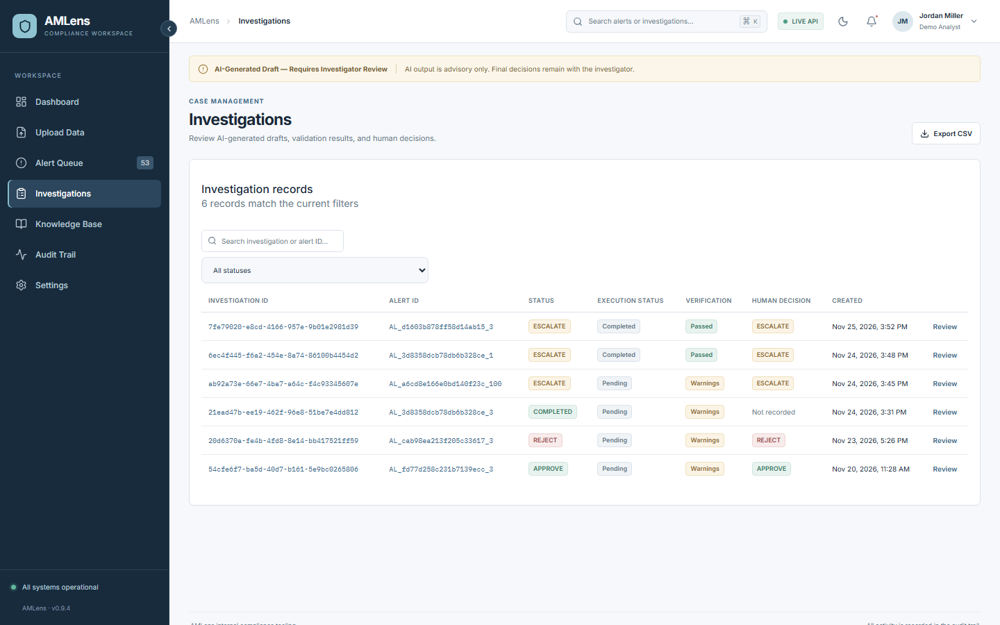

# Investigations list

## What it is

The **Investigations** page lists every [investigation](../glossary.md) (case), newest first, with its case status, AI run status, verification result and human decision.

## Why you would use it

- To find cases waiting for your decision.
- To spot failed runs that need to be retried.
- To check which cases have been decided, and how.
- To export a case list for a supervisor or auditor.

## Where to find it

Select **Investigations** in the sidebar.

## Before you start

At least one AI investigation must have been started from an alert. Otherwise the page shows *No investigations match*.

<figure markdown="span">
  { loading=lazy }
  <figcaption>The Investigations list, showing each run's execution status, verification result and human decision.</figcaption>
</figure>

## Read the list

The panel **Investigation records** says how many records match the current filters.

| Column | Meaning |
| --- | --- |
| **Investigation ID** | The case ID (a long code). Select it to open the case. |
| **Alert ID** | The alert the case belongs to. Select it to open the alert. |
| **Status** | The overall case status: *PENDING AGENT*, *RUNNING*, *COMPLETED*, *INCOMPLETE*, *FAILED*, or, once decided, *APPROVE*, *REJECT* or *ESCALATE*. |
| **Execution status** | The AI run status: *pending*, *running*, *completed*, *incomplete* or *failed*. |
| **Verification** | *Passed*; *Failed* (the report has verification errors); or *Warnings* (verification has not passed but no errors are listed). Note that a **failed** or not-yet-finished run also shows the label *Warnings*, because no report was checked. Always read it together with **Execution status**. |
| **Human decision** | *APPROVE*, *REJECT*, *ESCALATE* or *Not recorded*. |
| **Created** | When the case was created. |
| **Review** | Opens the case. |

See [Understanding results](../understanding-results.md) for how these statuses relate.

## Find a case

1. Type part of an investigation ID or alert ID in **Search investigation or alert ID…**.
2. Choose a status in the drop-down: *All statuses*, *Pending agent*, *Running*, *Completed*, *Incomplete*, *Failed*, *Approved*, *Rejected* or *Escalated*.

**What you should see:** the table and the record count update immediately.

!!! tip "Useful filters"
    - **Completed** or **Incomplete**: cases with a report that may still need a decision. Check the **Human decision** column for *Not recorded*.
    - **Failed**: runs to retry. See [Retrying a failed investigation](../workflows/retry-failed-investigation.md).
    - **Escalated**: cases you have passed on for further review.

!!! note "Status filter after a decision"
    Once a decision is recorded, the case **Status** becomes the decision (for example *ESCALATE*), but its execution status stays *completed* or *incomplete*. So a decided case appears under both **Escalated** and **Completed**.

## Export the list

Select **Export CSV**. A file named `amlens-investigations.csv` downloads with the rows **currently shown** (after search and filter): investigation ID, alert ID, status, execution status, whether verification passed, decision and created date.

## Limits

The page loads the **200 most recent** investigations. Older ones are not shown here. Open them by pasting their ID into the top-bar search.

## Errors and edge cases

| You see | Meaning | What to do |
| --- | --- | --- |
| *No investigations match* with **Open alert queue** | Nothing matches the search or filter, or no cases exist. | Clear the search, choose *All statuses*, or start a case from an alert. |
| *Unable to load this information* | The service did not respond. | Select **Retry**. If it persists, contact your administrator. |

## Related pages

- [Reading the investigation report](investigation-report.md)
- [Recording a decision](recording-decisions.md)
- [Audit trail](audit-trail.md)
- [Understanding results](../understanding-results.md)
