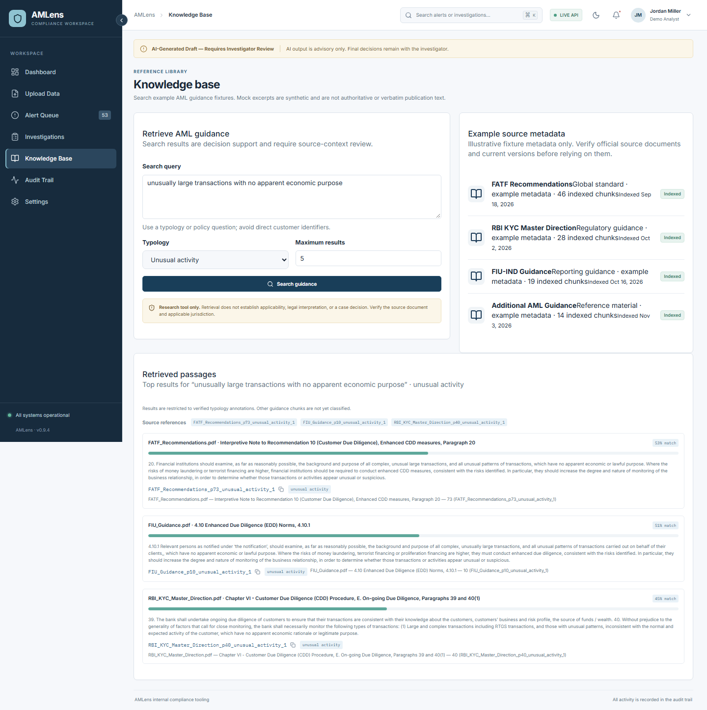

# Knowledge base

## What it is

The **Knowledge base** page lets you search the same library of regulatory guidance passages that the AI investigation uses for its citations. You describe a pattern or policy question, choose a [typology](../glossary.md), and AMLens returns the passages that match, each with a relevance score.

!!! warning "Research tool only"
    As the page says: *"Retrieval does not establish applicability, legal interpretation, or a case decision. Verify the source document and applicable jurisdiction."*

## Why you would use it

- To read the guidance behind a citation in a report.
- To check what the guidance says about a pattern before writing your rationale.
- To understand why an AI report had *No guidance references*.

## Where to find it

Select **Knowledge Base** in the sidebar.

## Before you start

The *AML knowledge retrieval* service should be healthy. See [Settings and service health](settings-and-health.md).

<figure markdown="span">
  { loading=lazy }
  <figcaption>Knowledge base search results for the Unusual activity typology, with match scores and source references.</figcaption>
</figure>

## How the search works (and why it often finds nothing)

Please read this before searching. It explains most "no results" outcomes.

1. **Results are limited to one typology.** Only passages tagged with the typology you choose are searched.
2. **Each typology has very few passages.** At present, only passages that a person has reviewed and tagged are searchable:

    | Typology | Verified passages available |
    | --- | --- |
    | Unusual activity | 3 |
    | Rapid movement | 1 |
    | Structuring | 1 |
    | Fan-in / fan-out | 1 |

3. **Search matches meaning, not keywords,** and a passage is only returned if it scores **at least 40% relevance** to your query.

Because of this, **short keyword searches usually return "No matching passages"**. A one- or two-word query (for example "structuring" or "cash") rarely scores high enough. Full sentences written in the style of regulatory guidance work much better.

### Queries that work

| Typology to choose | Try this query |
| --- | --- |
| **Unusual activity** | `unusually large transactions with no apparent economic purpose` |
| **Rapid movement** | `high account turnover inconsistent with the size of the balance maintained` |
| **Structuring** | `splitting cash deposits to avoid reporting thresholds` |
| **Fan-in / fan-out** | `many accounts sending funds to one account` |

!!! tip "If you get no results"
    1. Check that the **Typology** matches your topic. A structuring question will find nothing under *Unusual activity*.
    2. Rewrite your query as a full descriptive sentence, using wording you would expect in a regulation.
    3. Try one of the example queries above to confirm the search is working.

## Search the guidance

1. Open **Knowledge Base**.
2. In **Search query**, describe the pattern or question (3–500 characters). The box is pre-filled with an example: *"high value payment inconsistent with customer profile"*.
3. Choose a **Typology**: *Structuring*, *Rapid movement*, *Fan-in / fan-out* or *Unusual activity*.
4. Set **Maximum results** (1–20, default 5).
5. Select **Search guidance**.

**What you should see:** the button shows **Searching…**, then the **Retrieved passages** panel at the bottom of the page fills in.

### Inputs

| Field | Rules |
| --- | --- |
| Search query | 3–500 characters. Do not include customer identifiers. |
| Typology | One of the four options. |
| Maximum results | Whole number from 1 to 20. Because each typology has at most 3 passages, values above 3 make no difference today. |

## Read the results

The **Retrieved passages** panel shows *Top results for "<your query>" · <typology>*, then:

- **Notes** explaining the result. When passages were found: *"Results are restricted to verified typology annotations. Other guidance chunks are not yet classified."*
- **Source references:** the IDs of the passages returned.
- One card per passage with the **source and section** (for example a chapter and paragraph of a regulatory direction), a **% match** bar, the **passage text**, its passage ID (copyable), the typology, and a formatted citation.

When nothing scored high enough you see the note *"No sufficiently relevant verified guidance was found for typology '…'. Typology coverage and relevance calibration are still incomplete."* and *"No matching passages were returned. Refine the query or typology."*

!!! note "How the score relates to AI reports"
    The AI investigation cites a passage only if it scores at least **45%**, slightly stricter than this page's 40%. So a passage you find here at 42% would not be cited in a report.

## The "Example source metadata" panel

The panel on the right lists four sources (FATF Recommendations, RBI KYC Master Direction, FIU-IND Guidance, Additional AML Guidance) with chunk counts, dates and an **Indexed** badge.

!!! warning "This list is illustrative only"
    This panel is **static example information** built into the page. It is not read from the live library, the numbers and dates are not live, and **the items cannot be opened**. Use it only as a rough idea of the kinds of sources involved. For the passages actually available, run a search.

Similarly, the page subtitle mentions "example AML guidance fixtures" and "mock excerpts". On the live site (top bar shows **LIVE API**), search results come from the live guidance library. Always verify any passage against the official, current publication.

## Errors and edge cases

| You see | Meaning | What to do |
| --- | --- | --- |
| *Enter at least 3 characters to search.* | Query too short. | Type more. |
| *No matching passages were returned.* | Nothing scored 40% or more in that typology. | See the tips above. This is expected behaviour, not a fault. |
| A red error message under the form, or *Request failed (5xx)* | The retrieval service is unavailable. | Check [Settings and service health](settings-and-health.md). If *AML knowledge retrieval* is not healthy, it is a system problem. Contact your administrator. |

## Related pages

- [Reading the investigation report](investigation-report.md)
- [AI investigation](ai-investigation.md)
- [Troubleshooting](../troubleshooting.md)
- [Glossary](../glossary.md)
