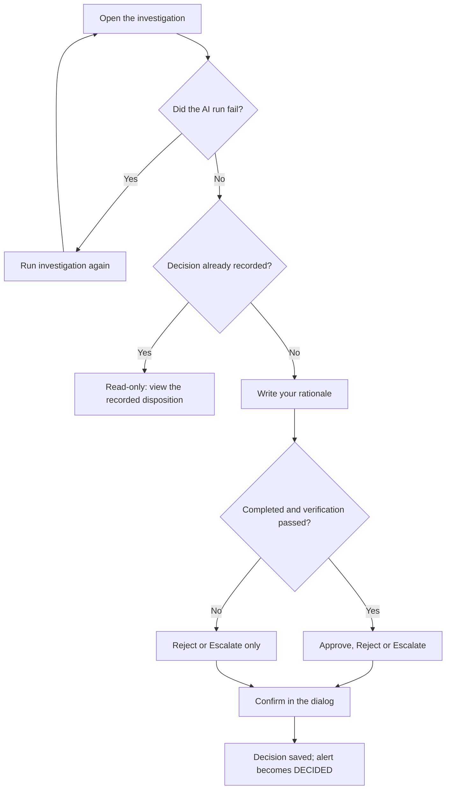
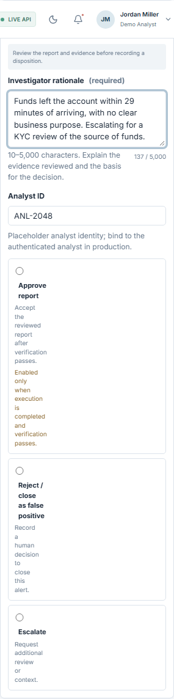
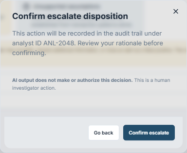

# Recording a decision

## What it is

The **Human investigator decision** form on the Investigation Review page is where you record your final [disposition](../glossary.md) for a case, together with your written [rationale](../glossary.md). This is the one action in AMLens that only a person can take: the form states *"The agent cannot record or authorize a decision."*

## Why you would use it

To close the loop on an alert. Recording a decision:

- marks the alert as **DECIDED**,
- sets the investigation status to your decision (**APPROVE**, **REJECT** or **ESCALATE**),
- writes a **Decision recorded** event, with your username and rationale, to the [audit trail](audit-trail.md).

## Where to find it

Open an investigation (see [Reading the investigation report](investigation-report.md)). The form is in the right-hand column.

## Before you start

- [x] The AI run has ended as **completed** or **incomplete**. Failed runs have no report and no decision form. See [Retrying a failed investigation](../workflows/retry-failed-investigation.md).
- [x] No decision has been recorded for this investigation yet. Decisions are final.
- [x] You have read the report, the verification result and the underlying transactions.

## The three decisions

| Option on screen | Stored as | Use it when | Available when |
| --- | --- | --- | --- |
| **Approve report** — *"Accept the reviewed report after verification passes."* | APPROVE | You accept the reviewed AI report as an accurate record. | Only if the run is **completed** **and** verification **passed**. |
| **Reject / close as false positive** — *"Record a human decision to close this alert."* | REJECT | You have concluded the activity is explained and the alert can be closed. | Completed or incomplete runs. |
| **Escalate** — *"Request additional review or context."* | ESCALATE | You need more information, a second opinion, or a referral under your organisation's procedures. | Completed or incomplete runs. |

!!! note "Approval is deliberately restricted"
    If the run is incomplete or verification did not pass, **Approve report** is greyed out. Hovering over it shows *"Approval requires a completed report with verification passed."* You can still Reject or Escalate. Your organisation's own policy decides what each decision means for the customer. AMLens only records it.

## Decision flow

## Record a decision

1. Read the decision note at the top of the form. It tells you which options are available, for example *"Review the report and evidence before recording a disposition."* or *"Verification did not pass. Approval is disabled until a valid report is available."*
2. In **Investigator rationale (required)**, explain the evidence you reviewed and the basis for your decision. Between 10 and 5,000 characters. A counter shows your progress, for example `152 / 5,000`.
3. Leave the **Analyst ID** box as it is, or type your analyst ID. It must be at least 3 characters. (On the live site your **signed-in username** is recorded instead. See below.)
4. Select one of the three options.

    **You should see** a confirmation window titled, for example, **Confirm escalate disposition**, with the reminder *"AI output does not make or authorize this decision. This is a human investigator action."*

    If the window does not open, an error appears under the rationale or analyst ID. Fix it and select the option again.

5. Re-read your rationale. Select **Go back** to change it, or **Confirm approve / reject / escalate** to save.

    **You should see** the message *"Investigator decision recorded"*. The form is replaced by *"A human disposition has already been recorded. It cannot be overwritten here."*, and a **Recorded investigator disposition** panel appears under the report showing the decision, *Recorded <date> by <username>*, and your rationale.

<figure markdown="span">
  { loading=lazy }
  <figcaption>The decision panel with a rationale entered. Choosing Approve, Reject or Escalate opens a confirmation.</figcaption>
</figure>

<figure markdown="span">
  { loading=lazy }
  <figcaption>The confirmation dialog. Select Confirm to record the decision; Go back lets you change it.</figcaption>
</figure>

## Inputs

| Field | Rules | Notes |
| --- | --- | --- |
| Investigator rationale | Required. 10–5,000 characters (spaces at the start and end are not counted). | This is stored permanently in the audit trail and cannot be edited. Write it as you would for a reviewer or auditor. |
| Analyst ID | 3–80 characters. Pre-filled with `ANL-2048`. | The confirmation window repeats this value, but on the live site **the saved decision uses your signed-in username**, not this box. |
| Decision | One of the three options. | Approve may be disabled. See above. |

!!! tip "Writing a good rationale"
    State what you checked (transactions, counterparties, guidance), what you found, any information you obtained from outside AMLens (for example KYC or source of funds), and why that leads to your decision. Do not paste direct customer identifiers.

## What happens after you confirm

- The investigation status becomes **APPROVE**, **REJECT** or **ESCALATE**.
- The alert status becomes **DECIDED**.
- The audit trail gains a **DECISION RECORDED** event containing the decision, your username and your rationale.
- The dashboard's **Decisions recorded** count goes up.

A decision **cannot be changed or deleted** in AMLens. If you made a mistake, follow your organisation's correction procedure and record the circumstances outside AMLens.

## Errors and edge cases

| Message | Meaning | Can you fix it? |
| --- | --- | --- |
| *Provide at least 10 characters of rationale.* | Rationale too short. | Yes. Write more. |
| *Keep rationale under 5,000 characters.* | Rationale too long. | Yes. Shorten it. |
| *Enter the signed-in analyst ID.* | Analyst ID shorter than 3 characters. | Yes. |
| **Decision conflict** — *A decision has already been recorded for this investigation* | A colleague (or you, in another tab) recorded a decision first. | No change needed. Refresh the page to see the recorded decision. |
| **Decision conflict** — *Cannot approve an incomplete or unverified AI report* | You tried to approve a report that is not both completed and verified. | Yes. Choose Reject or Escalate. |
| **Decision conflict** — *Investigation report must be generated before a review decision* | There is no finished report. | Run the investigation first. |
| *The existing case state could not be confirmed. Decision actions are disabled.* | The page could not load the case status. | Refresh the page. If it persists, contact your administrator. |
| **Decision not recorded** with another message | A system problem. | Try again later. If it persists, contact your administrator. |

## Related pages

- [Reading the investigation report](investigation-report.md)
- [Audit trail](audit-trail.md)
- [Understanding results](../understanding-results.md)
- [Account and sign-in](../account-and-login.md)
