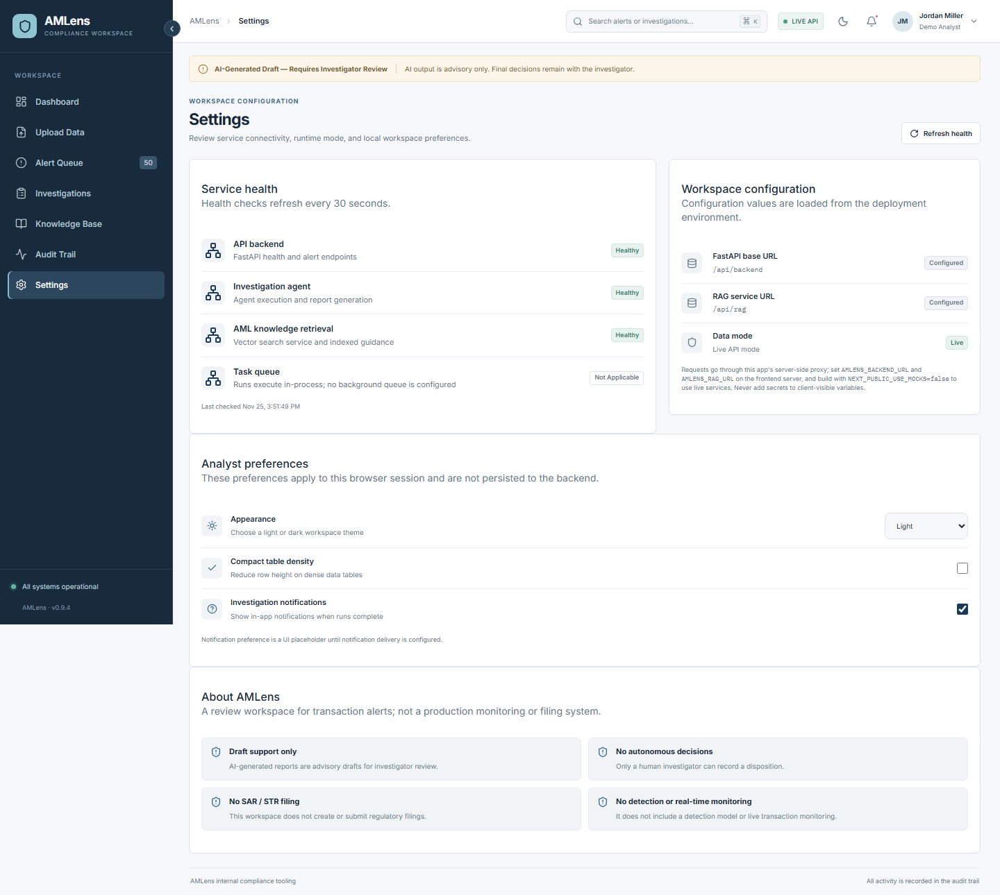

# Settings and service health

## What it is

The **Settings** page shows whether the services behind AMLens are working, confirms that you are connected to live data, lets you change a few display preferences for your current browser session, and states what AMLens is and is not.

## Why you would use it

- When something is not working, to find out whether it is **something you can fix** or **a system problem** for your administrator.
- To switch between light and dark themes, or make tables more compact.

## Where to find it

- Select **Settings** in the sidebar, or
- Select the profile button in the top-right corner, then **Account settings**.

## Before you start

Nothing. Settings is available to every signed-in user.

<figure markdown="span">
  { loading=lazy }
  <figcaption>Settings: service health for the backend, AI agent and guidance search, plus workspace preferences.</figcaption>
</figure>

## Check service health

The **Service health** panel refreshes every 30 seconds. To check immediately, select **Refresh health** at the top right.

| Service | What it does for you | If it is not healthy |
| --- | --- | --- |
| **API backend** | Uploads, alerts, investigations, decisions and the audit trail. | Most pages show *Unable to load this information*. |
| **Investigation agent** | Runs the AI investigation. | **Investigate with AI** fails. |
| **AML knowledge retrieval** | Searches the guidance library. | Knowledge base searches fail, and AI runs may fail. |
| **Task queue** | Not used in this deployment. Runs happen directly. | Always shows **not applicable**. This is expected. |

### Health statuses

| Badge | Meaning | What to do |
| --- | --- | --- |
| **healthy** | Working normally. | Nothing. |
| **degraded** | Running on a stand-in rather than the real service. For knowledge retrieval this means the approved guidance library is **not** in use. | Tell your administrator. Treat AI citations with extra caution. |
| **offline** | Not reachable. | System problem. Contact your administrator. |
| **not applicable** | Not part of this deployment. | Nothing. |

The **Last checked** time shows when the status was last updated.

The same information appears in short form as the dot at the bottom of the sidebar (*All systems operational*, *Service attention required*, *Service offline*, *Health status unavailable*) and in the **System health** panel on the [dashboard](../navigation-and-dashboard.md).

!!! warning "If the health panel itself shows an error"
    *Unable to load this information* in the Service health panel (or *Health status unavailable* in the sidebar) means AMLens cannot reach its backend at all. This is a system problem. Contact your administrator.

!!! note "Healthy does not guarantee a successful AI run"
    The health check confirms that services are reachable. An AI run can still fail if the AI model service is busy or unavailable at that moment. See [Retrying a failed investigation](../workflows/retry-failed-investigation.md).

## Workspace configuration

This read-only panel shows:

- **FastAPI base URL** and **RAG service URL**: internal addresses the app uses. You do not need these, but your administrator may ask for them.
- **Data mode**: should read **Live API mode** with a **Live** badge. If it reads *Mock fixtures enabled — no external service calls* with a **Demo** badge, you are not working with real data. Tell your administrator.

## Change your preferences

The **Analyst preferences** panel applies only to **this browser tab and session**. Preferences are not saved to your account and reset when you reload the page.

| Preference | What it does |
| --- | --- |
| **Appearance** | Choose **Light** or **Dark**. Same as the sun/moon button in the top bar. |
| **Compact table density** | Reduces row height on dense tables. |
| **Investigation notifications** | A placeholder only. As the page notes, *"Notification preference is a UI placeholder until notification delivery is configured."* Changing it has no effect. |

## About AMLens

The final panel states the product's boundaries:

- **Draft support only.** AI-generated reports are advisory drafts for investigator review.
- **No autonomous decisions.** Only a human investigator can record a disposition.
- **No SAR / STR filing.** This workspace does not create or submit regulatory filings.
- **No detection or real-time monitoring.** It does not include a detection model or live transaction monitoring.

## Related pages

- [Navigation and dashboard](../navigation-and-dashboard.md)
- [Troubleshooting](../troubleshooting.md)
- [Account and sign-in](../account-and-login.md)
