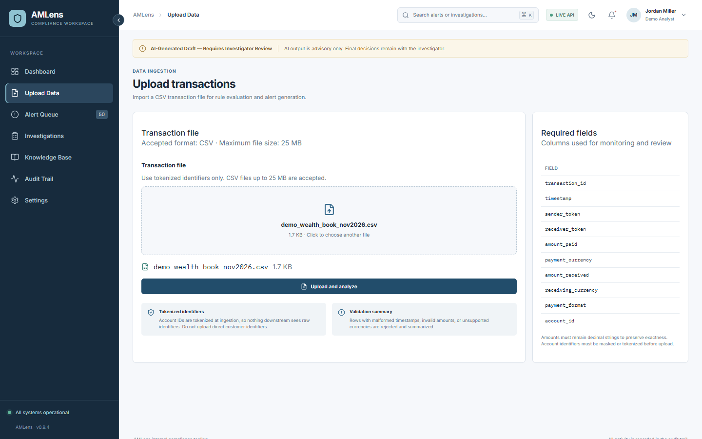
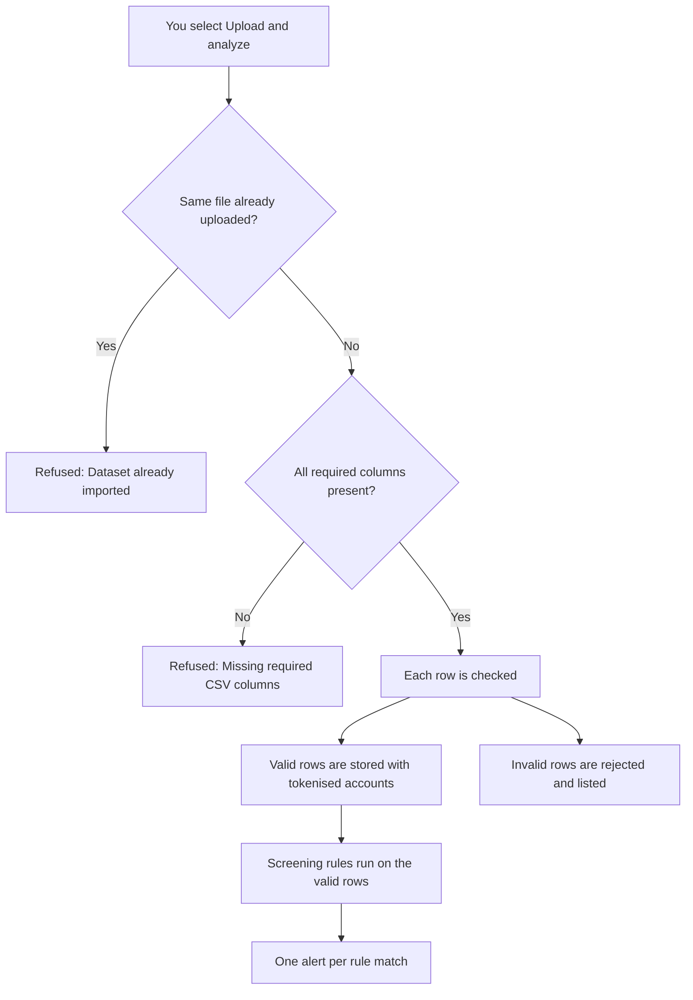
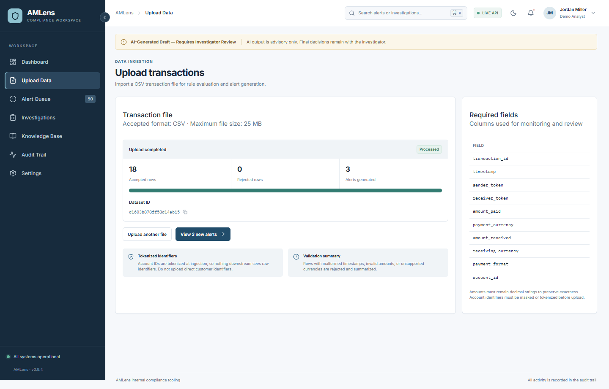

# Upload transaction data

## What it is

The **Upload transactions** page imports a CSV ([comma-separated values](../glossary.md)) file of transactions. AMLens checks every row, stores the valid ones with tokenised account identifiers, runs the three screening rules, and creates an [alert](../glossary.md) for each match.

## Why you would use it

Alerts only exist after a file has been uploaded. AMLens does not watch transactions live, so uploading a file is how new work enters the system.

## Where to find it

- Select **Upload Data** in the sidebar, or
- Select **Upload transactions** on the dashboard.

## Before you start

- [x] You are signed in.
- [x] Your file is a **.csv** file of **20 MB or less** and **100,000 rows or fewer**.
- [x] The file has the **exact column headings** listed below.
- [x] The file contains **no direct customer identifiers** (names, emails, phone numbers, addresses).
- [x] The file has **not been uploaded before**. Uploading the identical file twice is refused.

## The file format

The first row must contain these column headings, spelled exactly as shown (capital letters and spaces matter). Every column must be present and every cell must have a value.

| Column heading | What to put in it | Example |
| --- | --- | --- |
| `Timestamp` | Date and time of the transaction | `2026-11-02 09:12:00` |
| `From Bank` | Sender's bank code | `021` |
| `Account` | Sender's account reference | `80A1C3E50` |
| `To Bank` | Receiver's bank code | `114` |
| `Account.1` | Receiver's account reference | `80F27B911` |
| `Amount Received` | Amount received, a positive number | `1450000.00` |
| `Receiving Currency` | Currency name from the list below | `US Dollar` |
| `Amount Paid` | Amount paid, a positive number | `1450000.00` |
| `Payment Currency` | Currency name from the list below | `US Dollar` |
| `Payment Format` | Payment method from the list below | `Wire` |
| `Is Laundering` | `0` or `1` | `0` |

**Allowed currencies** (write the full name, not a code such as USD): US Dollar, Euro, Swiss Franc, Yuan, Shekel, Rupee, UK Pound, Yen, Ruble, Bitcoin, Canadian Dollar, Australian Dollar, Mexican Peso, Saudi Riyal, Brazil Real.

**Allowed payment formats:** Cheque, Credit Card, ACH, Cash, Reinvestment, Wire, Bitcoin.

!!! warning "The 'Required fields' panel on the page shows different names"
    The **Required fields** panel on the right of the Upload page lists fields such as `transaction_id`, `sender_token` and `amount_paid`, with currencies "ISO 4217" and a 25 MB limit. These do **not** match what the upload actually accepts. Use the column headings, currency names and 20 MB limit in the table above. A file built from the on-page panel will be refused with *Missing required CSV columns*.

!!! note "About the Is Laundering column"
    This column comes from the standard transaction-file layout AMLens accepts. It must contain `0` or `1`, but AMLens does **not** use it to create alerts and does not show it anywhere. Alerts come only from the screening rules.

!!! tip "Account references are tokenised on upload"
    The bank code and account reference are combined and replaced by a token such as `ACC_9d2e…`. The same bank-and-account always gets the same token, so you can follow an account across files. The original values are never displayed.

## Upload a transaction file

1. Open **Upload Data**.
2. Drag your file onto the box that says **Drop a file here or browse**, or select the box and choose the file.

    **You should see** the file name and size in the box and beneath it.

3. Select **Upload and analyze**.

    **You should see** the button change to **Processing file…**. Small files usually take a few seconds.

4. When processing finishes, the form is replaced by an **Upload completed** summary.

<figure markdown="span">
  { loading=lazy }
  <figcaption>The Upload transactions page with a CSV file selected, before you select Upload and analyze.</figcaption>
</figure>

## What happens behind the scenes

## Read the upload result

<figure markdown="span">
  { loading=lazy }
  <figcaption>After the upload: accepted and rejected row counts, alerts generated and the dataset ID.</figcaption>
</figure>

| Item | Meaning |
| --- | --- |
| **Accepted rows** | Rows that passed every check and were stored. |
| **Rejected rows** | Rows that failed at least one check. They are **not** stored. |
| **Alerts generated** | Number of new alerts created from the accepted rows. |
| **Bar** | A two-part bar showing the share of accepted rows (first part) and rejected rows (second part). |
| **Dataset ID** | A 20-character code that identifies this exact file. Select the copy icon to copy it. Keep it with your records. |

If any rows were rejected, a **Rejected rows** table lists each row number and the reasons. Row numbers match the line numbers in your file, counting the heading row as line 1, so the first data row is row 2.

| Reason shown | What is wrong | How to fix it |
| --- | --- | --- |
| `missing:<column>` | That cell is empty. | Fill in the value. |
| `invalid_timestamp` | The date/time could not be read. | Use a format like `2026-11-02 09:12:00`. |
| `invalid_amount:Amount Paid` or `invalid_amount:Amount Received` | Not a number, or zero or negative. | Use a positive number with a dot for decimals and no currency symbols or thousands separators. |
| `invalid_currency:Payment Currency` or `invalid_currency:Receiving Currency` | Currency is not in the allowed list. | Use the full name, for example `US Dollar`, not `USD`. |
| `invalid_payment_format` | Payment format is not in the allowed list. | Use one of the allowed values exactly. |
| `invalid_ground_truth_label` | `Is Laundering` is not `0` or `1`. | Enter `0` or `1`. |

Up to 50 rejected rows are listed. If more were rejected, a note appears below the table (it currently says "Only the first 3 rejection reasons are shown", but up to 50 are actually listed).

!!! warning "Rejected rows are not silently dropped, and they are not added later"
    Fix the rejected rows in your file and upload **only those corrected rows** as a new file. If you re-upload the whole corrected file, the rows that were accepted the first time will be stored again and may create duplicate alerts.

**Next:** select **View N new alerts** to open the [alert queue](alert-queue.md), or **Upload another file**.

## The dataset ID and re-uploading

The dataset ID is calculated from the exact contents of the file. This means:

- Uploading **the identical file again** is refused with the error **Dataset already imported**. No new transactions or alerts are created.
- Changing **anything** in the file, even one character or the line endings, produces a different dataset ID, so the file is treated as new. Be careful not to create duplicate alerts this way.

## Errors and edge cases

| Message | Meaning | What to do |
| --- | --- | --- |
| *Select a transaction file to continue.* | No file chosen. | Choose a file. |
| *Use a .csv file only.* / *CSV file required* | The file name does not end in `.csv`. | Save the file as CSV. |
| *File must be smaller than 25 MB.* | Checked in your browser. | Split the file. |
| *MVP upload limit is 20 MB. Split the full dataset first.* | The file is over 20 MB. | Split it into smaller files. |
| *MVP limit is 100,000 rows; use a representative subset.* | Too many rows. | Split the file. |
| *Missing required CSV columns: ...* | One or more headings are missing or misspelled. | Correct the headings exactly as listed above. |
| *Could not parse CSV: ...* | The file is not valid CSV. | Re-save it as CSV (comma-separated, UTF-8). |
| *Dataset already imported* | This exact file was uploaded before, possibly by a colleague. | Find its alerts in the [alert queue](alert-queue.md). Do not re-upload. |
| *Request failed (5xx)* or *The backend service is unreachable.* | A system problem. | Try again later. If it persists, contact your administrator. |

A file where every row is valid but no rule matches is a normal result: **Alerts generated: 0**.

## Related pages

- [Alert queue](alert-queue.md)
- [Your first case, end to end](../workflows/first-case-end-to-end.md)
- [Understanding results](../understanding-results.md)
- [Troubleshooting](../troubleshooting.md)
