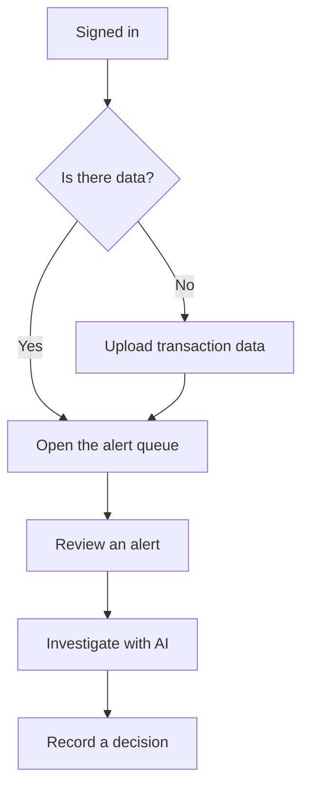

# Getting started

This page gets you from "I have an account" to "I have opened my first alert" in about ten minutes.

## Before you begin

You need:

- [x] A **username and password** for AMLens, created for you by an administrator. See [Account and sign-in](account-and-login.md).
- [x] A current desktop web browser (for example a recent version of Edge, Chrome, Firefox or Safari). A specific list of supported browsers has not been verified.
- [x] The AMLens address: **<https://amlens-870b3a.southindia.cloudapp.azure.com>**
- [ ] Optional: a transaction file to upload. If you do not have one, ask your trainer or administrator for the sample file used in [Your first case, end to end](workflows/first-case-end-to-end.md).

## Step 1: Sign in

1. Open **<https://amlens-870b3a.southindia.cloudapp.azure.com>** in your browser.
2. You are taken to the **Sign in** page ("AML investigation workspace. Authorised analysts only.").
3. Enter your **Username** and **Password**, then select **Sign in**.

You should now see the **Compliance overview** dashboard.

!!! warning "Sign-in attempts are rate limited"
    To slow down password guessing, the sign-in page only accepts a limited number of requests from your network per minute. If you mistype your password several times quickly, wait a minute before trying again. See [Account and sign-in](account-and-login.md).

## Step 2: Take a quick tour

Look at the screen from left to right:

| Area | What it is |
| --- | --- |
| **Sidebar** (left) | The main menu: Dashboard, Upload Data, Alert Queue, Investigations, Knowledge Base, Audit Trail, Settings. The number next to **Alert Queue** is the total number of alerts. At the bottom, a coloured dot shows overall service health. |
| **Top bar** | Where you are (for example *AMLens > Alert Queue*), a **search box**, a **LIVE API** badge, a light/dark theme button, a notifications bell and a profile button. |
| **Yellow banner** | "AI-Generated Draft — Requires Investigator Review". It is always shown as a reminder. |
| **Main area** | The page you opened. |

For a full description, see [Navigation and dashboard](navigation-and-dashboard.md).

!!! note "The name in the top-right corner is a demo placeholder"
    The profile button in the top-right corner always shows the same built-in demo analyst name, the label "Demo Analyst" and the analyst ID **ANL-2048**. It does **not** show your account. AMLens still records **your signed-in username** on every decision you make. See [Recording a decision](features/recording-decisions.md).

## Step 3: Check that the services are working

1. Look at the dot at the bottom of the sidebar.
2. If it says **All systems operational**, you are ready to go.
3. If it says anything else, open **Settings** and read the **Service health** panel. See [Settings and service health](features/settings-and-health.md).

## Step 4: Open the alert queue

1. Select **Alert Queue** in the sidebar.
2. You should see a table titled **Flagged transactions**, with one row per alert.
3. If the table says *No alerts match the current filters* and the total is 0, no transactions have been uploaded yet. Go to [Upload transaction data](features/upload-data.md).

## Step 5: Open an alert

1. Select any row in the table (or its **Review** link).
2. The **Alert review** page opens, showing the alert summary, its evidence and the account's transaction history.

That is the core of AMLens. From here you can [run the AI investigation](features/ai-investigation.md) and [record a decision](features/recording-decisions.md).

## What to read next

- Want a guided practice run? Follow [Your first case, end to end](workflows/first-case-end-to-end.md).
- Working real alerts? Use [Working the daily alert queue](workflows/daily-alert-triage.md).
- Not sure what a status means? See [Understanding results](understanding-results.md).
