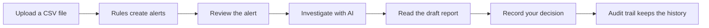

# Introduction

This page explains what AMLens is, who it is for, and, just as important, what it does **not** do.

## What AMLens is

AMLens is a web workspace for reviewing transaction alerts as part of anti-money-laundering ([AML](glossary.md)) work. It brings four things together in one place:

1. **Alert generation.** You upload a file of transactions. AMLens checks it against a small set of fixed screening [rules](glossary.md) and creates an [alert](glossary.md) for each match.
2. **Alert review.** For each alert you can see the triggering transaction, the evidence the rule recorded, and the account's recent transaction history.
3. **AI-assisted investigation.** With one click, an AI assistant drafts a structured investigation report. The report links every factual claim to the transactions it came from and to the regulatory guidance passages it cites. A built-in checker, called [verification](glossary.md), then tests the draft against the evidence.
4. **Human decision and audit.** You read the draft, write your reasoning, and record a decision: **Approve**, **Reject / close as false positive**, or **Escalate**. The decision and every earlier step are stored in an append-only [audit trail](glossary.md).

!!! note "AI output is advisory only"
    Every page in AMLens carries the banner **"AI-Generated Draft — Requires Investigator Review"**. The AI cannot record or authorise a decision. Final decisions always remain with the investigator.

## Who AMLens is for

| You are... | You will mostly use... |
| --- | --- |
| An **AML analyst** working alerts day to day | [Alert queue](features/alert-queue.md), [Alert review](features/alert-review.md), [AI investigation](features/ai-investigation.md), [Recording decisions](features/recording-decisions.md) |
| A **team lead or reviewer** checking the quality of decisions | [Investigations list](features/investigations-list.md), [Investigation report](features/investigation-report.md), [Audit trail](features/audit-trail.md) |
| A **data or operations contact** who loads transaction files | [Upload transaction data](features/upload-data.md) |
| A **compliance or audit reviewer** | [Audit trail](features/audit-trail.md), [Preparing evidence for an audit](workflows/audit-evidence.md) |

Everyone signs in with an account created by an administrator. There are no separate user roles inside the application: every signed-in user sees the same pages and can perform the same actions.

## What AMLens does not do

AMLens is deliberately limited in scope. The **About AMLens** panel on the Settings page states these limits, and you should keep them in mind:

| AMLens does **not**... | What this means for you |
| --- | --- |
| Make decisions on its own | You must read the report and record every decision yourself. |
| File regulatory reports | It does not create or submit a SAR or STR ([suspicious activity / transaction report](glossary.md)). Use your organisation's filing process. |
| Monitor transactions in real time | Alerts only appear after someone uploads a file. Nothing is watched live. |
| Use a machine-learning detection model | Alerts come from three simple, fixed rules (see below). A rule match is a screening signal, **not proof** of wrongdoing. |
| Hold customer profile or KYC data | The AI only sees tokenised transactions. Information such as [KYC](glossary.md) or [source of funds](glossary.md) is always listed as a gap for you to fill. |

## The three screening rules

When a file is uploaded, AMLens applies these rules. Transfers where an account pays itself are ignored by every rule.

| Rule (as shown in the app) | What it looks for | Example |
| --- | --- | --- |
| **High Value** (`HIGH_VALUE`) | A single payment of **US$1,000,000 or more** (only payments in US Dollar are checked). | One wire of $1,450,000. |
| **Repeated Pair** (`REPEATED_PAIR`) | **Five or more** payments from the same sender to the same receiver, in the same currency, within **48 hours**. | Six cash transfers of about $9,500 between the same two accounts over two days. |
| **Rapid Movement Candidate** (`RAPID_MOVEMENT_CANDIDATE`) | Money arriving in an account and money leaving the **same account in the same currency** within **60 minutes**. | $486,000 received, then $482,500 sent 29 minutes later. |

See [Understanding results](understanding-results.md) for how each rule's evidence is displayed.

## How the pieces fit together

## Privacy by design

- **Account numbers are tokenised.** When a file is uploaded, each bank-and-account pair is replaced by a random-looking token such as `ACC_3f9a…`. The original account numbers are not shown anywhere in AMLens.
- **Exports are redacted.** Downloaded reports and audit events hide common direct identifiers.
- **Do not upload direct customer identifiers** such as names, email addresses or phone numbers.

## Next steps

- [Getting started](getting-started.md): sign in and take a short tour.
- [Your first case, end to end](workflows/first-case-end-to-end.md): practise with the sample file.
- [Glossary](glossary.md): look up any unfamiliar term.
