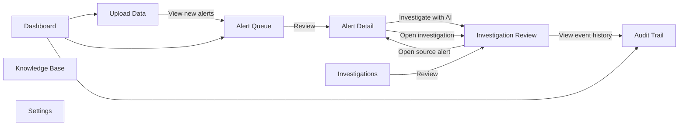
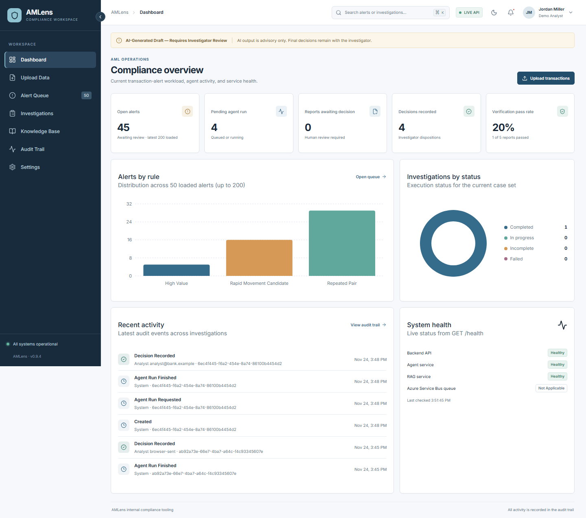

# Navigation and dashboard

This page describes the parts of the screen that are always visible, and the **Compliance overview** dashboard you see after signing in.

## The navigation map

## The sidebar

The sidebar on the left is the main menu.

| Menu item | Opens | Use it to |
| --- | --- | --- |
| **Dashboard** | Compliance overview | See workload and service health at a glance. |
| **Upload Data** | Upload transactions | Import a CSV file. See [Upload transaction data](features/upload-data.md). |
| **Alert Queue** | Alert queue | Browse alerts. The small number beside it is the **total** number of alerts. See [Alert queue](features/alert-queue.md). |
| **Investigations** | Investigations | See every case and its status. See [Investigations list](features/investigations-list.md). |
| **Knowledge Base** | Knowledge base | Search regulatory guidance passages. See [Knowledge base](features/knowledge-base.md). |
| **Audit Trail** | Audit trail | See the event history of a case. See [Audit trail](features/audit-trail.md). |
| **Settings** | Settings | Check service health and change the theme. See [Settings and service health](features/settings-and-health.md). |

At the bottom of the sidebar:

- A **coloured dot and label** show overall service health: *All systems operational*, *Service attention required*, *Service offline*, *Checking services* or *Health status unavailable*. It refreshes every 30 seconds.
- The application version (for example *AMLens · v0.9.4*).

**Collapse the sidebar:** select the arrow next to the AMLens logo to shrink the sidebar to icons only. Select it again to expand it. On a small screen, the sidebar is hidden. Select the **menu** button (three lines) in the top bar to open it.

## The top bar

| Element | What it does |
| --- | --- |
| **Breadcrumb** (for example *AMLens > Alert Queue*) | Shows which page you are on. Detail pages show *Alert Detail* or *Investigation Review*. |
| **Search box** ("Search alerts or investigations…") | Jump to an alert or investigation by ID. See below. Press ++ctrl+k++ (or ++cmd+k++ on a Mac) to place the cursor in it. |
| **LIVE API** badge | Confirms you are working with live data. If it ever says **DEV · Mock data**, you are looking at demonstration data. Tell your administrator. |
| **Sun / moon button** | Switches between light and dark themes. |
| **Bell** | Shows how many alerts are available for review, with a link to the alert queue. It does not show individual notifications. |
| **Profile button** | Shows a fixed **demo** analyst name, "Demo Analyst" and "Analyst ID: ANL-2048", with an **Account settings** link that opens Settings. This is a placeholder, not your account. |

### Using the search box

Type an ID and press ++enter++.

| What you type | What happens |
| --- | --- |
| An alert ID starting with `AL_` (for example `AL_3c1f…_1`) | The alert opens directly. |
| An investigation ID (a long code such as `1b4e28ba-2fa1-11d2-883f-0016d3cca427`) | The investigation opens directly. |
| Anything else | The alert queue opens with your text in its search box. |

!!! warning "IDs are case-sensitive"
    Copy IDs using the copy icon next to them rather than retyping them. If you get "Alert not found", check upper and lower case.

!!! note "Free-text search only covers one page of alerts"
    When you search for text that is not an ID, the alert queue filters **only the alerts on the page currently loaded** (10 by default). To search more widely, increase **Rows** to 200 at the bottom of the queue. See [Alert queue](features/alert-queue.md).

## Banners and footer

- The yellow banner **"AI-Generated Draft — Requires Investigator Review. AI output is advisory only. Final decisions remain with the investigator."** appears on every page.
- The footer reads *"AMLens internal compliance tooling · All activity is recorded in the audit trail"*.

## The Compliance overview dashboard

**Where to find it:** select **Dashboard** in the sidebar, or sign in.

**Why use it:** to see, at the start of your shift, how much work is waiting and whether the system is healthy.

<figure markdown="span">
  { loading=lazy }
  <figcaption>The Compliance overview dashboard: workload counts, alerts by rule, investigations by status, recent activity and system health.</figcaption>
</figure>

### Metric cards

| Card | What it counts |
| --- | --- |
| **Open alerts** | Alerts with status *OPEN* (not yet investigated), counted among the **first 200 alerts** loaded. If you have more than 200 alerts, the real number may be higher. |
| **Pending agent run** | Investigations that have been created but whose AI run is queued or still running. |
| **Reports awaiting decision** | Investigations whose AI run has ended (completed, incomplete or failed) and that do not yet have a human decision. |
| **Decisions recorded** | Investigations with a recorded human decision. |
| **Verification pass rate** | Percentage of investigations whose report passed [verification](glossary.md), for example "2 of 3 reports passed". |

!!! note "Failed runs count as awaiting decision"
    A failed AI run produces no report, so you cannot record a decision on it. It still appears in **Reports awaiting decision** until it is re-run successfully. See [Retrying a failed investigation](workflows/retry-failed-investigation.md).

### Panels

| Panel | What it shows | Link |
| --- | --- | --- |
| **Alerts by rule** | A bar chart of how many loaded alerts came from each rule (High value, Repeated pair, Rapid movement). | **Open queue** |
| **Investigations by status** | A ring chart of investigations by run status: Completed, In progress, Incomplete, Failed. | |
| **Recent activity** | The latest audit events from the four most recent investigations, for example *Agent Run Finished* or *Decision Recorded*. Select a row to open the investigation. | **View audit trail** |
| **System health** | The status of the Backend API, Agent service, RAG service and the queue. | |

The **Upload transactions** button in the top-right corner of the dashboard opens [Upload transaction data](features/upload-data.md).

### Empty and error states

| You see | Meaning |
| --- | --- |
| **—** in a metric card | The data could not be loaded yet, or failed to load. |
| *No alert data* | No transactions have been uploaded, or no rule matched. |
| *No investigations yet* | Nobody has started an AI investigation. Start one from an alert. |
| *Unable to load this information* with a **Retry** button | A service did not respond. Select **Retry**. If it keeps happening, it is a system problem. Contact your administrator. |

!!! info "The queue shows as not applicable"
    In the System health panel, the fourth row (labelled *Azure Service Bus queue*) normally shows **not applicable**. This is expected: AI runs happen directly, without a background queue. It is not a fault.

## Related pages

- [Getting started](getting-started.md)
- [Settings and service health](features/settings-and-health.md)
- [Understanding results](understanding-results.md)
