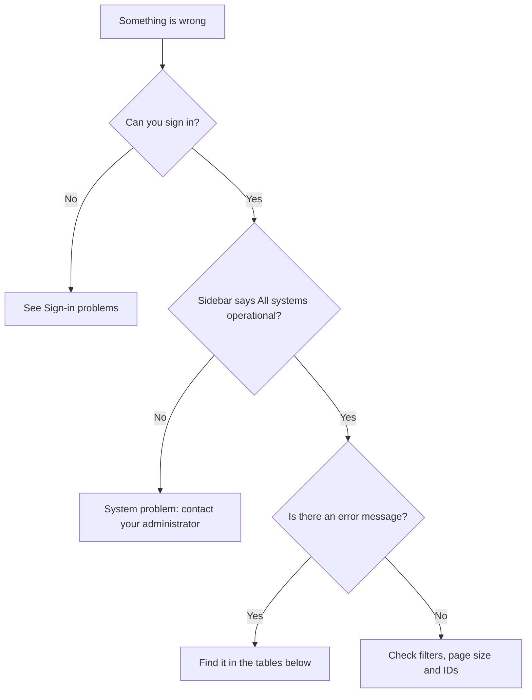

# Troubleshooting

Find the message or symptom you are seeing, then follow the advice. Each entry says whether it is **something you can fix** or **a system problem** for your administrator.

!!! tip "First, check service health"
    Many problems come from a service being unavailable. Look at the dot at the bottom of the sidebar. If it does not say **All systems operational**, open [Settings and service health](features/settings-and-health.md) before anything else.

## Quick diagnosis

## Who to contact

| Type | Meaning | Examples |
| --- | --- | --- |
| **You can fix it** | Caused by input, filters or timing. | Wrong file columns, rationale too short, filters hiding results, short Knowledge base queries. |
| **System problem** | A service, account or configuration issue. | Services offline, repeated AI failures, *Request failed (5xx)*, cannot reach the site. |

When you contact your administrator, include: the page, the exact message, the time, and any alert or investigation ID (copy it with the copy button). **Do not** send passwords or customer identifiers.

## Sign-in problems

| Symptom | Cause | Fix |
| --- | --- | --- |
| You stay on the sign-in form with a message | Wrong username or password. | **You:** check Caps Lock, retype slowly. If it still fails, **administrator**: ask for a reset. There is no self-service reset. |
| An error page appears after several attempts | Sign-in is rate limited (about 20 requests per minute per network). | **You:** wait one minute, then try again. |
| An error page with **Sign in again** | Session ended or sign-in failed. | **You:** select **Sign in again**. |
| Site does not load / connection warning | Site or network problem. | **System problem.** Contact your administrator. |
| You want to sign out but there is no button | AMLens has no sign-out button. | **You:** go to `/oauth2/sign_out` on the AMLens address. See [Account and sign-in](account-and-login.md). |

## Upload problems

| Message | Cause | Fix |
| --- | --- | --- |
| *Missing required CSV columns: ...* | Column headings are missing or misspelled, often because the file follows the on-page **Required fields** panel, which lists different names. | **You:** use the exact headings in [Upload transaction data](features/upload-data.md). |
| *Dataset already imported* | This exact file was uploaded before. | **You:** do not re-upload; find its alerts in the queue. |
| *MVP upload limit is 20 MB...* / *File must be smaller than 25 MB.* | File too large. | **You:** split the file (20 MB is the real limit). |
| *MVP limit is 100,000 rows...* | Too many rows. | **You:** split the file. |
| *Use a .csv file only.* / *CSV file required* | Wrong file type. | **You:** save as `.csv`. |
| *Could not parse CSV: ...* | The file is not readable as CSV. | **You:** re-save as comma-separated UTF-8 CSV. |
| Many **Rejected rows** with `invalid_currency` | Codes such as `USD` used instead of names. | **You:** use full names such as `US Dollar`. |
| Rejected rows with `invalid_ground_truth_label` | **Is Laundering** is not `0` or `1`. | **You:** fill with `0` or `1`. |
| Note says *"Only the first 3 rejection reasons are shown"* | Known wording issue: up to 50 rejected rows are actually listed. | No action needed. |
| **Alerts generated: 0** | No transaction matched a rule. | Normal. No action needed. |

## Alert queue problems

| Symptom | Cause | Fix |
| --- | --- | --- |
| Search or filter does not find an alert you know exists | Filters only work on the **loaded page**. | **You:** set **Rows** to 200, page through, or paste the alert ID into the top-bar search. |
| Amount filter hides Repeated Pair alerts | These alerts have no single amount. | **You:** clear the amount filters. |
| **Alert not found** | ID mistyped (IDs are case-sensitive). | **You:** copy the ID with the copy button. |
| Exported CSV has an empty `created_at` column | Known limitation of the export. | **You:** use the **Created** column on screen. |
| Dashboard **Open alerts** seems too low | It only counts the first 200 alerts. | **You:** use the Alert queue with the **Open** filter. |

## AI investigation problems

| Message or symptom | Cause | Fix |
| --- | --- | --- |
| **Agent service unavailable** / **The AI run did not finish** | A connected service failed during the run. | **You:** check service health, then [retry](workflows/retry-failed-investigation.md). If it fails two or three times with healthy services: **system problem**. |
| **Investigation already running or linked elsewhere** | Another run is in progress for this case. | **You:** wait, refresh, then open the investigation. |
| *Investigation is not available to run* | The case is not in a state that can be run (for example stuck as running). | **System problem.** Contact your administrator. |
| *Agent persistence unavailable* | The AI service's storage is unavailable. | **System problem.** Contact your administrator. |
| **Investigation in progress** never finishes | The run may be stuck. | Wait 10–15 minutes and refresh. If unchanged, **system problem**. |
| Step indicator stops on one step | The indicator is approximate. | Normal. Wait. |
| Strip says **Review required · completed** | Warnings exist; verification may still have passed. | Check the **Verification passed** badge. See [Understanding results](understanding-results.md). |
| *No guidance references* in the report | No guidance passage scored 45% or more. | Normal for some alerts. Search the [Knowledge base](features/knowledge-base.md) yourself. |
| Two investigations for one alert | **Start investigation** on the alert page was used after a failure. | Work on the newest one; tell your supervisor. In future, retry from the investigation page. |

## Decision problems

| Message | Cause | Fix |
| --- | --- | --- |
| **Approve report** is greyed out | Run is incomplete or verification did not pass. | **You:** choose Reject or Escalate. This is by design. |
| *Provide at least 10 characters of rationale.* | Rationale too short. | **You:** write more. |
| *Enter the signed-in analyst ID.* | Analyst ID under 3 characters. | **You:** enter at least 3 characters. |
| **Decision conflict** — *A decision has already been recorded...* | Someone decided first. | **You:** refresh to see the decision. Decisions cannot be overwritten. |
| **Decision conflict** — *Cannot approve an incomplete or unverified AI report* | Approval not allowed for this report. | **You:** choose Reject or Escalate. |
| *The existing case state could not be confirmed...* | Case status could not be loaded. | **You:** refresh. If it persists, **system problem**. |
| The decision shows a different name than the Analyst ID you typed | By design: the signed-in username is recorded. | No action needed. |
| You recorded the wrong decision | Decisions cannot be changed in AMLens. | Follow your organisation's correction procedure. |

## Knowledge base problems

| Symptom | Cause | Fix |
| --- | --- | --- |
| *No matching passages were returned* | Only passages scoring **40% or more** within the **selected typology** are returned, and each typology has only 1–3 verified passages. Short keywords rarely score high enough. | **You:** choose the right typology and write a full sentence in regulatory language. Try: *"unusually large transactions with no apparent economic purpose"* (Unusual activity), *"high account turnover inconsistent with the size of the balance maintained"* (Rapid movement), *"splitting cash deposits to avoid reporting thresholds"* (Structuring), *"many accounts sending funds to one account"* (Fan-in / fan-out). |
| Source documents in **Example source metadata** cannot be opened | That list is static illustrative information, not live data. | Nothing to fix. Use search results instead. |
| Page subtitle mentions "mock excerpts" | Fixed wording on the page. | On the live site (**LIVE API** badge), results are from the live library. |
| Search shows an error | The retrieval service is unavailable. | **System problem** if *AML knowledge retrieval* is not healthy. |

## General problems

| Symptom | Cause | Fix |
| --- | --- | --- |
| *Unable to load this information* with **Retry** | A request failed. | **You:** select **Retry**. If repeated: **system problem**. |
| *Request failed (502)* or *The backend service is unreachable.* | A service is down. | **System problem.** |
| *Not authenticated* | The app could not confirm the request came through sign-in. | **You:** reload the page or sign in again. If it persists: **system problem**. |
| Top bar shows **DEV · Mock data** | Demonstration data mode. | **System problem**: tell your administrator. Do not record real decisions. |
| The top-right profile shows someone else's name | It is a fixed demo placeholder. | No action needed. Your username is still recorded. |
| Theme or compact setting resets | Preferences are only kept for the current page session. | Set it again. |
| Times look different from the file | Times are shown in your browser's time zone. | Check your computer's time zone. |

## Related pages

- [FAQ](faq.md)
- [Understanding results](understanding-results.md)
- [Settings and service health](features/settings-and-health.md)
- [Retrying a failed investigation](workflows/retry-failed-investigation.md)
