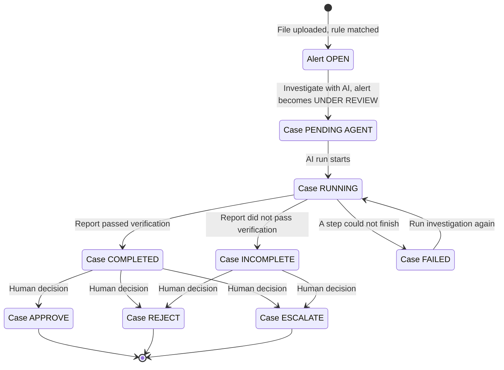

# Understanding results

This page explains every status, badge and score you will meet in AMLens, how they relate to each other, and what to do next in each situation.

## Three kinds of status

AMLens tracks three related things. It helps to keep them apart:

| Thing | Where you see it | Possible values |
| --- | --- | --- |
| **Alert status** | Alert queue, alert page | OPEN, UNDER REVIEW, DECIDED |
| **Investigation (case) status** | Investigations list | PENDING AGENT, RUNNING, COMPLETED, INCOMPLETE, FAILED, APPROVE, REJECT, ESCALATE |
| **Execution (run) status** | Investigations list, report page, dashboard | pending, running, completed, incomplete, failed |

Plus one result: **verification** (passed or not passed).

## The case lifecycle

When any decision is recorded, the alert becomes **DECIDED**.

## Alert statuses

| Status | Meaning | What to do next |
| --- | --- | --- |
| **OPEN** | No investigation yet. | Review it and select **Investigate with AI**. |
| **UNDER REVIEW** | An investigation has been started (whatever its run status). | Select **Open investigation**. |
| **DECIDED** | A human decision is recorded. | Nothing, unless you are reviewing. |

Alert statuses only move forward. Starting another investigation never reopens a decided alert.

## Investigation and execution statuses

| Case status | Execution status | Meaning | What to do next |
| --- | --- | --- | --- |
| PENDING AGENT | pending | Case created, AI not run yet. | Open it and select **Run investigation**. |
| RUNNING | running | AI run in progress. | Wait. If it lasts a very long time, contact your administrator. |
| COMPLETED | completed | Report produced **and verification passed**. | Read it; Approve, Reject or Escalate. |
| INCOMPLETE | incomplete | Report produced but verification **did not pass** after one automatic redraft. | Read it carefully; Reject or Escalate (Approve is disabled). |
| FAILED | failed | No report. | [Retry the run](workflows/retry-failed-investigation.md). |
| APPROVE / REJECT / ESCALATE | completed or incomplete | A human decision is recorded. | Nothing; the case is closed in AMLens. |

On the dashboard ring chart, *running* is labelled **In progress**.

## Verification

[Verification](glossary.md) is an automatic check run on every AI draft. It **recalculates** the transaction facts independently and compares them with the draft. It checks that:

- every section matches the recalculated evidence,
- every transaction and guidance reference in a claim really exists,
- the narrative only uses approved statements and contains no accusatory words, and
- the required limitations and disclaimer are present.

If the first draft fails, the AI redrafts **once** and it is checked again.

| Result | Shown as | Effect |
| --- | --- | --- |
| **Passed** | *Verification passed* badge; *Passed* in lists | Run is **completed**. Approve is allowed. |
| **Not passed** | *Verification failed* / *Needs review* badge; errors listed | Run is **incomplete**. Approve is disabled. |

**Warnings** do not stop verification from passing. Nearly every report has the warning *"Intent and economic purpose cannot be established from transaction patterns alone."*, so the strip usually reads **Review required · completed** even when verification passed. See [Reading the investigation report](features/investigation-report.md).

!!! warning "Passed verification does not mean the activity is suspicious, or that it is not"
    Verification checks that the report is **faithful to the evidence**. It does not judge the customer. That judgement is yours.

## Decisions

| Decision | Label | Typical meaning |
| --- | --- | --- |
| **APPROVE** | Approve report | You accept the verified AI report as an accurate record of the case. |
| **REJECT** | Reject / close as false positive | You close the alert: the activity is explained. |
| **ESCALATE** | Escalate | You need further review, context or a referral. |

What each decision triggers outside AMLens (for example a SAR/STR filing) is governed by your organisation's procedures. AMLens does not file anything.

## Rule evidence

| Rule | Key evidence | How to read it |
| --- | --- | --- |
| High Value | Amount Paid, Threshold `1000000`, Currency | A single US Dollar payment at or above $1,000,000. |
| Repeated Pair | Count, Window Hours `48`, Sender/Receiver tokens | At least 5 payments, same sender, receiver and currency, within 48 hours. Each group of payments creates one alert. |
| Rapid Movement Candidate | Gap Minutes, Incoming Amount, Outgoing Amount | Money in and money out of the same account, same currency, within 60 minutes. *"Fund identity is unverified"*: AMLens cannot prove it is the same money. |

## Scores and percentages

| Score | Where | Meaning |
| --- | --- | --- |
| **% relevance** / **% match** | Report guidance cards, Knowledge base | How closely a guidance passage matches the search, from 0 to 100%. Knowledge base shows passages of **40% or more**; the AI only cites passages of **45% or more**. A higher score means closer in meaning, not more legally applicable. |
| **Verification pass rate** | Dashboard | Share of investigations whose report passed verification. |

## Evidence claim types and support

| Claim type | Support | Meaning |
| --- | --- | --- |
| Observed fact | supported | Calculated directly from transactions. |
| Supported interpretation | limited | Guidance gives context. Not legal applicability. |
| Potential concern | limited | A question to review, not proof. |
| Unsupported assumption | unsupported | Cannot be shown from the data (for example intent). |

## Information gap statuses

| Status | Meaning |
| --- | --- |
| **Not provided** | Not given to AMLens; it is unknown whether it exists. This is the usual value today. |
| **Confirmed missing** | Explicitly reported as missing. |
| **Not applicable** | Explicitly marked as not relevant. |
| **Available / verified** | Reported as available and verified. |

## Service health statuses

| Status | Meaning |
| --- | --- |
| healthy | Working. |
| degraded | Running on a stand-in, not the real service. |
| offline | Not reachable. |
| not applicable | Not part of this deployment (the task queue). |

See [Settings and service health](features/settings-and-health.md).

## Related pages

- [Glossary](glossary.md)
- [Reading the investigation report](features/investigation-report.md)
- [Recording a decision](features/recording-decisions.md)
- [Troubleshooting](troubleshooting.md)
