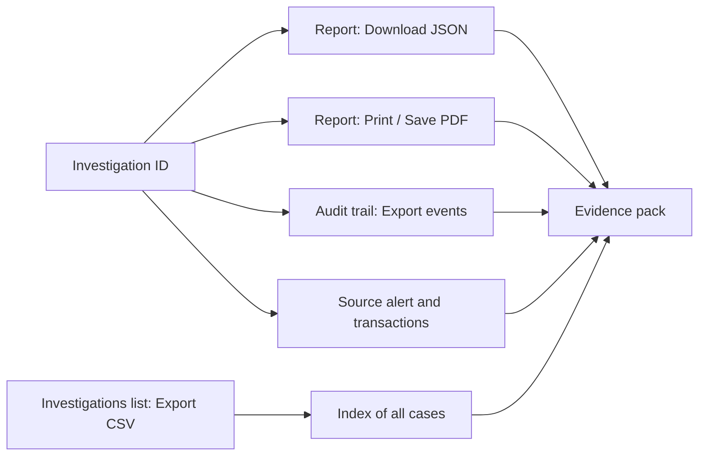

# Preparing evidence for an audit

When a supervisor, internal auditor or regulator asks how a case was handled, you need to show **what the AI drafted, what was checked, who decided, when, and why**. This page shows how to collect that evidence from AMLens for one case or for a set of cases.

!!! note "What AMLens can and cannot provide"
    AMLens holds the uploaded transactions (tokenised), the alert, the AI report, the verification result, the human decision and the event history. It does **not** hold customer KYC data, external documents you consulted, or any regulatory filing. Keep those in your organisation's case-management records.

## The evidence pack at a glance

| Item | Where it comes from | File |
| --- | --- | --- |
| Case index | Investigations → **Export CSV** | `amlens-investigations.csv` |
| Full AI report, verification and production trace | Investigation → **Export → Download JSON** | `<investigation ID>-investigation-report.json` |
| Human-readable report | Investigation → **Export → Print / Save PDF** | A PDF you name |
| Event history incl. decision, analyst and rationale | Audit Trail → **Export events** | `amlens-audit-events.csv` |
| Alert details and transactions | Alert page (print or screenshot), and **Alert Queue → Export current page** | `amlens-alerts-current-page.csv` |

## Collect evidence for one case

1. **Find the case.** Open **Investigations**, search for the investigation or alert ID, and select **Review**.
2. **Record the key facts.** Note the investigation ID, alert ID, run status, verification result and the **Recorded investigator disposition** (decision, date, analyst, rationale).
3. **Download the report.** Select **Export → Download JSON**. This file contains the full report, the verification result (errors and warnings) and the list of production steps. Account values not already masked are replaced with *[redacted]*.
4. **Save a readable copy.** Select **Export → Print / Save PDF** and save as PDF. Open each report tab you need before printing, since tabs that are not open may not appear in the printout.
5. **Export the event history.** In the **Audit trail** panel select **View event history**, make sure **Event type** is **All events**, then select **Export events**.

    **You should see** the CSV include **CREATED**, **AGENT RUN REQUESTED**, **AGENT RUN FINISHED** (or **FAILED**), and **DECISION RECORDED** with the analyst and rationale in the details column.

6. **Capture the source alert.** Select **Open source alert**. Save the page as PDF with your browser's print function, so the alert summary, evidence and transaction history are captured.
7. **Store the files together** in your organisation's case record, named with the investigation ID.

## Collect evidence for many cases

1. Open **Investigations**. Filter as needed (for example **Escalated**). Select **Export CSV**. This is your index.
2. For each case in the index, follow steps 3–5 above. The audit trail can only export **one investigation at a time**.

!!! tip "Who decided?"
    In the audit trail screen, **Actor** shows *system* for every event. The person who recorded the decision is the **analyst_id** inside the **DECISION RECORDED** event details, and the name shown under **Recorded investigator disposition** on the investigation page. On the live site this is the signed-in username, not whatever was typed in the Analyst ID box.

## Points to explain to an auditor

| Question | Answer from AMLens |
| --- | --- |
| Was the decision made by a person? | Yes. Only a signed-in user can record a decision, after a confirmation step; the AI cannot. The decision event records the username. |
| Can a decision be changed? | No. AMLens refuses a second decision on the same investigation and offers no edit or delete. |
| Was the AI report checked? | Yes. Every report is independently verified. The result (passed or not, with errors and warnings) is shown on the page and included in the JSON export. |
| Could an unverified report be approved? | No. **Approve** is only possible when the run completed and verification passed; this is enforced by the system, not just the screen. |
| Are events editable? | AMLens offers no way to edit or delete events. The retention period is set by your organisation (not verified here). |
| Are customer identifiers exposed? | Account numbers are tokenised at upload. Exports redact common direct identifiers. |

## Related pages

- [Audit trail](../features/audit-trail.md)
- [Reading the investigation report](../features/investigation-report.md)
- [Investigations list](../features/investigations-list.md)
- [Recording a decision](../features/recording-decisions.md)
