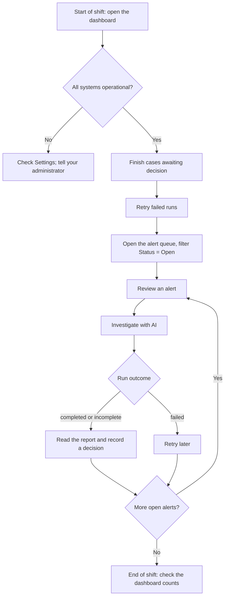

# Working the daily alert queue

This page suggests a repeatable daily routine for working through alerts in AMLens. Adapt it to your team's procedures. AMLens does not assign alerts to people, so agree with your team who works which alerts (for example by rule or by upload).

## The routine at a glance

## 1. Start of shift: check the dashboard

1. Sign in and look at the **Compliance overview** dashboard.
2. Confirm the sidebar dot says **All systems operational**. If not, open [Settings and service health](../features/settings-and-health.md). If a service is **offline**, AI runs will fail: tell your administrator and limit yourself to reviewing alerts until it is fixed.
3. Note the counts:
    - **Open alerts**: new work.
    - **Reports awaiting decision**: cases with a finished (or failed) run and no decision.
    - **Pending agent run**: runs still in progress.

## 2. Finish what is already started

Clear existing cases before starting new ones, so nothing is left half-done.

1. Open **Investigations**.
2. Filter **Status** to **Completed**, and look for *Not recorded* in **Human decision**. Open each, read the report, and [record a decision](../features/recording-decisions.md).
3. Repeat with the **Incomplete** filter. Remember: you can only Reject or Escalate an incomplete report.
4. Filter to **Failed** and retry each one. See [Retrying a failed investigation](retry-failed-investigation.md).

## 3. Triage new alerts

1. Open **Alert Queue**.
2. Set **Rows** to **200** so filters cover as many alerts as possible. (Filters only apply to the loaded page.)
3. Set **Status** to **Open**.
4. Decide an order. A common approach:

    | Priority | Rule | Why |
    | --- | --- | --- |
    | 1 | **Rapid Movement Candidate** | Money passing quickly through an account can indicate layering. |
    | 2 | **High Value** | Large single payments need customer context. |
    | 3 | **Repeated Pair** | Repeated similar amounts may indicate structuring, or a normal regular payment. |

    Use the **Rule** filter and **Minimum amount** to focus, for example Rapid Movement over 100000.

5. For each alert:
    1. Open it and read the summary, evidence and transaction history. See [Reviewing an alert](../features/alert-review.md).
    2. Select **Investigate with AI**.
    3. When the report opens, read the verification strip and every tab. See [Reading the investigation report](../features/investigation-report.md).
    4. Gather any information from outside AMLens that the **Missing Info & Questions** tab asks for (KYC, source of funds, purpose), following your procedures.
    5. Record your decision with a clear rationale.

!!! tip "Avoid duplicate work"
    Before starting, check the alert's status. **UNDER REVIEW** means a colleague has already started an investigation: select **Open investigation** rather than starting your own.

## 4. End of shift

1. Return to the dashboard. **Pending agent run** should be 0.
2. Check **Reports awaiting decision**. Hand over any you could not finish, with the investigation IDs.
3. If your team keeps a daily log, export it:
    - **Investigations → Export CSV** for the list of cases and decisions.
    - **Alert Queue → Export current page** for the alerts you worked on.

## Good habits

- **Read before you decide.** The AI report is a draft. It cannot see customer information and cannot establish intent.
- **Write rationales for a reader who was not there.** Decisions cannot be edited later.
- **Copy IDs with the copy buttons.** IDs are case-sensitive.
- **Do not upload or type direct customer identifiers.**

## Related pages

- [Alert queue](../features/alert-queue.md)
- [Investigations list](../features/investigations-list.md)
- [Understanding results](../understanding-results.md)
- [Troubleshooting](../troubleshooting.md)
