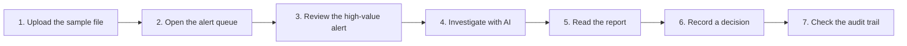

# Your first case, end to end

This walkthrough takes you through a complete case using a small **sample file**: upload, find the alerts, review one, run the AI investigation, read the report, record a decision, and check the audit trail. Allow about 20–30 minutes.

## The journey



## Before you begin

- [x] You can sign in. See [Account and sign-in](../account-and-login.md).
- [x] The sidebar says **All systems operational**. See [Settings and service health](../features/settings-and-health.md).
- [x] You have the sample file **demo_wealth_book_nov2026.csv**. Ask your trainer or administrator for it, or create it from the contents below.

??? note "Sample file contents (18 transactions)"
    Copy the lines below into a plain-text editor and save the file with a `.csv` extension, for example `demo_wealth_book_nov2026.csv`. A file you create yourself may differ in invisible ways (such as line endings) from the official sample, so it will get a different dataset ID. That is fine for practice.

    ```text
    Timestamp,From Bank,Account,To Bank,Account.1,Amount Received,Receiving Currency,Amount Paid,Payment Currency,Payment Format,Is Laundering
    2026-11-02 08:40:00,114,80F27B911,305,81C02A4D7,2350.00,US Dollar,2350.00,US Dollar,Credit Card,0
    2026-11-02 09:12:00,021,80A1C3E50,114,80F27B911,1450000.00,US Dollar,1450000.00,US Dollar,Wire,0
    2026-11-02 09:30:00,207,81B7731C0,114,81D4410E2,18500.00,Euro,18500.00,Euro,ACH,0
    2026-11-02 10:02:00,033,80C44D201,114,80D9E0377,486000.00,US Dollar,486000.00,US Dollar,Wire,0
    2026-11-02 10:31:00,114,80D9E0377,207,80E55F822,482500.00,US Dollar,482500.00,US Dollar,Wire,0
    2026-11-02 11:15:00,114,81D4410E2,412,81E9902B3,4200.00,Euro,4200.00,Euro,Cheque,0
    2026-11-02 13:05:00,305,81F3307A1,114,81A6625F4,12750.00,UK Pound,12750.00,UK Pound,ACH,0
    2026-11-02 15:48:00,114,81A6625F4,305,81C02A4D7,640.00,UK Pound,640.00,UK Pound,Credit Card,0
    2026-11-03 09:05:00,114,80B31A746,118,80A90C118,9650.00,US Dollar,9650.00,US Dollar,Cash,0
    2026-11-03 11:42:00,114,80B31A746,118,80A90C118,9400.00,US Dollar,9400.00,US Dollar,Cash,0
    2026-11-03 14:20:00,114,80B31A746,118,80A90C118,9850.00,US Dollar,9850.00,US Dollar,Cash,0
    2026-11-03 16:55:00,114,80B31A746,118,80A90C118,9500.00,US Dollar,9500.00,US Dollar,Cash,0
    2026-11-04 09:10:00,114,80B31A746,118,80A90C118,9700.00,US Dollar,9700.00,US Dollar,Cash,0
    2026-11-04 12:35:00,114,80B31A746,118,80A90C118,9550.00,US Dollar,9550.00,US Dollar,Cash,0
    2026-11-04 10:00:00,412,81E9902B3,114,81D4410E2,3100.00,Euro,3100.00,Euro,ACH,0
    2026-11-04 14:30:00,114,81A6625F4,207,81B7731C0,25000.00,UK Pound,25000.00,UK Pound,Wire,0
    2026-11-04 16:20:00,305,81C02A4D7,114,80F27B911,1800.00,US Dollar,1800.00,US Dollar,ACH,0
    2026-11-05 10:45:00,114,80F27B911,021,80A1C3E50,7500.00,US Dollar,7500.00,US Dollar,Wire,0
    ```

!!! warning "Practise only with sample data"
    The live site is shared with your colleagues. Only upload the sample file if your team has agreed to use the live site for training. If the sample has already been uploaded by someone else, you will see **Dataset already imported**. In that case skip Step 1 and use the existing sample alerts.

## What the sample contains

The file has **18 transactions** over 2–5 November 2026. All 18 rows are valid, and three patterns in them match the screening rules, so the upload should create **3 alerts**:

| Alert rule | What happened in the file | Why the rule fired |
| --- | --- | --- |
| **High Value** | One wire payment of **$1,450,000.00** on 2 Nov at 09:12. | It is a US Dollar payment of $1,000,000 or more. |
| **Rapid Movement Candidate** | One account received **$486,000.00** by wire at 10:02 and sent **$482,500.00** by wire at 10:31 on 2 Nov. | Money came in and went out of the same account, in the same currency, **29 minutes** apart (within 60). |
| **Repeated Pair** | **Six** cash transfers of $9,400–$9,850 (about $9,500 each) from the same sender to the same receiver between 3 Nov 09:05 and 4 Nov 12:35. | Five or more payments between the same pair in the same currency within 48 hours. |

The other transactions (smaller amounts, Euro and UK Pound payments) do not match any rule.

## Step 1: Upload the sample file

1. Select **Upload Data** in the sidebar.
2. Drag the sample file onto **Drop a file here or browse**, or select the box and choose the file.
3. Select **Upload and analyze**.

**You should see** an **Upload completed** summary with:

| Accepted rows | Rejected rows | Alerts generated |
| --- | --- | --- |
| 18 | 0 | 3 |

and a **Dataset ID** (20 characters). Copy the dataset ID into your notes.

If you see **Dataset already imported**, the sample is already on the system. Continue with Step 2.

More detail: [Upload transaction data](../features/upload-data.md).

## Step 2: Find the sample alerts

1. Select **View 3 new alerts**, or **Alert Queue** in the sidebar.
2. If you have the dataset ID, paste it into **Search current page…**. Alert IDs contain the dataset ID (for example `AL_<dataset ID>_1`). Set **Rows** to 200 if you do not see them.
3. You should see three alerts from the sample:
    - a `HIGH_VALUE` alert with amount **$1,450,000.00**,
    - a `REPEATED_PAIR` alert with amount **—**,
    - a `RAPID_MOVEMENT_CANDIDATE` alert with amount **$486,000.00** (the incoming amount).

    All three should have status **OPEN** if nobody has worked on them.

More detail: [Alert queue](../features/alert-queue.md).

## Step 3: Review the high-value alert

1. Select the `HIGH_VALUE` alert.
2. In **Alert summary**, check:
    - **Transaction amount:** $1,450,000.00
    - **Monitoring rule:** High Value
    - **Payment rail:** Wire
3. In **Evidence**, note the **Threshold**: `1000000`.
4. Open **Transaction history**. The sender (anchor) account's history is shown. In the sample this account appears twice: the $1,450,000.00 payment on 2 Nov, labelled **Alert transaction**, and a $7,500.00 wire it **received back** from the same counterparty on 5 Nov. (You will see more rows if the same account appears in other uploaded files.)

More detail: [Reviewing an alert](../features/alert-review.md).

!!! tip "Try the others too"
    On the **Rapid Movement Candidate** alert, the Evidence panel shows **Gap Minutes: 29**, **Incoming Amount: 486000.00** and **Outgoing Amount: 482500.00**. On the **Repeated Pair** alert it shows **Count: 6** and **Window Hours: 48**.

## Step 4: Run the AI investigation

1. On the high-value alert, select **Investigate with AI**. (If you see **Open investigation** instead, someone has already started one. Select it and go to Step 5.)
2. Wait while **Investigation in progress** shows the six steps.

**You should see** the **Investigation Review** page open automatically when the run finishes. The alert's status is now **UNDER REVIEW**.

If you see **Agent service unavailable**, the run failed. Follow [Retrying a failed investigation](retry-failed-investigation.md), then come back to Step 5.

More detail: [AI investigation](../features/ai-investigation.md).

## Step 5: Read the report

1. Read the **verification strip**. For a passing report it usually reads **Review required · completed** with one warning (*"Intent and economic purpose cannot be established from transaction patterns alone."*) and a **Verification passed** badge.
2. Go through the five tabs:
    - **Alert Summary:** typology **Unusual Activity**.
    - **Transaction Analysis:** statistics and patterns for the account. Look at the **Limitations**.
    - **Guidance & Evidence:** any cited guidance passages. Select a citation to read it.
    - **Missing Info & Questions:** the seven information areas, normally all *Not provided*, with questions.
    - **Narrative:** the draft narrative and recommended next steps.

The exact wording and figures depend on the AI service and on what else is in the system, so your report may differ in detail.

More detail: [Reading the investigation report](../features/investigation-report.md).

## Step 6: Record a decision

For practice, record **Escalate**, which is available whatever the verification result.

1. In **Investigator rationale**, type for example: *"Training case. Single $1.45M wire to one counterparty, with a $7,500 wire received back three days later. No KYC or source-of-funds information available in AMLens. Escalating for customer context."*
2. Select **Escalate**.
3. In the confirmation window, select **Confirm escalate**.

**You should see** *"Investigator decision recorded"* and a **Recorded investigator disposition** panel showing **ESCALATE**, the date and **your username**.

More detail: [Recording a decision](../features/recording-decisions.md).

## Step 7: Check the audit trail

1. In the right-hand **Audit trail** panel, select **View event history**.
2. You should see four events, oldest first:
    1. **CREATED**
    2. **AGENT RUN REQUESTED**
    3. **AGENT RUN FINISHED**
    4. **DECISION RECORDED**
3. Open **View sanitized event details** on the last event. It shows your decision, your username as `analyst_id`, and your rationale.

Go back to the alert queue: the high-value alert's status is now **DECIDED**.

More detail: [Audit trail](../features/audit-trail.md).

## You're done

You have completed a full case. Next:

- [Working the daily alert queue](daily-alert-triage.md)
- [Understanding results](../understanding-results.md)
