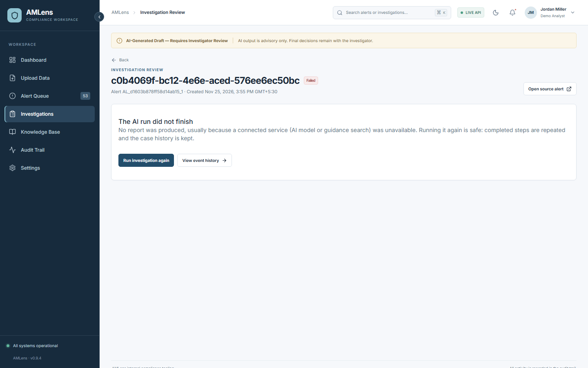
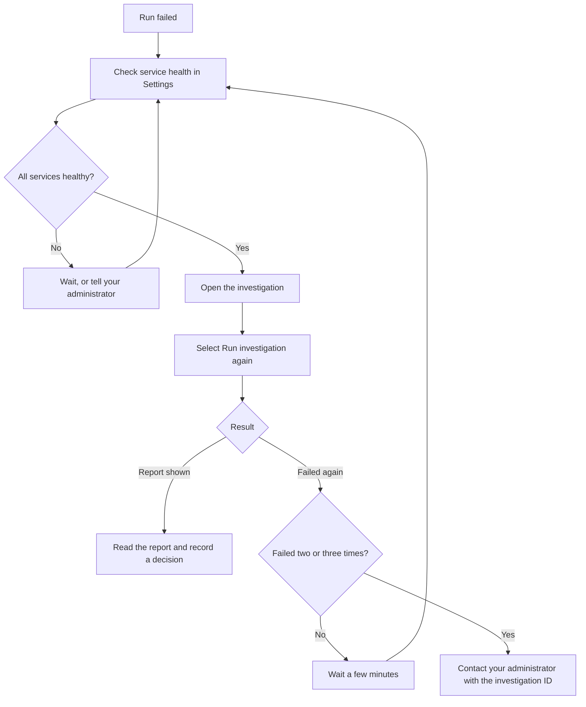

# Retrying a failed investigation

Sometimes the AI investigation cannot finish. This page explains how to recognise a failed run, how to retry it safely, and when to stop and contact your administrator.

## Why runs fail

A run **fails** when one of its steps cannot finish. Usually this is because a connected service (the AI model or the guidance search) was busy or unavailable at that moment. No report is produced, so no decision can be recorded until the run succeeds.

A failed run is different from an **incomplete** one. An incomplete run **did** produce a report, but the report did not pass verification. You do not retry incomplete runs; you review them and can Reject or Escalate. See [Understanding results](../understanding-results.md).

## How you will notice

| Where | What you see |
| --- | --- |
| Alert page, right after selecting **Investigate with AI** | A red box: **Agent service unavailable** — *Agent investigation failed; inspect persisted status*, with a **Retry run** button. |
| Investigation page | Panel title **The AI run did not finish**, with **Run investigation again** and **View event history**. |
| Investigations list | **Execution status:** *failed*, **Status:** *FAILED*. |
| Dashboard | Counted in **Investigations by status → Failed** and in **Reports awaiting decision**. |
| Audit trail | An **AGENT RUN FAILED** event. |

<figure markdown="span">
  { loading=lazy }
  <figcaption>A failed investigation. The page explains what happened and offers Run investigation again.</figcaption>
</figure>

## The retry journey

## Retry a failed run

1. **Check the services first.** Open **Settings** and look at **Service health**. If **Investigation agent** or **AML knowledge retrieval** is **offline** or **degraded**, a retry will probably fail too. Wait, or contact your administrator. See [Settings and service health](../features/settings-and-health.md).
2. **Open the investigation.** Use one of:
    - the alert page → **Open investigation**,
    - **Investigations** → filter **Failed** → **Review**,
    - the top-bar search with the investigation ID.
3. You should see **The AI run did not finish**: *"No report was produced, usually because a connected service (AI model or guidance search) was unavailable. Running it again is safe: completed steps are repeated and the case history is kept."*
4. Select **Run investigation again**.

    **You should see** the panel change to **Investigation in progress**.

5. Wait for the result:
    - **Success:** the full report appears. Continue with [Reading the investigation report](../features/investigation-report.md) and [Recording a decision](../features/recording-decisions.md).
    - **Failed again:** the panel returns with a red message such as *Agent investigation failed; inspect persisted status*. Wait a few minutes and try again.

!!! tip "Retry from the investigation page, not the alert page"
    On the alert page, the **Investigation draft** tab of a failed case may offer **Start investigation**. That creates a **second, separate** investigation for the same alert. Use **Run investigation again** on the investigation page so the alert keeps one case and one history.

!!! note "What a retry does to the history"
    Each retry adds an **AGENT RUN REQUESTED** event, followed by **AGENT RUN FINISHED** or **AGENT RUN FAILED**. Earlier failures stay in the [audit trail](../features/audit-trail.md). Nothing is deleted.

## When it is not something you can fix

Contact your administrator if:

- the run has failed **two or three times** in a row while all services show **healthy**,
- **Service health** shows a service **offline** for more than a few minutes,
- the case shows **Investigation in progress** for a long time (for example more than 10–15 minutes) and never finishes, or
- retrying shows *Investigation is not available to run* or *Agent persistence unavailable*.

Give them:

- the **investigation ID** (copy it from the page header),
- the **alert ID**,
- the time of the failure (from the audit trail), and
- the exact error message.

## Related pages

- [AI investigation](../features/ai-investigation.md)
- [Settings and service health](../features/settings-and-health.md)
- [Troubleshooting](../troubleshooting.md)
- [Understanding results](../understanding-results.md)
